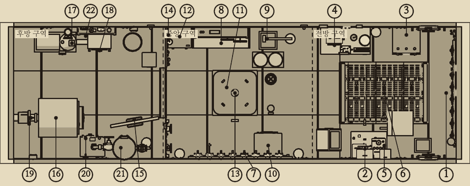
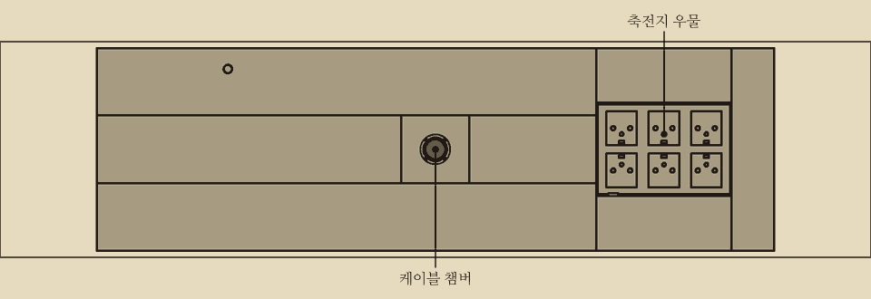
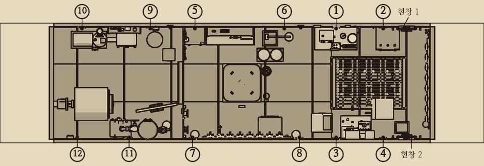
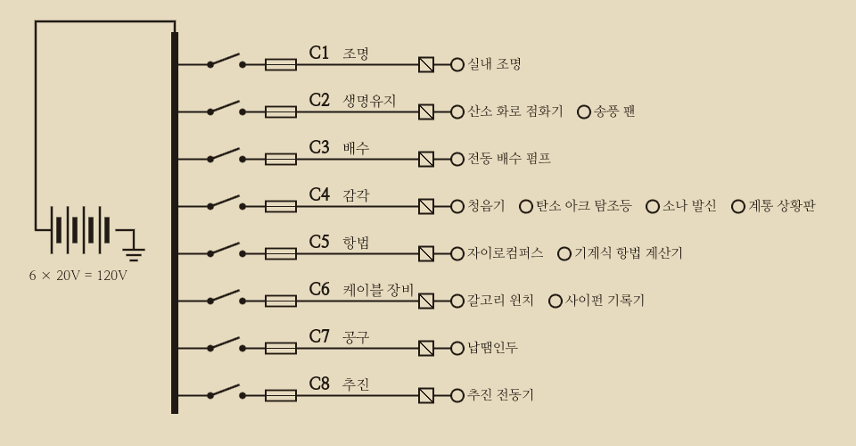
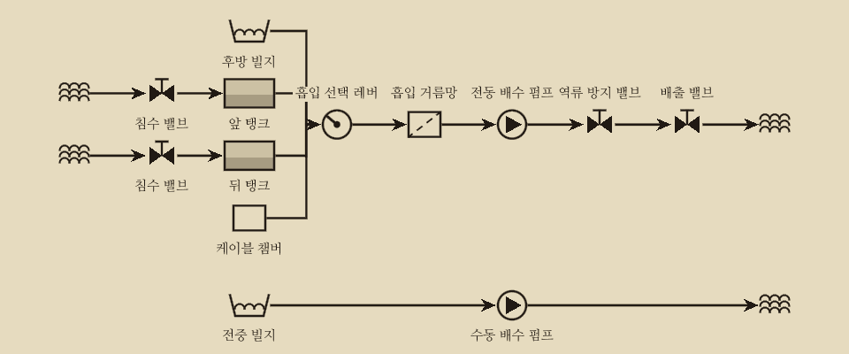
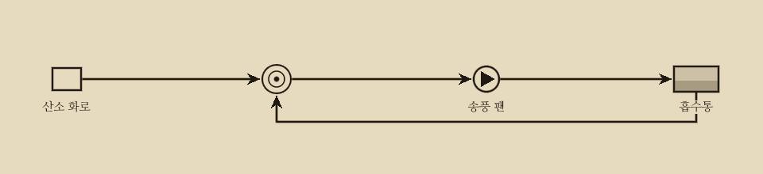
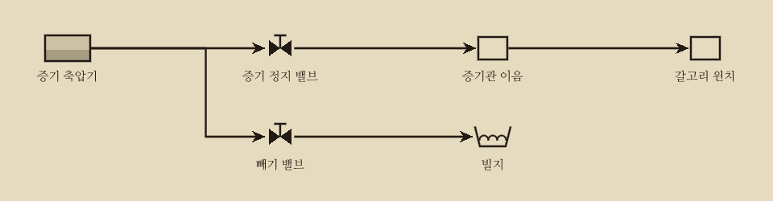

# 모스호 정비 교범

대양전신회사 케이블 수리정 모스호 비치용. 기관사용.

이 교범은 조종석 옆에 늘 꽂아 둔다. 이상이 생기면 먼저 이 책을 편다. 적힌 대로 하면 고칠 수 있다. 순서를 어기면 다친다.

## 이 교범을 읽는 법

1. 계통 상황판에서 켜진 표시등을 본다.
2. 진단 표에서 증상을 찾아 원인을 하나로 좁힌다.
3. 해당 절차 페이지를 펴고 순서대로 한다.
4. 끝나면 같은 계기로 다시 확인한다.

- **굵은 글씨**는 어기면 다치거나 배를 잃는 사항이다.
- 쪽 번호와 계통은 '차례'에 있다. 진단 표는 03~05쪽, 수리 절차는 20쪽부터 계통 순서로 실었다.
- 진단 표의 '확인' 열은 원인을 가르는 방법이다. 위에서부터 차례로 확인하고, 처음 맞는 줄의 조치를 따른다.
- 이 판에 싣지 않은 고장은 진단 표 끝에 버티는 법과 함께 적었다.

## 제원

| 항목 | 내용 |
| --- | --- |
| 길이 | 약 13m. 실내 보행 길이 약 8m |
| 운용 | 1인 |
| 선체 | 리벳 이음 강철. 현창 2개 |
| 설계 수심 | 600m |
| 한계 | 600m보다 깊으면 이음새가 상하기 시작한다. 900m에서 선체가 무너진다 |
| 축전지 | 납축전지 {{n:tuning.battery.cells}}셀. {{n:tuning.battery.capacityWh}}Wh. 공칭 120V |
| 배전 | 회로 8개(C1~C8). 회로마다 칼날 스위치, 퓨즈, 부하 단자, 회로 표시등, 분기함 |
| 빌지 | 두 칸. 전중 빌지 {{n:tuning.water.bilges.bilge.fwd.capacityL}}L, 후방 빌지 {{n:tuning.water.bilges.bilge.aft.capacityL}}L. 합계 600L |

## 구역 배치

선내는 앞에서 뒤로 전방, 중앙, 후방 세 구역이다. 중앙과 후방 사이에 해치가 있다. 해치를 닫으면 후방 기관 구역이 나머지 구역과 분리된다.

| 구역 | 주요 설비 |
| --- | --- |
| 전방 · 조종 | 조종석, 현창 2개, 계통 상황판과 램프 시험 단추, 끝벽의 기관 전령기와 탐조등 레버, 탐조등, 좌현 항법 책상(항법 계산기, 자이로 중계 나침반, 자기 나침반, 탁상 계산기), 자이로컴퍼스 함, 우현 통신 책상(사이펀 기록기, 저항 측정 브리지), 청음기와 소나, 축전지 갑판 판, 축전지 셀 상자, C4·C5 분기함 |
| 중앙 · 생명 | 배전반(칼날 스위치, 퓨즈, 회로 전류계), 배전반 아래의 C1·C2·C6·C7 분기함, 중앙 사물함과 그 위의 전기 예비품 벽장, 흡수제 통 받침, 폐기함, 해치 격벽의 공구판, 수동 배수 펌프, 산소 화로와 흡수통, 송풍 팬, 접이식 침상 |
| 후방 · 기관 | 추진 전동기(정류자 쪽 끝 덮개), 프로펠러 축 패킹 상자, 전동 배수 펌프(흡입 거름망, 베어링 뚜껑), 케이블 윈치 구동부, 후방 예비품 사물함, 후방 폐기함, C3·C8 분기함 |

- 분기함은 회로마다 자리가 다르다. 자리표는 '분기함과 누전'에 있다.

그림 1-1의 번호는 다음과 같다.

| 구역 | 번호와 설비 |
| --- | --- |
| 전방 · 조종 | 1 계통 상황판, 2 청음기, 3 자이로컴퍼스, 4 항법 계산기, 5 통신 책상(사이펀 기록기), 6 축전지 갑판 판 |
| 중앙 · 생명 | 7 배전반, 8 예비품 사물함, 9 수동 배수 펌프, 10 산소 화로, 11 송풍 팬(천장), 12 흡수통, 13 케이블 챔버 해치, 14 공구판 |
| 후방 · 기관 | 15 해치, 16 추진 전동기, 17 전동 배수 펌프, 18 흡입 거름망, 19 프로펠러 축 패킹, 20 윈치 구동부, 21 증기 축압기, 22 후방 예비품 사물함 |

### 바닥 아래

| 위치 | 있는 것 |
| --- | --- |
| 전방 아래 | 축전지 {{n:tuning.battery.cells}}셀. 전중 빌지 칸 안에 있다. 바닥 격자 너머로 셀과 물이 보인다. 갑판 판을 들면 셀마다 단자 너트가 손에 닿는다. 점퍼 걸이는 우물 우현 벽에 있다 |
| 중앙 아래 | 케이블 챔버와 전중 빌지 칸. 수동 펌프는 전중 빌지의 물만 퍼낸다 |
| 후방 아래 | 후방 빌지 칸. 전동 배수 펌프 흡입구와 흡입 거름망 |

- 전중 빌지는 전방과 중앙 아래를 덮는다. {{n:tuning.water.bilges.bilge.fwd.capacityL}}L.
- 후방 빌지는 후방 아래를 덮는다. {{n:tuning.water.bilges.bilge.aft.capacityL}}L.
- 해치를 열어 두면 물이 두 칸 사이를 오가 두 칸이 같은 비율로 찬다. 닫으면 두 칸이 따로 찬다.
- 케이블 챔버의 물은 실내 빌지와 따로 찬다.
- 빌지 칸마다 수위 유리관이 있다. 전중 빌지의 유리관은 중앙 좌현 수동 펌프 옆에, 후방 빌지의 유리관은 후방 좌현 해치 옆에 있다. 유리관은 센서를 거치지 않으므로 상황판이 꺼져도 읽을 수 있다.

### 누수 지점

| 지점 | 수 | 위치 |
| --- | --- | --- |
| 리벳 이음 | 12 | 전방 1~4번, 중앙 5~8번, 후방 9~12번 |
| 현창 | 2 | 전방 |
| 프로펠러 축 패킹 | 1 | 후방 |
| 선체 밸브 | 4 | 전방 1, 중앙 2, 후방 1 |
| 케이블 챔버 바깥 문 | 1 | 챔버. 실내로는 새지 않는다 |

이 판의 선체 절차는 리벳 이음과 프로펠러 축 패킹에 쓴다.

## 계통도: 전기

전기는 다음 순서로 흐른다.

1. 축전지 {{n:tuning.battery.cells}}셀. 전방 바닥 아래.
2. 배전반의 버스 바. 중앙 구역.
3. 회로마다 칼날 스위치.
4. 회로마다 퓨즈.
5. 회로마다 분기함.
6. 장비.

- 구역 붉은 경고등은 배전반을 거치지 않는다. 축전지에 바로 물린 비상 급전으로 켜진다.
- 퓨즈는 어느 회로에나 맞는다.

### 회로

| 회로 | 이름 | 퓨즈 정격 | 기본 위치 | 장비 |
| --- | --- | --- | --- | --- |
| C1 | 조명 | {{a:circuits.C1.fuseRating}}A | 올림 | 실내 조명 |
| C2 | 생명유지 | {{a:circuits.C2.fuseRating}}A | 올림 | 송풍 팬, 산소 화로 점화기 |
| C3 | 배수 | {{a:circuits.C3.fuseRating}}A | 내림 | 전동 배수 펌프 |
| C4 | 감각 | {{a:circuits.C4.fuseRating}}A | 올림 | 계통 상황판, 청음기, 탐조등, 소나 |
| C5 | 항법 | {{a:circuits.C5.fuseRating}}A | 올림 | 자이로컴퍼스, 항법 계산기 |
| C6 | 케이블 장비 | {{a:circuits.C6.fuseRating}}A | 올림 | 갈고리 윈치, 사이펀 기록기 |
| C7 | 공구 | {{a:circuits.C7.fuseRating}}A | 내림 | 납땜인두 |
| C8 | 추진 | {{a:circuits.C8.fuseRating}}A | 올림 | 추진 전동기 |

### 장비

| 장비 | 회로 | 위치 | 전력 | 최소 전압 | 소음 |
| --- | --- | --- | --- | --- | --- |
| 실내 조명 | C1 | 중앙 | {{n:devices.cabin_lights.powerW}}W | {{v:devices.cabin_lights.minVoltage}}V | {{n:devices.cabin_lights.noise}} |
| 송풍 팬 | C2 | 중앙 | {{n:devices.vent_fan.powerW}}W | {{v:devices.vent_fan.minVoltage}}V | {{n:devices.vent_fan.noise}} |
| 산소 화로 점화기 | C2 | 중앙 | {{n:devices.o2_igniter.powerW}}W | {{v:devices.o2_igniter.minVoltage}}V | {{n:devices.o2_igniter.noise}} |
| 전동 배수 펌프 | C3 | 후방 | {{n:devices.bilge_pump.powerW}}W | {{v:devices.bilge_pump.minVoltage}}V | {{n:devices.bilge_pump.noise}} |
| 계통 상황판 | C4 | 전방 | {{n:devices.status_panel.powerW}}W | {{v:devices.status_panel.minVoltage}}V | {{n:devices.status_panel.noise}} |
| 청음기 | C4 | 전방 | {{n:devices.hydrophone.powerW}}W | {{v:devices.hydrophone.minVoltage}}V | {{n:devices.hydrophone.noise}} |
| 탄소 아크 탐조등 | C4 | 전방 | {{n:devices.searchlight.powerW}}W | {{v:devices.searchlight.minVoltage}}V | {{n:devices.searchlight.noise}} |
| 소나 발신 (1회 {{n:devices.sonar.pulseSeconds}}초) | C4 | 전방 | {{n:devices.sonar.powerW}}W | {{v:devices.sonar.minVoltage}}V | {{n:devices.sonar.noise}} |
| 자이로컴퍼스 | C5 | 전방 | {{n:devices.gyrocompass.powerW}}W | {{v:devices.gyrocompass.minVoltage}}V | {{n:devices.gyrocompass.noise}} |
| 기계식 항법 계산기 | C5 | 전방 | {{n:devices.nav_computer.powerW}}W | {{v:devices.nav_computer.minVoltage}}V | {{n:devices.nav_computer.noise}} |
| 갈고리 윈치 | C6 | 후방 | {{n:devices.hook_winch.powerW}}W | {{v:devices.hook_winch.minVoltage}}V | {{n:devices.hook_winch.noise}} |
| 사이펀 기록기 | C6 | 전방 | {{n:devices.siphon_recorder.powerW}}W | {{v:devices.siphon_recorder.minVoltage}}V | {{n:devices.siphon_recorder.noise}} |
| 납땜인두 | C7 | 중앙 | {{n:devices.soldering_iron.powerW}}W | {{v:devices.soldering_iron.minVoltage}}V | {{n:devices.soldering_iron.noise}} |
| 추진 전동기 (최대) | C8 | 후방 | {{n:devices.propulsion.powerW}}W | {{v:devices.propulsion.minVoltage}}V | {{n:devices.propulsion.noise}} |

### 전기에 관해 알아 둘 것

- 버스 전압은 만충일 때 120V다.
- 전압은 충전량이 2할 남을 때까지 110V 위에 머문다. 그 아래로는 급히 떨어진다. 전압만으로는 남은 충전량을 가늠하기 어렵다.
- 실내등 밝기는 전압을 따른다. 등이 어두워지면 전압이 떨어진 것이다.
- 장비는 최소 전압 아래에서 멈춘다. 퓨즈가 멀쩡해도 멈춘다.
- 120V에서 장비 전류는 전력을 120으로 나눈 값이다. 펌프 {{n:devices.bilge_pump.powerW}}W는 {{a:devices.bilge_pump.powerW}}A다.
- 전동기(팬, 펌프, 자이로, 항법 계산기, 윈치, 사이펀, 추진, 소나)는 전압이 낮으면 전류가 조금 더 흐른다.
- 회로 전류가 퓨즈 정격을 넘는 상태가 {{n:tuning.switchboard.fuseBlowSeconds}}초 동안 이어지면 퓨즈가 끊긴다. 끊길 때 불꽃이 튄다.
- 정상 부하만으로는 퓨즈가 끊기지 않는다. 다만 퓨즈가 낡아 저절로 끊기는 일은 있다.
- 평시 부하에서는 축전지로 약 다섯 시간 쓸 수 있다. 펌프를 함께 돌리면 약 두 시간이다.

### 배수 펌프

- 전동 배수 펌프는 C3로 돈다. 배전반의 C3 칼날 스위치로 켜고 끈다.
- 정격 배수량은 분당 {{lpm:tuning.water.pumpRatedLps}}L다.
- 흡입구는 후방 빌지에 있다. 후방 빌지의 물만 빨아들인다.
- 빌지가 말라 있어도 펌프가 돌면 전력을 쓴다.
- 몸체가 {{n:devices.bilge_pump.cutoutC}}°C에 이르면 스스로 멈춘다. {{n:devices.bilge_pump.cutoutResetC}}°C로 식으면 저절로 다시 돈다.
- 수동 펌프는 중앙에 있다. 전중 빌지에서 한 번에 {{n:tuning.water.handPumpStrokeL}}L를 퍼낸다. 전기 없이 쓸 수 있다.

## 계통도: 공기와 증기

## 도구

도구는 중앙 구역 해치 격벽의 공구판에 걸어 두고, 쓸 도구를 공구띠에 다섯 개까지 차고 다닌다. 도구마다 쓰는 곳과 손동작은 '손과 도구'에 있다.

- 빈손은 아무 도구도 들지 않은 상태를 말한다.
- 도구를 든 채로 물건 하나를 쥘 수 있다. 예를 들어 나무망치를 들고 쐐기를 쥔다.
- 쥐는 물건은 한 번에 하나다. 흡수제 통과 축전지 셀은 두 손으로 든다.
- 칼날 스위치와 해치는 무엇을 들고 있든 다룰 수 있다.

## 예비품

예비품은 중앙 사물함, 그 위의 전기 예비품 벽장, 흡수제 통 받침, 후방 예비품 사물함, 축전지 셀 상자에 나누어 둔다. 자리와 재고는 '예비품 사물함'에 있다.

- 꺼내려면 손에 쥔 것이 없어야 한다.
- 항해 중에는 다시 채워지지 않는다. 아껴 쓸 것.
- 끊긴 퓨즈와 그 밖의 헌 부품은 폐기함에 버린다. 버린 것은 되찾지 못한다. 다 쓴 셀만 셀 상자에 넣는다.

## 수리의 종류

- **정식 수리**: 부품을 새것처럼 되돌린다. 오래간다. 예: 퓨즈 교체, 펌프 흡입 거름망 청소, 리벳 이음 코킹, 축 패킹 끈 교체.
- **응급 수리**: 빠르다. 시간이 지나면 다시 고장 난다. 예: 리벳 이음 응급 막기, 퓨즈 대용 철사, 축 패킹 누름판 조이기. 응급 수리 뒤에는 정식 수리를 할 것.
- 원인이 아닌 부품을 손보면 그 부품만 새것이 된다. 증상은 그대로 남는다. 시간이 들고 소음이 날 뿐이다.
