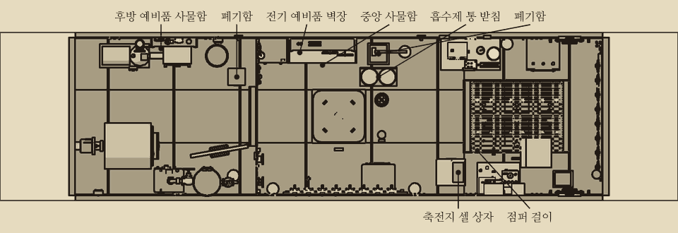
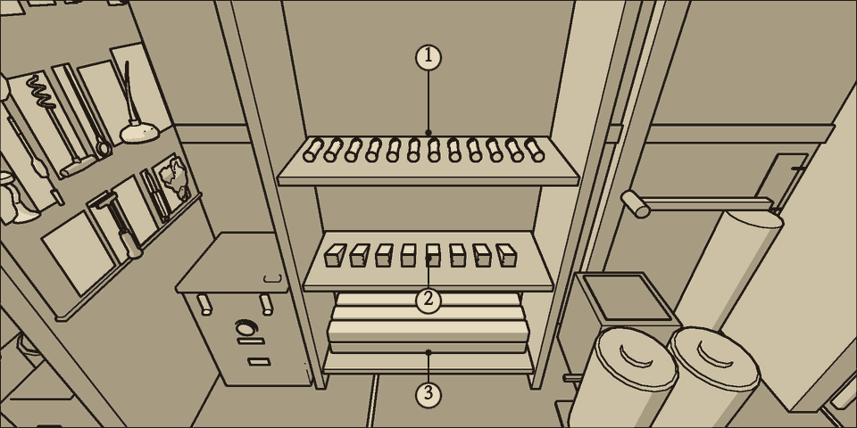
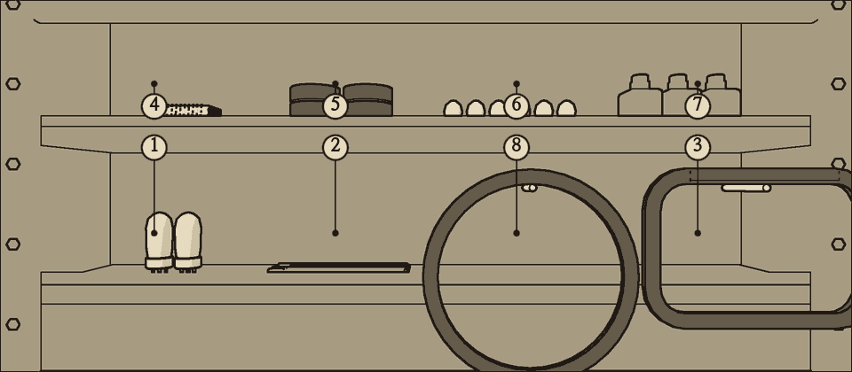
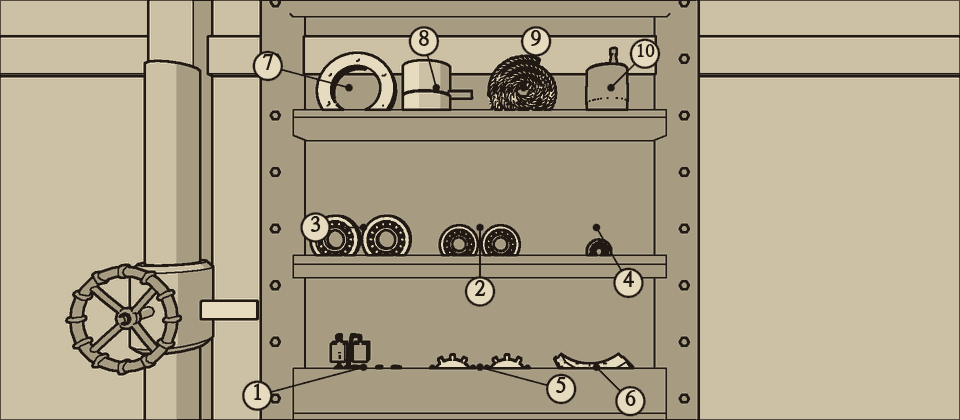

# 예비품 사물함

예비품은 장부 하나로 관리하고, 배 안 여러 곳에 나누어 둔다.

## 보관 위치

- **중앙 사물함**(중앙 구역 좌현 벽): 퓨즈, 나무 쐐기, 버팀목.
- **전기 예비품 벽장**(중앙 사물함 바로 위): 퓨즈 대용 철사, 절연 테이프, 상황판 전구, 잉크병, 진공관, 탄소봉, 현창 밀봉, 챔버 문 밀봉.
- **흡수제 통 받침**(중앙 사물함 옆, 폐기함 앞 바닥): 흡수제 통. 두 손으로 든다.
- **후방 예비품 사물함**(후방 구역 좌현 벽 높은 곳, 선반 세 칸): 기계 예비품. 축압기 개스킷, 이음 감개 테이프, 패킹 끈, 침투유, 펌프·팬·자이로 베어링, 전동기 브러시, 항법 계산기 톱니, 브레이크 라이닝.
- **축전지 셀 상자**(전방 구역 입구 우현 바닥): 예비 축전지 셀. 다 쓴 셀은 이 상자의 '다 쓴 셀 칸'에 넣는다.
- **점퍼 걸이**(축전지 우물 우현 벽): 점퍼 막대. 쓴 뒤 다시 건다.
- **폐기함**: 중앙 사물함 옆 바닥과 후방 해치 옆 좌현 바닥에 하나씩 있다. 헌 부품은 무거워도 폐기함에 버린다. 다 쓴 셀만 셀 상자에 넣는다.

## 재고

| 예비품 | 재고 | 비고 |
| --- | --- | --- |
| {{name:item.fuse}} | {{stock:fuse}} | |
| {{name:item.fuse_wire}} | {{stock:fuse_wire}} | |
| {{name:item.wood_wedge}} | {{stock:wood_wedge}} | |
| {{name:item.timber_shore}} | {{stock:timber_shore}} | |
| {{name:item.insulating_tape}} | {{stock:insulating_tape}} | |
| {{name:item.panel_bulb}} | {{stock:panel_bulb}} | |
| {{name:item.vacuum_tube}} | {{stock:vacuum_tube}} | **한정** |
| {{name:item.carbon_rods}} | {{stock:carbon_rods}} | **한정** |
| {{name:item.ink_bottle}} | {{stock:ink_bottle}} | |
| {{name:item.viewport_seal}} | {{stock:viewport_seal}} | |
| {{name:item.chamber_seal}} | {{stock:chamber_seal}} | |
| {{name:item.canister}} | {{stock:canister}} | 두 손으로 든다 |
| {{name:item.packing_tape}} | {{stock:packing_tape}} | |
| {{name:item.gasket}} | {{stock:gasket}} | |
| {{name:item.brush_set}} | {{stock:brush_set}} | |
| {{name:item.pump_bearing}} | {{stock:pump_bearing}} | |
| {{name:item.fan_bearing}} | {{stock:fan_bearing}} | |
| {{name:item.gyro_bearing}} | {{stock:gyro_bearing}} | **한정** |
| {{name:item.nav_gear}} | {{stock:nav_gear}} | |
| {{name:item.brake_lining}} | {{stock:brake_lining}} | |
| {{name:item.penetrating_oil}} | {{stock:penetrating_oil}} | |
| {{name:item.packing_cord}} | {{stock:packing_cord}} | |
| {{name:item.spare_cell}} | {{stock:spare_cell}} | **한정**, 두 손으로 든다 |
| {{name:item.jumper_bar}} | {{stock:jumper_bar}} | 쓴 뒤 되돌려 건다 |

## 한정 예비품

진공관, 탄소봉, 자이로 베어링, 예비 축전지 셀은 수량이 적다. 다 쓰면 아래와 같이 한다. 진공관을 빼 쓰면 고장이 고쳐지나 관을 뺀 장비를 쓰지 못한다. 나머지 셋은 고장이 남은 채로 버틴다.

- 진공관이 떨어지면 덜 급한 장비에서 성한 진공관을 빼서 쓴다.
- 예비 셀이 떨어지면 점퍼로 그 셀을 건너뛴다.
- 탄소봉이 떨어지면 보내기 손잡이로 남은 봉을 끝까지 쓴다.
- 자이로 베어링이 떨어지면 자기 나침반과 자차표로 침로를 잡는다.

## 헌 부품

- 손상되거나 닳은 부품을 빼면 헌 부품이 손에 남는다(끊긴 퓨즈, 닳은 베어링, 헌 패킹 등). 폐기함에 버린다.
- **헌 부품을 다시 끼워도 고쳐지지 않는다.** 대개 뺄 때와 같은 상태로 돌아간다. 헌 개스킷은 다시 끼우면 처음부터 조금씩 샌다('증기 축압기' 장).
- 헌 부품은 사물함에 되돌려 넣을 수 없다.
- 거름망 바구니처럼 장비에 딸린 부품은 버릴 수 없다.

## 쓰지 않은 예비품 되돌리기

꺼냈으나 쓰지 않은 예비품은 같은 칸에 되돌려 넣는다. 폐기함에 버린 것은 되찾을 수 없다.

## 진공관 바꿔 끼우기

아래 네 관은 모두 같은 6호 진공관이다. 사물함의 진공관이 떨어지면 덜 급한 장비에서 성한 관을 빼서 쓴다. 성한 관은 빼낸 그대로 새 관으로 쓸 수 있다.

| 장비 | 자리 | 뺐을 때 | 뺄 때 지킬 것 |
| --- | --- | --- | --- |
| 청음기 | 문 안 1번 관, 2번 관 | 청음기가 멎는다. 감각 표시등 노랑 | 청음기를 끄고 식힌다 |
| 소나 발신기 | 앞면 1번 관 | 소나가 발신하지 못한다 | 소나가 발신하고 있지 않을 것 |
| 사이펀 기록기 증폭기 | 기록기 뒤 1번 관 | 테이프는 흐르지만 기록 줄이 곧다. 케이블 표시등 노랑 | 배전반의 C6 스위치를 내린다(윈치도 멎는다) |

- 빼 쓰는 순서는 '청음기 진공관'의 '소나 진공관 빼 쓰기'를 본다.
- 필라멘트가 흐리거나 끊긴 관은 뽑으면 탄 진공관으로 손에 남는다. 폐기함에 버린다.
