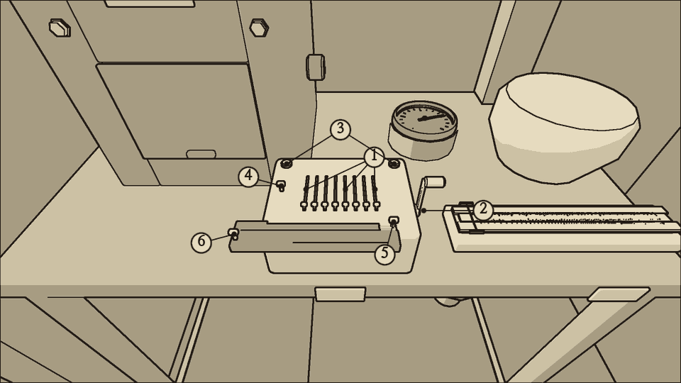
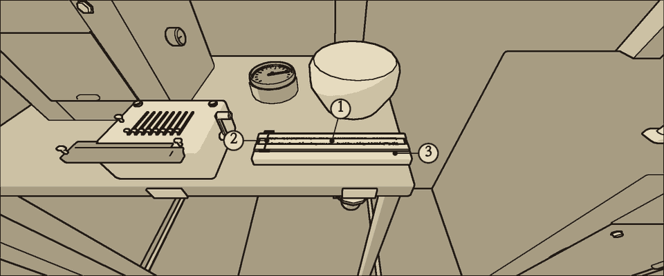
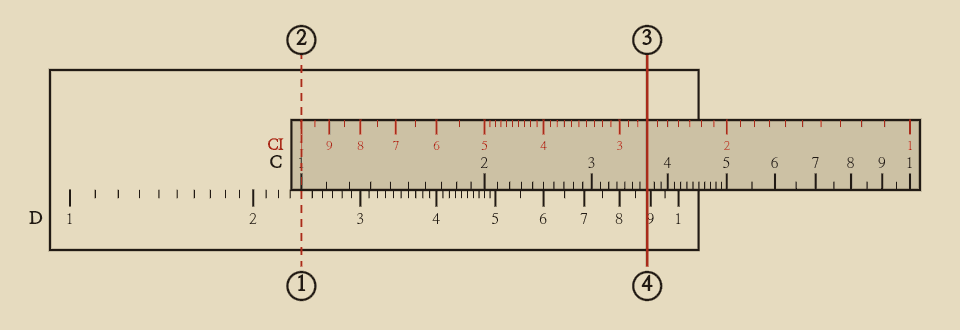
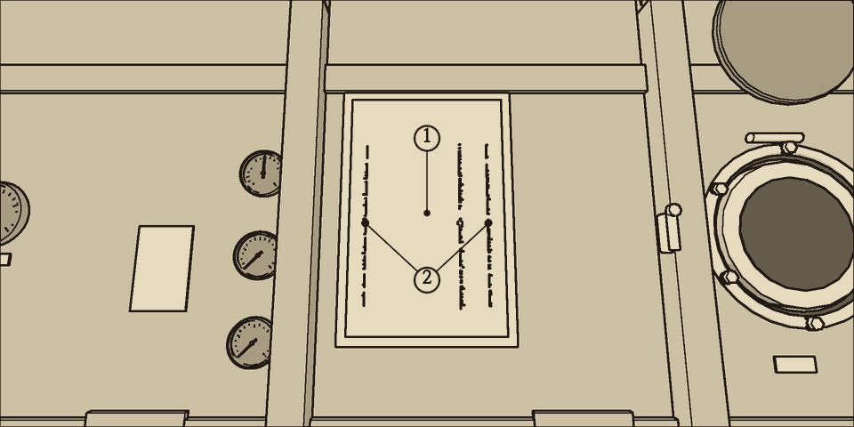
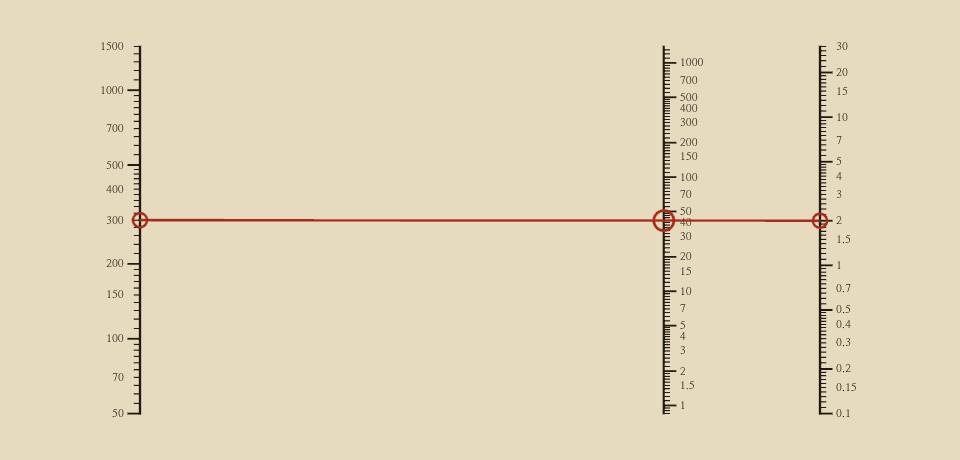
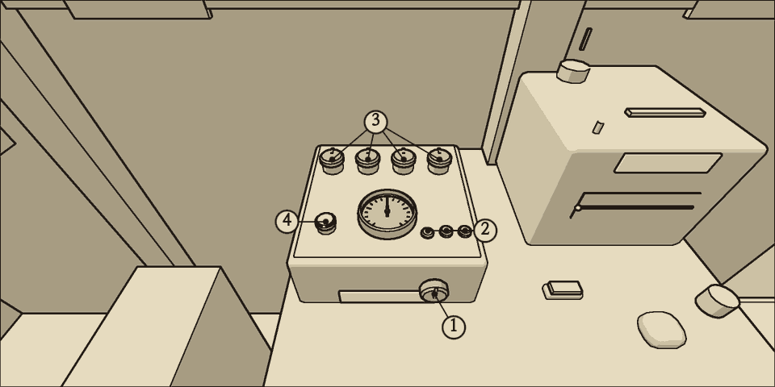

# 계산 도구

배 안의 셈은 항법 책상의 탁상 계산기, 계산자, 계산 도표(노모그램)로 한다. 저항은 통신 책상의 저항 측정 브리지로 잰다. 이 장은 도구를 쓰는 법과 자주 쓰는 식, 풀이 예를 적는다.

## 탁상 계산기

바퀴식 계산기다. 셈이 정확하고 자릿수가 많지만 손잡이를 돌릴 때마다 소리가 난다.

| 부분 | 쓰는 법 |
| --- | --- |
| 설정 레버 8개 | 잡은 채 위로 올리면 한 칸씩 커지고, 아래로 내리면 작아진다. 오른쪽 끝이 일의 자리다. 놓은 수는 레버 뒤 창에 보인다 |
| 손잡이 | 몸통 오른쪽에 있다. 잡은 채 원을 그려 돌린다. 시계 방향으로 그리면 손잡이가 앞으로 돌아 놓은 수를 결과 창에 더하고, 반시계 방향으로 그리면 뒤로 돌아 뺀다 |
| 캐리지 | 몸통 앞에 걸친 막대다. 뒤 줄이 결과 창(13자리), 앞 줄이 회전 수 창(8자리)이다 |
| 캐리지 단추 | 몸통 뒤 양 모서리에 있다. 오른쪽 단추는 캐리지를 오른쪽으로 한 칸, 왼쪽 단추는 왼쪽으로 한 칸 옮긴다. 캐리지가 오른쪽으로 한 칸 갈 때마다 손잡이 한 바퀴가 열 배가 된다 |
| 지우기 손잡이 3개 | 결과 창 지우기 손잡이는 캐리지 오른쪽 끝, 회전 수 창 지우기 손잡이는 캐리지 왼쪽 끝, 설정 지우기 손잡이는 레버 줄 왼쪽에 있다. 누르면 그 창이나 레버가 0이 된다 |
| 벨 | 빼다가 결과가 0 아래로 내려가면 울린다. 결과 창의 앞자리가 9로 바뀐다. 앞으로 한 바퀴 돌리면 돌아온다 |

- 회전 수 창은 캐리지가 놓인 자리에서 손잡이를 돌린 횟수를 센다. 앞으로 돌리면 늘고, 뒤로 돌리면 준다. 뒤로 돌린 것이 더 많으면 숫자가 붉다.
- 손잡이는 한 바퀴마다 소음 3을 낸다. 조용히 해야 할 때는 계산자나 계산 도표를 쓴다.
- 셈을 시작할 때는 지우기 손잡이 셋을 모두 누르고 캐리지를 왼쪽 끝에 둔다.

### 곱하기: 123456 × 789

1. 지우기 손잡이 셋을 누르고 캐리지를 왼쪽 끝에 둔다.
2. 설정 레버에 123456을 놓는다.
3. 곱하는 수의 일의 자리가 9이므로 손잡이를 앞으로 아홉 바퀴 돌린다.
4. 캐리지를 오른쪽으로 한 칸 옮기고, 십의 자리 8만큼 앞으로 여덟 바퀴 돌린다.
5. 캐리지를 한 칸 더 옮기고, 백의 자리 7만큼 앞으로 일곱 바퀴 돌린다.
6. 결과 창에 97406784가 남는다. 회전 수 창이 789이면 돌린 횟수가 맞다.

### 나누기: 12.34 ÷ 0.065

나누기는 빼기를 되풀이해서 한다. 소수점은 셈하기 전에 정리한다. 두 수에 똑같이 1,000을 곱하면 12340 ÷ 65가 되고, 몫을 소수 둘째 자리까지 원하면 나뉘는 수 끝에 0을 둘 더 붙인 1234000을 65로 나눈다.

1. 지우기 손잡이 셋을 누르고 캐리지를 왼쪽 끝에 둔다.
2. 설정 레버에 1234를 놓는다. 캐리지를 오른쪽으로 세 칸 옮기고 손잡이를 앞으로 한 바퀴 돌린다. 결과 창에 1234000이 올라간다.
3. 회전 수 창과 설정 레버를 지우고, 레버에 65를 놓는다.
4. 65의 맨 윗자리 6이 결과 창에 올라간 수 1234000의 맨 윗자리 1과 같은 자리에 오도록 캐리지를 옮긴다. 이 셈에서는 왼쪽 끝에서 오른쪽으로 다섯 칸이다.
5. 벨이 울릴 때까지 손잡이를 뒤로 돌린다.
6. 벨이 울리면 앞으로 한 바퀴 돌려 되돌리고, 캐리지를 왼쪽으로 한 칸 옮긴다.
7. 캐리지가 왼쪽 끝에 닿아 5와 6을 마칠 때까지 되풀이한다.
8. 회전 수 창의 붉은 수 18984가 몫이다. 0을 둘 붙였으므로 소수점은 뒤에서 두 자리, 곧 189.84다. 결과 창에 남은 40은 나머지다.

## 계산자

25cm 계산자다. 빠르고 조용하지만 세 자리쯤만 읽힌다. 항법 책상의 쟁반에 있다.

- 몸체 앞쪽에 D 눈금, 슬라이드 앞쪽에 C 눈금, 슬라이드 뒤쪽에 붉은 CI 눈금이 있다. CI는 C를 거꾸로 새긴 것으로, 수의 역수를 읽는다.
- 슬라이드와 유리 커서는 잡은 채 좌우로 민다. 커서의 붉은 실선 아래에서 눈금을 읽는다.
- 슬라이드는 왼쪽으로 조금만 빠진다. 왼쪽에 탁상 계산기가 있기 때문이다. 그래서 곱이 10을 넘는 곱하기와, 소수점을 떼고 보아 나뉘는 수가 나누는 수보다 작은 나누기(120 ÷ 62라면 1.2와 6.2)는 CI 눈금으로 한다.
- 눈금 한 칸은 1과 2 사이에서 0.01, 2와 4 사이에서 0.02, 4부터 10까지 0.05다. 칸 사이는 눈대중으로 5분의 1까지 읽는다.
- 계산자는 소수점을 알려 주지 않는다. 자릿수는 어림셈으로 정한다.

### 곱하기: 2.4 × 3.7

1. 커서를 D의 2.4에 맞춘다.
2. 슬라이드를 밀어 C의 왼쪽 1을 커서 선에 맞춘다.
3. 커서를 C의 3.7로 옮긴다.
4. 커서 아래 D를 읽는다: 8.88.

곱이 10을 넘으면 C의 곱하는 수가 몸체 밖으로 나간다. 이때는 CI 눈금으로 곱한다.

### CI 눈금으로 곱하기: 4 × 3.7

곱하는 수의 역수로 나누는 셈이다. 곱이 10을 넘을 때 쓴다.

1. 커서를 D의 4에 맞춘다.
2. 슬라이드를 밀어 CI의 3.7을 커서 선 아래로 가져온다.
3. 커서를 C의 왼쪽 1에 맞추고 D를 읽는다: 1.48.
4. 어림셈으로 자릿수를 정한다. 4 × 4는 16이므로 답은 14.8이다.

### 나누기: 600 ÷ 400

소수점을 떼고 견주어 나뉘는 수가 나누는 수보다 크거나 같으면(6과 4, 1.2와 1.04처럼) C와 D로 나눈다. 첫 자리가 같으면 둘째 자리를 본다.

1. 커서를 D의 6에 맞춘다.
2. 슬라이드를 밀어 C의 4를 커서 선 아래로 가져온다.
3. 커서를 C의 왼쪽 1로 옮기고 D를 읽는다: 1.5.
4. 어림셈으로 자릿수를 정한다. 600 ÷ 400은 1과 2 사이이므로 답은 1.5다.

### CI 눈금으로 나누기: 120 ÷ 62

소수점을 떼고 견주어 나뉘는 수가 나누는 수보다 작으면(1.2와 6.2, 1.5와 1.9처럼) 나누는 수의 역수를 곱한다.

1. 슬라이드를 밀어 C의 왼쪽 1을 D의 1.2에 맞춘다.
2. 커서를 CI의 6.2로 옮긴다.
3. 커서 아래 D를 읽는다: 1.936.
4. 어림셈으로 자릿수를 정한다. 120 ÷ 60은 2쯤이므로 답은 1.94다.

## 계산 도표

항법 책상 벽에 도표판이 걸려 있다. 도표 세 장이 겹쳐 있고, 판을 누르면 다음 장으로 넘어간다. 맨 위에 지금 장의 번호가 붉게 보인다.

- 한 장에 눈금이 셋 있다. 왼쪽과 오른쪽 눈금에 아는 값을 찾고, 가운데 눈금에서 답을 읽는다.
- 투명한 자의 두 끝에 놋쇠 핀이 있다. 핀을 잡은 채 끌어 왼쪽 핀은 왼쪽 눈금의 값에, 오른쪽 핀은 오른쪽 눈금의 값에 놓는다.
- 자의 붉은 선이 가운데 눈금을 지나는 곳에 붉은 고리가 선다. 고리 자리의 눈금이 답이다.
- 도표로 읽은 값은 공식으로 셈한 값과 3% 안에서 맞는다. 계산기보다 거칠지만 손잡이를 돌리지 않으므로 조용하다.

### 1. 수심별 누수량

**누수량(L/분) = 60 × {{n:tuning.water.leakK|2}} × 누수 면적(cm²) × √수심(m)**

왼쪽 눈금이 수심(m), 오른쪽 눈금이 누수 면적(cm²), 가운데 눈금이 누수량(L/분)이다.

### 2. 축전지 남은 시간

**남은 시간(시간) = 축전지 잔량(Wh) ÷ 부하(W)**

왼쪽 눈금이 잔량(Wh), 오른쪽 눈금이 부하(W), 가운데 눈금이 남은 시간이다. 가득 찬 축전지는 {{n:tuning.battery.capacityWh}}Wh다. 잔량은 비중계로 잰 셀의 충전율('재는 법'의 비중계)에 {{n:tuning.battery.capacityWh}}Wh를 곱해 어림한다. 열화한 셀이 있으면 실제 잔량은 이보다 적다. 부하(W)는 상황판의 총전류(A)에 전압(V)을 곱한 값이다. 부하 눈금은 위로 갈수록 작다.

### 3. 축전지가 잠길 때까지

**남은 시간(분) = ({{n:tuning.water.batterySubmergeStartL}} − 전중 빌지 수위(L)) ÷ 순유입(L/분)**

왼쪽 눈금이 전중 빌지 수위(L), 오른쪽 눈금이 순유입(L/분), 가운데 눈금이 남은 시간(분)이다. 전중 빌지가 {{n:tuning.water.batterySubmergeStartL}}L에 이르면 셀이 잠기기 시작하고 염소가 나온다. 전중 빌지 수위는 전중 빌지 수위 유리관으로 읽는다. 상황판의 빌지 계기는 두 칸의 합계이므로 쓰지 않는다. 두 바깥 눈금은 모두 위로 갈수록 작다.

순유입은 전중 빌지로 새어 드는 양에서 전중 빌지를 퍼내는 양을 뺀 것이다.

- 전동 펌프는 후방 빌지만 퍼낸다. 해치가 닫혀 있으면 전동 펌프는 전중 빌지를 줄이지 못하므로 수동 펌프로 퍼내는 양만 뺀다.
- 해치가 열려 있으면 두 빌지가 같은 비율로 찬다. 이때는 (새어 드는 양 − 전동 펌프가 퍼내는 양)의 {{n:tuning.water.bilges.bilge.fwd.capacityL}} ÷ ({{n:tuning.water.bilges.bilge.fwd.capacityL}} + {{n:tuning.water.bilges.bilge.aft.capacityL}})만 전중 빌지에 쌓인다.

## 저항 측정 브리지

통신 책상에 있다. 다이얼을 돌려 검류계 바늘을 가운데에 세운다. 그때 다이얼이 가리키는 네 자리 수에 범위를 곱한 값이 저항이다.

| 부분 | 쓰는 법 |
| --- | --- |
| 리드 선택기 | 상자 앞면에 있다. 잡은 채 위로 올리면 다음 자리로, 아래로 내리면 이전 자리로 넘어간다. 고른 자리의 이름이 옆에 보인다 |
| 범위 키 3개 | ×1, ×1k, ×1M. 누른 키가 가라앉는다 |
| 다이얼 4개 | 잡은 채 위로 올리면 한 칸씩 커진다. 왼쪽이 맨 윗자리다. 다이얼마다 앞 창에 숫자가 보인다 |
| 누름 키 | 누르고 있는 동안만 검류계에 전류가 흐른다. 놓으면 바늘이 가운데로 돌아온다 |
| 검류계 | 바늘이 오른쪽(+)이면 다이얼을 올리고, 왼쪽(−)이면 내린다 |

리드 선택기의 자리는 시험 A, 시험 B, 분기함 C1~C8, 상황판 배선, 케이블 단자 순이다.

- 시험 A와 시험 B는 상자 안의 고정 저항(100Ω, 4,700Ω)이다. 브리지가 바르게 읽는지 볼 때 잰다.
- 분기함의 절연은 그 회로의 스위치를 내리고 잰다. 스위치가 올라가 있으면 바늘이 떨기만 한다.
- 케이블 단자에는 아직 케이블이 이어져 있지 않다. 바늘이 오른쪽 끝에 붙는다.

### 재는 순서

1. 리드 선택기로 잴 곳을 고른다.
2. 범위 키를 고른다. 저항을 모르면 ×1M부터 누른다.
3. 다이얼을 모두 0에 둔다.
4. 누름 키를 누른 채 맨 왼쪽 다이얼을 한 칸씩 올린다. 바늘이 왼쪽으로 넘어가면 한 칸 되돌리고 다음 다이얼로 간다.
5. 네 다이얼을 마치면 저항은 네 자리 수 × 범위다. 참값은 이 값과, 이 값에 범위 한 칸을 더한 값 사이에 있다.
6. 맨 오른쪽 다이얼을 1에 놓아도 바늘이 왼쪽으로 가면 그 범위에서 읽기에는 저항이 작다. 한 단계 아래 범위 키를 누르고 3부터 다시 한다.

### 케이블 끊긴 자리까지의 거리

케이블 단자에 케이블이 이어지면 리드 선택기의 마지막 칸으로 도체 저항을 재어 끊긴 자리까지의 거리를 셈한다.

**거리(km) = 잰 도체 저항(Ω) ÷ 1km당 도체 저항(Ω/km)**

나누기는 탁상 계산기로 한다. 1km당 도체 저항은 케이블마다 다르다. 지금은 케이블 단자에 케이블이 이어져 있지 않다.

## 풀이 예: 누수 속도

수심 300m에서 리벳 이음 하나가 완전히 터졌다. 누수 면적은 3cm²다.

1. 공식: 누수량 = 60 × {{n:tuning.water.leakK|2}} × 3 × √300.
2. √300은 17과 18 사이다. 17 × 17 = 289이므로 17.3쯤이다.
3. 계산자로 셈한다. 60 × {{n:tuning.water.leakK|2}} = 1.2, 1.2 × 3 = 3.6, 3.6 × 17.3 = 62.3이다.
4. 도표 1로 셈한다. 왼쪽 핀을 수심 300에, 오른쪽 핀을 면적 3에 놓는다. 고리가 62 언저리에 선다.
5. 1분에 62L쯤 들어온다. 같은 수심에서 0.5cm²만 새면 10.4L/분이다.

## 풀이 예: 축전지 남은 시간

비중계로 잰 셀의 충전율이 반이다. 상황판의 총전류에 전압을 곱하니 400W다.

1. 잔량은 {{n:tuning.battery.capacityWh}}Wh의 반, 600Wh다.
2. 공식: 남은 시간 = 600 ÷ 400.
3. 도표 2: 왼쪽 핀을 600에, 오른쪽 핀을 400에 놓는다. 고리가 1.5에 선다.
4. 탁상 계산기로 셈하면, 소수 둘째 자리까지 원하므로 60000 ÷ 400을 한다. 회전 수 창에 150이 남고, 소수점을 두 자리 옮기면 1.50시간이다.
5. 1시간 30분이다. 쓰지 않는 장비를 끄면 오른쪽 핀이 올라가고 답이 커진다.

## 풀이 예: 축전지가 잠길 때까지

전중 빌지로 10.4L/분이 새어 든다. 해치가 닫혀 있고, 전중 빌지 수위 유리관은 120L를 가리킨다.

1. 공식: 남은 시간 = ({{n:tuning.water.batterySubmergeStartL}} − 120) ÷ 10.4.
2. 도표 3: 왼쪽 핀을 수위 120에, 오른쪽 핀을 순유입 10.4에 놓는다. 고리가 11.5 언저리에 선다.
3. 11분 남짓 남았다. 그 안에 수동 펌프를 젓는다. 해치가 열려 있으면 전동 펌프를 살려도 된다.
4. 전중 빌지를 퍼내는 양이 새어 드는 양보다 많으면 순유입이 0 아래가 되고, 축전지는 잠기지 않는다. 해치를 닫았으면 전동 펌프는 여기에 들지 않는다.

## 풀이 예: 절연 저항 읽기

C3 회로의 퓨즈가 거듭 끊긴다. C3 분기함이 젖었는지 본다.

1. 배전반에서 C3 스위치를 내린다.
2. 리드 선택기를 분기함 C3에 놓는다. 범위 키 ×1M을 누르고 다이얼을 모두 0에 둔다.
3. 누름 키를 누른다. 바늘이 오른쪽 끝으로 간다.
4. ×1M에서는 맨 오른쪽 다이얼을 1에 놓아도 바늘이 왼쪽으로 간다. 1MΩ보다 작다.
5. 범위 키 ×1k를 누르고 다시 맞춘다. 다이얼이 0, 3, 0, 0에서 멈춘다.
6. 0300 × 1k = 300kΩ, 곧 0.3MΩ이다. {{n:measure.bridge.insulationMOhm.4.1}}MΩ 아래이므로 분기함이 젖었다. 판정 기준은 '재는 법'의 '저항 브리지' 표에 있다.
7. 마른 분기함은 ×1M에서 읽히고, {{n:measure.bridge.insulationMOhm.2.1}}MΩ을 넘는다.

## 풀이 예: 축 회전수로 거리 셈하기

항법 계산기의 거리 계수기를 맞출 때 쓴다. 축이 한 바퀴 돌 때 배는 {{n:tuning.nav.advancePerRevM}}m 나아간다.

**거리(km) = 누적 회전수 × {{n:tuning.nav.advancePerRevM}} ÷ 1,000**

배는 셈하는 동안에도 나아가고, 계수기도 함께 오른다. 그러므로 누적 회전수와 계수기 값을 같은 때에 읽고, 셈한 거리와 계수기 값의 차이만큼 되돌림 손잡이를 돌린다. 정해진 값에 계수기를 맞추지 않는다.

축 회전계의 누적 회전수가 4,520이고, 같은 때에 계수기가 3.20km를 가리킨다.

1. 탁상 계산기의 설정 레버에 4,520을 놓는다.
2. 곱하기는 더하기를 되풀이해서 한다. 0.8을 곱하려면 8을 곱한 뒤 소수점을 한 자리 옮긴다. 손잡이를 앞으로 여덟 바퀴 돌리면 결과 창에 36,160이 나온다.
3. 소수점을 한 자리 옮기면 3,616m다. 1,000으로 나누면 3.616km다.
4. 차이는 3.616 − 3.20 = 0.416km다. 한 눈금이 0.05km이므로 되돌림 손잡이를 시계 방향으로 여덟 눈금(0.40km) 돌린다. 남는 0.016km는 허용 범위(0.05km) 안이다.

## 풀이 예: 속력과 시간으로 거리 셈하기

속력계가 가리키는 노트 값에 지난 시간을 곱한다. 1노트는 한 시간에 1,852m다.

**거리(km) = 속력(노트) × 1.852 × 시간(분) ÷ 60**

속력계가 3.9노트를 가리키고 30분이 지났다.

1. 계산자로 3.9 × 1.852를 셈한다: 7.22. 시속 7.22km다.
2. 30분이면 그 반인 3.61km다.
3. 누적 회전수로 셈한 거리와 견주어 계수기를 확인한다.

## 풀이 예: 침로 셈하기

자기 나침반 값에서 자차표의 자차를 빼면 참 침로다. 자차는 나침반 값에 가까운 두 줄 사이를 비례로 셈한다. 자차표는 '자이로컴퍼스' 장에 있다.

나침반이 73.8도다.

1. 45도의 자차 3도와 90도의 자차 1도 사이에서 73.8도는 45도에서 28.8도 지난 곳이다.
2. 자차 = 3 − 2 × 28.8 ÷ 45 = 1.72도.
3. 참 침로 = 73.8 − 1.72 = 72.08도, 약 72.1도다.
