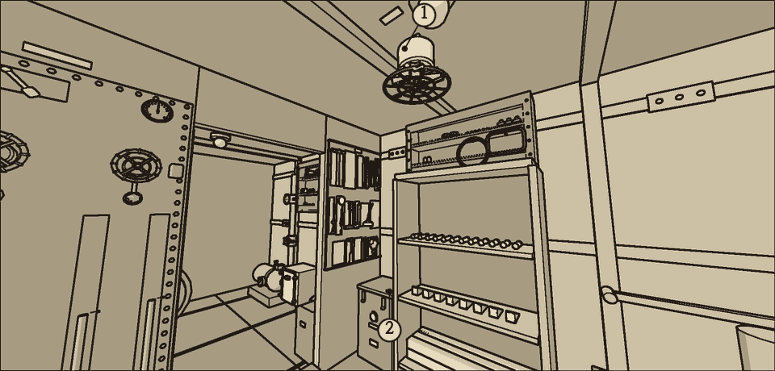
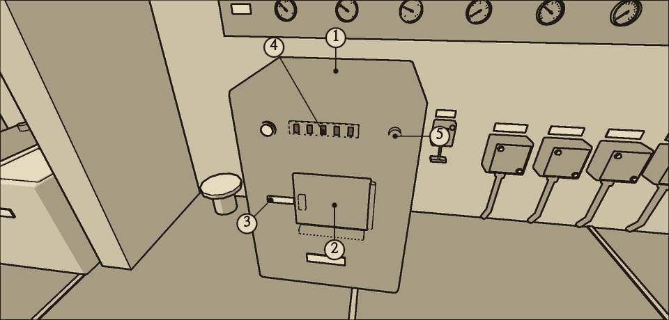
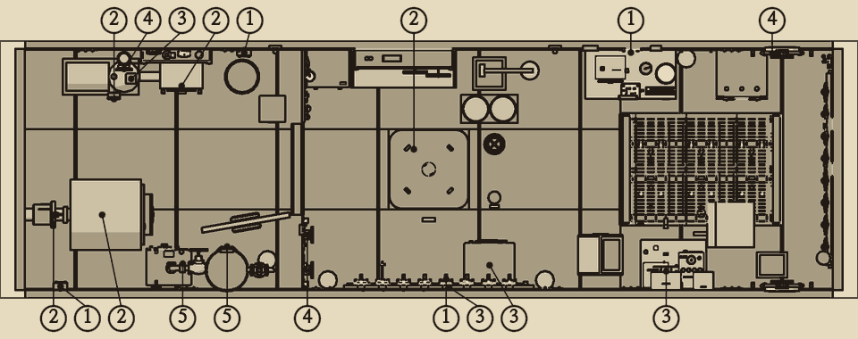

# 공기와 몸 상태

선내 공기는 하나로 이어져 있다. 해치를 닫아도 공기는 나뉘지 않는다. 몸 상태를 재는 계기는 없다. 숨소리와 시야로 판단한다.

## 몸에 나타나는 증상

이산화탄소와 염소는 표의 값 이상에서, 산소는 표의 값 이하에서 증상이 나타난다.

| 기체 | 1단계 | 2단계 | 3단계 | 최종 단계 |
| --- | --- | --- | --- | --- |
| 이산화탄소 | {{n:tuning.crew.co2Levels.0}}% 숨소리가 거칠다 | {{n:tuning.crew.co2Levels.1}}% 눈앞이 흐리다 | {{n:tuning.crew.co2Levels.2}}% 손이 굼뜨다 | {{n:tuning.crew.co2Levels.3}}% 의식을 잃는다 |
| 산소 | {{n:tuning.crew.o2Levels.0}}% 숨이 차다 | {{n:tuning.crew.o2Levels.1}}% 시야가 좁아진다 | 없음 | {{n:tuning.crew.o2Levels.2}}% 의식을 잃는다 |
| 염소 | {{n:tuning.crew.cl2Levels.0}}ppm 기침과 눈물이 난다 | {{n:tuning.crew.cl2Levels.1}}ppm 기침과 눈물이 심하다 | 없음 | {{n:tuning.crew.cl2Levels.2}}ppm 의식을 잃는다 |

- 수소는 몸에 증상을 일으키지 않는다. 다만 {{n:tuning.air.explosiveH2Pct}}% 이상일 때 불꽃이 튀면 폭발한다.
- 의식을 잃으면 스스로 깨어나지 못한다. 1인 운용이므로 깨워 줄 사람도 없다.

## 기체의 증감

아래 값은 분당 변화량이다.

| 기체 | 늘리는 것 | 줄이는 것 |
| --- | --- | --- |
| 이산화탄소 | 사람 {{n:tuning.air.personCo2PerMin}}% | 흡수통 {{n:tuning.air.scrubCo2PerMin|2}}%. 팬이 돌 때만 |
| 산소 | 산소 양초 {{n:tuning.air.candleO2PerMin}}%. {{n:tuning.air.candleMinutes}}분 동안 | 사람 {{n:tuning.air.personO2PerMin|2}}% |
| 염소 | 잠긴 셀 하나당 {{n:tuning.air.cl2PpmPerMinPerCell}}ppm | 팬. 있는 양의 2할 |
| 수소 | 잠긴 셀 하나당 {{n:tuning.air.h2PerMinPerSubmergedCell}}% | 팬. 있는 양의 2할 |

- 흡수통 하나는 이산화탄소를 누적 {{n:tuning.air.canisterCapacityPct}}%만큼 흡수하면 포화된다. 그 뒤에는 팬이 돌아도 이산화탄소가 오른다.
- 팬이 서면 흡수통도 이산화탄소를 흡수하지 못한다. 염소와 수소도 빠지지 않는다.
- 송풍 팬과 산소 화로 점화기는 C2 생명유지 회로에서 전기를 받는다. C2 퓨즈가 끊기면 둘 다 멎는다.
- 상황판의 기체 계기는 이산화탄소와 산소 두 가지뿐이다. 염소와 수소는 공기 표시등으로만 알 수 있다.

| 공기 표시등 | 노랑 | 빨강 |
| --- | --- | --- |
| 이산화탄소 | {{n:tuning.panel.co2Warn}}% 이상 | {{n:tuning.panel.co2Fault}}% 이상 |
| 산소 | {{n:tuning.panel.o2Warn}}% 이하 | {{n:tuning.panel.o2Fault}}% 이하 |
| 염소 | {{n:tuning.panel.cl2Warn}}ppm 이상 | {{n:tuning.panel.cl2Fault}}ppm 이상 |
| 수소 | {{n:tuning.panel.h2Warn}}% 이상 | {{n:tuning.panel.h2Fault}}% 이상 |

## 산소 양초

- 산소가 떨어지면 산소 화로 앞면의 점화 단추를 빈손으로 눌러 양초 하나에 불을 붙인다.
- 점화기가 작동해야 불이 붙는다. C2가 살아 있고 전압이 {{v:devices.o2_igniter.minVoltage}}V 이상이어야 한다.
- 한 번에 하나만 탈 수 있다. 양초 하나는 {{n:tuning.air.candleMinutes}}분 탄다.
- 선내 적재 수는 {{n:tuning.inventory.oxygenCandles}}개다.

## 다쳤을 때

- **감전**: 회로가 살아 있는 채로 퓨즈 소켓, 분기함, 칼날 스위치의 칼날과 집게 나사, 송풍 팬 베어링, 전동기 브러시와 정류자, 상황판 배선함, 켜 둔 청음기·소나·사이펀 기록기의 진공관 소켓에 손을 대면 감전된다. 칼날 스위치의 위 집게는 스위치를 내려도 늘 살아 있다. 몸이 상한다. 잠시 손을 전혀 쓰지 못한다.
- **끼임**: 돌고 있는 기계에 손을 넣으면 손이 끼인다. 배수 펌프의 흡입구와 베어링, 송풍 팬, 추진 전동기의 브러시 끝, 축 패킹, 자이로 회전자, 항법 계산기 톱니, 하중이 걸린 윈치가 그렇다. 몸이 상한다. 감전보다 덜 상하고, 손을 쓰지 못하는 시간도 짧다.
- **분기함 감전**: 젖은 분기함은 회로가 살아 있으면 상자 겉까지 전기가 온다. 덮개를 열거나, 손을 대거나, 걸레로 닦으면 감전된다. 배선을 손볼 때도 그 회로 스위치가 올라가 있으면 감전된다.
- **화상**: {{n:tuning.crew.touch.burnAtC}}°C 이상인 몸체는 만지기만 해도 덴다. 그보다 식었어도 배수 펌프는 {{n:tuning.crew.touch.bandsC.3}}°C 이상일 때 뚜껑을 열면, 청음기는 {{n:fixtures.senses.burnC}}°C 이상일 때 진공관을 뽑으면 덴다. 탐조등은 {{n:fixtures.senses.lampHotC}}°C 이상일 때 걸쇠를 풀거나 장전 문을 열거나 탄소봉을 뽑으면 덴다. 산소 화로는 양초가 타는 동안이나 몸통이 {{n:fixtures.air.hotHandC}}°C 이상일 때 문을 열거나 재받이를 긁으면 덴다. 오래 돈 배수 펌프와 청음기, 켜 두었던 탐조등은 끈 뒤에도, 산소 화로는 양초가 다 탄 뒤에도 한동안 뜨겁다.
- **물줄기**: 현창 덮개를 닫고 걸쇠 둘을 조이기 전에 테 볼트를 풀면, 침수 밸브가 열린 채 패킹 너트를 다 풀거나 패킹에 손을 대면, 배출 밸브가 열려 있거나 배수 펌프가 도는 채 역류 방지 밸브 보닛을 열면 바닷물이 뿜어 나와 몸을 친다. 몸이 상하고 잠시 손을 쓰지 못한다. 쥔 도구를 떨어뜨린다. 그 구역에 물 {{n:tuning.crew.hazards.spray.burstL}}L가 쏟아진다.
- **증기**: 관에 증기가 남은 채 증기 축압기의 관 이음에 테이프를 감거나, 플랜지 볼트를 풀거나, 개스킷을 뽑으면 증기에 덴다. 정지 밸브를 닫고 빼기 밸브를 열어 관의 증기를 뺀 뒤에 한다.
- **땜질 불꽃**: 납땜인두를 이음에 댈 때마다 불꽃이 튄다. 철사를 감은 퓨즈 탓에 분기함 배선이 탈 때도 튄다. 수소가 {{n:tuning.air.explosiveH2Pct}}% 이상이면 폭발한다.
- 손을 쓰지 못하는 동안에는 스위치, 해치, 수동 펌프, 도구, 사물함 어느 것에도 손댈 수 없다. 그동안에도 물은 들어오고 공기는 나빠진다.
- 몸은 아주 천천히 회복된다.
- **거듭 다치면 쓰러진다.** 쓰러지면 다시 일어나지 못한다. 몇 번까지 버틸 수 있는지 셈하지 말 것. 한 번도 다치지 않는 것을 원칙으로 한다.

## 다치지 않는 원칙

1. 퓨즈를 만지기 전에 그 회로 스위치를 내린다.
2. 거름망 바구니에 손대기 전에 C3 스위치를 내린다.
3. 펌프가 서 있어도 C3 스위치가 내려가 있는지 확인한다. 펌프 소리만으로 판단하지 않는다.
4. 축전지가 잠겼으면 불꽃이 튀는 작업을 하지 않는다.
5. 분기함을 열거나 닦기 전에 그 회로 스위치를 내린다. 땜질은 수소가 없을 때만 한다.
6. 장비 몸체는 끄고 식기를 기다린 뒤에 연다. 얼마나 식혀야 하는지는 그 장비의 절차 쪽을 따른다. 배수 펌프는 손을 댈 수 있을 때까지, 청음기 진공관은 따뜻하다고 느껴질 때까지 식힌다.
