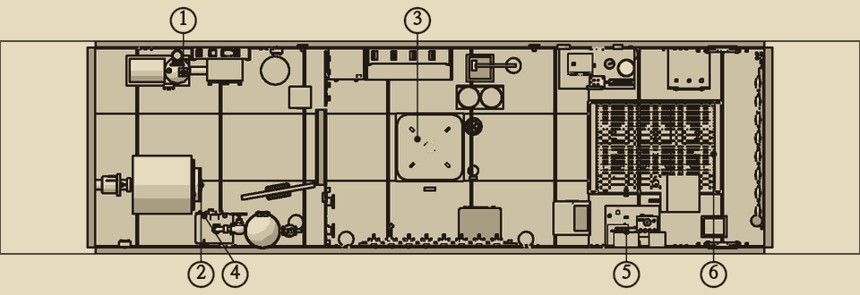
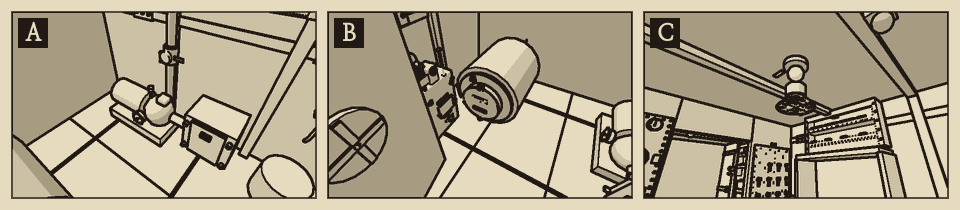
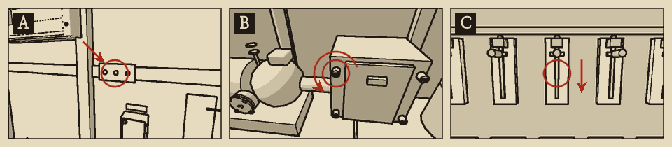

# 소음 표

수리 작업을 하면 소리가 난다. 그 소리는 선체 밖으로 퍼진다. 시끄러운 작업은 때를 골라 한다.

## 읽는 법

- 소음은 0~100의 눈금으로 나타낸다. 100을 넘지 않는다.
- 등급은 조용 0~5, 보통 6~20, 시끄러움 21 이상이다.
- 현재 소음은 가동 중인 장비의 소음과 진행 중인 손동작의 소음을 모두 더한 값이다.
- 손동작 소음은 정해진 시간 동안 이어진다. 겹치면 더해진다.
- 선체 밖으로 퍼진 소리는 바로 사라지지 않는다. 크게 낸 소리일수록 오래 남는다.

## 장비 소음

장비가 가동되는 동안 계속 난다.

| 장비 | 소음 |
| --- | --- |
| 실내 조명, 계통 상황판, 청음기, 납땜인두 | {{n:devices.cabin_lights.noise}} |
| 사이펀 기록기 | {{n:devices.siphon_recorder.noise}} |
| 산소 화로 점화기 | {{n:devices.o2_igniter.noise}} |
| 자이로컴퍼스 | {{n:devices.gyrocompass.noise}} |
| 기계식 항법 계산기 | {{n:devices.nav_computer.noise}} |
| 송풍 팬 | {{n:devices.vent_fan.noise}} |
| 탄소 아크 탐조등 | {{n:devices.searchlight.noise}} |
| 전동 배수 펌프 | {{n:devices.bilge_pump.noise}} |
| 추진 전동기 | 최대 {{n:devices.propulsion.noise}}. 출력에 비례 |
| 소나 발신 | {{n:devices.sonar.noise}}. {{n:devices.sonar.pulseSeconds}}초 |
| 갈고리 윈치 | {{n:devices.hook_winch.noise}} |

## 손동작 소음

| 동작 | 소음 | 이어지는 시간 |
| --- | --- | --- |
| 칼날 스위치 (위치를 바꿀 때) | {{noise:switch}} | {{n:tuning.noise.actions.switch.seconds}}초 |
| 퓨즈 뽑기, 꽂기 | {{noise:fuse}} | {{n:tuning.noise.actions.fuse.seconds}}초 |
| 사물함에서 꺼내기 | {{noise:locker}} | {{n:tuning.noise.actions.locker.seconds}}초 |
| 공구판에서 도구 꺼내기, 돌려놓기 | {{noise:toolboard}} | {{n:tuning.noise.actions.toolboard.seconds}}초 |
| 렌치 (볼트 하나) | {{noise:wrench}} | {{n:tuning.noise.actions.wrench.seconds}}초 |
| 덮개 여닫기, 바구니 빼고 넣기 | {{noise:cover}} | {{n:tuning.noise.actions.cover.seconds}}초 |
| 표시등 테 돌리기, 상황판 전구 뽑기와 꽂기 | {{noise:tap}} | {{n:tuning.noise.actions.tap.seconds}}초 |
| 드라이버 (나사 하나) | {{noise:screwdriver}} | {{n:tuning.noise.actions.screwdriver.seconds}}초 |
| 해치 여닫기 | {{noise:hatch}} | {{n:tuning.noise.actions.hatch.seconds}}초 |
| 솔질 한 번 | {{noise:scrub}} | {{n:tuning.noise.actions.scrub.seconds}}초 |
| 버팀목 대기 | {{noise:shore}} | {{n:tuning.noise.actions.shore.seconds}}초 |
| 나무망치 한 번 | {{noise:mallet}} | {{n:tuning.noise.actions.mallet.seconds}}초 |
| 수동 펌프 한 번 | {{noise:handpump}} | {{n:tuning.noise.actions.handpump.seconds}}초 |
| 코킹 한 번 | {{noise:caulk}} | {{n:tuning.noise.actions.caulk.seconds}}초 |

## 절차별 소음

| 절차 | 가장 큰 소리 | 등급 |
| --- | --- | --- |
| 퓨즈 교체 | {{noise:fuse}} | 조용 |
| 펌프 흡입 거름망 청소 | 솔질 {{noise:scrub}} | 보통 |
| 리벳 이음 응급 막기 (쐐기와 버팀목) | 나무망치 {{noise:mallet}} | 보통 |
| 리벳 이음 코킹 | 코킹 {{noise:caulk}} | 시끄러움 |
| 상황판 전구 교체 | 사물함 {{noise:locker}} | 조용 |
| 청음기 진공관 교체, 소나 진공관 빼 쓰기 | 문 여닫기 {{noise:cover}} | 조용 |
| 상황판 배선함 건조와 단자 재고정 | 덮개 여닫기({{noise:cover}})와 공구판 왕복({{noise:toolboard}})이 겹친다 | 보통 |
| 탄소봉 간격 재조정 | 소리 없음 | 조용 |
| 탐조등 탄소봉 교체 | 걸쇠 {{noise:latch}}, 문 여닫기 {{noise:cover}} | 조용 |
| 상황판 계기 영점 보정 | 드라이버 {{noise:screwdriver}} | 조용 |

- 거름망 청소를 마치고 펌프를 돌리면 펌프 소음 {{n:devices.bilge_pump.noise}}가 이어진다.
- 수동 펌프는 시끄럽다. 오래 저으면 소리가 쌓인다.
- 코킹은 여러 번에 나누어 쳐도 된다. 앞서 친 횟수는 이음새에 그대로 남는다.
