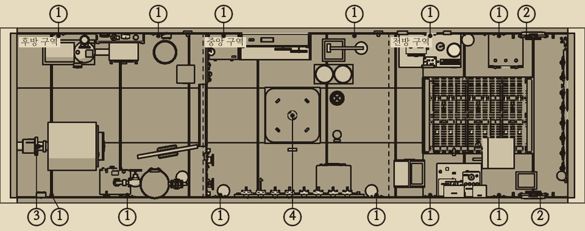
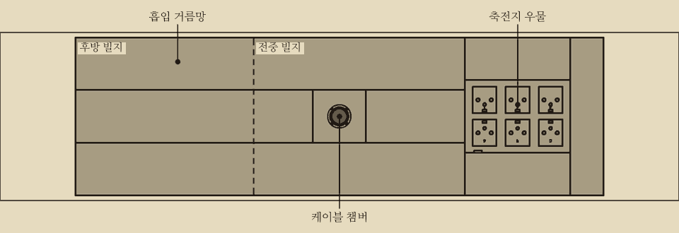
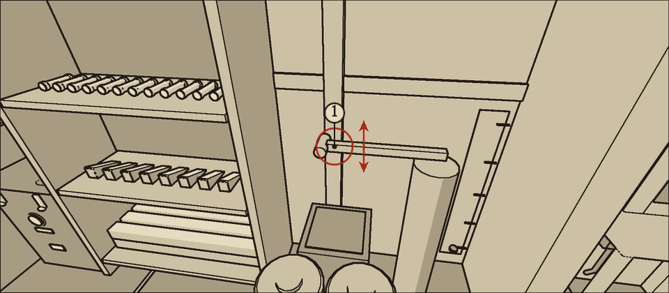
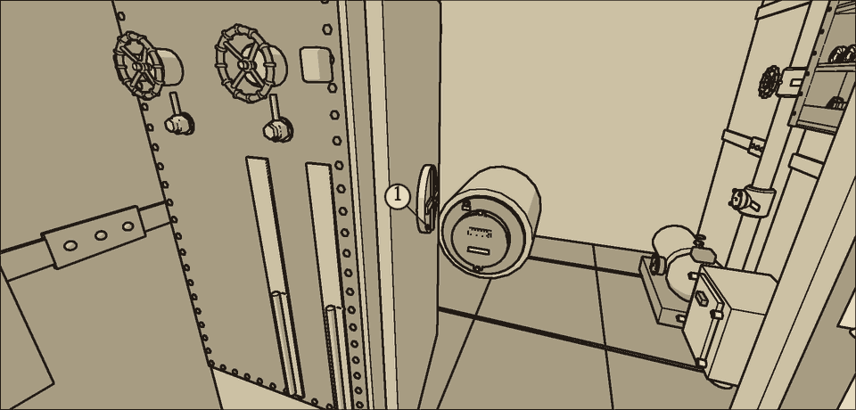

# 침수 대응

물이 새면 먼저 해치를 열지 닫을지 정한다. 다음으로 펌프를 돌린다. 그다음 새는 곳을 막는다. 무엇보다 축전지가 물에 잠기지 않게 하는 일이 우선한다.

## 침수 때 할 일 순서

1. 구역 붉은 경고등으로 새는 구역을 확인한다.
2. 해치를 열지 닫을지 정한다. 아래 '해치 판단'을 따른다.
3. 펌프 흡입 선택 레버를 첫째 칸(빌지)에 둔다. C3 스위치를 올려 전동 배수 펌프를 돌린다. 배수량이 오르지 않으면 진단 표의 '배수 펌프 가르기'를 본다.
4. 새는 곳을 막는다. 리벳 이음이면 '리벳 이음 응급 막기 (쐐기와 버팀목)'를 따른다. 축 고리 둘레가 새면 '축 패킹 누름판 조이기'를 따른다. 현창 유리 테가 새면 덮개를 닫고 걸쇠 둘을 조인다.
5. 전동 펌프가 들어오는 물을 따라잡지 못하거나 물이 고인 칸에 전동 펌프가 닿지 않으면 수동 펌프를 젓는다.
6. 전중 빌지가 {{n:tuning.water.batterySubmergeStartL}}L에 다가가면 무엇보다 먼저 그 칸을 퍼낸다.
7. 누수가 잡히면 리벳 이음 코킹, 축 패킹 끈 교체, 현창 밀봉 교체로 마무리한다.

## 물의 흐름

1. 새어 든 물은 먼저 그 구역 아래 빌지 칸으로 모인다.
2. 빌지 칸이 차면 그 구역 바닥 위로 차오른다.
3. 해치가 열려 있으면 물이 두 빌지 칸 사이를 오가, 두 칸이 용량에 견주어 같은 비율로 찬다. 바닥 위 물도 이웃 구역으로 퍼진다.
4. 해치를 닫으면 해치 앞뒤가 갈린다. 바닥 위로도 바닥 아래로도 물이 넘어가지 않는다.
5. 바닥 위 물은 빌지 칸에 자리가 나면 다시 빌지로 빠진다.

| 빌지 칸 | 덮는 구역 | 용량 | 들어 있는 것 |
| --- | --- | --- | --- |
| 전중 빌지 | 전방, 중앙 | {{n:tuning.water.bilges.bilge.fwd.capacityL}}L | 축전지. 수동 펌프가 퍼낸다 |
| 후방 빌지 | 후방 | {{n:tuning.water.bilges.bilge.aft.capacityL}}L | 전동 펌프 흡입구와 거름망 |

- 한 구역의 바닥 면적은 약 {{n:tuning.water.zoneFloorAreaM2}}m²다. 바닥 위 물 80L가 수위 1cm에 해당한다.
- 선내 바닥 위 물의 합계가 {{n:tuning.failure.swampedFloorWaterL}}L를 넘으면 모스호는 버티지 못한다.

## 들어오는 양

- 누수량(L/초) = {{n:tuning.water.leakK|2}} × 누수 면적(cm²) × √수심(m).
- 리벳 이음 하나가 완전히 터지면 누수 면적은 3cm²다.

| 수심 | 1cm²당 분당 | 리벳 이음이 완전히 터지면 분당 |
| --- | --- | --- |
| 100m | 12L | 36L |
| 300m | 약 21L | 약 62L |
| 400m | 24L | 72L |
| 600m | 약 29L | 약 88L |

## 퍼내는 양

| 펌프 | 위치 | 퍼내는 칸 | 양 | 소음 |
| --- | --- | --- | --- | --- |
| 전동 배수 펌프 | 후방 | 후방 빌지 | 분당 {{lpm:tuning.water.pumpRatedLps}}L | {{n:devices.bilge_pump.noise}} (도는 동안) |
| 수동 펌프 | 중앙 | 전중 빌지 | 한 번에 {{n:tuning.water.handPumpStrokeL}}L | {{noise:handpump}} (한 번마다) |

- 수동 펌프는 한 번 젓는 데 {{n:tuning.water.handPumpStrokeSeconds}}초 걸린다. 한 번이 끝나기 전에 다시 저으면 헛손질이 된다.
- 쉬지 않고 저어도 분당 약 75L가 한계다.
- 수동 펌프는 전기 없이 쓸 수 있다.
- 배수량 계기는 전동 펌프의 배수량만 보인다. 수동 펌프로 퍼낸 양은 빌지 계기로 확인한다.

## 해치 판단

해치는 중앙과 후방 사이에 있다.

| 새는 곳 | 해치 | 까닭 |
| --- | --- | --- |
| 후방만 | 닫는다 | 후방 물이 축전지 쪽으로 넘어가지 못한다. 전동 펌프가 후방 빌지를 퍼낸다 |
| 전방이나 중앙 | 열어 둔다 | 물이 후방 빌지로 건너가 전동 펌프가 퍼낸다 |
| 앞뒤 모두 | 열어 둔다 | 전동 펌프가 모두 퍼낸다. 수동 펌프를 함께 쓴다 |

### 해치를 닫으면

- 앞쪽(전방과 중앙) 물은 전동 펌프로 퍼낼 수 없다. 중앙의 수동 펌프로 퍼낸다.
- 전중 빌지에 이미 고인 물도 수동 펌프로만 빠진다.
- 후방이 새는데 전동 펌프를 쓸 수 없으면 후방 물은 그대로 쌓인다. 후방 빌지 {{n:tuning.water.bilges.bilge.aft.capacityL}}L가 다 차면 물이 후방 바닥 위로 차오른다. 이때는 해치를 열어 수동 펌프로 함께 퍼낼지 정한다. 해치를 열면 물이 축전지 쪽으로 넘어간다.
- 빌지 계기는 두 칸의 합계다. 해치를 닫았으면 칸마다의 수위는 빌지 수위 유리관으로 읽는다.
- 후방 빌지가 마르면 배수량이 0으로 떨어진다. 고장이 아니다.
- 해치를 여닫는 소음은 {{noise:hatch}}이다.

## 축전지를 지킬 것

- 축전지는 전방 바닥 아래, 전중 빌지 칸 안에 있다.
- 전중 빌지가 {{n:tuning.water.batterySubmergeStartL}}L에 이르면 셀이 잠기기 시작한다. 20L 오를 때마다 한 셀씩 잠긴다. {{n:tuning.water.batterySubmergeFullL}}L에서 {{n:tuning.battery.cells}}셀이 모두 잠긴다.
- 해치가 열려 있으면 이 수위는 빌지 계기 합계 400L에 해당한다. 합계 600L이면 셀이 모두 잠긴다.
- **해치를 닫았으면 빌지 계기가 {{n:tuning.panel.bilgeFaultL}}L(배수 빨강)에 이르기 전에도 셀이 잠길 수 있다.**
- 물을 퍼내 셀이 다시 드러나면 가스 발생도 멎는다.

### 잠긴 셀에서 나오는 가스

- **염소**: 잠긴 셀 하나당 분당 {{n:tuning.air.cl2PpmPerMinPerCell}}ppm. 팬이 돌면 분마다 있는 양의 2할이 빠진다.
- 팬이 돌아도 염소는 잠긴 셀 하나당 약 15ppm까지 쌓여 그 수준에 머문다. 셀 하나면 기침과 눈물이 나는 10ppm을 넘는다. 둘이면 30ppm(심각) 가까이, 넷을 넘으면 60ppm(의식 상실)에 이른다.
- 팬이 서면 염소는 빠지지 않고 계속 오른다.
- **수소**: 잠긴 셀 하나당 분당 {{n:tuning.air.h2PerMinPerSubmergedCell}}%. 팬이 돌면 분마다 있는 양의 2할이 빠진다. 팬이 서면 쌓인다.
- **수소가 {{n:tuning.air.explosiveH2Pct}}% 이상일 때 불꽃이 튀면 폭발한다.**
- 셀이 잠기면 송풍 팬(C2)을 반드시 계속 돌린다.
- 셀이 잠기면 불꽃이 튀는 작업을 하지 않는다. 살아 있는 소켓의 퓨즈를 만지지 않는다. 원인이 남은 회로를 다시 올리지 않는다. 퓨즈가 끊길 때도 불꽃이 튄다.

## 축 패킹이 샐 때

- 축 패킹은 후방 끝, 추진 전동기 뒤에 있다. 새는 물은 후방 빌지로 간다. 해치는 '후방만' 새는 경우를 따른다.
- 수심 300m에서 헌 패킹은 분당 약 30L가 샌다. 두 너트를 한 칸씩 조이면 약 21L로 준다.
- 축 패킹 끈 교체 중에는 더 샌다(수심 300m). 너트를 다 풀면 분당 약 48L, 패킹 고리를 다 빼면 약 84L가 들어온다. 전동 배수 펌프(분당 {{lpm:tuning.water.pumpRatedLps}}L)를 먼저 돌려 두고 시작한다.
- 교체에는 축을 멈춰야 한다. 추진 회로(C8)를 내리면 배는 추진을 잃는다. 때를 골라 한다.
- **누름판을 꽉 조여 물을 아주 멎게 하지 말 것.** 축이 도는 동안 패킹이 타서 나중에 더 크게 샌다. 1초에 한 방울은 새야 한다.

## 현창이 샐 때

- 현창은 전방 끝벽 좌우에 있다. 새는 물은 전중 빌지로 간다. 축전지가 있는 칸이다. 해치는 '해치 판단' 표의 '전방이나 중앙' 줄을 따른다(열어 둔다).
- 수심 300m에서 상한 밀봉은 분당 약 10L가 샌다.
- **덮개를 열어 두면 밀봉이 점점 더 상해 약 30분 뒤 유리에 금이 간다.** 금 간 유리로는 분당 200L가 넘게 들어온다. 먼저 덮개를 닫고 걸쇠 둘을 조인다. 새는 양은 그대로지만 더 상하지 않는다. 금 간 유리도 덮개가 붙잡지만 처음의 세 배쯤(분당 약 30L) 샌다. 밀봉을 갈아도 금 간 유리는 그대로다.
- 정식 수리는 현창 밀봉 교체다. 덮개를 닫은 채 한다.

## 케이블 챔버가 찰 때

- 챔버는 중앙 바닥 아래의 따로 막힌 방이다. 챔버에 든 물은 빌지로 가지 않고, 경고등도 켜지지 않는다. 챔버 수위 유리를 때때로 본다.
- 챔버 물은 펌프 흡입 선택 레버를 넷째 칸(챔버)에 두고 전동 배수 펌프로 뺀다. 챔버 줄은 분당 {{lpm:tuning.suction.chamberLineLps}}L까지만 뺀다. 그동안 펌프는 빌지를 퍼내지 않는다. 빌지가 급하면 레버를 첫째 칸(빌지)으로 되돌린다.
- 바깥 문 밀봉이 상하면 챔버 줄로 따라잡지 못한다. 조임 바퀴를 끝까지 조여 새는 양을 줄인다.
- **챔버에 물이 {{n:tuning.chamber.sillL}}L 넘게 있을 때는 안쪽 해치를 열지 말 것.** 수압에 눌려 열리지도 않는다. 그 아래에서 열어도 남은 물이 전중 빌지로 넘친다.

## 응급 패치는 다시 샌다

- 쐐기와 버팀목은 수압에 밀려 시간이 지나면 빠진다. 깊을수록 빨리 빠진다.
- 빠지면 원래대로 샌다. 구역 경고등이 다시 켜진다.
- 버티는 시간은 '리벳 이음 응급 막기 (쐐기와 버팀목)' 쪽의 표를 본다.
- 시간 여유가 생기면 리벳 이음 코킹으로 정식 수리한다. 코킹은 시끄러우므로 때를 골라 한다.
