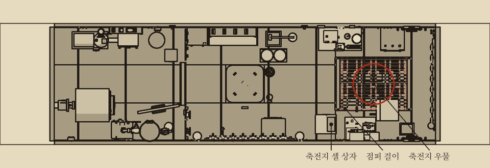
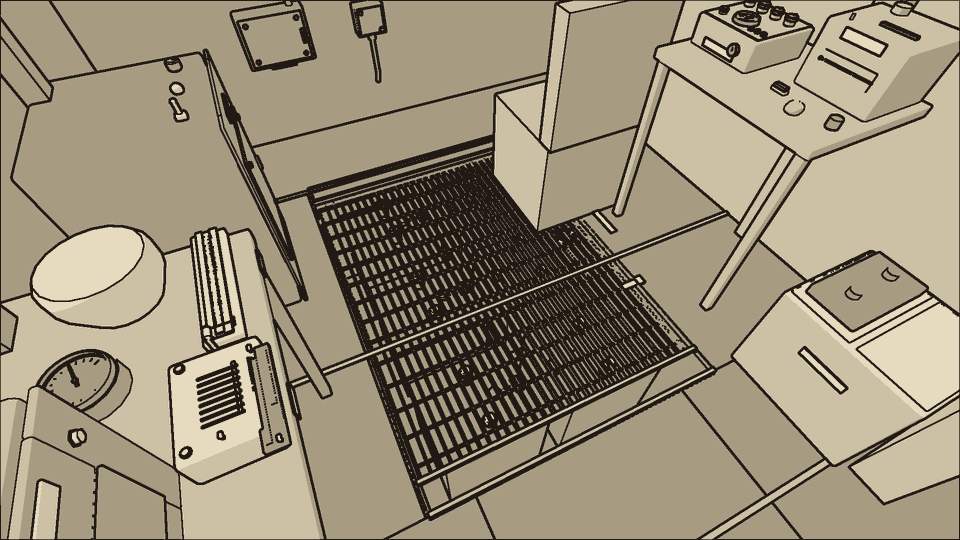
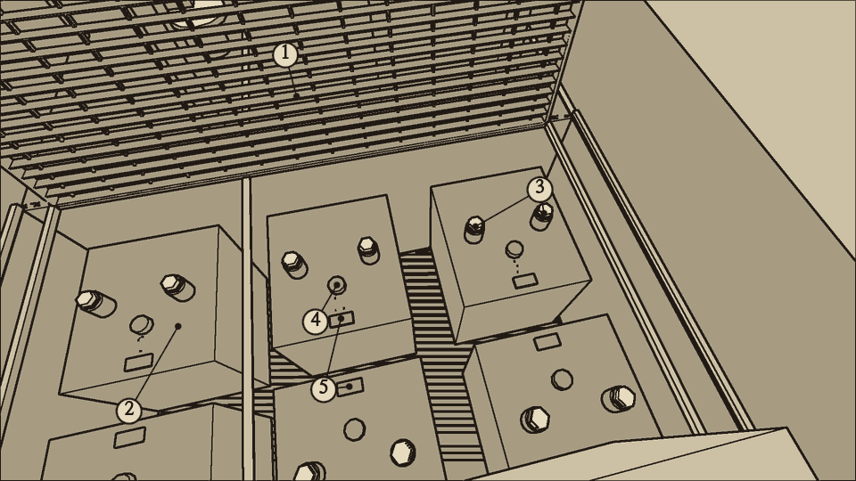
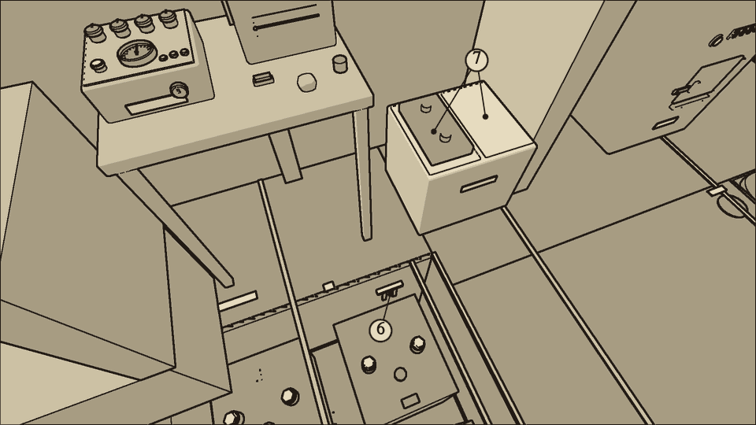
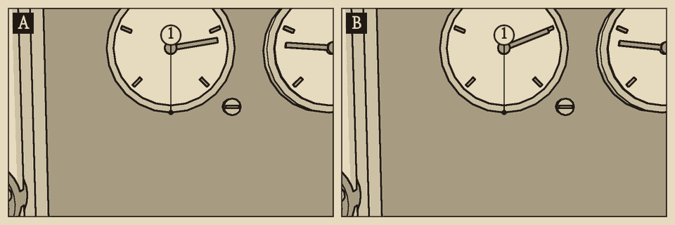
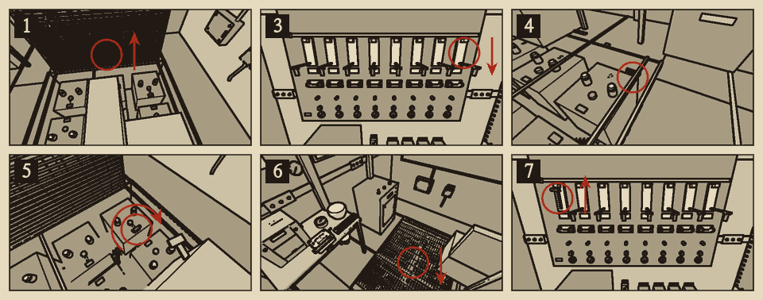
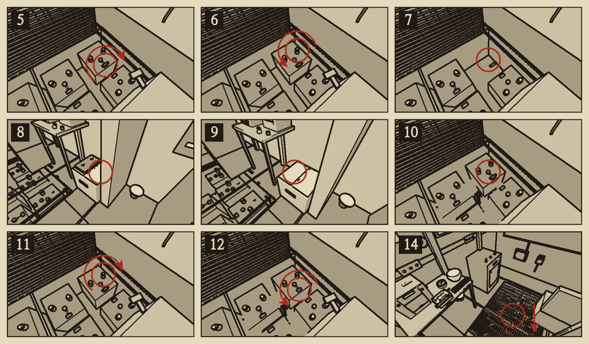

# 축전지 셀

분류: 동력 · 축전지 셀 열화 (PWR-01) · 응급 수리와 정식 수리

축전지는 셀 {{n:tuning.battery.cells}}개를 한 줄로 이은 것이다. 셀 하나가 열화하면 그 셀만 전압이 낮고 다른 셀보다 빨리 달아오른다. 줄로 이어져 있으므로 점퍼 없이 셀 하나가 빠지면 배 안의 전기가 모두 나간다.

## 이럴 때 쓴다

- 상황판 전압계가 평소보다 조금 낮다. 약 113V를 가리킨다.
- 셀이 {{n:tuning.panel.cellHotC}}°C를 넘으면 상황판 동력 표시등이 노랑으로 켜진다. 부하가 클 때만 그렇다. 추진 전동기를 반속으로 돌리고 있으면 열화가 시작되고 5~10분 뒤다. 부하가 작으면(추진과 탐조등을 쓰지 않으면) 셀이 그만큼 달아오르지 않아 표시등이 켜지지 않는다.
- 실내등이 한 단계 어둡다.
- 열화한 셀이 먼저 방전되면 전압이 더 떨어진다. 그러면 최소 전압이 높은 장비(탐조등 {{v:devices.searchlight.minVoltage}}V, 자이로컴퍼스 {{v:devices.gyrocompass.minVoltage}}V)부터 멎는다. 감각이나 항법 고장처럼 보인다.
- 셀이 30°C를 넘으면 갑판 판 아래에서 지글거리는 소리가 난다.

## 어디에

전방 구역 바닥 아래 축전지 우물에 있다. 우물은 걸쇠 둘로 잠근 갑판 판으로 덮여 있다. 갑판 판 옆에 웅크리고 앉아 작업한다. 점퍼 걸이는 우물 우현 벽에 있다. 축전지 셀 상자는 전방 구역 입구 우현 바닥에 있다.

## 무엇이 있나

| 부분 | 생김새 |
| --- | --- |
| 1 갑판 판 | 우물을 덮은 격자 판. 걸쇠 둘을 벗기면 좌현 쪽 경첩으로 들린다 |
| 2 셀 | 우물 안에 세 개씩 두 줄. 1~3번은 좌현, 4~6번은 우현이다 |
| 3 단자 너트 | 셀마다 위에 둘. 이웃 셀과 잇는 연결 막대를 물고 있다 |
| 4 통기 마개 | 셀 위 가운데의 검은 마개. 비중계를 꽂는 곳이다 |
| 5 연결 자리 | 셀 안쪽 가장자리의 구리 판. 점퍼 막대를 걸친다 |
| 6 점퍼 걸이 | 우물 우현 벽의 갈고리. 점퍼 막대 {{stock:jumper_bar}}개가 걸려 있다 |
| 7 셀 상자 | 나무 상자. 한쪽 칸에 예비 셀, 다른 쪽 칸에 다 쓴 셀을 넣는다 |

## 가르기

| 살필 것 | 셀 열화 | 축전지 방전 | 상황판 전압계가 틀림 |
| --- | --- | --- | --- |
| 손에 든 전압계를 버스 바에 댄다 | 상황판과 같다 | 상황판과 같다 | 상황판과 다르다 |
| 셀마다 전압계(30V 눈금) | 한 셀만 약 13V, 나머지는 약 20V | 모든 셀이 고르게 낮다 | 모든 셀이 약 20V |
| 셀마다 손을 대 본다 | 한 셀만 다른 셀보다 한 단계 이상 덥게 느껴진다(다른 셀이 차가우면 그 셀만 미지근하다) | 모든 셀이 같게 느껴진다 | 모든 셀이 같게 느껴진다 |
| 셀마다 비중계 | 한 셀만 비중이 빨리 떨어진다 | 모든 셀의 비중이 고르게 낮다 | 모두 {{n:measure.hydrometer.sgFull|2}} 가까이 |

- 손에 느껴지는 온도는 부하와 시간에 따라 다르다. 부하가 작을 때(추진을 쓰지 않을 때)는 열화한 셀이 미지근하고 나머지는 차갑다. 추진 전동기를 반속으로 15분쯤 돌리면 열화한 셀이 뜨거워진다.
- 셀을 재려면 먼저 갑판 판을 연다. 판이 덮여 있으면 비중계를 꽂을 수 없다.
- 상황판 전압계가 의심스러우면 버스 바부터 잰다. '재는 법'의 '전압계'를 본다.

{{procedure:proc.cell.jumper}}

### 응급 수리의 수명

- 점퍼를 걸면 열화한 셀이 줄에서 빠지고 나머지 다섯 셀이 일한다. 전압은 약 100V(평소의 6분의 5)로 떨어지지만 그 셀은 더 이상 달아오르지 않는다. 이 전압에서는 탐조등({{v:devices.searchlight.minVoltage}}V)이 켜지지 않는다. 축전지가 더 방전되어 {{v:devices.gyrocompass.minVoltage}}V 아래로 내려가면 자이로컴퍼스도 멎는다.
- 점퍼는 언제까지나 버틴다. 다만 다섯 셀이 모든 부하를 지므로 축전지가 그만큼 빨리 닳는다.
- 셀이 완전히 죽어 있으면(전압이 거의 0) 점퍼 없이는 전압이 평소의 3할로 떨어지고 상황판이 꺼진다. 점퍼를 걸면 6분의 5로 살아난다.

{{procedure:proc.cell.replace}}

### 끝난 뒤 확인

- 상황판 전압계가 평소 값(약 120V)으로 돌아온다.
- 동력 표시등이 꺼진다. 몇 분 뒤 셀을 하나씩 짚어 보아 온도가 고르다.
- 새 셀을 전압계로 재면 약 20V다. 비중계로 재면 약 1.26(9할 충전)이 나온다.

### 순서를 어기면

- **부하가 걸린 채 점퍼를 대거나 떼면 연결 자리에서 불꽃이 튄다. 우물에 수소가 {{n:tuning.air.explosiveH2Pct}}% 이상 차 있으면 폭발한다.** 배전반 스위치를 모두 내린 뒤에 댄다.
- **점퍼 없이 살아 있는 셀의 단자 너트를 풀면 불꽃이 튄다.** 두 너트가 다 풀리면 줄이 끊겨 배 안의 전기가 모두 나간다. 셀을 들어낸 채 점퍼가 없어도 같다.
- 너트를 조여 둔 셀은 들리지 않는다. 물에 잠긴 셀은 들어낼 수 없다. 먼저 물을 퍼낸다.
- 단자 너트 하나를 덜 조인 채 두면 겉보기에는 수리가 끝난 것 같다. 그러나 그 단자가 저항이 되어 전압이 약 2% 낮고, 셀이 달아오르고, 부하가 바뀔 때마다(스위치를 올리고 내릴 때) 우물 안에서 불꽃이 튄다. 그 셀만 다시 다른 셀보다 온도가 높으면 너트부터 조인다.
- 다 쓴 셀은 어느 자리에 앉혀도 다 쓴 셀이다. 아무것도 고쳐지지 않는다.
- 성한 셀을 빼면 쓰던 셀로 나온다. 사물함에 되돌릴 수 없다. 다른 자리로 옮겨 앉히면 그 자리는 성해지지만, 뺀 자리는 점퍼를 걸거나 예비 셀을 앉혀야 한다.

### 우물의 수소

- 셀이 바닷물에 잠기면 수소와 염소가 나온다. 수소는 팬이 돌아야 빠진다.
- 공기 표시등이 켜졌는데 이산화탄소와 산소 계기가 정상이고 염소 냄새가 없으면 수소다. 수소가 {{n:tuning.air.explosiveH2Pct}}% 이상일 때 불꽃이 튀면 폭발한다. 점퍼, 단자 너트, 퓨즈를 만지기 전에 팬을 돌려 공기 표시등이 꺼질 때까지 수소를 뺀다.

## 예비품

- 예비 셀은 {{stock:spare_cell}}개뿐이다. 한정 예비품이다. 다 쓰면 점퍼로 버틴다.
- 점퍼 막대는 쓰고 나면 걸이에 되건다. 닳지 않는다.
- 셀은 무거워 두 손으로 든다. 셀을 든 채로는 도구를 쥘 수 없다.

## 소음

| 동작 | 소음 |
| --- | --- |
| 칼날 스위치 | {{noise:switch}} |
| 갑판 판 열고 닫기 | {{noise:cover}} |
| 렌치(단자 너트, 점퍼) | {{noise:wrench}} |
| 셀 들어내고 앉히기 | {{noise:cell_lift}} |

조용한 수리다. 가장 큰 소리는 셀을 들어내고 앉힐 때 난다.
