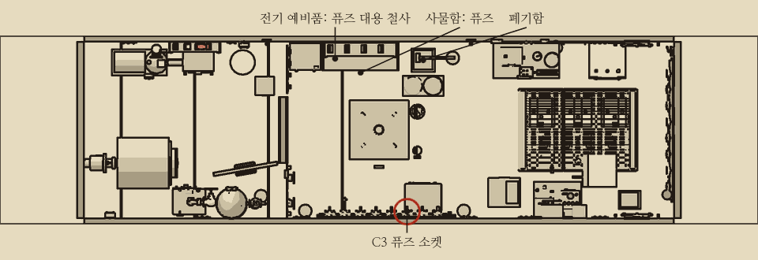
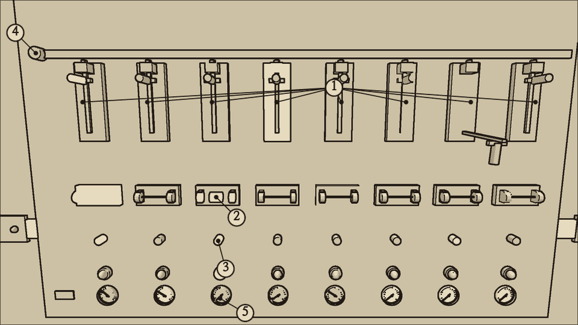
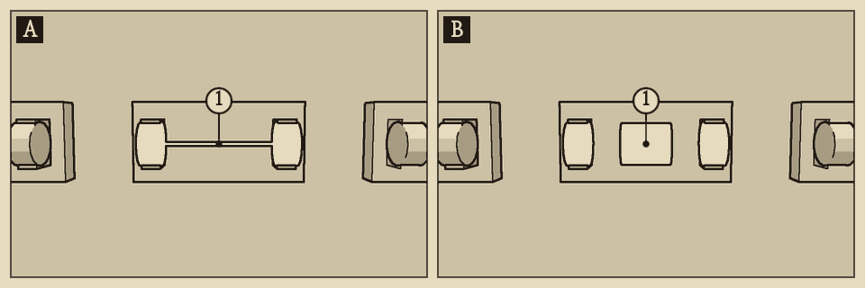
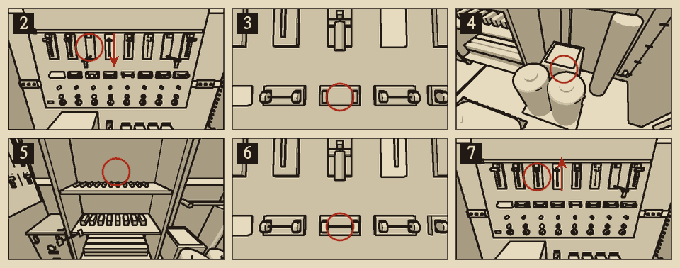
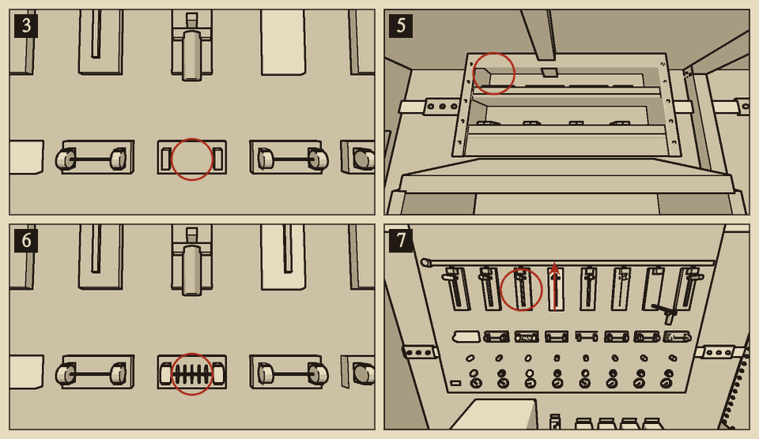
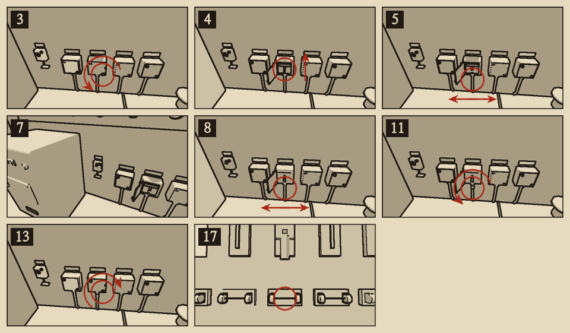
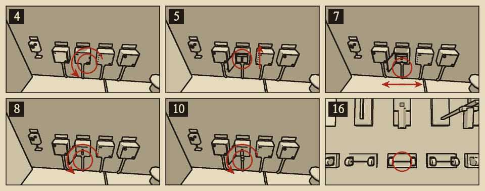

# 퓨즈 교체

분류: 배전반 · 퓨즈 단선 (ELC-01) · 정식 수리

배전반은 중앙 구역 우현 벽에 있다. 회로마다 위에서부터 칼날 스위치, 퓨즈 소켓, 부하 단자, 회로 표시등이 하나씩 있다. 회로 표시등은 부하 쪽에 연결된 작은 전구다. 회로에 전기가 통하면 켜진다.

## 이럴 때 쓴다

- 상황판 배전반 표시등이 빨강이다.
- 배전반에서 스위치를 올린 회로의 표시등이 꺼져 있다.
- 한 회로의 장비가 한꺼번에 멎었다.
- 끊긴 퓨즈는 유리관 안의 선이 끊어져 검게 그을려 있다.

- 상황판 전체가 꺼졌으면 C4 퓨즈를 의심한다.

## 도구와 예비품

| 도구 | 쓰는 곳 |
| --- | --- |
| 전압계 | 끊긴 퓨즈 찾기 |
| 빈손 | 퓨즈 뽑기와 꽂기 |

| 예비품 | 수 | 사물함 적재 |
| --- | --- | --- |
| 퓨즈 | 1 | {{stock:fuse}} |

## 순서

1. 끊긴 퓨즈를 찾는다. 스위치가 올라가 있는데 회로 표시등이 꺼진 회로를 찾는다. 전압계를 퓨즈 소켓에 댄다. 약 120V가 읽히면 그 퓨즈가 끊긴 것이다. 스위치는 아직 내리지 않는다.
2. 그 회로의 칼날 스위치를 내린다.
3. 도구를 내려놓는다. 빈손으로 끊긴 퓨즈를 소켓에서 뽑는다.
4. 끊긴 퓨즈를 폐기함에 버린다.
5. 예비품 사물함에서 새 퓨즈를 꺼낸다.
6. 새 퓨즈를 소켓에 끝까지 밀어 넣는다.
7. 스위치를 올린다. 회로 표시등과 장비가 살아나는지 본다.

## 단계마다 지킬 것

| 단계 | 지킬 것 | 어기면 |
| --- | --- | --- |
| 1 재기 | 스위치를 올린 채 잴 것 | 내린 뒤에는 끊긴 퓨즈도 0으로 읽힌다 |
| 3 뽑기 | **스위치를 내릴 것** | 감전된다. 퓨즈는 빠진다 |
| 3 뽑기 | 빈손일 것. 손에 쥔 것이 없을 것 | 뽑히지 않는다 |
| 3 뽑기 | 끊긴 퓨즈만 뽑을 것 | 전기가 흐르는 회로에서 성한 퓨즈를 뽑으면 불꽃이 튀고 감전된다 |
| 5 꺼내기 | 손에 쥔 것이 없을 것 | 꺼낼 수 없다. 끊긴 퓨즈부터 버린다 |
| 6 꽂기 | **스위치를 내릴 것** | 불꽃이 튀고 감전된다. 수소가 {{n:tuning.air.explosiveH2Pct}}% 이상이면 폭발한다 |
| 6 꽂기 | 소켓이 비어 있을 것 | 꽂히지 않는다 |

## 위험

- **감전**: 스위치가 올라간 소켓은 퓨즈가 끊겼어도 살아 있다. 전원 쪽 단자에는 전압이 걸려 있다. 만지면 감전된다. 잠시 손을 전혀 쓰지 못하고 몸이 상한다. 거듭되면 쓰러진다.
- **불꽃**: 살아 있는 소켓에 퓨즈를 꽂으면 불꽃이 튄다. 전기가 흐르는 회로에서 성한 퓨즈를 뽑아도 튄다. 퓨즈가 끊길 때도 튄다. 수소가 {{n:tuning.air.explosiveH2Pct}}% 이상 차 있으면 폭발한다.
- 축전지가 바닷물에 잠긴 뒤에는 수소를 먼저 의심한다.

## 끝난 뒤 확인

- 상황판 배전반 표시등이 꺼진다.
- 그 회로의 표시등이 다시 켜진다.
- 그 회로의 장비가 다시 돈다. 배수 회로라면 펌프 전류가 약 {{a:devices.bilge_pump.powerW}}A로 오른다.
- 전압계를 퓨즈 소켓에 대면 0이다. 부하 단자에 대면 약 120V다.
- **{{n:tuning.switchboard.fuseBlowSeconds}}초 남짓 만에 또 끊기면 원인이 남아 있다.** 누전이거나 장비 과부하다. 진단 표의 '퓨즈 단선과 누전 가르기'를 본다. 원인을 없애기 전에는 다시 갈지 말 것.

## 흔한 실수

- 스위치를 내리면 배전반 빨강이 꺼진다. 고친 것이 아니다.
- 끊긴 퓨즈를 다시 꽂아도 회로는 살아나지 않는다.
- 다른 회로의 성한 퓨즈를 잘못 뽑았으면 버리지 말고 제자리에 다시 꽂는다.
- 끊긴 퓨즈를 쥔 채로는 새 퓨즈를 꺼낼 수 없다. 먼저 버린다.
- 새 퓨즈를 버리면 되찾지 못한다.

## 소음

| 동작 | 소음 |
| --- | --- |
| 칼날 스위치 | {{noise:switch}} |
| 퓨즈 뽑기, 꽂기 | {{noise:fuse}} |
| 사물함에서 꺼내기 | {{noise:locker}} |

조용한 수리다.

{{procedure:proc.fuse.wire}}

### 이럴 때 쓴다

- 사물함에 예비 퓨즈가 하나도 없을 때만 쓴다. 퓨즈가 있으면 퓨즈 교체를 한다.
- 퓨즈 대용 철사는 빈 퓨즈 몸통에 철사를 감아 둔 것이다. 퓨즈처럼 소켓에 꽂고 스위치를 올리면 회로가 살아난다.
- 꽂아 둔 철사는 겉으로 알아볼 수 있다. 몸통에 구리 철사가 감겨 있고, 끊긴 퓨즈와 달리 유리관이 그을리지 않았다.

### 응급 수리의 수명

- **철사는 끊기지 않는다.** 그 회로에 정격을 넘는 전류가 {{n:tuning.switchboard.fuseBlowSeconds}}초 넘게 흐르면 퓨즈 대신 그 회로의 분기함 배선이 탄다. 불꽃이 튀고, 분기함 틈으로 연기가 새고, 타는 냄새가 난다. 회로는 죽는다.
- 누전이나 과부하가 남은 회로에는 철사를 감지 말 것.
- 예비 퓨즈가 생기면 바로 퓨즈 교체로 철사를 뺀다. 뺀 철사는 다시 쓰지 못한다.
- **공구 회로(C7)에는 철사를 감지 말 것.** C7 분기함 배선이 타면 납땜인두가 돌지 않아 그 배선을 다시 이을 수 없다. 꼬아 잇기밖에 남지 않는다.

{{procedure:proc.junction.rewire}}

### 이럴 때 쓴다

- 철사를 감은 회로가 갑자기 죽었다. 상황판 배전반 표시등이 빨강이다.
- 그 회로의 분기함에서 연기가 새고 타는 냄새가 난다.
- 스위치를 올린 채 전압계를 퓨즈 소켓에 대면 0이다. 퓨즈는 멀쩡하다. 부하 단자도 0이다.
- 공구 회로(C7)의 분기함이 탔으면 이 절차를 쓰지 않는다. 아래의 '탄 배선 꼬아 잇기'를 한다.

### 납땜인두

- 인두는 공구판에 걸려 있다. 인두의 전원 스위치는 따로 있다. 중앙 구역 배전반 아래 분기함 줄의 오른쪽 벽에 있고 '납땜인두' 명판이 붙어 있다.
- 공구 회로(C7) 스위치를 올리고 전원 스위치를 켜면 스위치 옆 붉은 등이 켜진다. 붉은 등이 꺼져 있으면 인두가 달궈지지 않는다.

### 순서를 어기면

- 땜질한 이음을 테이프로 감지 않고 두면 맨 이음이 된다. 맨 이음은 젖은 분기함처럼 누전한다. 같은 퓨즈가 끊기거나 전력이 샌다.
- 피복을 다 벗기지 않으면 납이 붙지 않는다.
- 인두가 꺼져 있으면 땜질이 되지 않는다. 인두는 공구 회로(C7)로 돈다. C7 분기함이 탔으면 인두를 쓸 수 없으니 꼬아 잇기를 한다.
- 마지막에 철사를 퓨즈로 바꾸지 않으면 같은 일이 되풀이된다.

### 소음

| 동작 | 소음 |
| --- | --- |
| 드라이버 (나사 하나) | {{noise:screwdriver}} |
| 칼로 피복 벗기기 | {{noise:rag}} |
| 테이프 감기 | {{noise:wrap}} |
| 땜질 | 0 |

조용한 수리다. 다만 땜질할 때마다 불꽃이 튄다. **수소가 {{n:tuning.air.explosiveH2Pct}}% 이상이면 땜질하지 말 것.**

{{procedure:proc.junction.twist}}

### 순서를 지킬 것

- **젖은 분기함은 먼저 닦는다.** C7 분기함은 대개 누전 때문에 탄다. 젖은 채 꼬아 잇고 스위치를 올리면 퓨즈 대용 철사 때문에 몇 초 뒤 또 탄다.
- **스위치를 올리기 전에 납땜인두를 끈다.** 켜 둔 인두와 누설이 겹치면 정격을 넘는다.
- 예비 퓨즈가 있으면 철사를 퓨즈로 바꾼다. 그래야 다음 누전에서 배선 대신 퓨즈가 끊긴다.

### 응급 수리의 수명

- 꼰 이음은 땜질한 이음보다 약하다. 응급 수리로 친다. 덮개를 열면 꼰 자리가 보인다.
- 꼰 뒤에도 테이프는 꼭 감는다. 맨 이음은 누전한다.
- 인두를 다시 쓸 수 있게 되면 다른 회로의 탄 배선은 다시 잇기로 고친다. C7의 꼰 이음은 C7을 살려 둔 채로는 땜질할 수 없으므로 그대로 둔다. 다른 회로에 인두를 쓸 때도 C7 분기함이 말라 있는지 먼저 본다.
