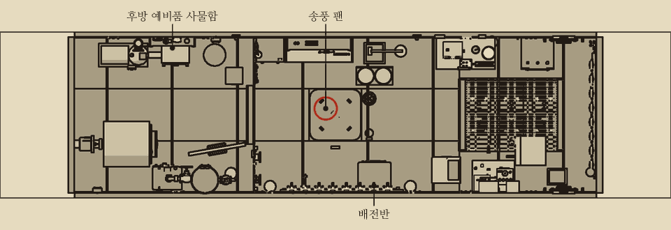
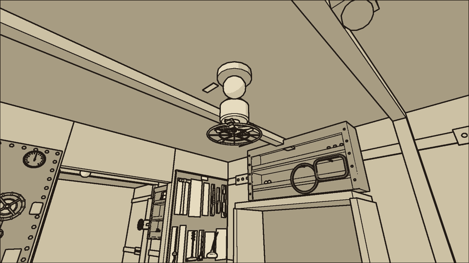
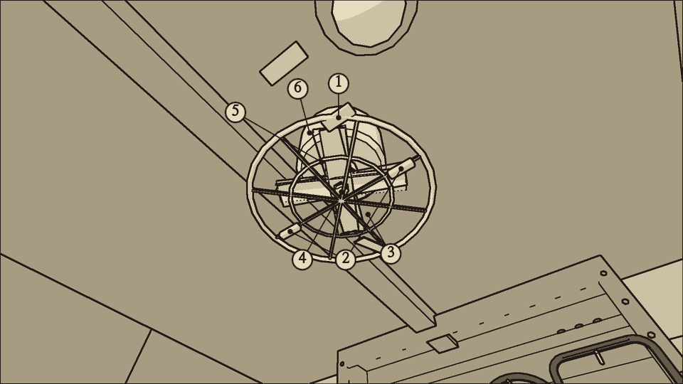
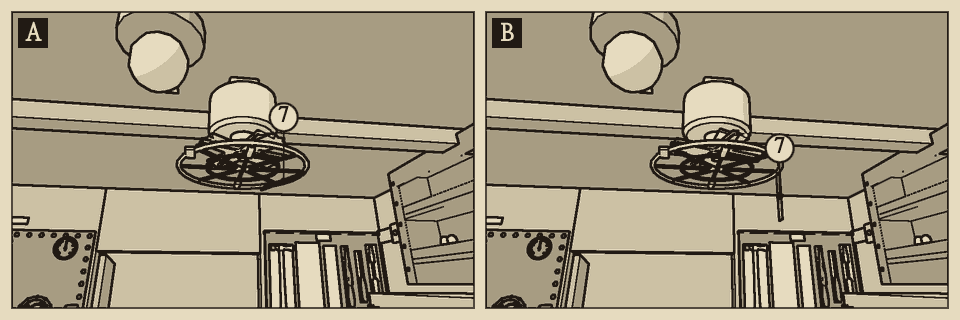
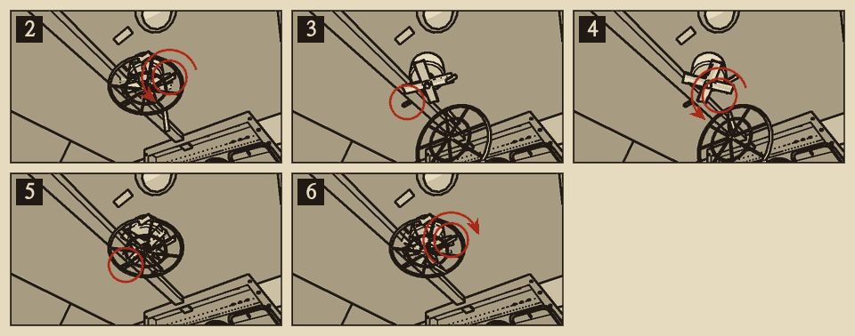
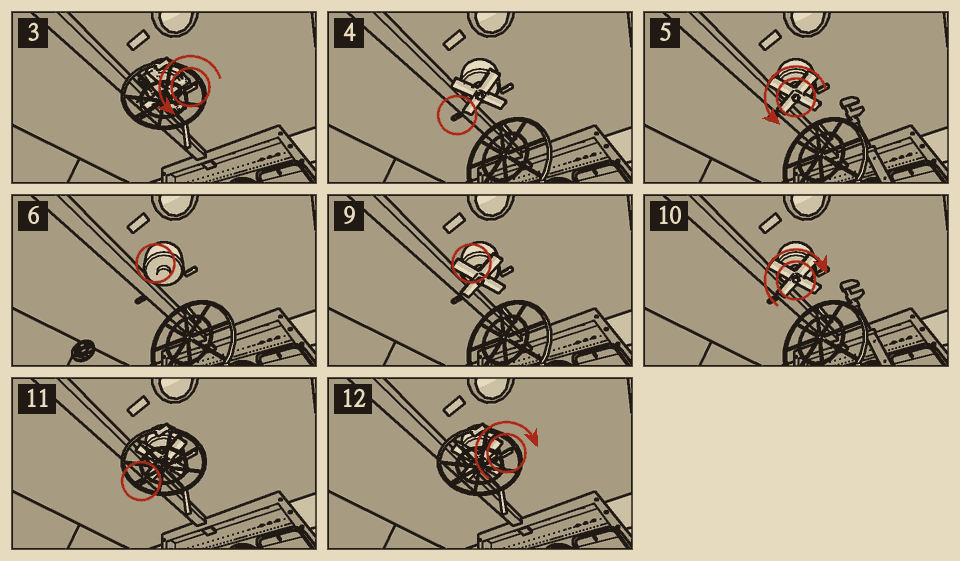

# 송풍 팬

분류: 공기 · 송풍 팬 정지 (AIR-01) · 응급 수리와 정식 수리

송풍 팬은 실내 공기를 흡수통으로 돌린다. 팬이 멎으면 흡수통이 이산화탄소를 거르지 못하고, 축전지에서 나온 염소와 수소도 빠지지 않는다.

## 이럴 때 쓴다

- 상황판 이산화탄소 계기가 오른다. 오래 두면 공기 표시등이 켜진다.
- 팬 소리가 없다. 보호망에 매단 종이 리본이 바람 없이 늘어져 있다.
- C2에 전기가 오는데 팬만 멎었다. 멎은 팬에서 낮게 웅웅거리는 소리가 난다.
- 전동기를 맨손으로 만지면 따뜻하고 떨리지 않는다. 청진기를 대면 소리가 거칠다.

## 어디에

중앙 구역 천장, 배전반과 사물함 사이 통로 위에 있다. 통로에 서서 올려다보며 작업한다.

## 무엇이 있나

| 부분 | 생김새 |
| --- | --- |
| 1 팬 보호망 | 아래를 향한 둥근 철망. 벽 쪽 테에 경첩이 있고 통로 쪽이 아래로 내려 열린다 |
| 2 보호망 나비 너트 | 보호망을 천장 받침에 물리는 너트 두 개. 빈손으로 돌린다 |
| 3 팬 날개 | 보호망 안의 네 날개. 끝을 잡고 손으로 돌릴 수 있다 |
| 4 팬 허브 너트 | 날개 한가운데의 너트. 렌치로 푼다 |
| 5 팬 베어링 | 허브 너트를 풀면 날개째 축에서 빠진다 |
| 6 송풍 팬 전동기 | 날개 위 천장에 붙은 둥근 몸통. 맨손으로 만져 볼 수 있다 |
| 7 종이 리본 | 보호망 가장자리에 매단 종이 띠. 팬이 돌면 바람에 날린다 |

## 가르기

| 확인 | 팬 정지 | C2 퓨즈 단선 | 흡수제 포화 |
| --- | --- | --- | --- |
| 팬 소리, 종이 리본 | 소리가 없고 리본이 늘어진다 | 소리가 없고 리본이 늘어진다 | 소리가 나고 리본이 날린다 |
| 멎은 팬의 웅웅 소리 | 난다 | 나지 않는다 | — |
| 산소 화로 점화기 창 | 붉게 빛난다 | 꺼져 있다 | 붉게 빛난다 |
| 전압계, C2 부하 단자 | 약 120V | 0V | 약 120V |
| 흡수통 지시약 창 | 상관없다 | 상관없다 | 보라색 |

- 점화기 창이 꺼져 있으면 '퓨즈 교체'를 먼저 한다.
- 팬이 도는데 이산화탄소가 오르면 흡수제를 의심한다. '흡수통 교체'를 본다. 이때 팬 베어링을 갈아도 이산화탄소는 내려가지 않는다.

{{procedure:proc.fan.spin}}

### 응급 수리의 수명

- 손으로 돌려 살린 팬은 약 8분 돌다가 다시 멎는다. 원인인 베어링이 그대로이기 때문이다.
- 다시 멎으면 다시 돌려 살릴 수 있다. 횟수에는 제한이 없다. 시간을 버는 동안 팬 베어링을 갈 준비를 한다.
- C2에 전기가 없거나 팬 장치가 꺼져 있으면 날개를 돌려도 곧 선다. 이때는 손을 다치지 않지만 팬도 살아나지 않는다.

{{procedure:proc.fan.bearing}}

### 끝난 뒤 확인

- 팬 소리가 돌아오고 종이 리본이 바람에 날린다.
- 산소 화로 점화기 창이 다시 붉게 빛난다.
- 이산화탄소 계기가 몇 분 안에 내려가기 시작한다.
- 전동기를 맨손으로 만지면 고르게 떨린다. 도는 팬은 늘 떨리고, 멎은 팬은 떨리지 않는다.

### 순서를 어기면

- **C2 스위치를 내리지 않고 베어링을 빼거나 넣으면 감전된다.** 잠시 손을 쓰지 못하고 몸이 상한다.
- **도는 날개나 허브에 손이나 렌치를 대면 끼인다.** 손으로 돌려 살린 팬도 돌고 있다. 베어링을 갈기 전에 반드시 C2 스위치를 내린다.
- 허브 너트를 풀어 둔 채 팬이 돌면 허브가 덜걱거린다. 팬은 약 5분 돈 뒤 다시 멎는다. 겉보기에는 고친 것과 같으므로 덜걱거리는 소리로 가린다. 소리가 나면 C2 스위치를 내려 팬을 세운다. 나비 너트를 풀어 보호망을 열고 허브 너트를 렌치로 끝까지 조인 뒤, 보호망을 닫아 나비 너트를 조이고 C2 스위치를 올린다. **도는 허브에 렌치를 대면 끼인다.**
- 이미 멎었으면 C2 스위치를 내리고 나비 너트 두 개를 풀어 보호망을 연다. 허브 너트는 이미 풀려 있으므로 날개를 베어링째 뽑아 그대로 다시 끼운다. 허브 너트를 렌치로 끝까지 조이고, 보호망을 닫아 나비 너트를 조인 뒤 C2 스위치를 올린다. 뽑은 베어링은 성한 것이므로 예비 베어링은 들지 않는다.
- 닳은 베어링을 도로 끼우면 팬은 돌지 않는다.

## 소음

| 동작 | 소음 |
| --- | --- |
| 칼날 스위치 | {{noise:switch}} |
| 나비 너트 | {{noise:latch}} |
| 보호망 열고 닫기 | {{noise:cover}} |
| 날개 돌리기 | {{noise:switch}} |
| 허브 너트 | {{noise:wrench}} |
| 베어링 빼고 끼우기 | {{noise:fuse}} |
| 사물함에서 꺼내기 | {{noise:locker}} |

조용한 수리다.
