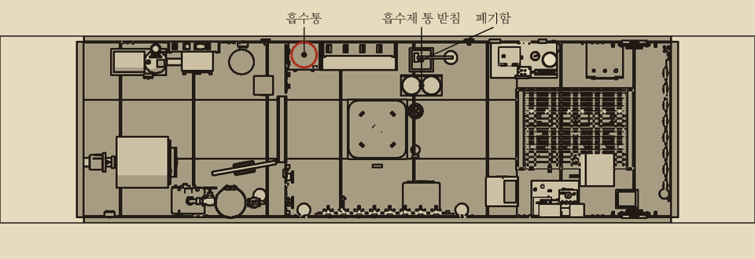
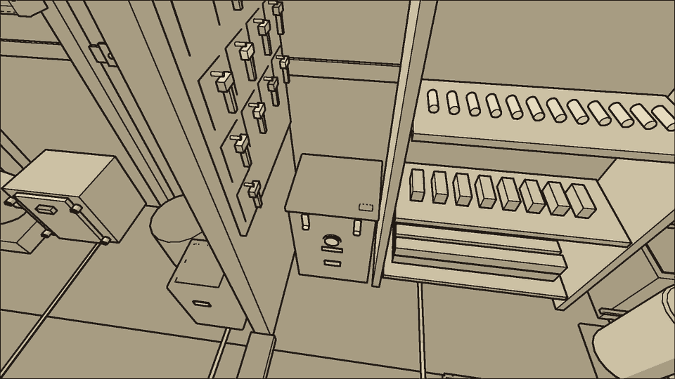
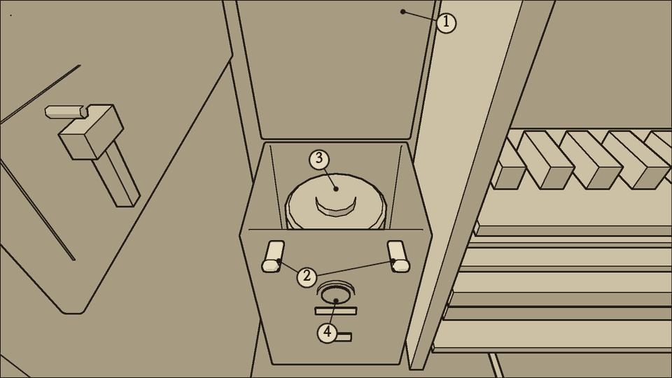
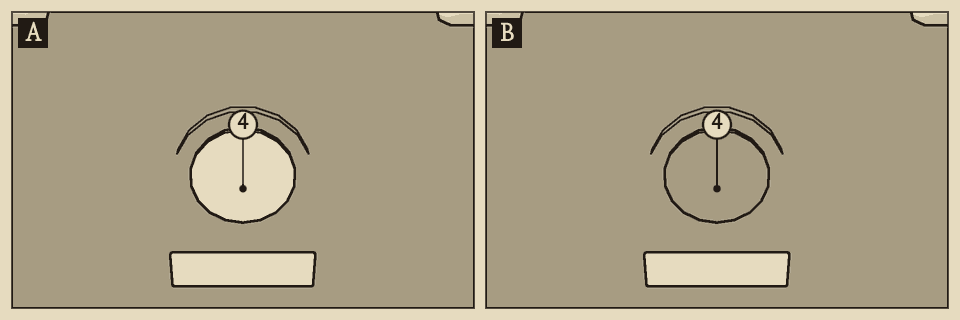
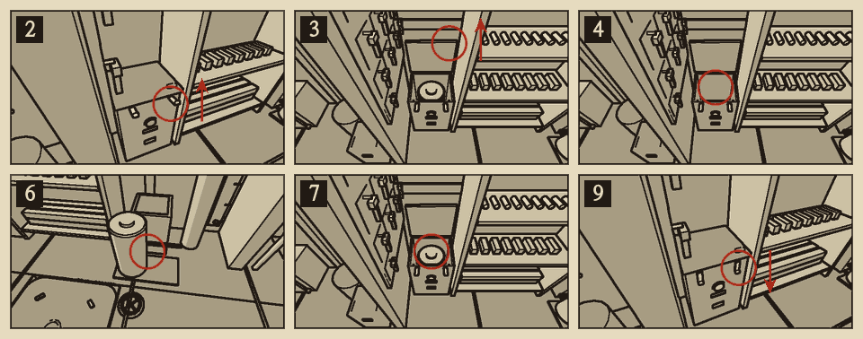

# 흡수통

분류: 공기 · 흡수제 포화 (AIR-02) · 정식 수리

흡수통은 팬이 보내는 공기에서 이산화탄소를 거른다. 흡수제 통 하나가 거르는 양은 정해져 있고, 다 차면 더 거르지 못한다. 응급 수리는 없다. 새 통으로 갈아 끼운다.

## 이럴 때 쓴다

- 팬이 돌고 종이 리본이 날리는데 상황판 이산화탄소 계기가 오른다.
- 흡수통 지시약 창이 보라색이다.
- 숨소리가 거칠어진다. 더 오르면 눈앞이 흐려진다.

## 어디에

중앙 구역 좌현 바닥, 해치 격벽 바로 앞에 있다. 공구판 아래다. 통로에 서서 내려다보며 작업한다. 예비 흡수제 통은 중앙 사물함 옆, 폐기함 앞 바닥 받침에 세워 둔다.

## 무엇이 있나

| 부분 | 생김새 |
| --- | --- |
| 1 흡수통 뚜껑 | 통 위의 철판. 벽 쪽에 경첩이 있고 앞이 들린다 |
| 2 흡수통 죔쇠 | 앞면 위쪽의 걸쇠 두 개. 위로 젖히면 열리고 아래로 누르면 잠긴다 |
| 3 흡수제 통 | 뚜껑 아래의 둥근 통. 무거워서 두 손으로 든다 |
| 4 지시약 창 | 통로 쪽 앞면의 작은 유리창. 흡수제가 찰수록 색이 변한다 |

## 지시약 색

| 창의 색 | 흡수제 | 할 일 |
| --- | --- | --- |
| 흰색 | 새것 | 없음 |
| 연보라 | 절반쯤 참 | 바닥 받침에 새 통이 있는지 확인한다 |
| 진보라 | 다 참 | 갈아 끼운다 |

## 가르기

| 확인 | 흡수제 포화 | 팬 정지 |
| --- | --- | --- |
| 팬 소리, 종이 리본 | 소리가 나고 리본이 날린다 | 소리가 없고 리본이 늘어진다 |
| 지시약 창 | 보라색 | 상관없다 |

- 팬이 멎어 있으면 흡수제가 새것이어도 이산화탄소가 오른다. '송풍 팬'을 먼저 본다.
- 흡수제 통을 갈아도 팬이 멎어 있으면 이산화탄소는 내려가지 않는다.

{{procedure:proc.canister.replace}}

### 끝난 뒤 확인

- 지시약 창이 흰색이다.
- 팬이 도는 동안 뚜껑 둘레에서 바람 새는 소리가 나지 않는다. 팬이 멎어 있으면 소리로 가릴 수 없으므로 죔쇠 두 개가 모두 아래로 눌려 있는지 눈으로 본다.
- 이산화탄소 계기가 몇 분 안에 내려가기 시작한다.
- 바닥 받침의 흡수제 통이 하나 줄었다.

### 순서를 어기면

- 죔쇠를 하나라도 열어 두면 공기가 흡수제를 비켜 간다. 팬이 돌면 뚜껑 틈에서 바람 새는 소리가 나고, 흡수량이 {{n:tuning.scrubber.bypassAbsorption|1}}배로 떨어진다. 지시약은 흰색이라 겉보기에는 고친 것과 같다. 죔쇠 두 개를 모두 아래로 눌러 잠근다.
- 뚜껑을 연 채 두면 흡수가 전혀 되지 않는다.
- 통을 빼 둔 채 뚜껑을 닫으면 흡수가 전혀 되지 않는다. 지시약 창도 비어 있어 흰색으로 보인다. 새 통이 들어 있는지 눈으로 확인한다.
- 연보라인 쓰던 통을 빼면 손에는 '다 쓴 흡수제 통'으로 들려 받침에 되돌릴 수 없다. 그 통을 도로 끼우면 빼기 전만큼 다시 거른다.
- 진보라가 된 통을 도로 끼우면 지시약은 보라색 그대로이고 이산화탄소도 계속 오른다.

## 예비품

흡수제 통은 중앙 사물함 옆, 폐기함 앞 바닥 받침에 {{stock:canister}}개 세워 둔다. 다 쓴 통은 무거워서 들고 있는 동안 도구를 쥘 수 없다. 버린 뒤에 새 통을 꺼낸다.

## 소음

| 동작 | 소음 |
| --- | --- |
| 죔쇠 | {{noise:latch}} |
| 뚜껑, 통 빼고 끼우기 | {{noise:cover}} |
| 받침에서 꺼내기 | {{noise:locker}} |

조용한 수리다.
