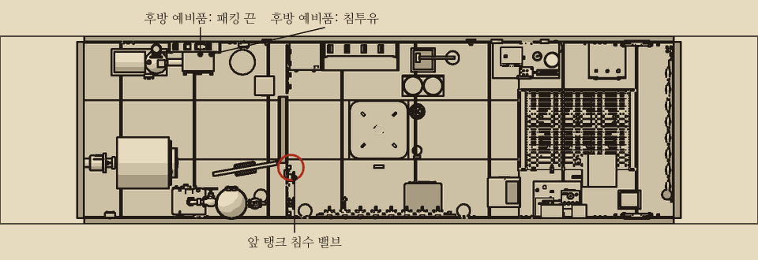
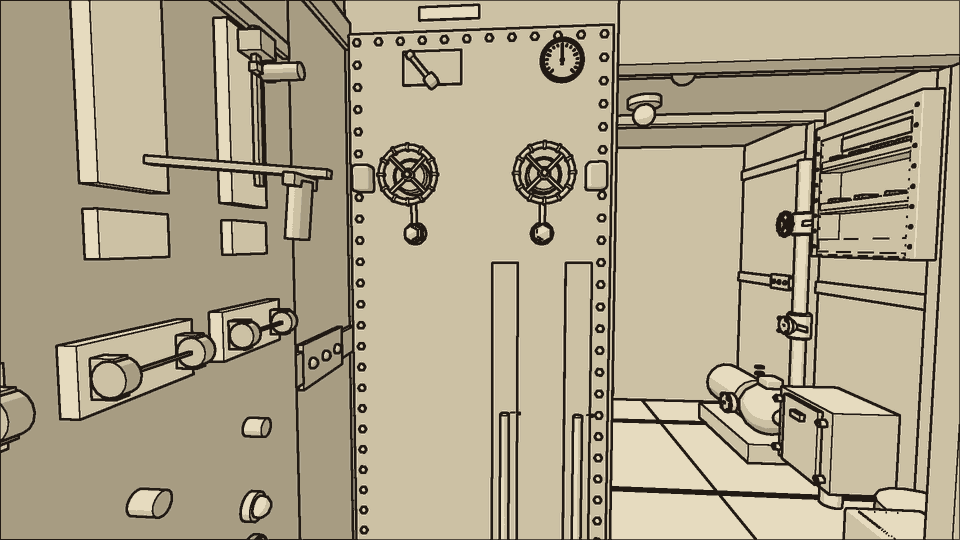
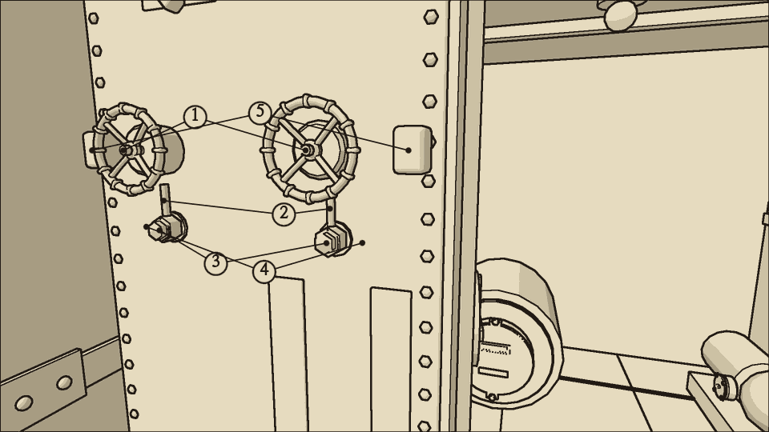
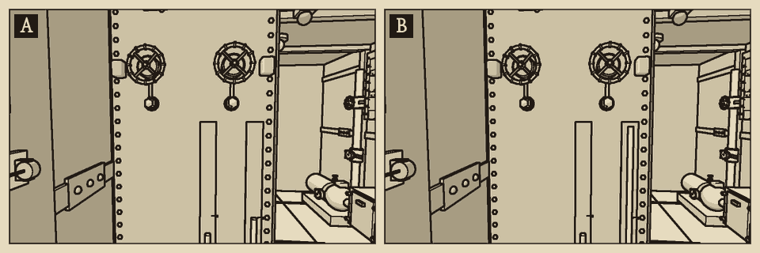
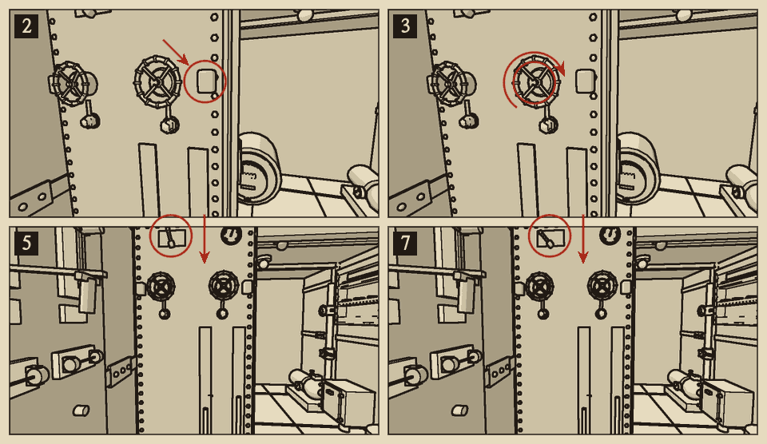
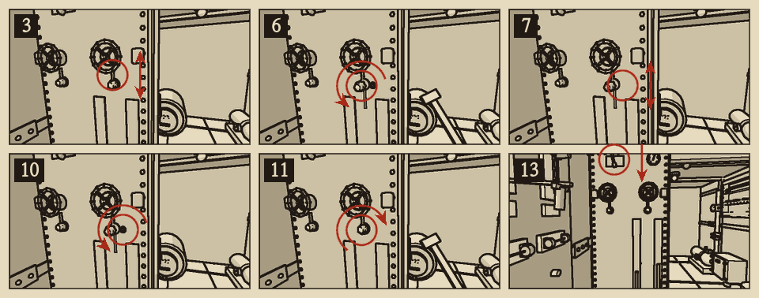

# 밸러스트 밸브

분류: 배수 · 밸러스트 밸브 고착 (WTR-04) · 응급 수리와 정식 수리

트림 탱크는 이물과 고물 바닥 밑에 하나씩 있다. 탱크마다 바닷물을 들이는 침수 밸브가 있고, 바퀴는 해치 격벽의 밸러스트 조절반에 있다. 축의 패킹이 삭으면 밸브가 열린 채 굳는다. 열린 밸브로 바닷물이 계속 들어 그 탱크가 차고 배가 그쪽으로 숙는다. 응급으로는 쇠망치로 쳐서 풀고, 정식으로는 침투유로 풀어 패킹을 새로 감는다. 어느 쪽이든 끝에 펌프로 탱크를 붉은 금까지 뺀다.

## 이럴 때 쓴다

- 경사계의 바늘이 한쪽으로 쏠린다. 앞 탱크면 이물이 숙고, 뒤 탱크면 고물이 숙는다.
- 한 탱크의 유리관이 붉은 금보다 높고 점점 오른다. 다른 탱크는 붉은 금에 있다.
- 그 탱크 쪽 바닥 밑에서 물이 콸콸 차오르는 소리가 난다. 탱크가 다 차면 소리가 멎는다.
- 기울기가 {{n:tuning.attitude.lampWarnDeg}}도를 넘으면 배수 표시등이 노랑이 되고 경보 벨이 울린다. {{n:tuning.attitude.lampFaultDeg}}도를 넘으면 빨강이 되고 벨이 다시 울린다.
- 침수 밸브 바퀴가 손으로 꿈쩍하지 않는다.
- 앞 탱크가 가득 차면 약 9도 숙는다.
- 기울기가 {{n:tuning.attitude.floorDriftFromDeg}}도를 넘으면 바닥 위 물이 낮은 쪽으로 흐른다. 이물이 숙으면 물이 축전지가 있는 전방으로 몰린다.
- 기울기가 {{n:tuning.toolBoard.rollTiltDeg}}도를 넘으면 바닥에 내려놓은 도구가 낮은 쪽으로 구른다. 선체가 삐걱거린다.

## 어디에

중앙 구역, 해치 격벽의 중앙 쪽 면 우현에 밸러스트 조절반이 있다. 통로에서 조절반을 마주 보고 설 때 위에서부터 다음이 있다.

- 맨 위 오른쪽: 경사계. 바늘이 가운데면 수평이다. 바늘이 오른쪽(앞 탱크 바퀴 쪽)으로 기울면 이물이, 왼쪽(뒤 탱크 바퀴 쪽)으로 기울면 고물이 숙은 것이다.
- 맨 위 왼쪽: 펌프 흡입 선택 레버. 네 칸이고 위에 1부터 4까지 번호가 있다.
- 그 아래 양쪽: 침수 밸브 바퀴 둘. 오른쪽이 앞 탱크, 왼쪽이 뒤 탱크다.
- 바퀴 바로 아래: 패킹 너트. 바퀴 바깥 옆: 밸브 몸통의 돌기.
- 아래쪽 오른쪽: 탱크 유리관 둘. 앞 탱크 바퀴 아래에 나란히 있고, 바깥쪽(오른쪽)이 앞 탱크다. 유리관 밑 명판에는 '전방 탱크', '후방 탱크'라고 적혀 있다. 붉은 금이 정상 수위다.

## 무엇이 있나

| 이름 | 하는 일 |
| --- | --- |
| 1 침수 밸브 바퀴 | 시계 방향으로 닫고 반시계 방향으로 연다. 끝까지 여는 데 네 바퀴 |
| 2 침수 밸브 축 | 바퀴 밑에서 몸통으로 들어가는 축. 침투유를 바르는 곳 |
| 3 패킹 너트 | 축 둘레의 패킹을 누른다. 렌치로 4분의 1바퀴가 한 칸이다. 0칸(다 풀림)부터 다섯째 칸까지 있고 제자리는 셋째 칸이다 |
| 4 침수 밸브 패킹 | 패킹 너트 안의 패킹 끈. 너트를 다 풀어야 손이 닿는다 |
| 5 밸브 몸통의 돌기 | 굳은 밸브를 쇠망치로 치는 곳 |
| 탱크 유리관 | 탱크의 물 높이. 붉은 금이 정상 수위({{n:tuning.attitude.tankNominalL}}L) |
| 경사계 | 배의 기울기 |
| 펌프 흡입 선택 레버 | 전동 배수 펌프가 어디서 빨지 고른다 |

### 펌프 흡입 선택 레버

| 칸 | 이름 | 펌프가 빠는 곳 | 배수량 |
| --- | --- | --- | --- |
| 1 | 빌지 | 후방 빌지 (평소 자리) | 분당 {{lpm:tuning.water.pumpRatedLps}}L |
| 2 | 앞 탱크 | 앞 트림 탱크 | 분당 약 96L |
| 3 | 뒤 탱크 | 뒤 트림 탱크 | 분당 약 96L |
| 4 | 챔버 | 케이블 챔버 | 분당 {{lpm:tuning.suction.chamberLineLps}}L 이하 |

- 레버는 빈손으로 한 칸씩 끌어 옮긴다. 빌지에서 챔버로 가려면 세 칸을 옮긴다.
- 레버가 빌지가 아닌 칸에 있는 동안에는 빌지의 물이 빠지지 않는다. 펌프 소리는 정상이고 배수량 계기는 분당 약 96L(챔버면 그보다 적게)를 가리키는데 빌지 수위가 오른다.
- 고른 탱크가 비면 펌프가 공기를 빨아 헛돈다. 펌프 전류가 약 1.0A로 떨어지고 배수량이 0이 된다.
- 흡입 거름망은 모든 칸에 함께 걸린다. 거름망이 막히면 탱크도 빠지지 않는다.

## 가르기

| 경우 | 경사계 | 탱크 유리관 | 바닥 위 물 | 침수 밸브 바퀴 |
| --- | --- | --- | --- | --- |
| 침수 밸브 고착 | 한쪽으로 쏠린다. 앞 탱크가 차면 약 9도 | 그 탱크만 붉은 금 위. 계속 오른다 | 없거나 낮은 쪽에 조금 | 꿈쩍하지 않는다 |
| 한쪽 구역의 침수 | 물이 고인 쪽으로 조금 쏠린다 | 둘 다 붉은 금 | 그 구역에 고인다. 구역 경고등 | 손으로 돈다 |
| 흡입 선택 레버를 탱크에 둠 | 뺀 탱크 반대쪽으로 쏠린다 | 뺀 탱크가 붉은 금 아래 | 빌지가 차오른다 | 손으로 돈다 |

- 기울기는 탱크 유리관 둘과 바퀴로 가른다. 한 탱크만 붉은 금 위이고 그 바퀴가 꿈쩍하지 않으면 침수 밸브 고착이다. 탱크가 둘 다 붉은 금에 있고 한 구역 바닥에 물이 고여 있으면 그 구역의 침수다. '침수 대응'을 본다.
- 바닥 위와 빌지의 물도 배를 기울이지만 탱크보다 덜하다. 전방이나 후방 바닥, 후방 빌지에 100L가 고일 때마다 약 1도, 전중 빌지는 약 0.5도다. 중앙 구역 바닥 위의 물은 기울이지 않는다. 9도쯤 기울었는데 바닥이 말라 있으면 탱크를 먼저 본다.

{{procedure:proc.ballast.hammer}}

{{procedure:proc.ballast.repack}}

## 끝난 뒤 확인

- 경사계의 바늘이 가운데로 돌아온다. 기울기가 {{n:tuning.attitude.lampWarnDeg}}도 안이면 배수 표시등이 꺼진다.
- 두 탱크 유리관이 붉은 금에 있다.
- 흡입 선택 레버가 첫째 칸(빌지)에 있다.
- 정식 수리 뒤: 침수 밸브 바퀴가 손으로 돈다. 축 둘레가 말라 있다. 패킹 너트가 셋째 칸이다.

## 위험

- **물 분출**: 침수 밸브가 열린 채로 패킹 너트를 다 풀거나 패킹에 손을 대면 바닷물이 뿜어 나와 몸을 친다. 잠시 몸을 못 가누고 물 {{n:tuning.crew.hazards.spray.burstL}}L가 쏟아진다. 든 도구를 떨어뜨린다. 바퀴를 끝까지 닫은 뒤 너트를 푼다.
- **쇠망치 소리**: 한 번 칠 때마다 소음 {{noise:hammer}}. 세 번 친다. 소리가 선체 밖으로 퍼진다.
- **흡입 선택 레버를 탱크에 둔 채 잊으면** 빌지가 차오르고 축전지가 잠긴다.

## 순서를 어기면

- **패킹 너트를 둘째 칸 이하로 조이면** 축 둘레로 물이 조금씩 배어 나온다. 수심 100m에서 분당 약 2.4L로 구역 경고등이 켜지지 않을 만큼 적어 다 고친 것처럼 보인다. 수심 약 150m보다 깊으면 중앙 구역 경고등이 켜진다. 축 둘레가 젖어 번들거린다. 배수 펌프가 서 있으면 전중 빌지가 천천히 오른다. 너트를 셋째 칸까지 마저 조이면 그친다.
- **패킹 너트를 다섯째 칸까지 조이면** 너트가 축을 문다. 바퀴는 한 번 돌아가지만 그 뒤 다시 꿈쩍하지 않는다. 너트를 셋째 칸으로 되돌린 뒤 다시 침투유로 푼다.
- **침투유를 바르고 {{n:fixtures.ballast.soakS}}초를 기다리지 않으면** 바퀴는 아직 꿈쩍하지 않는다.
- **패킹을 갈지 않으면** 침투유로 푼 밸브도 10분이 지나면 다시 굳는다. 바퀴를 한 번 돌릴 때마다 남은 시간이 약 3분 20초 준다. 새 패킹을 다 감으면 축이 풀리고 다시 굳지 않는다.
- **탱크를 빼지 않으면** 밸브를 닫아도 기울기는 그대로다. 밸브는 물이 더 드는 것만 막는다.
- **엉뚱한 탱크의 밸브를 손보면** 고장은 그대로 남는다. 탱크 유리관으로 어느 탱크인지 먼저 본다.

## 응급 수리의 수명

- 쇠망치로 푼 밸브는 10분이 지나면 다시 굳는다. 바퀴를 한 번 돌릴 때마다 수명이 약 3분 20초 준다. 닫는 데 한 번을 쓰므로 닫은 뒤에는 약 6분 40초나 바퀴 두 번이 남는다.
- 다시 굳으면 바퀴는 그때 자리에서 굳는다. 닫아 두었으면 탱크에 물이 더 들지 않는다.
- 다시 굳어도 쇠망치로 또 풀 수 있다. 그때마다 소리가 난다.
- 침투유는 {{stock:penetrating_oil}}병이다. 다 쓰면 쇠망치로 버틴다.

## 알아 둘 것

- 쇠망치와 패킹 갈고리는 공구판에 걸려 있다. 공구띠에 빈 칸이 없으면 쓰지 않는 도구 하나를 공구판에 걸고 가져온다.
- 침투유와 패킹 끈은 후방 예비품 사물함에 있다. 패킹 끈은 축 패킹과 같은 끈이다.
- 패킹 너트를 다 풀면 밸브가 닫혀 있어도 축 둘레로 물이 샌다(수심 100m에서 분당 약 3.6L). 중앙 구역 경고등과 선체 노랑이 켜지고 벨이 울린다. 너트를 다시 조이면 꺼진다. 서둘러 감는다.
- 앞 탱크를 붉은 금까지 빼는 데는 가득 찼을 때 1분 30초쯤 걸린다.
- 기울어 있는 동안 바닥에 도구를 내려놓지 않는다. {{n:tuning.toolBoard.rollTiltDeg}}도를 넘으면 {{n:tuning.toolBoard.rollSeconds}}초마다 한 구역씩 낮은 쪽으로 구른다. 구른 도구는 낮은 쪽 바닥에서 줍는다.

## 소음

| 동작 | 소음 |
| --- | --- |
| 쇠망치로 한 번 치기 | {{noise:hammer}} |
| 바퀴 한 바퀴 | {{noise:valve}} |
| 패킹 너트 한 칸 (렌치) | {{noise:wrench}} |
| 패킹 끌어내기 | {{noise:hook}} |
| 패킹 끈 감기 | {{noise:wrap}} |
| 침투유 바르기 | {{noise:oil}} |
| 흡입 선택 레버 한 칸 | {{noise:lever}} |

침수 밸브 망치로 풀기는 시끄러운 수리다. 침수 밸브 침투유로 풀고 패킹 다시 감기는 조용한 수리다.
