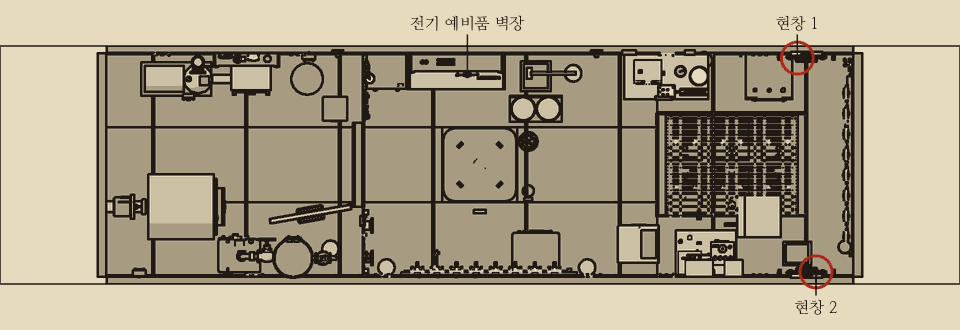
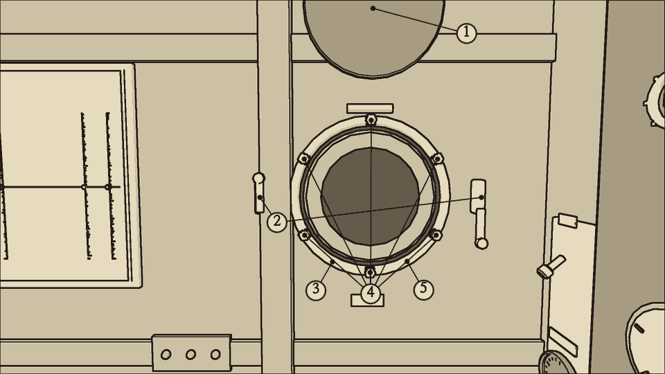
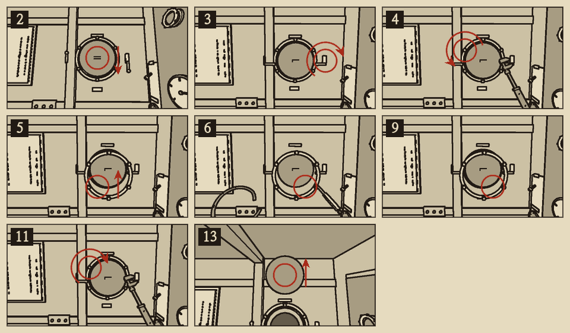
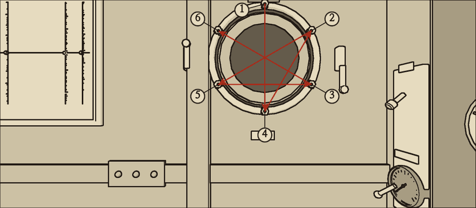

# 현창 밀봉

분류: 선체 · 현창 밀봉 열화 (HUL-02) · 정식 수리 (응급 수리 없음)

전방 끝벽 좌우에 현창이 하나씩 있다. 두꺼운 유리를 고무 밀봉이 둘러싸고, 테가 볼트 여섯 개로 밀봉을 눌러 둔다. 안쪽에는 경첩 달린 쇠 덮개가 있고, 걸쇠 두 개로 덮개를 유리에 붙여 잠근다. 평소에는 덮개를 열어 둔다.

## 이럴 때 쓴다

- 선체 표시등이 노랑이고 전방 구역 경고등이 켜졌다.
- 현창 유리 테 둘레에 물방울이 맺혀 흘러내린다. 이음새에서 뿜는 물줄기가 아니다.
- 현창 쪽에서 물이 졸졸 흐르는 소리가 나고 유리가 이따금 똑 하고 운다. 쉿 소리는 나지 않는다.
- 수심 300m에서 분당 약 10L가 들어온다.

## 어디에

전방 구역 끝벽, 눈높이의 좌현(1번)과 우현(2번). 1~4번 리벳 이음과 가깝다.

## 무엇이 있나

| 이름 | 하는 일 |
| --- | --- |
| 1 덮개 | 유리 안쪽의 쇠 덮개. 위쪽 경첩에 달려 있다. 아래로 끌어내려 닫고, 밀어 올려 연다 |
| 2 걸쇠 1, 2 | 덮개 아래쪽 좌우의 나비 걸쇠. 손으로 돌려 조인다. 덮개를 닫아야 걸린다 |
| 3 테 | 유리 둘레의 놋쇠 테. 밀봉을 눌러 둔다 |
| 4 테 볼트 1~6 | 테를 붙드는 볼트 여섯 개. 1번이 위, 시계 방향으로 2~6번이다 |
| 5 밀봉 | 유리 둘레의 고무 띠. 칼로 도려내어 뽑는다 |

## 가르기

| 새는 곳 | 보이는 것 | 소리 | 이 쪽의 조치 |
| --- | --- | --- | --- |
| 현창 유리 테 둘레 | 테에서 물방울이 맺혀 흘러내린다 | 졸졸 흐르는 소리, 유리가 똑 하고 운다 | 이 쪽 |
| 리벳 이음 (1~4번) | 이음새에서 물줄기가 뿜는다 | 쉿 소리. 이음새 쪽에서 난다 | 리벳 이음 응급 막기, 리벳 이음 코킹 |

- 쐐기와 버팀목은 현창에 맞지 않는다. 리벳 이음이 아니기 때문이다.

## 덮개를 닫으면

- 덮개를 닫고 걸쇠 둘을 조이면 **밀봉이 더 상하지 않는다.** 새는 양은 그대로다. 들어온 물은 빌지로 모이므로 배수로 버틴다.
- 덮개를 열어 둔 현창의 상한 밀봉은 점점 더 상한다. **그대로 두면 약 30분 뒤 유리에 금이 간다.** 금 간 유리로는 분당 200L가 넘게 들어온다. 침수 위기다.
- 유리에 금이 갔으면 바로 덮개를 닫고 걸쇠 둘을 조인다. 덮개가 금 간 유리를 붙잡는다. 그래도 수심 300m에서 분당 약 30L가 새어 처음의 세 배쯤 된다. 밀봉을 갈아도 금 간 유리는 그대로이므로 덮개를 다시 열지 않는다. 이 판에는 유리를 가는 절차가 없다. 덮개를 닫은 채 배수로 버틴다.
- 응급 수리는 없다. 덮개를 닫는 것은 밀봉 교체의 첫 단계이기도 하다.

{{procedure:proc.viewport.reseal}}

### 들어오는 물

- 덮개를 닫고 걸쇠 둘을 조였으면 테 볼트를 풀어도 바닷물이 더 들지 않는다. 덮개가 막는다.
- 덮개를 열어 둔 채 테 볼트를 풀면 수심 300m에서 볼트 하나마다 분당 약 8L씩 더 뿜어 든다. 여섯 개를 다 풀고 테까지 떼면 분당 약 70L가 더 든다. 첫 볼트를 풀 때 물이 뿜어 나와 몸을 친다.
- 밀봉은 전기 예비품 벽장에 {{stock:viewport_seal}}개 있다. 헌 밀봉은 다시 쓰지 않는다.

## 끝난 뒤 확인

- 덮개를 열었을 때 유리 테 둘레가 마른 채로 있고 전방 경고등이 꺼지면 맞다.
- 선체 표시등도 꺼진다.

## 순서를 어기면

- **테 볼트를 1, 4, 2, 5, 3, 6 순서로 조이지 않으면 밀봉이 한쪽으로 몰린다.** 경고등은 꺼지고 다 고친 듯 보인다. 그러나 유리 테에서 물방울이 계속 맺히고, 분당 약 2L가 들어온다. 경고등이 켜질 만큼은 아니다.
- 다시 하려면 덮개를 닫고 걸쇠를 조인 뒤 테 볼트 여섯을 다 풀고 순서대로 조인다. 밀봉은 그대로 써도 된다.

## 소음

| 동작 | 소음 |
| --- | --- |
| 덮개 열고 닫기, 테 떼기 | {{noise:cover}} |
| 걸쇠 | {{noise:latch}} |
| 테 볼트 하나 (렌치) | {{noise:wrench}} |
| 밀봉 도려내기 | {{noise:scrape}} |

가장 큰 소리는 밀봉 도려내기 {{noise:scrape}}이다. 조용한 수리다.
