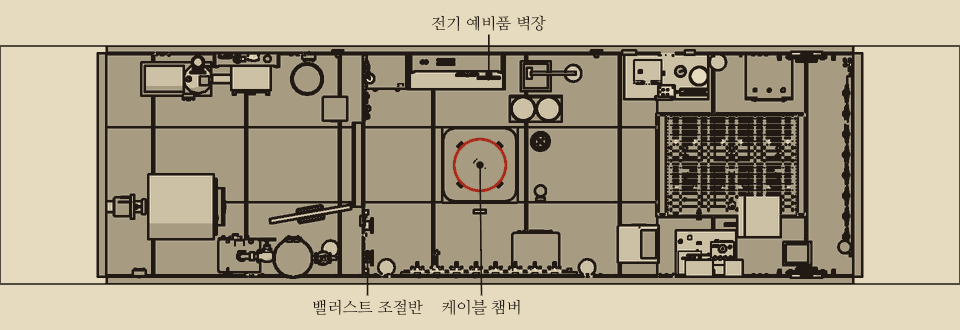
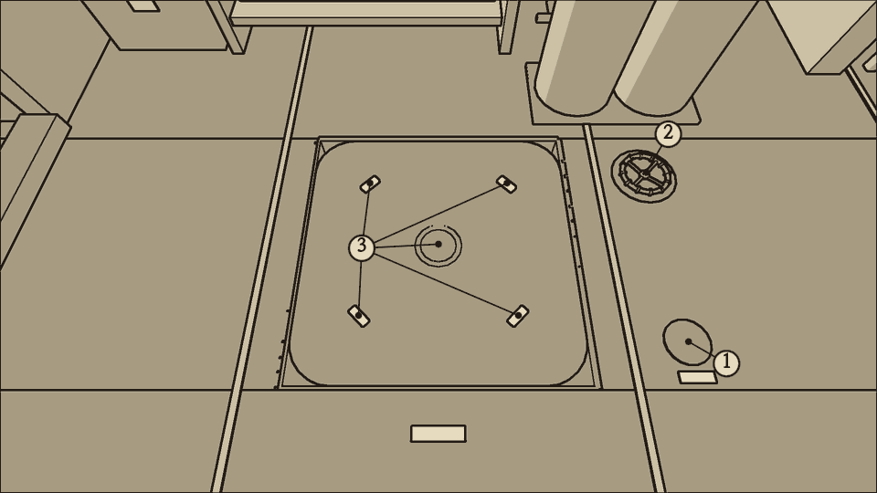
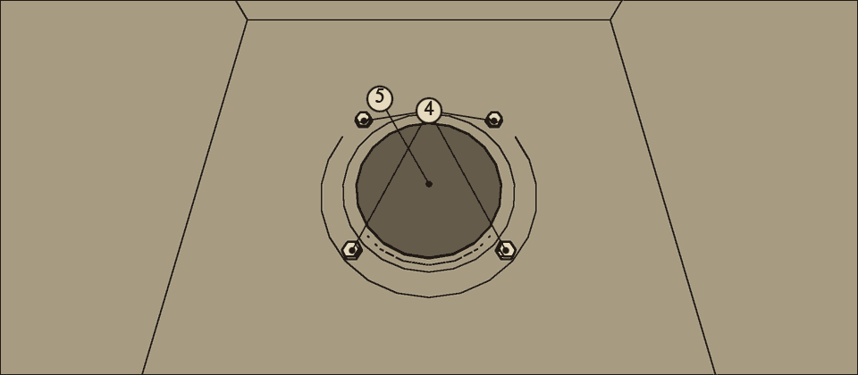
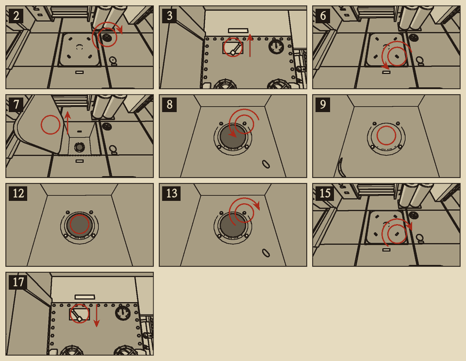
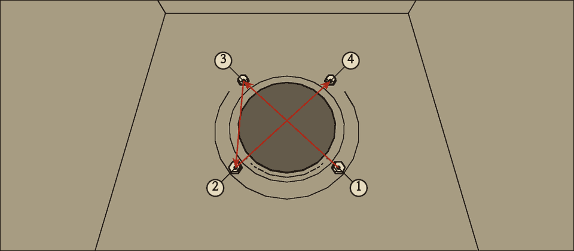

# 케이블 챔버 바깥 문

분류: 선체 · 케이블 챔버 바깥 문 밀봉 (HUL-04) · 정식 수리 (응급 수리 없음)

케이블 챔버는 중앙 구역 바닥 아래의 작은 방이다. 바닥에는 안쪽 해치가, 선체 쪽에는 바다로 열리는 바깥 문이 있다. 바깥 문은 밀봉 띠와 누름쇠 나사 네 개로 막혀 있다. 챔버에 든 물은 펌프 흡입 선택 레버의 '챔버' 칸으로만 뺀다. 바깥 문으로 케이블을 내보내는 일은 이 판에 없다.

## 이럴 때 쓴다

- 챔버 수위 유리가 오른다. 흡입 선택 레버를 '챔버' 칸에 두고 배수 펌프를 돌려도 수위가 그대로이거나 더 오른다.
- 중앙 바닥 아래에서 꾸르륵 물이 드는 소리가 난다.
- 상황판 표시등과 구역 경고등은 켜지지 않는다. 챔버에는 감지기가 없다. 수위 유리를 때때로 본다.
- 안쪽 해치를 열려 하면 수압에 눌려 열리지 않는다.

## 어디에

중앙 구역 바닥 가운데. 해치는 걸쇠 네 개로 잠긴 둥근 판이다. 해치 옆 바닥에 조임 바퀴와 챔버 수위 유리가 바닥과 같은 높이로 박혀 있다. 밀봉 누름쇠는 챔버 안 바깥 문 둘레에 있고, 해치를 열고 웅크려 들어가야 손이 닿는다.

## 무엇이 있나

| 이름 | 하는 일 |
| --- | --- |
| 1 챔버 수위 유리 | 챔버에 든 물의 양을 L로 가리킨다 |
| 2 조임 바퀴 | 바깥 문을 문틀에 누른다. 시계 방향으로 세 번 돌리면 끝까지 조여진다 |
| 3 안쪽 해치와 걸쇠 1~4 | 챔버로 들어가는 바닥 해치. 걸쇠 네 개를 다 풀어야 열린다 |
| 4 밀봉 누름쇠 나사 1~4 | 바깥 문 둘레의 누름쇠를 붙드는 나사. 1번이 위, 시계 방향으로 2~4번이다 |
| 5 밀봉 | 바깥 문 둘레의 고무 띠 |

## 챔버의 물

| 때 | 드는 양 (수심 300m, 대략값) |
| --- | --- |
| 상한 밀봉 | 분당 약 60L |
| 조임 바퀴를 끝까지 조였을 때 | 분당 약 18L |
| 밀봉을 빼 둔 동안 (조임 바퀴를 조인 채) | 분당 약 36L |
| 새 밀봉 | 거의 없다 |

- 챔버 줄은 분당 {{lpm:tuning.suction.chamberLineLps}}L까지만 뺀다. 상한 밀봉으로 드는 물을 따라잡지 못한다. 그래서 조임 바퀴를 먼저 조인다.
- **안쪽 해치는 챔버 수위가 {{n:tuning.chamber.sillL}}L 넘으면 수압에 눌려 열리지 않는다.** 수위 유리가 그 아래로 내려갈 때까지 뺀다.
- 해치를 열면 남은 물이 전중 빌지로 넘친다. 축전지가 있는 칸이다. 수위를 충분히 내린 뒤 연다.
- 흡입 선택 레버를 '챔버' 칸에 둔 동안 펌프는 빌지를 퍼내지 않는다. 일이 끝나면 '빌지'로 되돌린다.

{{procedure:proc.chamber.reseal}}

## 끝난 뒤 확인

- 흡입 선택 레버를 '빌지' 칸으로 되돌린 뒤 몇 분 동안 챔버 수위 유리가 오르지 않으면 맞다.
- 꾸르륵 소리가 그친다.

## 순서를 어기면

- **누름쇠 나사를 1, 3, 2, 4 순서로 조이지 않으면 밀봉이 한쪽으로 몰린다.** 경고는 없다. 챔버가 분당 약 5L씩 천천히 다시 찬다.
- 다시 하려면 챔버 물을 빼고 해치를 열어 나사 네 개를 다 푼 뒤 순서대로 조인다. 밀봉은 그대로 써도 된다.
- 안쪽 해치를 열어 둔 동안에는 챔버에 드는 물이 모두 전중 빌지로 넘친다. 이때는 챔버 줄로 물이 빠지지 않는다. 일을 마치면 곧바로 해치를 닫고 걸쇠 네 개를 조인다.

## 소음

| 동작 | 소음 |
| --- | --- |
| 조임 바퀴 한 번 | {{noise:valve}} |
| 해치 열고 닫기 | {{noise:hatch}} |
| 걸쇠 | {{noise:latch}} |
| 누름쇠 나사 (드라이버) | {{noise:screwdriver}} |

가장 큰 소리는 해치 {{noise:hatch}}이다. 조용한 수리다.
