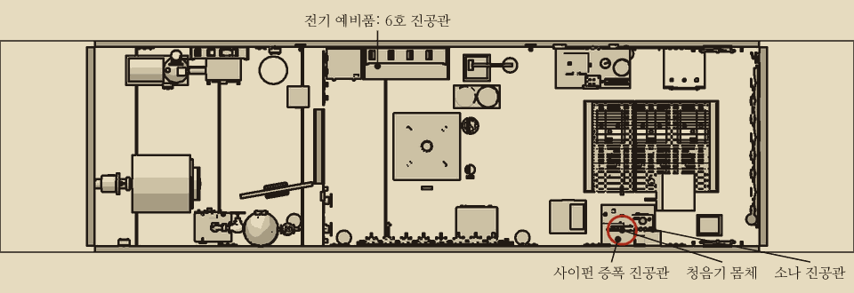
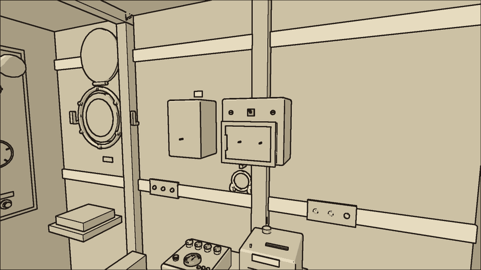
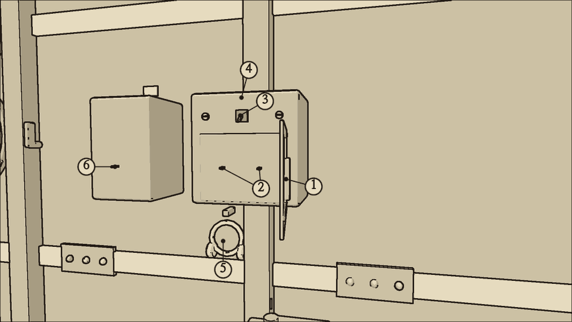
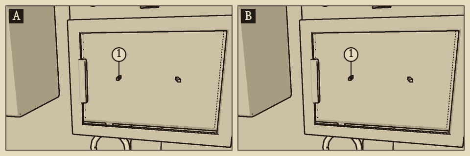
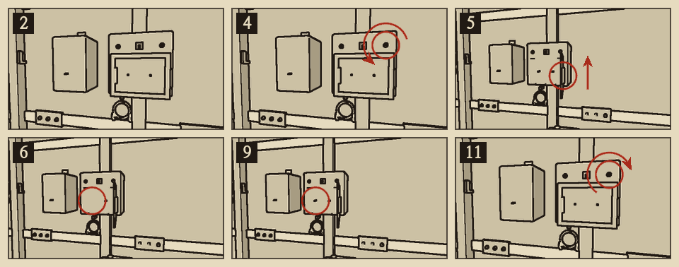
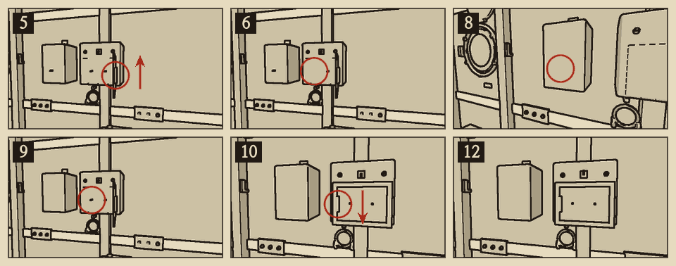

# 청음기 진공관

분류: 감각 · 청음기 진공관 소손 (SNS-03) · 정식 수리

청음기는 바깥 물소리를 증폭해 헤드폰으로 들려준다. 증폭기에는 6호 진공관이 두 개 있다. 소나 발신기에 하나, 사이펀 기록기 증폭기에 하나가 더 있다. 네 관은 모두 같은 6호 관이라 서로 바꿔 끼울 수 있다.

진공관이 빠졌거나 필라멘트가 끊기면 그 장비는 작동하지 않는다. 필라멘트가 약해진 관은 장비를 켜 둔 동안 점점 더 약해지다가 5분 남짓 지나면 끊긴다.

## 이럴 때 쓴다

- 헤드폰의 쉬익거리는 잡음이 점점 커진다.
- 잡음이 커지다가 소리가 아예 끊긴다. 이때 상황판 감각 표시등이 노랑으로 켜진다.
- 청음기 문 유리 너머로 보면 한 관의 필라멘트가 흐리거나 꺼져 있고, 다른 관은 주황빛으로 빛난다.

## 어디에

전방 구역 우현 벽, 통신 책상 위. 벽을 마주 보고 왼쪽이 소나 발신기, 오른쪽이 청음기다. 헤드폰은 청음기 아래 걸이에 걸려 있다. 사이펀 기록기의 증폭 진공관은 책상 위 기록기 뒤에 있다.

## 무엇이 있나

- **청음기 문**: 유리창이 달린 문. 나사 두 개로 닫혀 있다. 드라이버로 나사를 풀고 왼쪽 손잡이를 당겨 연다. 닫힌 채로도 유리 너머로 필라멘트가 보인다.
- **진공관 1, 2**: 문 안쪽의 소켓에 가로로 꽂혀 있다. 왼쪽이 1번이다.
- **청음기 전원 스위치**: 문 위, 두 나사 사이의 작은 토글 스위치. 올리면 켜지고 내리면 꺼진다.
- **청음기 몸체**: 켜 둔 동안 진공관의 열로 뜨겁다. 손을 대 보면 데워진 정도를 안다.
- **헤드폰**: 청음기 아래 걸이에 있다. 집어 쓰면 청음기 소리가 크게 들린다.
- **소나 진공관**: 소나 발신기 앞면에 드러나 있다.
- **사이펀 증폭 진공관**: 통신 책상 위, 사이펀 기록기 뒤에 서 있다.

## 가르기

| 보이는 것 | 의심 | 결정적 확인 |
| --- | --- | --- |
| 청음기 잡음이 커지거나 소리가 없다. 상황판은 켜져 있다 | 청음기 진공관 소손 | 한 필라멘트만 흐리거나 꺼져 있다 |
| 청음기 소리가 없고 상황판도 꺼졌다 | C4 퓨즈 | 배전반 C4. 두 필라멘트가 모두 꺼져 있다 |
| 청음기와 다른 장비가 함께 약하다 | 전압 저하 | 상황판 전압 계기. 청음기는 {{v:devices.hydrophone.minVoltage}}V 아래에서 멎는다 |

{{procedure:proc.tube.replace}}

{{procedure:proc.tube.salvage}}

## 진공관 바꿔 끼우기

- 사물함의 6호 진공관은 {{stock:vacuum_tube}}개뿐이다. 다 쓰면 덜 급한 장비에서 성한 관을 빼 쓴다. 바꿔 끼울 수 있는 관은 '예비품 사물함'의 진공관 표에 있다.
- 사이펀 기록기의 관을 빼서 쓸 때는 배전반의 C6 스위치를 먼저 내린다. **C6가 살아 있는 채로 뽑거나 꽂으면 감전된다.** C6에는 윈치도 물려 있다. 관을 뺀 기록기는 C6를 다시 올려도 테이프만 흐르고 신호를 그리지 않는다(기록 줄이 곧다). 케이블 표시등이 노랑으로 켜진다. 테이프가 멈추는 것은 C6가 죽었을 때다.
- 소나의 관을 뺀 뒤에는 소나가 발신하지 못한다.
- 성한 소켓에서 뺀 관은 손에 든 그대로 새 관이다. 필라멘트가 흐리거나 끊긴 관은 뽑으면 탄 진공관으로 손에 남는다.

## 끝난 뒤 확인

- 청음기를 켜면 두 필라멘트가 함께 주황빛으로 빛난다.
- 헤드폰의 쉬익거리는 잡음이 가라앉는다.
- 상황판 감각 표시등이 꺼진다.

## 흔한 실수

- 성한 관을 바꿔 끼우면 약한 관은 그대로 남는다. 필라멘트를 먼저 보고 흐린 관을 고른다.
- 탄 진공관을 다시 꽂아도 청음기는 작동하지 않는다.
- 탄 진공관을 쥔 채로는 새 관을 꺼낼 수 없다. 먼저 버린다.

## 위험

- **감전**: 청음기를 켠 채로 진공관을 뽑거나 꽂으면 감전된다. 잠시 손을 전혀 쓰지 못하고 몸이 상한다.
- **화상**: 켜 둔 청음기의 진공관은 손을 댈 수 없을 만큼 뜨겁다. 끈 뒤 1분쯤 지나면 따뜻한 정도로 식는다. 몸체가 {{n:fixtures.senses.burnC}}°C 이상일 때 관을 뽑으면 손을 덴다. 만져 보아 따뜻하다고 느껴질 때까지 기다린다.

## 소음

| 동작 | 소음 |
| --- | --- |
| 나사 풀기, 조이기 | {{noise:screwdriver}} |
| 문 열기, 닫기 | {{noise:cover}} |
| 진공관 뽑기, 꽂기 | {{noise:fuse}} |
| 사물함에서 꺼내기 | {{noise:locker}} |

조용한 수리다.
