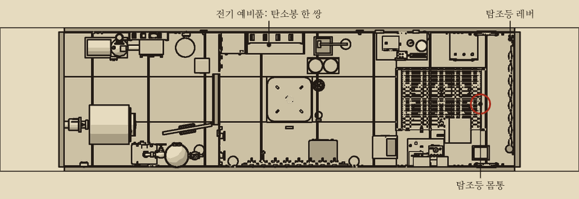
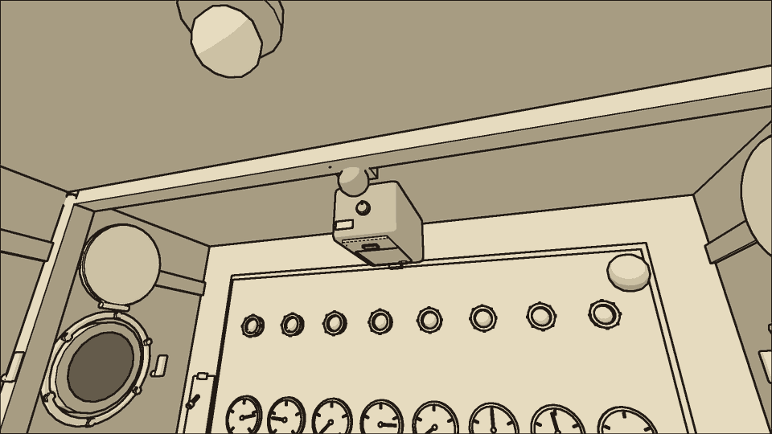
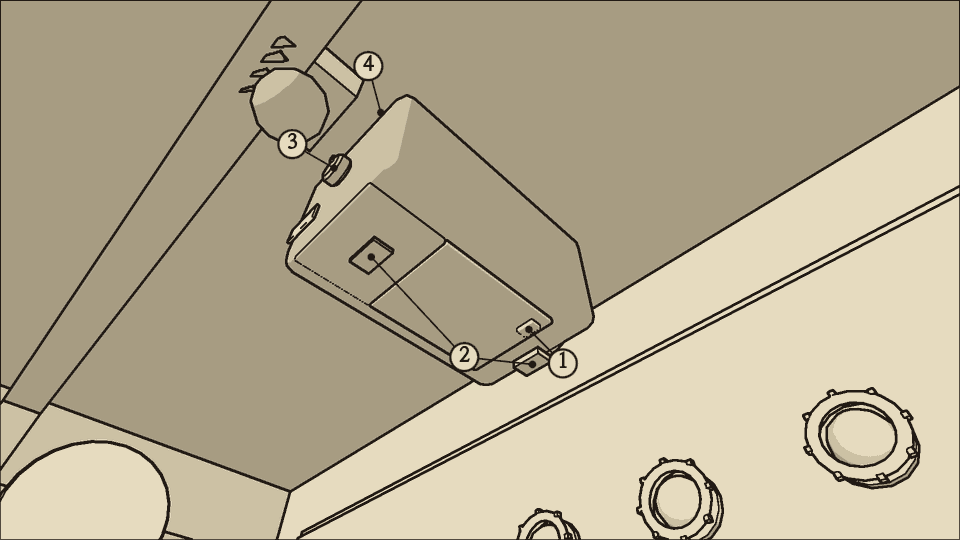
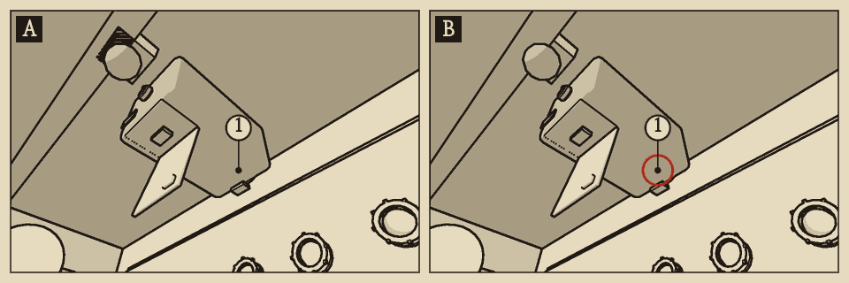
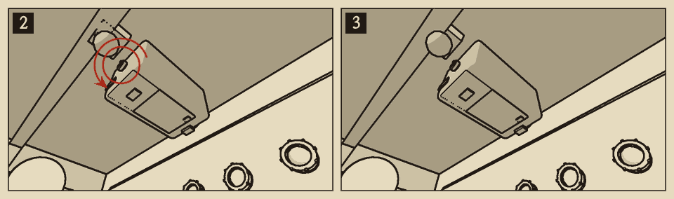
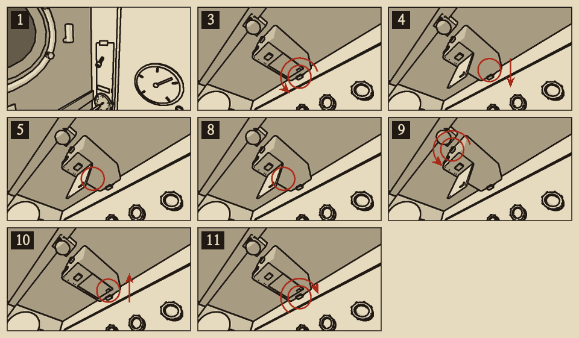

# 탐조등 탄소봉

분류: 감각 · 탐조등 탄소봉 소모 (SNS-04) · 응급 수리, 정식 수리

탐조등은 두 탄소봉 끝 사이에 아크를 일으켜 빛을 낸다. 봉은 켜 둔 동안 타서 짧아진다. 몸통 안의 자동 보내기 장치가 봉을 밀어 간격을 지키지만, 봉이 너무 짧아지면 장치가 봉을 물지 못해 간격이 벌어진다. 간격이 벌어지면 불빛이 누렇게 흔들리고, 더 벌어지면 아크가 꺼진다.

탐조등은 {{v:devices.searchlight.minVoltage}}V 아래에서는 아크가 서지 않는다.

## 이럴 때 쓴다

- 현창 너머의 탐조등 불빛이 누렇고 흔들린다.
- 탐조등 몸통에서 지직거리는 소리가 난다.
- 배전반의 C4 전류계 바늘이 떨린다.
- 탐조등을 켜 두었는데 불빛이 없고 상황판 감각 표시등이 노랑이다.

## 어디에

전방 조종 구역 천장, 현창 사이. 장전 문은 몸통 아래쪽에 있고, 탄소봉 보내기 손잡이는 몸통 뒤쪽 끝(상황판 반대쪽)에 있다. 탐조등 레버는 상황판 왼쪽 끝벽의 기관 전령기 위에 있다. 레버를 올리면 켜지고 내리면 꺼진다.

## 무엇이 있나

- **장전 문**: 몸통 아래쪽의 문. 걸쇠 두 개로 닫혀 있다. 걸쇠를 젖히면 아래로 열린다.
- **탄소봉**: 문 안의 집게에 한 쌍이 물려 있다. 타서 짧아진 봉은 문을 열면 짧게 보인다.
- **보내기 손잡이**: 한 번 돌릴 때마다 봉 끝이 한 눈금 나아가 간격이 좁아진다. 봉 끝이 표시 눈금에 닿으면 더 돌아가지 않는다.
- **몸통**: 켜 둔 동안 손을 댈 수 없을 만큼 뜨겁다(약 140°C).

## 가르기

| 보이는 것 | 의심 | 결정적 확인 |
| --- | --- | --- |
| 손에 든 전압계로 잰 버스 바 전압은 정상인데 불빛이 누렇게 흔들리고 지직거린다 | 탄소봉 소모 | 장전 문 안의 봉이 짧다 |
| 불빛과 소리가 없고 감각 표시등이 노랑이다. 다른 장비는 정상이다 | 탄소봉 소모 | 손에 든 전압계로 잰 버스 바 전압이 {{v:devices.searchlight.minVoltage}}V를 넘는다. 장전 문 안의 봉이 짧다 |
| 불빛이 없고 소리도 없다. 다른 장비도 약하다 | 전압 저하 | 손에 든 전압계로 버스 바를 재면 {{v:devices.searchlight.minVoltage}}V 아래 |
| 불빛이 없고 상황판도 꺼졌다 | C4 퓨즈 | 배전반의 C4 |

{{procedure:proc.arc.feed}}

보내기 손잡이로 좁힌 간격은 봉이 다할 때까지 간다. 짧은 봉이면 손잡이를 돌린 때에 따라 3~6분쯤 하얗게 타다가 다시 흔들리고, 5~8분 뒤에 꺼진다. 그 안에 탄소봉을 간다.

{{procedure:proc.arc.rods}}

## 끝난 뒤 확인

- 현창 너머의 불빛이 하얗고 고르다.
- 지직거리는 소리가 없다. C4 전류계 바늘이 떨리지 않는다.
- 상황판 감각 표시등이 꺼진다.

## 흔한 실수

- 새 봉은 간격이 넓은 채 들어간다. 보내기 손잡이를 돌리지 않으면 아크가 서지 않는다.
- 다 탄 봉을 다시 꽂아도 불이 붙지 않는다.
- 장전 문이 열려 있으면 아크가 서지 않는다.

## 순서를 어기면

- **봉 끝을 표시 눈금까지 보내지 않으면** 간격이 넓은 채 남는다. 불빛이 흔들리고 봉이 두 배로 빨리 탄다.

## 위험

- **화상**: 켜 둔 탐조등 몸통은 약 140°C다. 끄고 2분 남짓 지나야 {{n:fixtures.senses.lampHotC}}°C 아래로 식는다. 그 전에 걸쇠, 장전 문, 탄소봉을 만지면 손을 덴다. 몸통이 {{n:tuning.crew.touch.burnAtC}}°C를 넘으면 만지기만 해도 덴다. 탐조등을 끄고 2분 넘게 기다린 뒤 몸통을 만져 본다. '손을 댈 수 없다'면 더 기다린다.

## 소음

| 동작 | 소음 |
| --- | --- |
| 보내기 손잡이 돌리기 | 소리 없음 |
| 걸쇠 젖히기, 걸기 | {{noise:latch}} |
| 장전 문 열기, 닫기 | {{noise:cover}} |
| 탄소봉 뽑기, 꽂기 | {{noise:tap}} |
| 예비품 벽장에서 꺼내기 | {{noise:locker}} |

켜 둔 탐조등은 그 자체로 소음 {{n:devices.searchlight.noise}}을 낸다.
