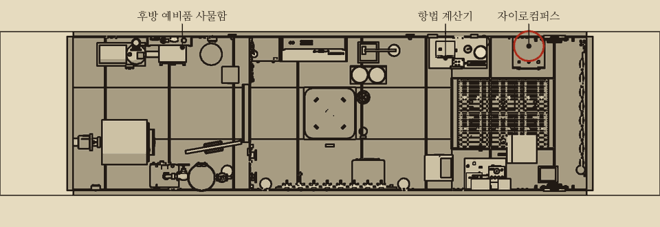
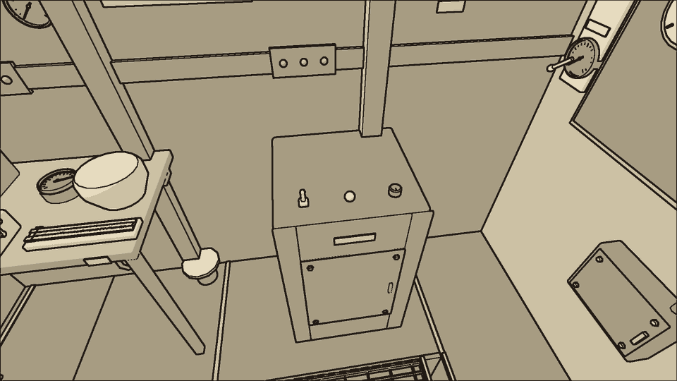
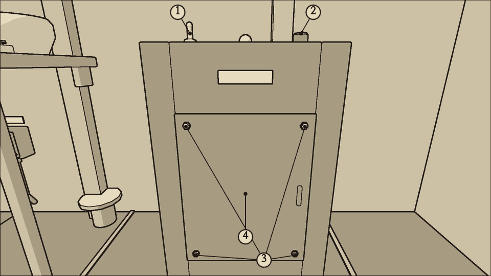
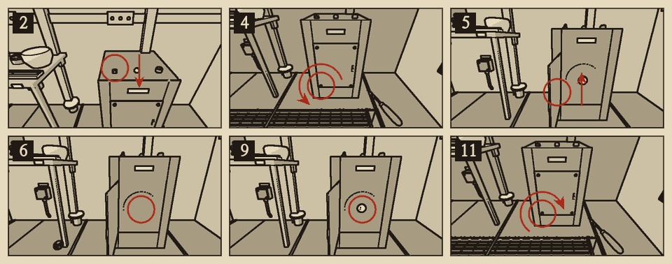
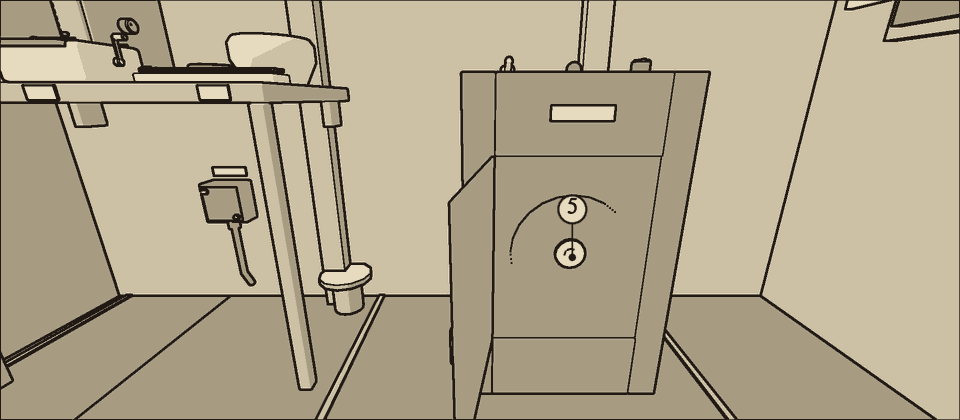

# 자이로컴퍼스

분류: 항법 · 자이로 베어링 마모 (NAV-01)

자이로 함은 전방 구역 좌현 바닥, 항법 책상 앞쪽 끝에 있다. 통로 쪽 앞면이 뚜껑이고 나사 네 개가 누른다. 뚜껑 안에 회전자와 회전자 베어링이 있다. 함의 윗면에 전원 스위치, 안정 표시등, 맞춤 손잡이가 있다. 자이로가 가리키는 침로는 항법 책상 위의 자이로 중계 나침반에 나온다. 같은 책상에 자기 나침반이 있고, 그 뒤 벽에 자차표가 붙어 있다.

## 침로를 읽는 법

- 자이로 중계 나침반의 값이 침로다. 자리 잡은 자이로만 믿는다.
- 자기 나침반은 배의 쇠붙이 때문에 침로마다 일정하게 틀린다. 이 틀림을 자차라 한다. **참 침로 = 나침반 값 − 자차.**
- 자차는 나침반 값에 가장 가까운 두 줄 사이를 비례로 셈해 얻는다.

| 침로 | 자차 |
| --- | --- |
| {{n:tuning.nav.deviationCard.0.0}}도 | {{n:tuning.nav.deviationCard.0.1}}도 |
| {{n:tuning.nav.deviationCard.1.0}}도 | {{n:tuning.nav.deviationCard.1.1}}도 |
| {{n:tuning.nav.deviationCard.2.0}}도 | {{n:tuning.nav.deviationCard.2.1}}도 |
| {{n:tuning.nav.deviationCard.3.0}}도 | {{n:tuning.nav.deviationCard.3.1}}도 |
| {{n:tuning.nav.deviationCard.4.0}}도 | {{n:tuning.nav.deviationCard.4.1}}도 |
| {{n:tuning.nav.deviationCard.5.0}}도 | {{n:tuning.nav.deviationCard.5.1}}도 |
| {{n:tuning.nav.deviationCard.6.0}}도 | {{n:tuning.nav.deviationCard.6.1}}도 |
| {{n:tuning.nav.deviationCard.7.0}}도 | {{n:tuning.nav.deviationCard.7.1}}도 |

예: 나침반이 73.8도를 가리킨다. 45도의 자차는 3도, 90도의 자차는 1도다. 73.8도는 45도에서 28.8도 지난 곳이므로 자차는 3 − 2 × 28.8 ÷ 45 = 약 1.7도다. 참 침로는 약 72.1도다.

## 기동과 정지

- 회전자는 전원을 넣은 뒤 약 {{n:tuning.nav.spinUpSeconds}}초가 지나야 제 속도에 이른다. 그동안 중계 나침반 바늘은 침로에서 크게 벗어난 채 머문다.
- 제 속도에 이른 뒤 바늘이 크게 흔들리다 잦아든다. 약 {{n:tuning.nav.settleSeconds}}초가 지나면 안정 표시등이 켜진다.
- 전원을 끊으면 회전자는 약 {{n:tuning.nav.spinDownSeconds}}초 동안 돌다가 선다. 윙 소리가 낮아지다가 멎는다. 닳은 베어링은 더 빨리 선다.
- 회전이 반 아래로 떨어지면 자이로가 자오선을 잃는다. 전원이 끊긴 지 약 30초(닳은 베어링은 약 20초)가 지나면 그렇게 된다. 전압이 떨어지거나 C5 퓨즈가 끊겨 자이로가 섰을 때도 같다. 그보다 짧게 끊겼다가 돌아오면 자리 잡은 채로 다시 돈다.
- 다시 자리 잡은 자이로는 {{n:tuning.nav.restartOffsetMinDeg}}~{{n:tuning.nav.restartOffsetMaxDeg}}도 어긋나 있으므로 다시 맞춘다.
- 자리 잡기 전에는 맞춤 손잡이가 잠겨 돌지 않는다. 그동안 상황판 항법 표시등이 노란색이다.

## 이럴 때 쓴다

- 자이로 중계 나침반과 참 침로(나침반 값 − 자차)의 차이가 1분에 약 1도씩 벌어진다. 맞춰 놓아도 다시 벌어진다.
- 자이로 함에서 떨리며 갈리는 소리가 난다. 함에 손을 대면 떨린다.
- 청진기를 자이로 함에 대면 거칠게 갈리는 소리가 난다.

## 가르기

| 증상 | 원인 | 확인 |
| --- | --- | --- |
| 차이가 1분에 약 1도씩 계속 벌어진다 | 베어링 마모 | 갈리는 소리. 맞춰도 다시 벌어진다 |
| 차이가 일정하다. 자이로를 다시 켠 지 얼마 안 된다 | 다시 자리 잡은 자이로를 맞추지 않았다 | 차이가 {{n:tuning.nav.restartOffsetMinDeg}}~{{n:tuning.nav.restartOffsetMaxDeg}}도에서 더 늘지 않는다. 맞추면 사라진다 |
| 바늘이 흔들린다. 항법 표시등이 노랗다 | 아직 자리 잡지 않았다 | 안정 표시등이 켜질 때까지 기다린다 |
| 나침반 값과 중계 나침반의 차이가 자차표의 자차와 같다 | 자차를 빼지 않았다 | 나침반 값에서 자차를 뺀 값과 다시 견준다 |

{{procedure:proc.gyro.bearing}}

## 위험

- **끼임**: 회전자는 전원을 끊은 뒤에도 약 {{n:tuning.nav.spinDownSeconds}}초 동안 돈다. 소리가 멎기 전에 뚜껑을 열거나 베어링에 손을 대면 손이 말려든다. 잠시 손을 못 쓰고 몸이 상한다.

## 끝난 뒤 확인

- 갈리는 소리가 없어지고 윙 소리가 고르다.
- 맞춘 뒤 몇 분이 지나도 중계 나침반과 참 침로가 1도 안에서 맞는다.
- 항법 표시등이 꺼진다.

## 순서를 어기면

- **맞추지 않으면** 다시 자리 잡은 자이로가 {{n:tuning.nav.restartOffsetMinDeg}}~{{n:tuning.nav.restartOffsetMaxDeg}}도 어긋난 채로 남는다. 차이는 늘지도 줄지도 않는다. 나침반 값에서 자차를 뺀 참 침로와 견주면 드러난다.
- 헌 베어링을 다시 넣으면 표류가 그대로 남는다.

## 예비 베어링이 없을 때

예비 자이로 베어링은 {{stock:gyro_bearing}}개뿐이다. 다 쓰면 자기 나침반으로 침로를 잡는다. 나침반 값에서 자차표의 자차를 빼서 참 침로를 얻고, 1분 남짓마다 맞춤 손잡이로 중계 나침반을 다시 맞춘다.

## 소음

| 동작 | 소음 |
| --- | --- |
| 전원 스위치 | {{noise:switch}} |
| 나사 하나 (드라이버) | {{noise:screwdriver}} |
| 뚜껑 여닫기, 베어링 빼고 넣기 | {{noise:cover}} |

자이로가 도는 동안에는 소음이 {{n:devices.gyrocompass.noise}}만큼 더해진다. 조용한 수리다.
