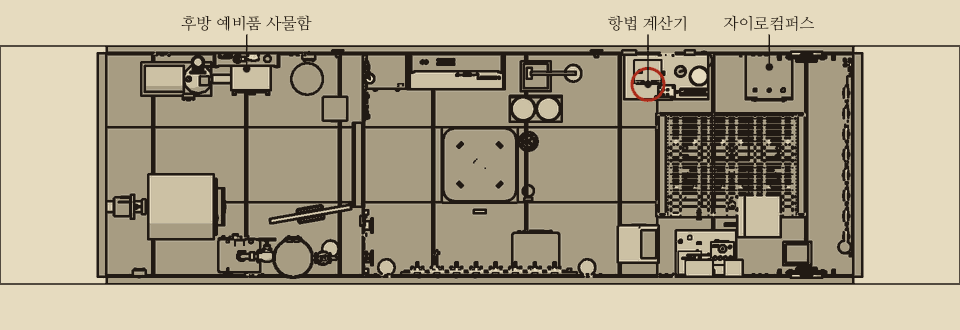
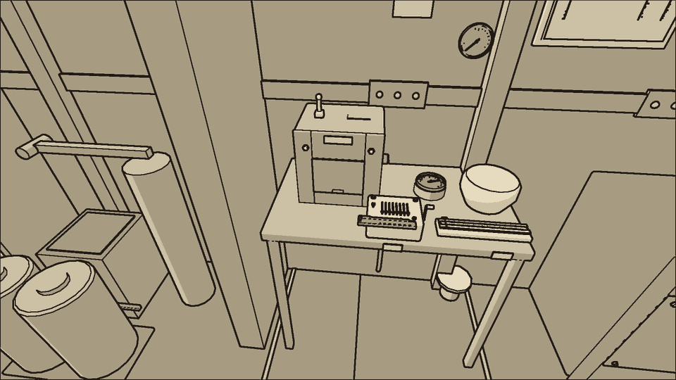
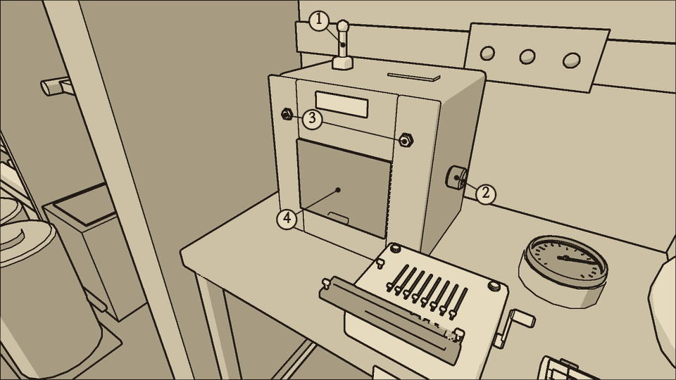
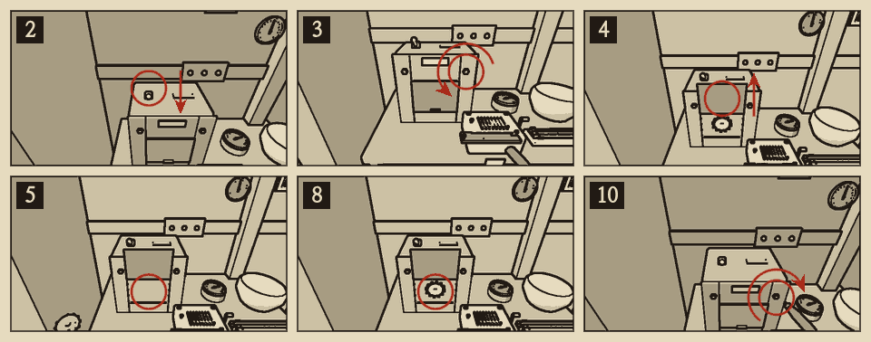
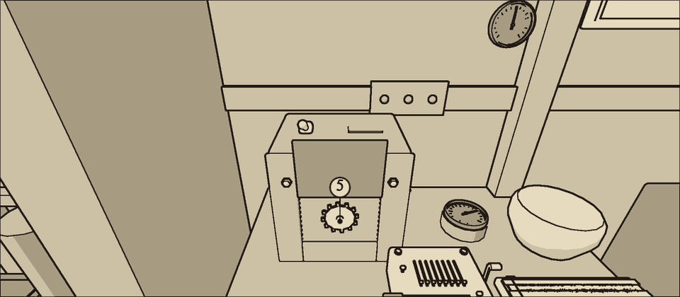

# 항법 계산기

분류: 항법 · 항법 계산기 톱니 이탈 (NAV-02)

기계식 항법 계산기는 전방 구역 좌현 항법 책상 위, 뒤쪽 끝에 있다. 프로펠러 축의 회전을 톱니 열로 받아 지나온 거리를 거리 계수기에 쌓는다. 윗면에 거리 계수기 창과 전원 레버가, 오른쪽 옆면에 되돌림 손잡이가 있다. 앞면의 덮개 위쪽을 나사 두 개가 누르고, 덮개 안에 바꿔 끼우는 톱니가 하나 있다. 책상 위 벽에 선내 시계, 속력계, 축 회전계(회전 속도와 누적 회전수), 수심 기준계가 걸려 있다.

## 계수기를 읽는 법

- 거리 계수기는 km를 0.01까지 보인다.
- 축이 한 바퀴 돌 때 배는 {{n:tuning.nav.advancePerRevM}}m 나아간다. **지나온 거리 = 누적 회전수 × {{n:tuning.nav.advancePerRevM}}m.** 축 회전계의 누적 회전수에 이 값을 곱한 거리가 계수기와 맞아야 한다.
- 속력계의 노트 값에 지난 시간을 곱해도 거리가 나온다. 1노트는 한 시간에 1,852m다.
- 추진 전동기가 서 있으면 계수기도 선다.

예: 축 회전계의 누적 회전수가 4,520이다. 4,520 × {{n:tuning.nav.advancePerRevM}} = 3,616m, 곧 3.62km다. 같은 때에 계수기가 3.20km를 가리키면 0.42km 모자란다.

## 이럴 때 쓴다

- 축 회전계 바늘은 고른데 거리 계수기가 몇 초씩 멎는다. 가끔 0.05km를 한꺼번에 뛴다.
- 계수기가 뛸 때 계산기에서 톱니가 딸깍한다. 청진기를 대면 딸깍 소리가 크게 들린다.
- 계수기가 누적 회전수로 셈한 거리와 맞지 않는다.

상황판에는 아무 표시도 나오지 않는다. 계수기를 보고, 소리를 듣고, 거리를 셈해서 찾는다.

## 가르기

| 증상 | 원인 | 확인 |
| --- | --- | --- |
| 축 회전계 바늘은 고른데 계수기가 몇 초씩 멎다가 가끔 0.05km를 뛴다 | 톱니 이탈 | 딸깍 소리. 누적 회전수 × 전진 거리와 어긋난다 |
| 축 회전계 바늘이 오르내리고 전동기에서 불꽃이 튄다 | 전동기 브러시 마모 | 진단 표: 전기와 동력 |
| 계수기가 고르게 오르지만 값이 다르다 | 계산기를 끈 동안 배가 나아갔다. 톱니를 갈고 맞추지 않았다 | 차이만큼 되돌림 손잡이를 돌린다. 그 뒤 다시 어긋나면 톱니 이탈이다 |

{{procedure:proc.navcomp.gear}}

## 위험

- **끼임**: 계산기가 도는 채로 톱니를 빼거나 끼우면 손가락이 톱니 열에 물린다. 잠시 손을 못 쓰고 몸이 상한다.

## 끝난 뒤 확인

- 계수기가 멎지 않고 고르게 오른다. 딸깍 소리가 없다.
- 몇 분 뒤 다시 셈해도 계수기와 셈한 거리가 0.05km 안에서 맞는다.

## 순서를 어기면

- **계수기를 맞추지 않으면** 계산기를 끈 동안 나아간 거리와 톱니가 미끄러진 동안 잃은 거리만큼 틀린 채로 남는다. 고장 표시는 나오지 않으나 셈하면 드러난다.
- 헌 톱니를 다시 끼우면 다시 미끄러진다.

## 소음

| 동작 | 소음 |
| --- | --- |
| 전원 레버 | {{noise:lever}} |
| 나사 하나 (드라이버) | {{noise:screwdriver}} |
| 덮개 여닫기, 톱니 빼고 끼우기 | {{noise:cover}} |

계산기가 도는 동안에는 소음이 {{n:devices.nav_computer.noise}}만큼 더해진다. 조용한 수리다.
