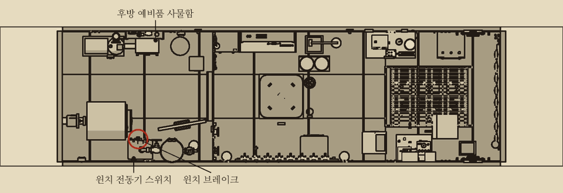
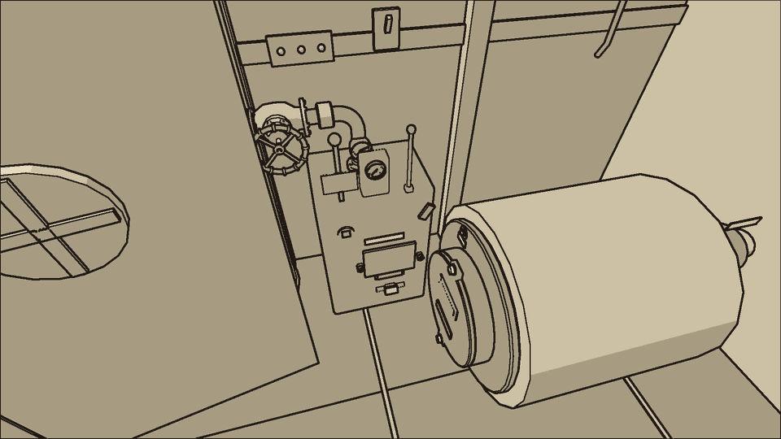
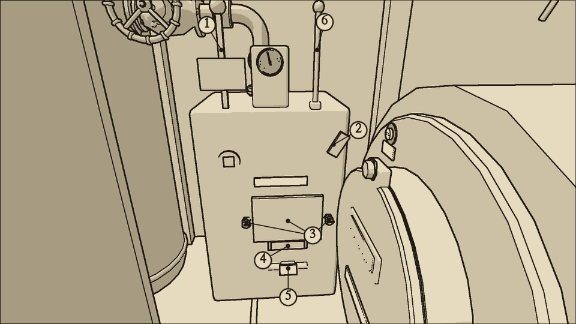
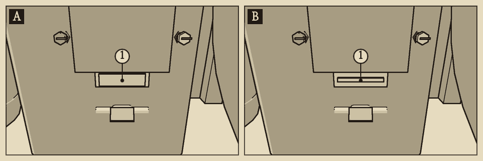
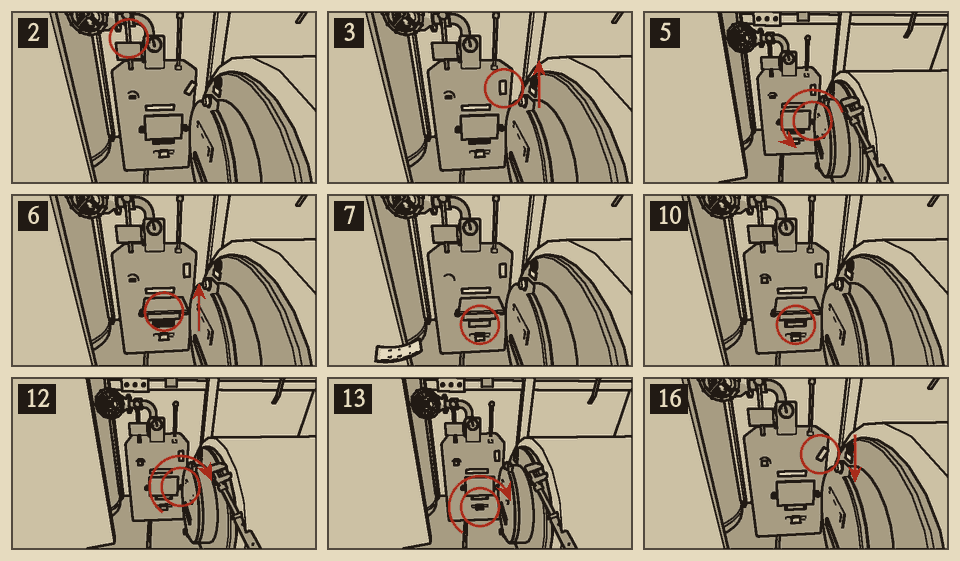

# 윈치 브레이크

분류: 케이블 · 윈치 브레이크 마모 (CBL-01)

갈고리 윈치는 후방 구역 우현에 있다. 드럼을 감싼 띠 브레이크가 하중을 잡는다. 띠 안쪽에 라이닝이 붙는다. 띠는 턴버클로 조인다.

## 이럴 때 쓴다

- 상황판 케이블 표시등이 빨강이고 벨이 울렸다. C6 회로는 살아 있다.
- 조종 레버가 멈춤에 있는데 드럼이 조금씩 풀려 나간다.
- 줄 계수기가 저절로 오른다.
- 와이어가 쉭 하고 풀리고 브레이크가 끽 하는 소리가 난다. 미끄러질수록 소리가 높아진다.
- 점검창 너머 라이닝이 얇다.

## 어디에

- 윈치 구동부: 후방 우현, 증기 축압기 바로 뒤. 통로 쪽 면에 조종 레버, 멈춤쇠, 띠 덮개, 턴버클이 있다.
- 줄 계수기와 하중계: 구동부 위 앞면.
- 윈치 전동기 스위치: 구동부 위쪽 우현 선체 벽. 위로 올리면 켜지고 내리면 꺼진다.
- 새 라이닝: 후방 예비품 사물함.
- 윈치 전동기는 케이블 장비 회로(C6)에서 전기를 받는다.

## 무엇이 있나

| 이름 | 하는 일 |
| --- | --- |
| 1 조종 레버 | 감기, 멈춤, 풀기 세 자리. 한 칸씩 움직인다 |
| 2 멈춤쇠 | 드럼이 풀리는 쪽으로 돌지 못하게 건다. 감는 쪽으로는 걸리지 않는다 |
| 3 띠 덮개 | 볼트 두 개가 누른다. 덮개 아래 틈으로 라이닝 끝이 보인다. 덮개를 열어야 라이닝을 뺄 수 있다 |
| 4 브레이크 라이닝 | 띠 안쪽의 마찰재. 닳으면 얇아진다 |
| 5 브레이크 턴버클 | 띠를 조인다. 렌치로 한 번에 한 눈금씩 돈다. 눈금 표시는 없다. 끝까지 조이면 더 돌지 않는다 |
| 점검창 | 라이닝 두께가 보인다 |
| 줄 계수기 | 풀려 나간 줄의 길이(m) |
| 하중계 | 매단 하중(kg) |
| 미끄럼 스위치 | 드럼이 멈춤에서 풀려 나가면 닫힌다. 상황판 케이블 표시등에 물려 있다 |
| 6 브레이크 레버 | 조종 레버와 함께 띠를 움직이는 연결 막대. 손으로 다룰 일은 없다 |

## 브레이크가 잡는 힘

- 새 라이닝에 턴버클이 맞으면 약 {{n:tuning.cable.winch.brakeMaxKg}}kg을 잡는다.
- 잡는 힘은 남은 라이닝 두께에 비례한다. 라이닝이 새것의 {{n:faults.CBL-01.set.lining}}배 두께로 닳으면 잡는 힘도 {{n:faults.CBL-01.set.lining}}배로 떨어져 시험 하중을 잡지 못하고 미끄러진다.
- 미끄러지면 라이닝이 더 닳는다. 미끄러짐은 점점 빨라진다.
- 드럼에는 줄이 {{n:tuning.cable.winch.lineMaxM}}m 감겨 있다. 줄 계수기가 {{n:tuning.cable.winch.lineMaxM}}m에 이르면 줄 끝이 드럼에서 빠져 하중을 잃는다.
- 멈춤쇠를 걸면 미끄러짐이 그친다. 수리가 아니다. 하중을 잡아 둘 뿐이다.
- 정상이면 감을 때 줄 계수기가 1초에 약 {{n:tuning.cable.winch.haulMps|2}}m씩 줄어든다. 턴버클을 너무 조이면 이보다 느리다.

## 가르기

<!-- pair:winch.weak -->

| 보이는 것 | 원인 | 확인 |
| --- | --- | --- |
| 멈춤에서 드럼이 풀려 나간다. 라이닝이 얇다 | 라이닝 마모 | 점검창. 하중계와 줄 계수기 |
| 라이닝은 두꺼운데 멈춤에서 하중이 미끄러지거나, 훈련이 끝나지 않는다 | 턴버클이 너무 풀림 | 턴버클을 끝까지 조여 보며 돈 눈금을 센다. 두 눈금보다 적었으면 너무 조였던 것이고, 네 눈금보다 많았으면 너무 풀렸던 것이다. 어느 경우든 끝까지 조인 자리에서 세 눈금 되돌린다 |
| 감기가 느리고 띠 덮개가 뜨겁거나, 훈련이 끝나지 않는다 | 턴버클이 너무 조임 | 감은 직후 띠 덮개를 만져 본다. 라이닝 타는 냄새. 턴버클을 끝까지 조여 보며 돈 눈금을 센다. 두 눈금보다 적었으면 너무 조였던 것이고, 네 눈금보다 많았으면 너무 풀렸던 것이다. 어느 경우든 끝까지 조인 자리에서 세 눈금 되돌린다 |
| 감기가 느리고 덮개가 차갑다 | 증기 보조가 약함 | 증기 축압기 압력계 |

- 청진기를 드럼에 대면 미끄러질 때 갈리는 소리가 크다.

{{procedure:proc.winch.reline}}

## 끝난 뒤 확인

- 멈춤쇠를 푼 채로 조종 레버를 멈춤에 두면 60초 동안 줄 계수기가 서 있다.
- 상황판 케이블 표시등이 꺼져 있다.
- 감은 직후에도 띠 덮개가 뜨겁지 않다.

## 순서를 어기면

- **멈춤쇠를 먼저 건다.** 멈춤쇠 없이 하중이 걸린 채로 라이닝을 빼면 손이 끼인다. 드럼이 헛돌기 시작하면 멈춤쇠가 걸리지 않고, 곧 줄이 다 풀려 하중을 잃는다.
- 헛도는 드럼에 라이닝을 다시 끼우려고 손을 넣어도 끼인다.
- 감기 중에 띠 안에 손을 넣으면 끼인다. 조종 레버를 멈춤에 두고 전동기를 끈다.
- 턴버클을 끝까지 조인 채로 두면 감을 때 띠가 드럼에 끌린다. 감기가 느려지고 띠 덮개가 뜨거워진다. 라이닝이 {{n:tuning.cable.winch.dragWearMultiplier}}배 빨리 닳는다.
- 턴버클을 너무 많이 되돌리면 잡는 힘이 준다. 다섯 눈금 이상 되돌리면 무거운 하중이 미끄러지고, 일곱 눈금 이상 되돌리면 시험 하중도 미끄러진다. 끝까지 조인 자리에서 두 눈금에서 네 눈금 되돌린 자리가 맞다.
- 닳은 라이닝을 도로 끼우면 고쳐지지 않는다.

## 응급 수리

없다. 새 라이닝이 다 떨어졌으면 멈춤쇠를 걸어 하중을 잡아 둔다. 멈춤쇠를 건 동안에는 줄을 풀 수 없다.

## 소음

| 동작 | 소음 |
| --- | --- |
| 조종 레버 | {{noise:lever}} |
| 멈춤쇠 | {{noise:pawl}} |
| 렌치 (볼트, 턴버클 한 눈금) | {{noise:wrench}} |
| 덮개 여닫기, 라이닝 빼고 끼우기 | {{noise:cover}} |
| 미끄러지는 드럼 | {{n:tuning.cable.winch.slipNoise}}. 미끄러지는 동안 계속 |
| 가동 중인 윈치 전동기 | {{n:devices.hook_winch.noise}} |

수리 자체는 보통 등급이다. 윈치 전동기는 켜 두는 동안 시끄러움 등급이다. 시험 감기가 끝나면 전동기를 끈다.
