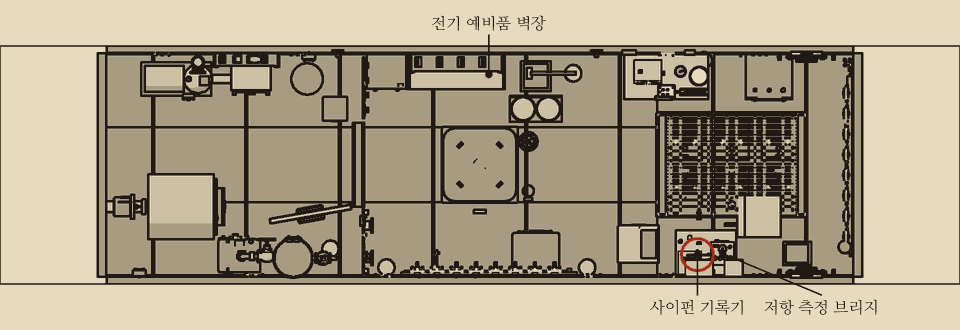
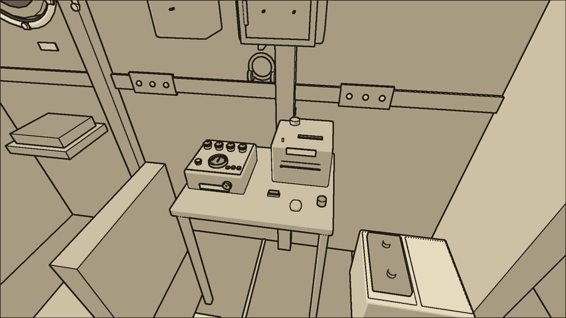
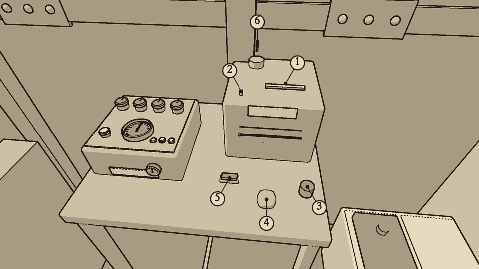
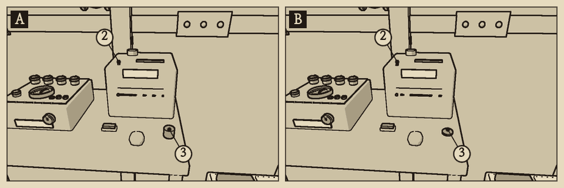
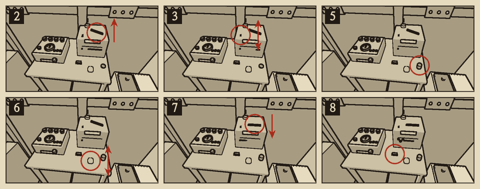

# 사이펀 기록기

분류: 케이블 · 사이펀 막힘 (CBL-02)

사이펀 기록기는 전방 구역 우현, 통신 책상 위에 있다. 가는 유리 모세관이 잉크 통의 잉크를 펜 끝까지 끌어올린다. 신호가 오면 펜이 위아래로 흔들려 흐르는 테이프에 물결을 그린다. 사이펀 막힘은 상황판 표시등에 나타나지 않는다. 테이프를 보고 판단한다.

## 이럴 때 쓴다

- 시험 키를 눌렀는데 물결이 끊어져 점선이 된다.
- 시험 키를 눌렀는데 테이프에 아무것도 그려지지 않는다.
- 펜 끝에 마른 잉크 딱지가 앉았다.
- 잉크 통의 잉크가 바닥 가까이 줄었다.
- 시험 신호를 그리는 동안 평소의 사각거리는 소리 대신 마른 펜이 끊어지듯 긁히는 소리가 난다.

## 어디에

- 기록기: 전방 우현 통신 책상. 펜 팔, 모세관, 잉크 통, 마중 고무공, 시험 키, 테이프 창, 증폭관이 한데 있다.
- 잉크병: 중앙 사물함 위 '전기 예비품' 벽장.
- 기록기는 케이블 장비 회로(C6)에서 전기를 받는다.

## 무엇이 있나

| 이름 | 하는 일 |
| --- | --- |
| 1 펜 팔 | 내리면 펜이 테이프에 닿는다. 들면 펜이 테이프에서 떨어진다 |
| 2 모세관 | 잉크를 펜 끝으로 끌어올린다. 마른 잉크가 막는다 |
| 3 잉크 통 | 잉크를 담는다. 잉크병으로 채운다 |
| 4 마중 고무공 | 눌러서 모세관에 잉크를 채운다 |
| 5 시험 키 | 누르면 {{n:tuning.cable.siphon.testSeconds}}초 동안 시험 신호가 간다 |
| 6 증폭관 | 신호를 키워 펜을 흔든다 |

## 테이프 읽는 법

<!-- pair:siphon.trace -->

시험 키를 누르지 않을 때에는 신호가 없으므로 곧은 줄이 정상이다. 판단은 시험 키를 누른 뒤 {{n:tuning.cable.siphon.testSeconds}}초 동안 그려진 줄로 한다.

| 테이프 | 뜻 | 확인 |
| --- | --- | --- |
| 끊김 없는 물결 | 정상 | — |
| 점선 물결 | 모세관이 일부 막혔다 | 펜 끝의 딱지 |
| 펜은 흔들리는데 아무것도 그려지지 않는다 | 잉크가 펜 끝까지 오지 않는다: 모세관 막힘, 잉크 바닥, 마중물 빠짐, 펜 팔 들림 | 딱지, 잉크 통의 잉크 높이, 펜 팔 |
| 시험 키를 눌러도 곧은 줄만 그려진다 | 신호가 펜에 오지 않는다. 잉크는 펜까지 온다 | 증폭관이 빠졌거나 필라멘트가 꺼져 있다 |
| 테이프가 멈춰 있다 | 기록기에 전기가 없다 | C6 퓨즈와 스위치 |

- 펜은 신호를 그리는 동안만 잉크를 쓴다. 잉크가 바닥나면 모세관에 공기가 든다. 다시 마중물을 채워야 한다.

{{procedure:proc.siphon.clear}}

## 끝난 뒤 확인

- 시험 키를 누르면 끊김 없는 물결이 그려진다.
- 펜이 테이프를 사각사각 긁는 소리가 난다.
- 잉크 통에 잉크가 가득하다.

## 순서를 어기면

- 펜 팔을 내린 채로는 바늘이 모세관에 들어가지 않는다.
- 쑤시고 나면 모세관에 공기가 든다. 마중물을 채우지 않으면 테이프에 아무것도 그려지지 않는다.
- 네 번을 다 쑤시지 않으면 막힘이 남는다. 한 번만 쑤셨으면 고무공을 눌러도 잉크가 올라오지 않는다. 두 번만 쑤셨으면 잉크는 올라오지만 물결이 점선으로 남는다. 더 쑤시면 마중물이 빠지므로 고무공을 다시 두 번 누른다.
- 잉크가 바닥이면 마중물이 차지 않는다. 먼저 잉크를 채운다.
- 펜 팔을 든 채로 두면 테이프에 아무것도 그려지지 않는다.

## 응급 수리

없다.

## 소음

| 동작 | 소음 |
| --- | --- |
| 펜 팔 | {{noise:lever}} |
| 쑤시개 바늘, 잉크 붓기, 시험 키 | {{noise:tap}} |
| 마중 고무공 | {{noise:prime}} |
| 가동 중인 기록기 | {{n:devices.siphon_recorder.noise}} |

조용한 수리다.
