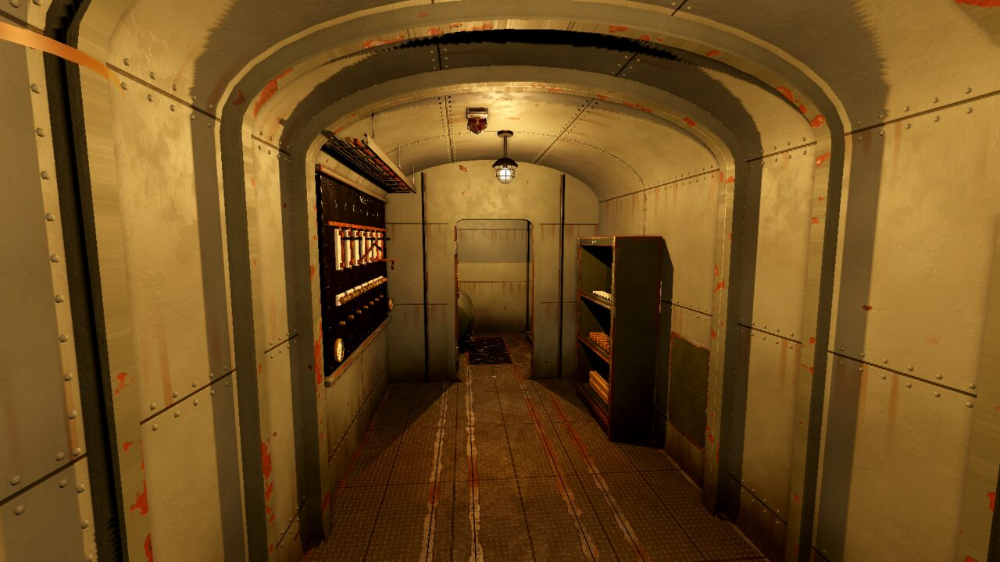
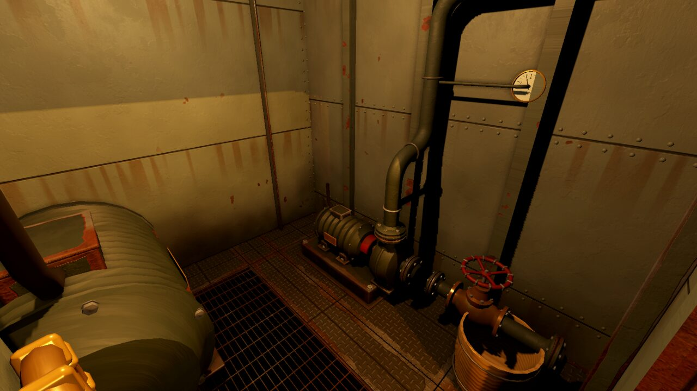
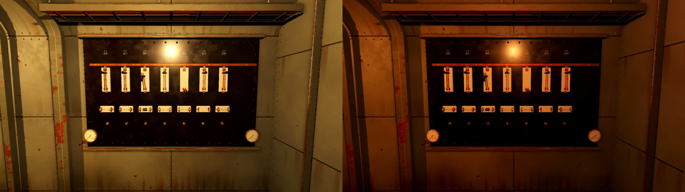
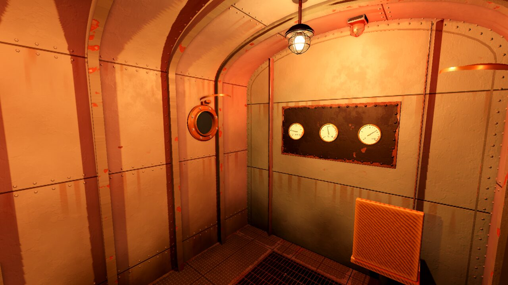
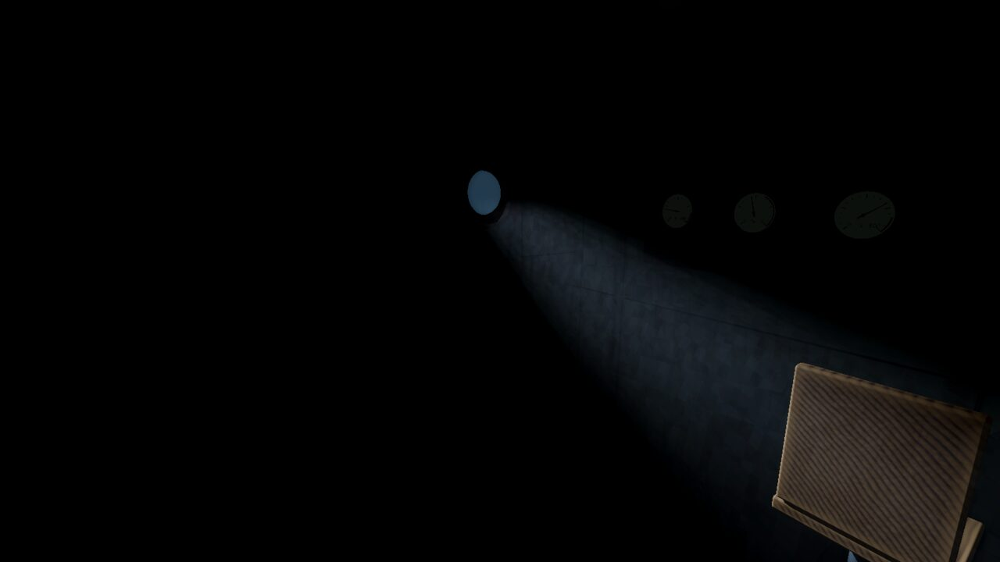
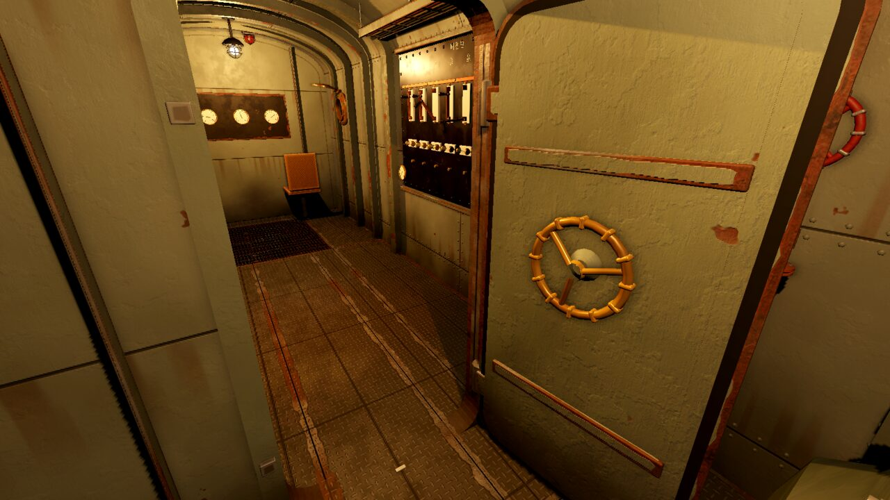
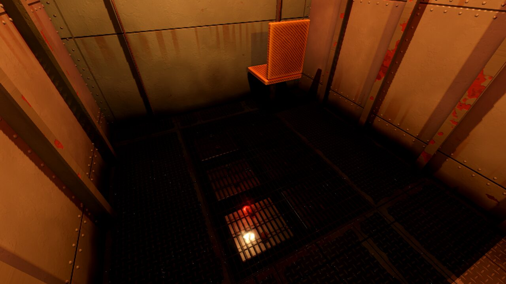
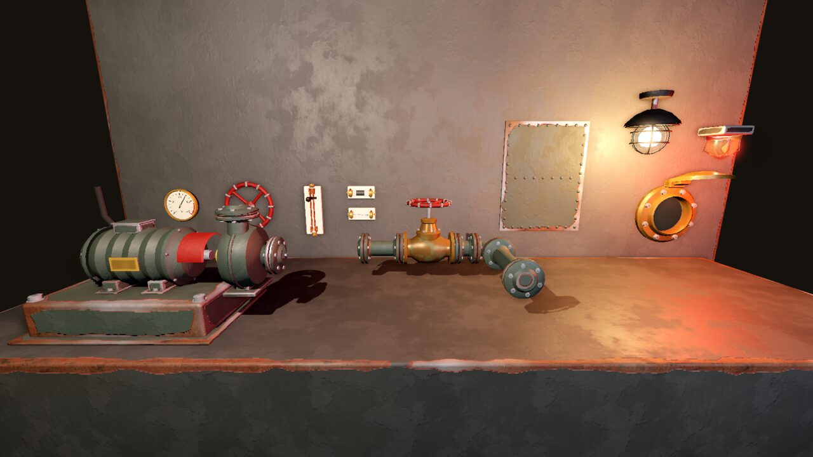

# 아트 키트 보고서 · M5 준비 (병렬 세션)

2026-10-27 · 브랜치 `claude/deepline-art-kit` (본선 `claude/dazzling-clarke-m2eohe`의 `5366ad6`에서 갈라짐)

## 요약

SPEC 11절 '아트와 사운드 구현 지침'에 맞춰 절차적 하드서피스 키트, 재질, 조명 규칙 라이브러리와 쇼케이스 장면을 만들었습니다. 본선 M2와 겹치지 않게 **기존 파일은 고치지 않았고**(예외: `docs/ASSETS.md`에 절 하나 추가) 새 파일만 더했습니다. 본선에서 회색 상자 도형을 바꿔 끼울 때 쓸 대응표는 아래 '통합 안내'에 있습니다.

| 할 일 | 결과 |
| --- | --- |
| 키트 조각 빌더 (`game/scripts/Art/`) | 배관(곡관, 플랜지, 지지대), 밸브 바퀴와 글로브 밸브, 계기, 리벳 패널, 칼날 스위치, 유리관 퓨즈 소켓, 해치 문짝과 문틀, 둥근 선체 내벽(늑골, 판, 리벳)과 격벽, 바닥판과 격자, 케이블 트레이, 철망 등기구, 사물함, 전동기와 원심 펌프, 현창 |
| 재질 | 낡은 도장 강철(모서리 닳음, 아래쪽 때, 판 이음선, 녹물 줄, 바닥판 무늬), 황동·구리·청동·맨 강철, 베이클라이트, 자기, 유리, 나무, 대리석, 물. 젖음은 구역별 수위와 결로 매개변수 |
| 조명 규칙 데모 | 어둑한 백열등, 버스 전압에 비례해 어두워지고 깜빡이는 등, 붉은 구역 경고등(회전 반사판), 현창으로 새어 드는 청백색 아크등 |
| 쇼케이스 | `game/scenes/KitShowcase.tscn`. `-- --shots=폴더`로 10곳을 찍고 끝난다. `--smoke=프레임`, `--stats`(조각별 삼각형 수) |
| 본선 확인 | `tools/godot-check.sh` 통과(빌드, 가져오기, 스모크, 종단 자동 플레이 `AUTOTEST PASS`) |
| 헤드리스 확인 | `godot --headless --path game res://scenes/KitShowcase.tscn -- --smoke=60` 오류 없음 |

## 화면

Mesa llvmpipe(OpenGL 호환 렌더러), 1600×900으로 찍은 것을 줄였습니다. 쇼케이스는 시뮬레이션을 돌리지 않고 버스 전압, 경보, 탐조등, 수위를 장면이 직접 정합니다.

| | |
| --- | --- |
|  조종 구역에서 본 회랑. 둥근 지붕, 늑골, 판 이음선과 리벳, 열린 해치 너머 기관 구역 |  전동 펌프 한 벌, 경로 배관(곡관, 플랜지, 벽 지지대), 글로브 밸브, 압력계, 빌지 격자, 주 전동기 |
|  배전반. 왼쪽 버스 전압 1.0, 오른쪽 0.5(어두워지고 붉어지며 깜빡인다) |  구역 경보: 붉은 덮개 안 반사판이 돌며 벽을 쓴다 |
|  실내등이 꺼진 조종 구역. 바깥 아크등 빛이 현창으로 새어 들어 바닥에 떨어진다 |  해치 문짝(도그 손잡이, 양면 바퀴, 패킹)과 문틀 |
|  전방 구역 바닥에 물 3.5cm, 결로 0.35. 젖은 벽 아랫단이 어둡고 매끈해지고 물이 등빛과 경고등을 되비춘다 |  조각 진열대: 펌프 한 벌, 계기, 밸브 바퀴, 칼날 스위치, 퓨즈 소켓(정상과 끊김), 글로브 밸브, 리벳 패널, 등, 경고등, 현창 |

다시 찍기:

```sh
xvfb-run -a -s "-screen 0 1600x900x24" $GODOT --path game --rendering-driver opengl3 --audio-driver Dummy \
  --resolution 1600x900 res://scenes/KitShowcase.tscn -- --shots=shots/
```

사람이 직접 볼 때는 편집기에서 `KitShowcase.tscn`을 열고 F6으로 실행합니다. 오른쪽 버튼을 누른 채 둘러보기, WASD/QE 이동, 1~9 촬영 자리, V 버스 전압(1 → 0.6 → 0.3 → 0), R 경고등, L 탐조등, F 침수, Esc 끝.

## 만든 것

### 파일

| 파일 | 내용 |
| --- | --- |
| `game/scripts/Art/ArtMesh.cs` | `MeshBuilder`: 둥근 모서리 상자, 회전체, 경로 쓸기(관), 원환, 다각형 판. 재질마다 표면 하나로 모은다. 꼭짓점 색 R = 모서리 마스크, UV = 미터. `Scatter`: MultiMesh 뿌리기 |
| `game/scripts/Art/ArtMat.cs` | 재질 라이브러리와 젖음 제어(`SetWater`, `SetDampness`) |
| `game/scripts/Art/Kit.cs` | 공용: 리벳(MultiMesh), 볼트, 축 맞추기, 글씨, `BakeStatic`(움직이지 않는 부분을 재질별로 합치기) |
| `game/scripts/Art/Kit.Fittings.cs` | 계기(`KitGauge`), 밸브 바퀴, 글로브 밸브, 칼날 스위치(`KitKnifeSwitch`), 퓨즈 소켓(`KitFuseSocket`) |
| `game/scripts/Art/Kit.Pipes.cs` | 경로 배관(`PipeSpec`): 원호 곡관, 플랜지 이음, 관 고리와 벽 지지대 |
| `game/scripts/Art/Kit.Structure.cs` | 선체 단면(`HullProfile`), 선체 내벽, 격벽, 바닥판, 격자, 해치 문짝(`KitHatch`)과 문틀, 현창, 리벳 패널 |
| `game/scripts/Art/Kit.Fixtures.cs` | 케이블 트레이, 철망 등기구, 사물함, 전동기, 원심 펌프, 펌프 한 벌 |
| `game/scripts/Art/ArtLights.cs` | 조명 규칙(`LightRules`), `IncandescentLamp`, `WarningBeacon`, `ArcSpill` |
| `game/scripts/Art/KitShowcase.cs`, `KitShowcaseTour.cs` | 쇼케이스 장면과 자동 촬영 |
| `game/scenes/KitShowcase.tscn` | 쇼케이스 장면 |
| `game/assets/shaders/art/*.gdshader(inc)` | 도장 강철, 금속, 나무, 대리석, 물, 빛줄기, 공용 함수(잡음, 젖음, 높이 → 법선) |
| `game/assets/textures/*.jpg` | CC0 잔결 질감 5장(512px, 합계 약 400KB). 출처는 `docs/ASSETS.md` '아트 키트 질감' |

### 키트의 약속

- 조각은 **보이는 모습만** 만듭니다. 부딪힘 상자(`Geo.Solid`, `Geo.Blocker`)와 조준 상자(`Interactable.Create`)는 만들지 않습니다.
- 움직이거나 숨기는 부분은 이름 붙은 자식이고 조각 클래스 속성으로도 꺼낼 수 있습니다. 회전 약속은 회색 상자와 같게 맞췄습니다.
  - `KitGauge.Needle`: Z축, 각도 `135 − 270 × f`도(상황판 계기와 같다). `SetFraction(f)`.
  - `KitKnifeSwitch.Blade`: X축, 0도 넣음, 95도 뺌(배전반 `pivot`과 같다). `SetAngle(deg)`.
  - `KitFuseSocket.Fuse/Element/Soot`: `SetState(present, blown)`.
  - `KitHatch`: 모스호 해치 경첩 노드의 틀 그대로(두께 X, 문짝은 경첩에서 −Z). `SetLock(0~1)`로 바퀴와 도그.
  - `GlobeValve`의 `Wheel`(Y축), `Motor`의 `Shaft`(X축), `Porthole`의 `Sea`(바깥 밝기).
- 벽에 붙는 조각은 앞(+Z)이 방 안이고 원점은 벽 면 위입니다. `Geo.Face`로 돌려 붙입니다.

### 재질과 젖음

- 낡은 도장 강철 셰이더: 꼭짓점 색의 모서리 마스크와 잡음으로 칠이 벗겨지고(방청 도료 → 맨 강철 → 녹), 바닥에서 0.7m까지 때가 타고, UV(m) 기준 판 이음선에서 녹물이 흘러내립니다. 바닥판은 미끄럼 방지 무늬와 닳은 돌기.
- 젖음: 모든 셰이더 재질이 `zone_water`(후방, 중앙, 전방 수면 y)와 `dampness`(결로)를 받습니다. 수면 아래와 그 위 16cm 띠가 어둡고 매끈해집니다. `ArtMat.SetWater(aftY, midY, foreY)`를 매 프레임 불러도 값이 바뀔 때만 재질을 고칩니다.
- 금속도는 0.5~0.6으로 낮췄습니다. 실내에 반사광이 거의 없어서(환경광 0.04, 배경은 거의 검정) 1에 가까우면 황동과 맨 강철이 검게만 보였습니다.

### 조명 규칙

| 규칙 | 구현 |
| --- | --- |
| 평상시 | `IncandescentLamp`: 따뜻한 백열등(1.0, 0.72, 0.42), 에너지 1.4, 거리 4.5m, 그림자. 회색 상자 등과 같은 값 |
| 전압 강하 | `Apply(volts, dt)`: 밝기는 전압에 **비례**(SPEC 문구대로), 0.85 아래에서 깜빡임(초당 확률 `(0.85 − V) × 14`, 0.03~0.12초씩 꺼짐)과 잔떨림, 전압이 낮을수록 필라멘트가 붉어진다. 깜빡임만 등마다 따로인 표현 층 난수 |
| 고장 | `WarningBeacon.Apply(on, simTime)`: 붉은 덮개 안 반사판이 돌며 스포트라이트가 벽을 쓸고, 점광원이 회색 상자와 같은 주기(`sin 4t`)로 맥동. 비상 급전이라 전압과 상관없다 |
| 바깥 | `ArcSpill.Apply(intensity, dt)`: 현창 유리 자리에서 안쪽으로 비추는 청백색 스포트라이트(그림자 있음), 원뿔 빛줄기(가산 혼합, 호환 렌더러에 부피 안개가 없어서), 유리 뒤 바다 밝기. 아크의 지지직 흔들림 |

## 통합 안내

원칙: **부딪힘 상자와 조준 상자는 크기와 위치를 그대로 두고, 보이는 메시만 바꿉니다.** `Geo.Solid`는 부딪힘과 메시를 함께 만드므로 메시만 숨깁니다(자식 순서가 CollisionShape → MeshInstance라서 `body.GetChild<MeshInstance3D>(1).Visible = false`). 본선이 `Geo.Solid`에 `visible` 매개변수를 더하는 편이 깔끔합니다(본선 몫, 아래 '프로젝트와 기존 파일에 필요한 변경').

공통으로 먼저 할 일:

1. `var prof = HullProfile.Mos();` — 벽이 z = ±1.2에서 바닥부터 y 2.0까지 곧게 서고, 그 위가 높이 2.5까지 타원 지붕, 바닥 아래가 깊이 0.8까지 둥근 빌지입니다. 벽에 붙은 장비, 누수 지점(y 1.1, 1.95), 현창이 지금 좌표 그대로 벽에 붙습니다. 천장 부딪힘 판(y 2.2)은 그대로 두고 메시만 숨기면 지붕은 그 위로 둥글게 보입니다.
2. 매 프레임 `ArtMat.SetWater(후방 수면, 중앙 수면, 전방 수면)`. 수면 y = `FloorLevelCm / 100`, 물이 없으면 빌지 높이(−0.55 정도). **`GameData.Zones` 순서는 (fore, mid, aft)이고 `SetWater`는 (aft, mid, fore)입니다.** 결로는 `ArtMat.SetDampness`(시뮬레이션에 습도 값이 생기면).

### 대응표

| 파일 · 메서드 | 지금 물체 | 바꿀 키트 조각 | 메모 |
| --- | --- | --- | --- |
| `Submarine.BuildHull` | 바닥 보이는 판 4장(우물 자리 비움) | `Kit.FloorDeck(this, 0, 8, 1.2f, new[] { new Rect2(5.9f, -0.55f, 1.6f, 1.1f) })` | `Geo.Blocker` 바닥은 그대로 |
| 〃 | 천장, 좌우 벽 `Geo.Solid` | `Kit.HullShell(this, 0, 8, prof, 늑골 x 목록)` | 메시만 숨김. 늑골 목록은 지금 반복문의 건너뛰는 규칙(해치, 전방 틀, 배전반 뒤, 사물함 뒤)을 그대로 |
| 〃 | 앞뒤 끝벽 `AftEnd`, `ForeEnd` | `Kit.Bulkhead(this, 0, prof)`, `Kit.Bulkhead(this, 8, prof)` | 메시만 숨김. 상황판은 전방 끝벽 앞에 그대로 |
| 〃 | 늑골 상자, 바닥 줄눈, 리벳 이음 띠 | (지움) `HullShell`의 늑골과 리벳, 바닥판 셰이더의 이음선 | |
| 〃 | 전방 틀 `ForeFrame*` 3개 | `Kit.Bulkhead(this, ForeX, prof, (0.7f, 1.95f), 0.12f)` | 메시만 숨김 |
| `Submarine.BuildLights` | 황동 원판, 전구 구, 점광원 | `IncandescentLamp.Create(this, new(x, 2.49f, 0), drop: 0.18f, seed: z)` → `lamp.Apply((float)s.LightsBrightness, dt)` | 등 아래 높이 약 2.1로 지금과 같다. '사람 확인 요청 1' |
| 〃 | 경고등 상자, 구, 점광원 | `WarningBeacon.Create(this, new(x + 0.6f, 2.47f, 0))` → `Apply(on, (float)s.TimeSeconds)` | |
| `Submarine.BuildFloorWater` | 물 판 재질 | 재질만 `ArtMat.Water` | 위치와 보임 처리는 그대로 |
| `Submarine.BuildBatteryWell` | 우물 벽 상자 | 재질만 `ArtMat.Bilge` | |
| 〃 | 격자 판과 살 | `Kit.Grating(well, 1.6f, 1.1f)`를 (6.7, 0, 0)에 | |
| 〃 | 셀 상자, 단자 | 재질만 `ArtMat.Bakelite`, 단자 `ArtMat.BareSteel` 등 | 쇼케이스 `BatteryCells` 참고 |
| 〃 | 우물 물 | 재질만 `ArtMat.BilgeWater` | |
| `Submarine.SightGlass` | 황동 판, 유리관, 물기둥 | 판 `MeshBuilder.Box(ArtMat.Brass…)`, 관 `ArtMat.Glass` | 키트 전용 조각 없음. 물기둥 처리는 그대로 |
| `Submarine.BuildFurniture` | 조종석 `PilotSeat` | 쇼케이스 `Seat`처럼 `MeshBuilder` + `ArtMat.Wood` | 메시만 숨김 |
| 〃 | 현창 2개 | `Kit.Porthole(this)`를 (7.5, 1.55, ±1.19)에 `Geo.Face`로 안쪽을 보게 | 탐조등이 생기면 `ArcSpill.Attach(porthole, 안쪽 방향)` |
| 〃 | 교범 꽂이, 바인더 | 재질만 `ArtMat.Wood` | |
| 〃 | 흡수통 `Scrubber` | `Kit.RivetedPanel` 넷으로 감싸거나 `MeshBuilder.Box(ArtMat.Machinery)` | 메시만 숨김 |
| 〃 | 주 전동기 원기둥 | `Kit.Motor(this, 0.35f, 1.0f)`를 (0.6, 0.45, 0.45), 회전 (0, 180, 0) | 축이 후방(−X)으로. `Blocker` 그대로 |
| 〃 | 프로펠러 축 | `MeshBuilder.Cylinder(ArtMat.BareSteel …)` | |
| `Equipment.BuildHatch` | 격벽 `Geo.Solid` 3개, 문턱 | `Kit.Bulkhead(this, HatchX, prof, (0.45f, 1.85f), 0.08f)` + `Kit.HatchFrame`를 (HatchX, 0, 0)에 | 메시만 숨김. 해치 `Blocker`와 조준 상자 그대로 |
| 〃 | 문짝 상자, 바퀴, 막대 | `Kit.HatchLeaf(hinge)` | 같은 경첩 틀. `OnUpdate`에서 `SetLock(closed ? 1 : 0)`을 각도처럼 천천히 |
| `Equipment.BuildStatusPanel` | 베이클라이트 판, 황동 테 | `Kit.RivetedPanel(root, new(1.9f, 1.05f), 0.05f, ArtMat.Bakelite)`를 (0, 1.45, 0) | |
| 〃 | 계기 8개(테, 판, 눈금, 바늘) | `Kit.Gauge(root, 0.078f, 단위, 눈금 글씨)`를 (x, 1.33, 0.05) | `needles[i] = gauge.Needle` 그대로 돌리면 된다(같은 각도 약속) |
| 〃 | 표시등 황동 원판 | 표시등 구는 그대로, 테만 `MeshBuilder.Lathe(ArtMat.Brass …)` | 발광 재질 처리 그대로 |
| `Equipment.BuildSwitchboard` | 판 상자 | `Kit.RivetedPanel(root, new(1.88f, 1.18f), 0.04f, ArtMat.Marble, 0.12f, 0.035f)`를 (0, 1.4, 0) | DESIGN 13절 '대리석 배전반' |
| 〃 | 칼날 받침, 집게, 칼날 | `Kit.KnifeSwitch(root)`를 (x, 1.46, 0.075) | `pivot` 대신 `sw.Blade` |
| 〃 | 퓨즈 받침, 집게, 퓨즈, 퓨즈선, 그을음 | `Kit.FuseSocket(root)`를 (x, 1.24, 0.08) | `fuse/wire/soot.Visible` 대신 `SetState(FusePresent, FuseBlown)` |
| 〃 | 버스 바, 단자 | 재질만 `ArtMat.Copper`, `ArtMat.Brass` | |
| 〃 | (다 붙인 뒤) | `Kit.BakeStatic(root, "Blade", "Fuse")` | 그리기 호출 절반 가까이 준다 |
| `Equipment.BuildLocker` | 선반 `Geo.Solid`들, 뒤판 | `Kit.Locker(root, 1.0f, 1.65f, 0.38f, new[] { 1.095f, 0.645f, 0.145f })` | 메시만 숨김. 칸 조준 상자 그대로 |
| 〃 | 퓨즈, 쐐기, 버팀목 | 재질만(`ArtMat.Porcelain`·`ArtMat.Glass`, `ArtMat.Wood`, `ArtMat.RawWood`) | 개수 표시 처리 그대로 |
| 〃 | 폐기함 | `MeshBuilder.Box(ArtMat.Machinery …)` | |
| `Equipment.BuildHandPump` | 몸통 원기둥, 손잡이 | 몸통 `MeshBuilder.Lathe(ArtMat.Machinery …)`, 손잡이 `ArtMat.BareSteel`, 손잡이 끝 `ArtMat.Wood` | 키트 전용 조각 없음. `pivot` 그대로 |
| `Equipment.BuildPumpAndStrainer` | 전동기, 펌프 구, 받침 | `Kit.PumpSet(aft)`를 (0.75, 0, −0.92) | 기본값이 지금 크기(받침 0.75×0.36, 전동기 r 0.14 길이 0.42)다. `Blocker` 그대로 |
| 〃 | 선외 배출관, 연결관, 흡입관 | `Kit.Pipe(aft, 경로, new PipeSpec { SupportPlane = 좌현 벽 })` | 경로는 펌프 토출 플랜지 → 위 → 천장 |
| 〃 | 거름망 함, 덮개 | 함 `MeshBuilder.Box(ArtMat.Machinery)`, 덮개 `Kit.RivetedPanel(hinge, new(0.28f, 0.37f))` | 덮개 경첩 노드와 조준 상자 그대로 |
| 〃 | 볼트 머리 | `Kit.AddBolt`로 `head` 노드 안에 | 머리 노드 위치와 회전 처리 그대로 |
| 〃 | 세척통 | 쇼케이스 `WashBucket`(나무 통과 쇠테) | |
| `Equipment.BuildLeaks` | 리벳 이음판과 머리 | `Kit.RivetedPanel(node, new(0.22f, 0.1f), 0.012f, ArtMat.HullPlate, 0.07f)` | 이음판이 `HullShell` 리벳과 겹치면 그 자리만 이음판을 쓴다 |
| 〃 | 쐐기, 버팀목 | 재질만 `ArtMat.Wood`, `ArtMat.RawWood` | |
| 〃 | 선체 밸브 | `Kit.HandWheel(node, 0.09f, 4)` + 짧은 `Kit.Pipe` | |

## 성능 메모

목표: 일반 데스크톱 GPU에서 60fps. 측정은 Mesa llvmpipe(소프트웨어 렌더러)라서 **fps는 의미가 없고**(1~7fps), 그리기 호출과 삼각형 수만 참고합니다. 그리기 호출 수에는 그림자 패스가 들어 있습니다.

| 촬영 자리 | 그리기 호출 | 물체 | 프리미티브 |
| --- | --- | --- | --- |
| 01 회랑(구역 셋이 다 보임) | 751 | 425 | 575k |
| 02 기관 구역 | 350 | 248 | 452k |
| 03 배전반 | 389 | 216 | 308k |
| 06 아크등(실내등 꺼짐) | 189 | 72 | 158k |
| 07 해치 | 780 | 438 | 591k |
| 09 진열대 | 73 | 73 | 37k |

조각 하나의 크기(`--stats`): 계기 1.8k 삼각형·표면 8, 칼날 스위치 3.0k·5, 퓨즈 소켓 1.4k·7, 밸브 바퀴 3.0k·2, 글로브 밸브 4.4k·4, 등 2.0k·5, 경고등 0.5k·4, 현창 1.5k·5, 펌프 한 벌 8.3k·12, 사물함 8.3k·5, 해치 문짝 10.4k·15. 선체 내벽 7.2m는 104k 중 리벳이 약 100k(MultiMesh 한 번).

이미 한 것:

- 조각마다 재질별로 표면을 모아 메시 하나(표면 수 = 그리기 호출 수).
- 리벳은 MultiMesh(그리기 호출 1, 그림자 없음, 4.5m 밖에서 숨김 `Kit.RivetRange`). 볼트는 삼각형 30개 남짓.
- 작은 조각(계기, 스위치, 퓨즈, 바퀴, 등기구, 도그, 현창 테)은 그림자를 던지지 않는다. 그림자는 선체, 배관, 기계, 사물함, 해치만.
- `Kit.BakeStatic`: 배전반 표면 112 → 58.

본선에서 할 것(권고):

- 그림자를 던지는 빛은 구역 등 셋과 아크등 하나로 한다. 경고등 스포트라이트와 진열용 빛은 그림자 없음.
- 배전반, 상황판처럼 같은 조각을 늘어놓은 곳은 `BakeStatic`.
- 실제 GPU에서 Forward+로 한 번 재 본다(아래 '사람 확인 요청 6').

## 정한 것 (사람이 자리에 없어 추천 기본값으로)

- **CC0 질감은 잔결에만 쓴다.** 큰 무늬는 셰이더가 만들고 ambientCG 질감 5장(512px)은 요철, 거칠기, 녹, 긁힘만 보탠다. 처음에는 네트워크가 막혀 셰이더만으로 만들다가, 접속이 열린 뒤 보탰다.
- **선체 단면은 '모스호 맞춤'(`HullProfile.Mos`)이 기본.** 참 원통(`HullProfile.Circle`, 반지름 1.5)은 벽이 z = ±1.49까지 부풀어 벽에 붙은 장비와 누수 지점이 30cm 떠 보인다. 벽은 곧게 두고 지붕과 빌지만 둥글게 했다.
- **실내등 밝기는 전압에 비례(선형).** 회색 상자는 `밝기²`를 쓴다. SPEC 문구('V에 비례해 어두워지고')를 따랐다.
- **경고등은 회전 반사판.** 회색 상자의 맥동(`sin 4t`)은 그대로 두고 도는 빛줄기를 더했다.
- **아크등 빛은 현창 안쪽에서 비추는 스포트라이트 + 가짜 빛줄기.** 선체 판에 구멍을 뚫지 않는다. 호환 렌더러에 부피 안개가 없어서 빛줄기는 원뿔 메시다.
- **반사 프로브는 구획마다 하나(한 번만 굽기).** 쇼케이스에만 넣었다. 호환 렌더러에서 실제로 쓰이는지는 화면으로 구분하지 못했다.
- **금속도 0.5~0.6.** 어두운 실내에서 금속이 검게 보이지 않게 낮췄다.

## 프로젝트와 기존 파일에 필요한 변경 (이 브랜치에서는 하지 않음)

- `project.godot`: 바꿀 것 없음. 젖음을 전역 셰이더 변수(`shader_globals`)로 옮기면 `ArtMat.SetWater`의 재질 반복이 없어진다(선택).
- `Geo.Solid`에 `visible` 매개변수(메시만 숨기기). 없으면 위 방식으로 자식 메시를 숨긴다.
- `Main.MakeEnvironment`: 그대로 써도 된다. 쇼케이스는 같은 값에 `ReflectedLightSource = Disabled`만 다르다.
- `docs/ASSETS.md`의 '그 밖' 절의 "외부 파일이 없다"는 합친 뒤 '아트 키트 질감' 절을 가리키게 고친다.
- `docs/DECISIONS.md`에 위 '정한 것'을 옮긴다.

## 사람 확인 요청

1. **실내등 밝기 곡선.** 선형(SPEC 문구)과 지금의 제곱 중 어느 쪽? 선형은 전압 0.5에서도 꽤 밝다(위 전압 비교 화면).
2. **분위기와 색.** 선체 판은 옅은 회녹색, 기계는 짙은 회녹색, 배전반은 검은 대리석. 닳음과 녹의 정도(지금은 '오래 쓴 배, 그래도 관리는 함')가 맞는지.
3. **선체 단면.** 벽은 곧고 지붕만 둥근 '모스호 맞춤'으로 충분한지, 아니면 장비 자리를 옮겨서라도 참 원통으로 갈지.
4. **경고등 연출.** 회전 빛줄기가 너무 극적인지(화면 05).
5. **CC0 질감 사용.** ambientCG 질감 5장을 저장소에 둔 것(약 400KB).
6. **실제 GPU에서의 성능.** llvmpipe로는 fps를 잴 수 없었다. 회랑 장면(그리기 호출 751)을 실제 기기 Forward+로 한 번 봐 주시면 그림자 정책을 정할 수 있다.
7. **화면 확인.** 이 보고서의 화면 8장 외에 쇼케이스를 직접 돌려 V, R, L, F로 바꿔 보는 것을 권한다.
