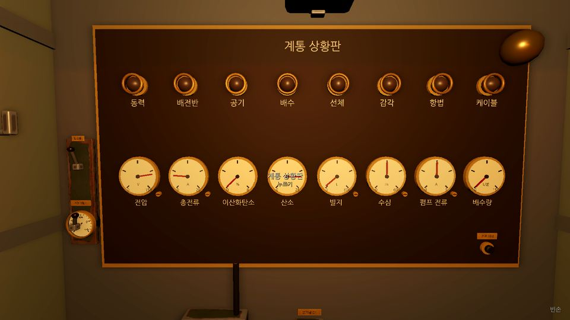
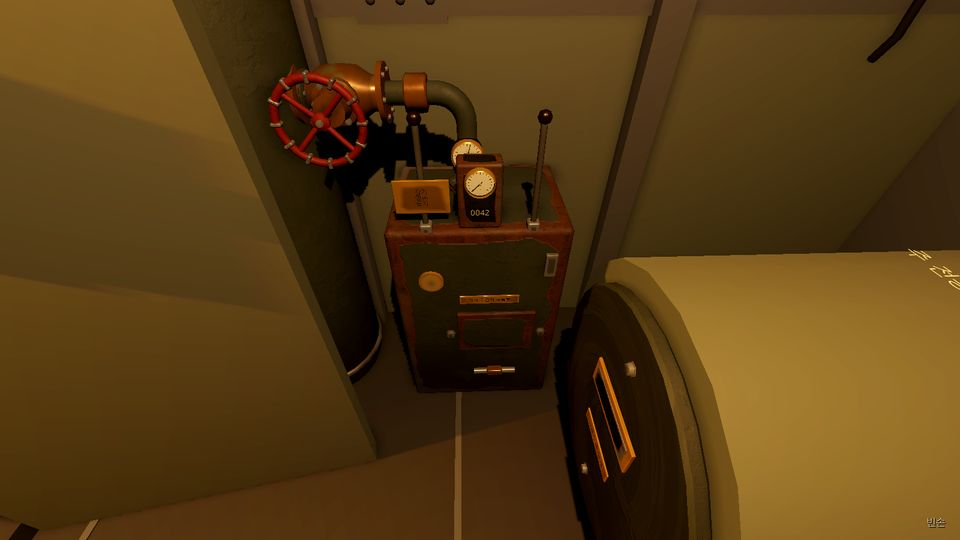
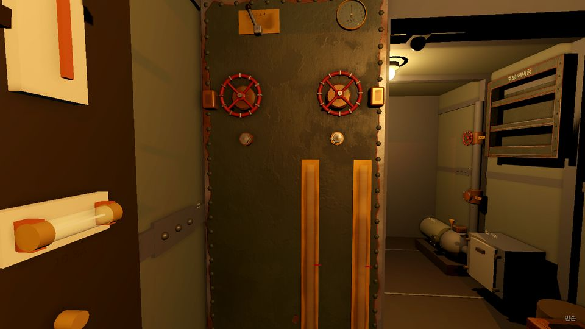
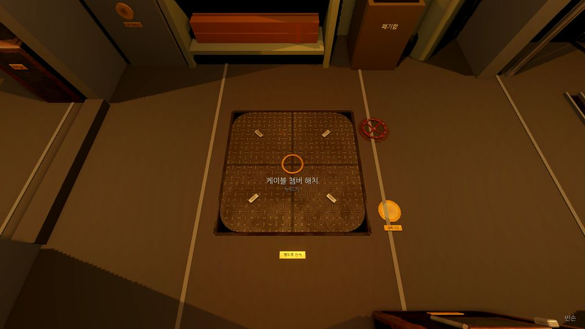
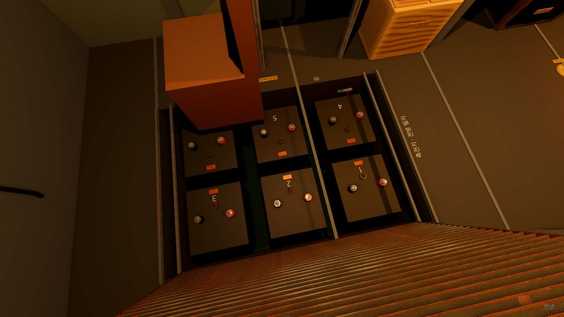
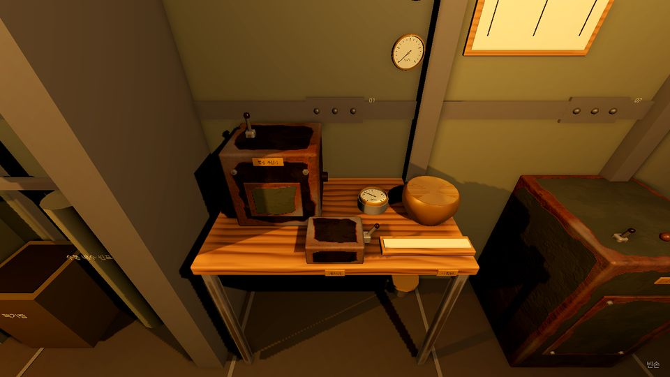

# M2 WP6 배치 보고서 · 장비 자리와 손 닿는지·작업 시점 검사

2026-10-27 · 브랜치 `claude/deepline-m2-layout` (본선 `claude/dazzling-clarke-m2eohe`의 `456ffb3`에서 갈라짐)

## 요약

M2의 새 장비 자리를 모두 Godot 장면에 놓았습니다. 동작은 없습니다. 장비마다 부딪힘 상자, 한국어 명판, 빈 상호작용 표지를 두었습니다. 표지는 조준 상자와 ID만 있고 명령은 없습니다.

| 할 일 | 결과 |
| --- | --- |
| 새 장비 자리 (`Submarine.Layout.cs`) | 배치도 표의 장비 29줄(분기함 여덟 포함), 표지 250개. 모습은 아트 키트로 지었다 |
| 배치 변경 | 주 전동기 x 0.45~1.15, 중앙 바닥 아래 케이블 챔버 우물, 축전지 갑판 판, 배전반을 y 0.77까지 내림. 리벳, 현창, 선체 밸브 자리는 그대로 |
| 자리 표 (`StandPoints.cs`) | 작업 시점 28곳과 손이 닿는지만 보는 자리 6곳 |
| `reach` 묶음 | 물체 301개(M1 51 + 표지 250)를 모두 서 있는 자리에서 가리지 않고 겨냥한다. 표지가 리벳·현창·선체 밸브·빌지 수위 유리관·M1 물체에서 0.25m 넘게 떨어졌는지도 본다 |
| `workviews` 묶음 | 28곳 모두 대상 전부가 1600×900 화면 안에 들고, 각각 자기 자신으로 겨냥된다. M1 네 곳의 옛 확인을 포함한다 |
| 확인 | `dotnet test`(시뮬레이션 268, 소리 139) 통과. `tools/godot-check.sh`(crisis, hands, reach, workviews) 통과. 종료 FATAL 여부를 보려고 전체 자동 플레이만 따로 6번 연달아 돌려 6번 모두 깨끗했다 |

`sim/`, `data/`, `sim.tests/`는 건드리지 않았습니다.

## 화면

xvfb와 `--rendering-driver opengl3`로 1600×900에서 찍고 960×540으로 줄였습니다. 모두 작업 시점(F) 화면입니다. 가운데 글씨는 조준한 표지의 이름(HUD)입니다.

| | |
| --- | --- |
|  상황판(넓힌 작업 시점). 왼쪽 끝벽에 기관 전령기와 탐조등 레버, 표시등 테, 계기 유리와 영점 나사, 오른쪽 아래에 램프 시험 단추 |  후방 우현: 케이블 윈치 구동부(레버 둘, 계수기와 하중계, 띠 덮개), 증기 축압기의 정지 밸브와 관, 줄어든 주 전동기의 끝 덮개 |
|  해치 격벽 중앙 쪽의 밸러스트 조절반: 침수 밸브 둘, 패킹 너트, 탱크 유리관, 흡입 선택 레버, 경사계 |  중앙 바닥의 케이블 챔버 해치(도그 넷), 바닥에 묻힌 압착 바퀴와 수위 유리 |
|  축전지 갑판 판을 연 모습. 셀마다 단자 너트 둘, 통기 마개, 연결 자리 |  좌현 항법 책상: 항법 계산기, 자이로 중계 나침반, 자기 나침반, 탁상 계산기, 계산자, 벽의 시계와 계산 도표. 오른쪽은 자이로 컴퍼스 함 |

다시 찍기(작업 시점 28곳 전부):

```sh
xvfb-run -a -s "-screen 0 1600x900x24" $GODOT --path game --rendering-driver opengl3 --audio-driver Dummy \
  --resolution 1600x900 -- --autotest=workviews --layoutshots=폴더
```

## 배치도

좌표는 M1 틀입니다. x 0(후방)~8(전방), z −1.2(좌현)~1.2(우현), 바닥 y 0, 천장 2.2. '표지'는 그 장비의 표지 수, '작업 시점'은 F로 들어가는 시점 이름입니다. 설계(`M2-design.md` 'Godot plan')에서 옮긴 것은 굵게 썼고 이유는 아래 '설계에서 옮긴 것'에 있습니다.

### 후방 (x 0~2.7), 표지 48

| 장비 | 자리 | 표지 ID | 표지 | 작업 시점 |
| --- | --- | --- | --- | --- |
| 주 전동기 정류자 쪽 덮개 (PWR-02) | 전동기 앞 끝면 (1.15, 0.45, 0.45), +x를 본다. 띠 창 | motor.cover, motor.cover.bolt.1~2 | 3 | motor |
| 축 패킹 상자 (HUL-03) | 패킹 상자 x 0.08~0.26, 누름판 0.28, 너트 A·B (0.335, 0.55/0.35, 0.45), 축 고리 0.4. 누수 자리 (0.06, 0.45, 0.45)는 그대로 | shaft.follower, shaft.nut.A, shaft.nut.B, shaft.collar | 4 | shaft (웅크림) |
| 분기함 C8 | (0.35, 1.3, 1.2) 벽, −z를 본다 | junction.C8.{cover, screw.1, screw.2, box, cable} | 5 | 없음 |
| 증기 축압기 (PWR-03) | **그릇 (2.0, 0~1.5, 1.0) r 0.2**. 압력계 (2.0, 1.35, 0.79), 점검 플랜지 볼트 넷 (2.0±0.05, 0.6±0.05, 0.78), **정지 밸브 바퀴 (1.72, 0.95, 0.80)**, **빼기 밸브 바퀴 위 (2.32, 0.5, 1.0)**, **관 이음 (1.56, 0.95, 0.94)**, 관은 윈치 지붕으로 | steam.stop, steam.bleed, steam.flange.bolt.1~4, steam.joint | 7 | accumulator (**해치를 닫고**) |
| 케이블 윈치 구동부 (CBL-01) | 상자 x 1.2~1.65, y 0~0.7, z 0.8~1.15. 브레이크 레버 (1.3, 0.85, 0.82), 조작 레버 (1.55, 0.85, 0.82), 멈춤쇠 (1.25, 0.6, 0.78), 띠 덮개 (1.38, 0.35, 0.78)와 볼트 둘, 턴버클 (1.38, 0.17, 0.77), 계수기와 하중계 (1.425, 0.78, 0.84), 점검 창 | winch.{control, brake, pawl, cover, cover.bolt.1~2, adjust} | 7 | winch |
| 펌프 더한 것 (WTR-02/03) | 베어링 덮개 (0.88, 0.3, −0.71)와 볼트 넷, 기름 컵 (0.88, 0.545, −0.92), **몸통 돌기 (1.05, 0.53, −0.9)**, 역류 밸브 보닛 (0.98, 0.85, −1.0)과 볼트 넷, **배출 밸브 (0.98, 1.5, −0.99)** | pump.cap, pump.cap.bolt.1~4, pump.oilcup, pump.body, checkvalve.bonnet, checkvalve.bolt.1~4, pump.discharge | 13 | pump |
| 분기함 C3 | **(2.17, 0.8, −1.2)** 벽, +z | junction.C3.* | 5 | 없음 |
| 후방 예비품 사물함 | 좌현 위 벽 x 1.15~1.85, y 1.3~2.05, 앞면 z −1.05, 선반 셋 | locker.aft.shelf.1~3 | 3 | locker.aft |
| 후방 폐기함 | (2.45, 0~0.42, −0.6) | discard.aft | 1 | 없음 |

### 중앙 (x 2.7~5.4), 표지 83

| 장비 | 자리 | 표지 ID | 표지 | 작업 시점 |
| --- | --- | --- | --- | --- |
| 도구판 | 해치 격벽 중앙 쪽 면 좌현: x 2.76, y 0.85~1.8, z −1.15~−0.5. 4열 5행에 윤곽 17개와 이름 | toolboard.{wrench … soldering_iron} | 17 | toolboard |
| 밸러스트 조절반 (WTR-04) | 같은 면 우현 z 0.47~1.19. 침수 밸브 바퀴 (y 1.55, z 0.65/1.0), 그 0.15 아래 패킹 너트, **바퀴 바깥 옆 몸통 돌기**, 탱크 유리관 (y 0.5~1.3, z 0.55/0.75), 흡입 선택 레버 (y 1.85, z 0.95), 경사계 (y 1.86, z 0.6) | ballast.{fore,aft}.{flood, gland, body}, pump.suction | 7 | ballast |
| 흡수통 (AIR-02) | M1 상자 (3.0, 0~0.6, −1.0) 그대로, 위에 뚜껑, 앞 위에 죔쇠 둘, 표시 창 (3.0, 0.4, −0.82) | scrubber.lid, scrubber.clamp.1~2 | 3 | scrubber |
| 환풍기 (AIR-01) | **(3.85, 2.05, −0.2)** 천장. 전동기 몸통, 날개, 아래를 향한 보호망과 나비 너트 둘, 종이 띠 | fan.guard, fan.guard.nut.1~2, fan.motor | 4 | fan |
| 분기함 C1, C2, C6, C7 | 배전반 아래 x 3.35/3.55/3.75/3.95, y 0.35, 벽 z 1.2 | junction.{C1,C2,C6,C7}.* | 20 | junctions (웅크림) |
| 산소 발생로 (AIR-03) | 배전반 앞쪽 끝 아래 (4.6, 0~0.7, 0.95), 앞면 z 0.73. 문과 걸쇠, 통풍구, 점화 창, 양초 단추 | o2.furnace.{door, latch, vent}, candle, o2.furnace | 5 | furnace (웅크림) |
| 배전반 더한 것 (ELC-02) | 회로마다 칼날 집게 나사(위 1.69), 전류계 (y 0.86). 판을 y 0.77까지 내림 | switch.Cx.clamp, ammeter.Cx (C1~C8) | 16 | switchboard |
| 케이블 챔버 (HUL-04) | 바닥 구멍 x 3.6~4.4, z −0.4~0.4. **모서리 둥근 네모 해치 0.78**와 도그 넷, 우물 깊이 0.9, 우물 바닥에 패킹 누름 고리 (4.0, −0.89, 0)와 나사 넷, **바닥에 묻힌 압착 바퀴 (4.52, 0, −0.25)와 수위 유리 (4.52, 0, 0.28)** | chamber.hatch, chamber.hatch.dog.1~4, chamber.squeeze / chamber.seal, chamber.seal.screw.1~4 | 11 | chamber / chamber.in (해치를 열고 웅크림) |

사이펀 기록기는 설계대로 중앙이 아니라 전방 통신 책상에 두었습니다(수동 펌프 손잡이와 부딪힘).

### 전방 (x 5.4~8), 표지 119

| 장비 | 자리 | 표지 ID | 표지 | 작업 시점 |
| --- | --- | --- | --- | --- |
| 상황판 더한 것 (SNS-01/05) | 표시등 여덟에 테 (y 1.73), 드리프트 계기 다섯(전압, 총전류, 빌지, 수심, 펌프 전류)에 유리와 **영점 나사 (계기 오른쪽 아래, y 1.25)**, 램프 시험 단추 (7.99, 1.0, 0.8) | panel.bezel.&lt;lamp&gt; ×8, gauge.&lt;g&gt;.glass ×5, gauge.&lt;g&gt;.zero ×5, panel.lamptest | 19 | panel (넓힘) |
| 끝벽 레버 | 상황판 옆 좌현 띠 **z −1.07**: 기관 전령기 (y 1.1, 눈금 다섯), 탐조등 레버 (y 1.41) | propulsion.telegraph, searchlight.switch | 2 | panel |
| 상황판 배선함 (SNS-02)과 분기함 C4 | 상황판 아래 끝벽 (8.0, 0.55, −0.45), (8.0, 0.55, 0.0), −x를 본다 | panel.wiring.cover, panel.wiring.screw.1~4, junction.C4.* | 10 | panelbox (웅크림) |
| 탐조등 (SNS-04) | 천장 (7.6, 2.05, 0) 몸통 x 7.4~7.8. 아래 장전 문과 걸쇠 둘, 뒤쪽 탄소봉 보내기 손잡이 (7.39, 2.05, 0) | searchlight.{door, latch.1~2, feed, housing} | 5 | searchlight |
| 현창 1, 2 (HUL-02) | (7.5, 1.55, ∓1.2). 둘레 볼트 여섯 r 0.2(번호는 위에서 시계 방향), 도그 둘 (±0.29), 조임 고리, **철판 덮개는 위로 젖힘** | viewport.N.{ring.bolt.1~6, dog.1~2, ring, deadlight} | 20 | viewport.1, viewport.2 |
| 축전지 갑판 판 (PWR-01) | **x 6.0~7.4**, z −0.55~0.55, 좌현 경첩, 걸쇠 둘. 판 아래 셀 여섯마다 단자 너트 둘, **통기 마개(가운데 줄 쪽 0.07)**, 연결 자리. **점퍼 걸이 (6.1, −0.2, 0.52)** | battery.deck / battery.cell.N, battery.cell.N.nut.1~2, battery.link.N, battery.jumper | 26 | battery (판을 열고 웅크림) |
| 예비 셀 상자 | **(5.7, 0~0.4, 0.85)**, 뚜껑 둘 | locker.spare_cell, discard.crate | 2 | 없음 |
| 항법 책상 (NAV-02, 좌현) | 윗면 y 0.78, x 5.55~6.45, z −1.2~−0.7. 항법 계산기 (5.8, 0.93, −1.0)와 덮개·나사 둘·되돌림 손잡이·전원 레버, **자이로 중계 나침반 (6.15, 0.82, −1.0)**, **자기 나침반 (6.35, 0.78~0.9, −0.95)**, **탁상 계산기 (6.0, 0.82, −0.78)**, **계산자 쟁반 (6.3, 0.79, −0.78)**. 벽: 수심 기준계 (5.6, 1.6), 시계·속도계·축 회전계 (6.25, 1.7/1.5/1.3), 계산 도표 (6.45~6.85, 1.3~1.9) | navcomp.{cover, cover.screw.1~2, reset, power}, gadget.{compass, calculator, sliderule} / gadget.nomogram | 9 | navdesk / nomogram |
| 분기함 C5 | 항법 책상 아래 (6.0, 0.4, −1.2) | junction.C5.* | 5 | 없음 |
| 자이로 컴퍼스 함 (NAV-01) | 바닥 x 6.85~7.35, y 0~0.8, z −1.2~−0.7. 통로 쪽 뚜껑과 나사 넷, 위에 전원 스위치·안정 표시등·맞춤 손잡이 | gyro.{lid, case.screw.1~4, switch, align, case} | 8 | gyro |
| 통신·시험 책상 (CBL-02, 우현) | 윗면 y 0.78, x 6.1~6.75, z 0.7~1.2. 사이펀 기록기 (6.25, 0.88, 1.05)와 잉크 병·마중 고무공·시험 단추·펜 팔·펜·**증폭 진공관 (6.3, 1.04, 1.12)**, 저항 측정 브리지 (6.6, 0.83, 0.95) | siphon.{ink, bulb, testkey, arm, pen, tube.1}, gadget.bridge | 7 | commdesk |
| 청음기와 소나 (SNS-03) | 책상 위 벽: **청음기 (6.35, 1.5, 1.11)** 문과 나사 둘, **소나 (6.72, 1.5, 1.11)** 진공관, 헤드폰 걸이 (6.45, 1.22, 1.15) | hydrophone.{door, door.screw.1~2}, hydrophone, sonar.tube.1, gadget.headphones | 6 | hydrophone |

### 표지에 넣지 않은 것

- **덮개 안쪽 부품.** 덮개를 열어야 보이는 것은 표지를 두지 않았습니다. 브러시, 정류자, 축 패킹, 개스킷, 브레이크 라이닝, 펌프 베어링, 역류 밸브 판, 밸브 줄기와 패킹, 흡수제 통, 환풍기 날개·축·베어링, 화로 격자, 상황판 전구, 배선함 단자대, 탐조등 탄소봉, 현창 패킹, 항법 계산기 톱니, 자이로 덮개와 베어링, 청음기 진공관이 여기에 해당합니다.
  - 덮개가 열리는 모습이 아직 없어서 겨냥 검사를 할 수 없습니다.
  - 덮개 바로 뒤에 놓일 것이라 덮개에 손이 닿으면 이것들도 닿습니다.
  - 계통 작업 묶음이 덮개를 열고 닫는 모습을 만들 때 함께 넣고, `reach` 표에 대상을 더하면 됩니다.
- **배전반 칼날·위 집게·받침(ELC-02).** M1 칼날 스위치의 조준 상자 하나가 이 셋을 덮고 있습니다. WP5가 스위치를 바인더로 다시 묶을 때 나눕니다.
- **M1 예비품 사물함 6칸.** 칸에 들어갈 물건이 WP2에서 정해집니다. 후방 사물함 칸 ID도 지금은 `locker.aft.shelf.N`이고, 물건이 정해지면 `locker.<물건>`으로 바꿉니다.
- **계산 도구 ID** (`gadget.*`)는 설계에 이름이 없어서 정했습니다. WP22가 바꿔도 됩니다.

## 설계에서 옮긴 것 (±0.2m 안, `reach`와 `workviews`로 정함)

| 무엇 | 설계 | 지금 | 이유 |
| --- | --- | --- | --- |
| 증기 축압기 전체 | 그릇 x 2.2 | x 2.0 | 선체 밸브 4 (2.4, 0.05, 0.9)가 그릇 안에 들어간다 |
| 축압기 정지 밸브 | (1.95, 1.05, 0.82) | 바퀴 (1.72, 0.95, 0.80) | 관이 리벳 11에서 0.25m 넘게, 바퀴가 열린 해치 문 자리(z 0.76까지) 밖 |
| 축압기 빼기 밸브 | (2.4, 0.35, 0.82) | 그릇 옆 (2.32, 0.35, 1.0), 바퀴는 위 | 앞을 보면 열린 해치 문과 겹치고, 배출관이 선체 밸브 4와 0.25m 안 |
| 축압기 관 이음 | (1.95, 0.8, 0.85) | 가로 구간 (1.56, 0.95, 0.94) | 작업 시점에서 정지 밸브 바퀴에, 서 있는 자리에서 윈치 레버에 가렸다 |
| 분기함 C3 | x 2.3 | x 2.17 | 후방 빌지 수위 유리관(x 2.48)과 0.25m |
| 환풍기 | (4.0, 2.05, 0) | (3.85, 2.05, −0.2) | 중앙 천장 등(4.05, 2.1, 0)과 겹친다. 등 바로 옆이라 그림자는 끔 |
| 케이블 챔버 해치 | 둥근 r 0.35 | 모서리 둥근 네모 0.78, 구멍 0.8 네모 | 바닥 부딪힘 판을 네모로 비우므로. 0.76이면 패킹 고리 나사가 구멍 가장자리에 가렸다 |
| 챔버 압착 바퀴와 수위 유리 | x 4.45 | x 4.52 | 구멍(4.4까지)과 겹친다 |
| 축전지 갑판 판 | x 6.2~7.2 | x 6.0~7.4 | 6.2~7.2면 1·3·4·6번 셀 바깥 단자가 고정 격자 밑 |
| 점퍼 걸이 | (5.95, −0.2, 0.5) | 우물 우현 벽 (6.1, −0.2, 0.52) | 5.95는 고정 격자(5.9~6.0) 밑이라 손이 안 닿는다 |
| 셀 통기 마개 | 셀 가운데 | 가운데 줄 쪽으로 0.07 | 비스듬히 보면 가까운 단자 너트에 가렸다 |
| 예비 셀 상자 | x 5.6 | x 5.7 | 우현 전방 틀 기둥(x 5.34~5.46)과 겹친다 |
| 자이로 중계 나침반 | 벽 (6.05, 1.0, −1.05) | 책상 위 (6.15, 0.82, −1.0) | 리벳 01과 0.19m |
| 탁상 계산기, 계산자 쟁반, 자기 나침반 | x 5.9 / 6.2 / 6.3 | x 6.0 / 6.3 / 6.35 | 항법 계산기 덮개, 중계 나침반과 겹친다 |
| 청음기, 소나, 증폭 진공관 | x 6.25 / 6.65 / (6.17) | x 6.35 / 6.72 / 6.3 | 리벳 03과 0.25m |
| 현창 철판 덮개 | (열린 자리 정하지 않음) | 위로 젖힘 | 옆으로 펴면 계산 도표 판에 닿는다 |
| 끝벽 레버 | z −1.05 | z −1.07 | 상황판 황동 테와 겹친다 |
| 계기 영점 나사 | 계기 아래 y 1.2 | 계기 오른쪽 아래 (x+0.085, 1.25) | y 1.2에는 M1 계기 이름 글씨가 있다 |
| 펌프 몸통(만져 보기) | 몸통 | 몸통 위 돌기 (1.05, 0.53, −0.9) | 몸통 앞은 M1 막는 상자 안이라 조준선이 닿지 않는다 |
| 펌프 배출 밸브 | y 1.6 | y 1.5 | 베어링 덮개(y 0.3)와 한 작업 시점에 들게 |
| 밸러스트 몸통 돌기 | (자리 없음) | 바퀴 바깥 옆 0.14 | 바퀴 아래는 패킹 너트, 그 아래는 유리관 |

작업 시점도 몇 곳 설계와 다릅니다.

| 작업 시점 | 설계 (눈 → 대상) | 지금 | 이유 |
| --- | --- | --- | --- |
| shaft | (0.9, 0.8, 0) → (0.2, 0.45, 0.45) | (0.35, 0.9, −0.25) → (0.3, 0.45, 0.45) | 설계 눈에서는 전동기 막는 상자가 가린다 |
| accumulator | (2.05, 1.25, 0.1) → (2.15, 0.8, 0.95) | (1.9, 1.3, 0.1) → (2.0, 0.75, 0.95) | 관 이음이 정지 밸브에 가리지 않게 |
| pump | (1.0, 1.2, −0.2) → (0.95, 0.65, −0.95) | (1.3, 0.95, 0.25) → (0.93, 0.9, −0.9) | 베어링 덮개(y 0.3)와 배출 밸브(y 1.5)가 한 화면에 |
| toolboard | 눈 z −0.8 | 눈 z −0.6 | z −0.8에서는 M1 사물함 옆판이 오른쪽 두 줄을 가린다 |
| ballast | (3.5, 1.3, 0.8) | (3.65, 1.35, 0.75) | 흡입 선택 레버(y 1.85)가 화면 밖 |
| searchlight | (7.0, 1.6, 0) | (7.25, 1.55, 0.55) → (7.6, 2.0, 0) | 전방 경고등이 몸통 앞을 가린다 |
| battery | (6.7, 1.0, 0.75) → (6.7, −0.2, 0) | (6.8, 1.35, −0.4) → (6.7, −0.25, 0.1) | 우현 쪽에서는 조종석이 6번 셀을 가린다(조종석이 우물 우현 가장자리 위에 있다) |
| commdesk | (6.4, 1.45, 0.2) | (6.2, 1.5, 0.3) | 조종석 등받이가 덜 보이게 |
| M1 switchboard | 눈 y 1.45, 대상 y 1.38 | 눈 y 1.55, 대상 y 1.3 | 낮은 눈에서는 칼날 스위치 조준 상자가 위 집게 나사를 가리고, 전류계도 화면에 들어야 한다 |
| M1 panel | (7.24, 1.45, 0) | (6.95, 1.45, −0.12) | 끝벽 레버(z −1.07)와 램프 시험 단추까지 보이게 넓힘 |

## 자리 표 (`game/scripts/Testing/StandPoints.cs`)

발 위치는 y 0.05입니다. '열기'는 대상을 드러내려고 먼저 하는 것입니다. `reach`는 각 자리에 몸(반지름 0.24, 높이 1.75 또는 웅크려 1.05)이 벽이나 장비에 박히지 않는지도 봅니다.

| 자리 | 발 (x, z) | 웅크림 | 열기 | 대상 수 | 작업 시점 |
| --- | --- | --- | --- | --- | --- |
| switchboard | (4.1, 0.3) | | | 42 | 예 |
| strainer | (1.55, −0.3) | 예 | | 6 | 예 |
| locker | (3.75, −0.25) | | | 4 | 예 |
| panel | (7.3, −0.1) | | | 22 | 예 |
| motor | (1.75, 0.2) | | | 3 | 예 |
| shaft | (0.3, −0.2) | 예 | | 4 | 예 |
| accumulator | (2.05, 0.15) | | 해치 닫기 | 7 | 예 |
| winch | (1.45, 0.25) | | | 7 | 예 |
| pump | (1.0, −0.3) | | | 13 | 예 |
| locker.aft | (1.5, −0.35) | | | 3 | 예 |
| toolboard | (3.4, −0.45) | | | 17 | 예 |
| ballast | (3.45, 0.5) | | | 7 | 예 |
| scrubber | (3.05, −0.35) | | | 3 | 예 |
| fan | (3.85, 0.25) | | | 4 | 예 |
| junctions | (3.65, 0.5) | 예 | | 20 | 예 |
| furnace | (4.6, 0.3) | 예 | | 5 | 예 |
| chamber | (4.0, 0.65) | | | 6 | 예 |
| chamber.in | (4.0, 0.64) | 예 | 챔버 해치 | 5 | 예 |
| panelbox | (7.45, −0.2) | 예 | | 10 | 예 |
| searchlight | (7.0, −0.1) | | | 5 | 예 |
| viewport.1 | (7.5, −0.45) | | | 10 | 예 |
| viewport.2 | (7.5, 0.45) | | | 10 | 예 |
| battery | (5.7, 0) | 예 | 갑판 판 | 25 | 예 |
| navdesk | (6.0, −0.35) | | | 8 | 예 |
| nomogram | (6.65, −0.4) | | | 1 | 예 |
| gyro | (7.1, −0.35) | | | 8 | 예 |
| commdesk | (6.4, 0.35) | | | 7 | 예 |
| hydrophone | (6.45, 0.35) | | | 6 | 예 |
| strainer.open | (1.55, −0.3) | 예 | 거름망 볼트 풀고 덮개 열기 | 1 (바구니) | |
| junction.C8 | (0.3, −0.2) | | | 5 | |
| aft.port | (2.0, −0.2) | | | 6 (후방 폐기함, C3) | |
| junction.C5 | (6.0, −0.2) | 예 | | 5 | |
| battery.deck | (5.7, 0) | | | 1 (닫힌 갑판 판) | |
| crate | (5.7, 0.3) | | | 2 | |

표에 없는 M1 물체(해치, 수동 펌프 손잡이, 리벳 이음 12곳)는 종단 플레이와 같은 방식으로 자리를 골라 겨냥합니다(`AutoPlayer.Approach`).

## 고친 기존 파일과 이유

| 파일 | 고친 것 | 이유 |
| --- | --- | --- |
| `game/scripts/World/Submarine.cs` | `Build`에서 `BuildLayout()` 호출 | 새 partial을 짓는다 |
| 〃 `BuildHull` | 바닥 부딪힘 판 한 장을 챔버 구멍과 갑판 판 구멍을 뺀 조각들로 나눔. 보이는 바닥에서 챔버 구멍을 뺌 | 덮개를 열면 우물 안이 보이고 손이 닿아야 한다. 덮개가 닫혀 있으면 덮개의 부딪힘 상자가 막아 M1과 똑같이 걷는다 |
| 〃 `BuildBatteryWell` | 반투명 격자 판과 살을 갑판 판 자리(x 6.0~7.4)에서 뺌 | 그 자리는 들어 올리는 갑판 판(아트 키트 격자)이 대신한다 |
| 〃 `BuildFurniture` | 주 전동기 원기둥, 막는 상자, 이름판, 축을 x 0.45~1.15로 | 설계의 배치 변경(축 패킹 상자 자리) |
| `game/scripts/World/Submarine.Equipment.cs` `BuildSwitchboard` | 판과 막는 상자를 아래로 y 0.77까지 | 설계의 배치 변경(전류계 자리) |
| `game/scripts/Testing/AutoPlayer.cs` | `Suites()`에 `reach`와 새 `workviews` 등록, 옛 `CheckWorkView` 지움(새 묶음이 M1 네 곳을 포함), 끝내기 전에 GC를 돌리고 두 프레임 기다림 | 아래 '종료 FATAL' |
| `tools/godot-check.sh` | 묶음 설명 줄 | 새 묶음 |

설계는 `Main.cs`도 고칠 파일로 적었지만 필요 없었습니다. 스크린샷은 `--layoutshots=` 인자를 자동 플레이어가 읽습니다.

## 정한 것 (사람이 자리에 없어 추천 기본값으로)

- **표지는 Interactable 그대로.** 조준하면 HUD에 이름이 뜨고 F로 작업 시점에 들어가지만, 누르면 아무 일도 없습니다. 계통 작업 묶음은 `Submarine.RemoveMarker(id)`로 표지를 지우고 같은 ID로 실제 물체를 붙입니다. 같은 ID가 둘이면 `Interactables.Add`가 예외를 냅니다. `Submarine.Markers`에 남은 수가 아직 바인딩되지 않은 자리 수입니다.
- **바닥 덮개(챔버 해치, 갑판 판)는 열림 상태가 표현 전용입니다.** `Submarine.SetCoverOpen(id, open)`으로 열고, 열면 구멍을 막던 부딪힘 상자가 꺼집니다. 지금은 확인 묶음만 부릅니다. 덮개 상태가 시뮬레이션 부품 속성으로 생기면(WP11, WP19) 스냅숏을 따라 부르면 됩니다.
- **축압기는 해치를 닫아야 손이 닿습니다.** 설계 자리(해치 문이 열려 닿는 x 1.7~2.6, z ≥ 0.8)는 열린 문 뒤라서, 통로 어디서도 가리지 않고 겨냥할 수 없습니다. 둘 만한 다른 자리가 후방에 없어 자리는 그대로 두고 '해치를 닫고 작업'을 기본으로 했습니다. 관 이음과 정지 밸브는 문 밖이라 열린 채로도 닿습니다. 사람 확인 요청 1.
- **새 장비 모습은 아트 키트, M1 장비는 회색 상자 그대로.** 한 화면에 두 질감이 섞입니다(DECISIONS 'M2 새 장비의 모습'대로이고, M1 장비를 바꾸는 것은 M5).
- **천장 등 바로 옆의 환풍기와 탐조등 몸통은 그림자를 던지지 않습니다.** 던지면 상황판 위쪽과 중앙 천장이 크게 가렸습니다.
- **새 장비가 M1 자리와 0.25m 넘게 떨어졌는지는 `reach`가 봅니다.** 같은 장치에 붙는 것(현창 볼트와 현창 누수 자리, 축 패킹 상자와 그 누수 자리, 배전반과 상황판에 더한 것)은 뺍니다.
- **종료 FATAL.** 새 묶음 둘을 더하자 전체 자동 플레이가 다섯 번에 세 번꼴로 모든 묶음을 통과한 뒤 끝날 때 Godot .NET이 `FATAL: csharp_lang && !csharp_lang->script_bindings.is_empty()`로 멈췄습니다(종료 코드 134).
  - 남은 것은 대부분 매 프레임 조준선 질의(`PhysicsRayQueryParameters3D`)의 C# 껍데기 약 7천 개였습니다. 묶음이 길어져 거두지 않은 껍데기가 끝날 때 한꺼번에 남은 것입니다.
  - 그래서 끝내기 전에 `GC.Collect()`를 하고 두 프레임 기다리게 했습니다. 그 뒤 6번 연달아 깨끗했습니다.
  - 본선 기준(456ffb3)은 5번 모두 깨끗했습니다.
  - 근본 원인은 `InteractionController.RayPick`이 매번 질의 객체를 새로 만드는 것입니다. 질의 객체를 하나 두고 재사용하는 일은 WP5(조작 핵심)에 넘깁니다.

합칠 때 위 결정의 요지를 `docs/DECISIONS.md`에 'M2 (WP6 배치)' 절로 옮깁니다. 본선이 같은 파일을 고치고 있어 이 브랜치에서는 고치지 않았습니다.

## 사람 확인 요청

1. **증기 축압기를 해치를 닫고 작업하는 것.** 증기를 빼는 정식 수리 중에 해치가 닫혀 빌지가 갈립니다. 괜찮다면 그대로 두겠습니다. 아니면 해치 문이 우현 경첩이라 생기는 문제이므로 둘 중 하나를 고르셔야 합니다.
   - 문 경첩을 좌현으로 바꾼다(M1 변경).
   - 축압기를 다른 곳으로 옮긴다(후방 우현은 윈치와 전동기로 차 있다).
2. **줄어든 주 전동기와 축 패킹 상자.** 웅크려 들어가는 느낌과 어두움을 봐 주세요. 후방 끝은 등에서 멀어 어둡습니다.
3. **케이블 챔버 우물.** 해치를 열고 들어가면 나올 방법(사다리)이 아직 없고, 우물 안이 아주 어둡습니다. WP19 때 사다리와 손전등 또는 작은 등을 넣을 생각입니다.
4. **조종석이 축전지 우물 우현 가장자리를 덮습니다(M1 배치).** 그래서 6번 셀은 좌현 쪽에서만 잘 보입니다. 조종석을 0.2m쯤 우현으로 옮길지 정해 주세요.
5. **표지에 손을 대면 이름만 뜨고 아무 일이 없습니다.** WP5와 계통 작업 묶음 전까지 그대로입니다. 플레이해 보실 때 헷갈리지 않으시도록 미리 알려 드립니다.
6. **작업 시점 각도.** 28곳을 F로 직접 둘러봐 주세요. 특히 shaft, pump, battery, commdesk는 각도를 여러 번 고쳤습니다.
7. **도구판 글씨 크기와 윤곽.** 이름 글씨(1.4cm)가 작업 시점에서 겨우 읽힙니다.

## 확인 방법

```sh
dotnet test
GODOT=/경로/Godot_v4.7.2-stable_mono_linux.x86_64 tools/godot-check.sh                 # crisis, hands, reach, workviews
GODOT=... tools/godot-check.sh reach workviews                                          # 배치 묶음만
```

전체 Godot 확인(빌드, 가져오기, 스모크, 네 묶음)은 이 환경에서 약 1분 10초 걸렸습니다(설계의 예산 3분 안).
