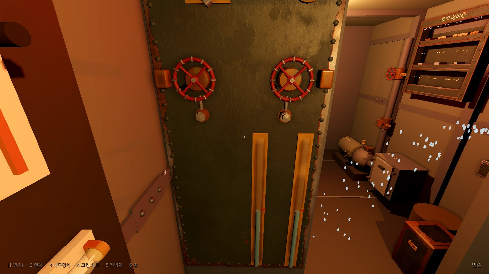
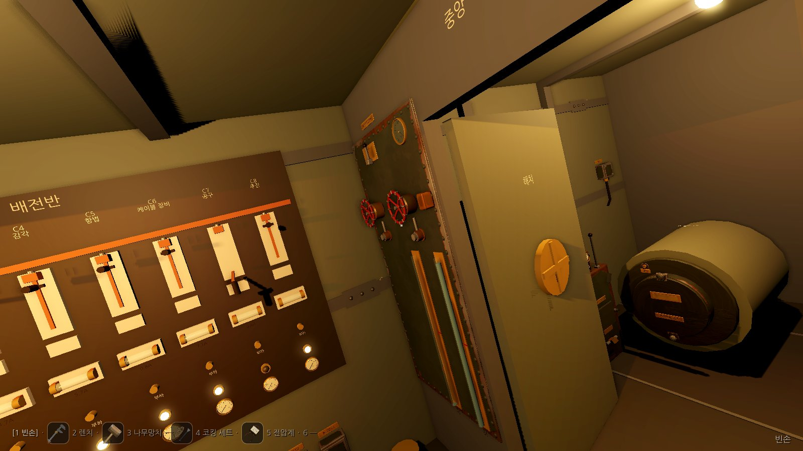
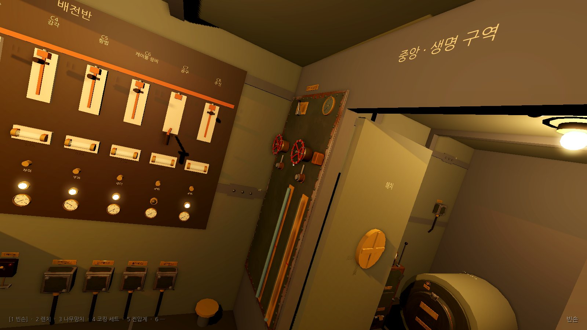

# M2 WP18 보고서: 자세와 밸러스트 (WTR-04, 트림, 흡입 선택기, 구르는 도구)

브랜치 `claude/deepline-m2-ballast`. 1단계(흡입 선택기, 8bf03e4)는 본선에 먼저 합쳐졌다(9e7d747).

## 만든 것

### 시뮬레이션

- **흡입 선택기** (`sim/Systems/Attitude.cs` `Suction`, WaterSystem 2단계): 상태 부품 `pump.suction` {pos} 0 빌지, 1 앞 탱크, 2 뒤 탱크, 3 챔버 줄. 레버 장치 `pump.suction`(명령 `pump.suction.bilge|fore|aft|chamber`, 맨손, 소음 lever). 조회 `pump.suction` → 'bilge' 등의 글. 탱크에서는 정격 × `tuning.suction.tankFactor`(0.8), 챔버 줄은 `chamberLineLps`(0.8 L/s) 이하. 고른 쪽 물이 `dryL`(0.5 L) 아래면 `PumpStarvation` = 1(헛돎, 전류가 준다). 선택기가 없는 데이터에서는 늘 빌지이고 펌프 코드가 예전 가지를 그대로 탄다.
- **기울기 모듈** (`Attitude`, ModuleSlots의 Attitude 칸): 상태 부품 `attitude` {trimDeg, rollClock}, `ballast.tank.fore/aft` {water}, `ballast.fore/aft.valve`.
  - 침수 밸브가 열려 있으면 q = leakK × 3cm² × 열린 바퀴 × √수심으로 탱크가 찬다(용량 300L까지). 수심 100m에서 한 바퀴면 0.6 L/s.
  - trimDeg = 0.015 × (Σ 탱크 (물 − 150) × 팔 ±4m + 0.25 × Σ 실내 물 × 팔). 빌지 팔: 후방 −2.7, 전중 +1.4. 바닥 물 팔: 전방 +2.7, 중앙 0, 후방 −2.7. 앞 탱크가 차면 +9.0도. 선형, 삼각함수 없음.
  - 5도를 넘으면 바닥 위 물이 낮은 쪽 이웃 구역으로 초당 0.02 × (|트림| − 5)의 비율로 흐른다(해치가 닫히면 넘지 않음).
  - `toolBoard.rollTiltDeg`(10도)를 넘으면 `rollSeconds`(3초)마다 바닥의 도구가 한 구역씩 낮은 쪽으로 구르고 `ToolRolled(도구, 구역 순번, 구역 이름)`을 낸다. 해치가 닫히면 넘지 않는다.
  - 배수 표시등: |트림| > 5도 주의, > 12도 고장(바뀔 때마다 경보 벨).
  - 조회 `attitude.trim`, `attitude.netBuoyancyL`(M3 훅, 기준 310L − 실내·챔버·탱크 물), `ballast.<t>.water|flood|open|weep`.
- **WTR-04 밸러스트 밸브 고착** (`data/parts|fixtures|faults|procedures/ballast.json`): 부품 `ballast.<t>.valve`(종류 flood_valve)의 상태 값 open, stuck, corroded, oil, soakLife/Armed, freeLife/Armed/Patch, strikes, gland(0~5, 제자리 3), packingOut, wrap. 고장은 stuck 1, open 1, corroded 1.
  - 장치: `ballast.<t>.flood`(밸브 4바퀴, `valve_seized`), `.gland`(조절 손잡이, 렌치), `.packing`(갈고리 hook ×2 → `packing_old`, 끈 wrap ×3), `.stem`(침투유 oil, 30초 스밈 타이머), `.body`(쇠망치 strike ×3, 만지기).
  - 응급(쇠망치 세 번): stuck 0, 품질 응급, freeLife 600초. 바퀴 한 번에 200초가 깎인다(시간과 조작이 수명 하나를 나눠 쓴다, 명세 'each turn of a freed valve'). 절차의 닫기 한 번을 쓰므로 마지막 타격 뒤 약 6분 40초에 다시 굳고 `TempRepairFailed`.
  - 침투유: 30초 뒤 stuck 0. 헌 패킹이고 쇠망치 수명이 걸려 있지 않을 때만 같은 수명(600초, 바퀴 한 번에 200초)이 걸린다. 응급 표시와 `TempRepairFailed`는 없다. 쇠망치 뒤에 스미면 쇠망치의 수명과 재발 사건을 그대로 둔다.
  - 패킹 끈을 세 번 다 감으면 corroded 0, stuck 0(새 패킹이 축을 풀어 준다), 타이머 해제. 그래서 정식 수리를 끝까지 하면 그사이 다시 굳었어도 늘 고쳐진다. `clearedWhen`: stuck 0, corroded 0, 패킹 다 참, 패킹 너트 1칸 이상.
  - 바다 경로(중앙): 너트 0칸 0.3cm², 1~2칸 0.2cm². 너트 5칸이면 바퀴를 한 번 돌린 뒤 다시 고착.
  - 위험: 밸브가 열린 채 너트를 마지막 칸까지 풀거나 패킹에 손대면 물 분출.
- **단서와 계기** (`data/observables/ballast.json`): 단서 `ballast.<t>.rush`(탱크로 드는 물소리), `ballast.<t>.weep`(축 둘레의 물), `hull.groan`(|트림| 4~15도), 계기 `inclinometer`(deg), `ballast.<t>.glass`(L).
- **절차**: `proc.ballast.hammer`(침수 밸브 망치로 풀기), `proc.ballast.repack`(침수 밸브 침투유로 풀고 패킹 다시 감기). 묶음 값 `t`(fore, aft). 끝에 흡입 선택기로 탱크를 붉은 금까지 빼고 빌지로 되돌린다.
- **훈련 `m2-ballast`**: 수심 100m, C3 켬, 뒤 탱크 120L(앞 당직이 더 뺌), 5초에 WTR-04. 성공은 두 탱크 140~160L, 두 밸브 닫힘, 레버 빌지, 정식 수리(stuck 0, corroded 0, 너트 3칸)를 60초. 제한 20분.
- **판단** `sim/Autoplay/BallastDrill.cs`: 경사계, 탱크 유리관, 배수 표시등, 시각만 읽는다. 높은 탱크 → 패킹 교체, 낮은 탱크 → 밸브를 한 바퀴 열었다가 붉은 금에서 닫기, 명령 뒤 기다릴 조건(침투유 31초, 유리관이 붉은 금).

### Godot

- `Submarine.Ballast.cs`: 배치(BallastManifold)의 한 덩어리 메시(Valves, Glass)와 바퀴를 감추고 같은 모양으로 다시 지었다. 바퀴(열린 바퀴 × 360°), 패킹 너트(칸 × −90°, 시계 방향이 조임, 풀면 앞으로 나옴), 몸통 돌기, 축(침투유를 바르면 번들거림), 패킹(너트를 다 풀면 헌 패킹, 감는 동안 새 끈), 유리관의 물(탱크 물 ÷ 용량), 네 칸 레버, 배치의 경사계 바늘(±15°). 축과 패킹은 배치에 표지가 없어 새로 붙였고 작업 자리 `ballast` 대상에 더했다(StandPoints).
- `PlayerController`: 카메라를 배의 가로축(+z) 둘레로 +기울기만큼 돌린다(이물이 숙으면 고물 쪽으로 젖혀진다, 경사계 읽기를 따라 부드럽게). 기울기 기저는 화면 갱신마다, 마우스로 머리를 돌린 직후에도 다시 맞춘다. 작업 시점에서는 대상을 그대로 보고 화면 위쪽만 중력을 따르게 하고(앞뒤 격벽을 보는 작업 시점은 대상이 가운데에 남고, 옆벽을 보는 작업 시점은 화면이 구른다), 작업 시점을 나올 때 수평 화면이 한 프레임도 나오지 않게 한다. 겨냥(`LookAt3D`, `PlaceAt`)은 −기울기만큼 되돌려 계산한다. 10도를 넘으면 오르막 걸음이 느려지고 25도 넘게는 30%. `Main`이 스냅숏의 `inclinometer`를 넘긴다(한 줄).
- `Submarine.Tools.cs`(위치와 이동만, 도구 모형 함수는 손대지 않음): 바닥 도구가 이웃 구역으로 옮겨 가면 굴러가듯 미끄러져 간다(초당 2.5m). 해치 격벽을 건너면 열린 문(|z| ≤ 0.35)으로 문턱(높이 0.06) 위 0.08 높이로 넘어 간다.
- `ProceduralAudio`: `ToolRolled`에 구르기 시작하는 자리에서 덜그럭(나무망치 목소리 약하게).
- 조절반: 축 둘레의 물(단서 `ballast.<t>.weep`)은 축 목과 패킹 상자의 젖은 광택과 상자 밑 물 자국으로 그린다. 탱크로 물이 드는 소리는 그 탱크의 바닥 밑(전방, 후방 구역 가운데, y −0.3)에서 난다. 패킹 너트는 한 칸 −90°(시계 방향이 조임). 배치의 바퀴는 자리로 찾아 둘 다 감추고, 유리관 이름표는 물기둥에 가리지 않게 유리관 밑으로 내렸다. 새 패킹을 다 감은 뒤 너트를 조일 때까지 헌 패킹이 다시 보이지 않는다.
- 확인 묶음: `tools`에 '기울어 구르는 도구'(m2-ballast에서 나무망치를 후방에 내려놓고 흡입 선택기를 뒤 탱크까지 두 칸 끌어 10도를 넘김 → aft → mid → fore, 화면의 도구도 전방 바닥, 다시 줍기). 새 묶음 `drill-ballast`(m2-ballast를 손동작으로, 5.0분에 성공). `fixtures`는 이웃하지 않은 레버 자리로 가는 손동작이 그쪽으로 한 칸 옮기는지 본다. `AutoPlayer.PerformLever`가 여러 칸 레버를 가운데 자리를 거쳐 움직인다(WP19 챔버 줄용).
- 스크린숏 투어에 `09-mid-ballast`, `10-tilt-bow-down`, `11-tilt-stern-down`. tools 묶음은 이물이 숙은 배에서 옆벽 쪽 수평으로 볼 때 카메라 위쪽이 고물(−x) 쪽인지, 10도 넘게 기운 배에서 'ballast' 작업 시점의 대상이 모두 화면 안에 있고 조준선이 닿는지 본다.

| 조절반 | 이물이 숙음 (앞 탱크 가득, 뒤 탱크 뺌) | 고물이 숙음 (뒤 탱크 침수, 앞 탱크 뺌) |
| --- | --- | --- |
|  |  |  |

두 기울기 그림은 중앙에서 해치 격벽 우현(조절반) 쪽을 비스듬히 본 것이다. 이물이 숙으면 화면이 한쪽으로, 고물이 숙으면 반대쪽으로 기운다. 사람은 중력에 맞춰 서 있으므로 배의 수직선(격벽, 해치 문)이 고물 쪽 끝이 들린 방향으로 기울어 보인다. 경사계 바늘은 이물이 숙으면 오른쪽(앞 탱크 바퀴 쪽), 고물이 숙으면 왼쪽으로 간다(교범 13쪽). 바닥 물이 흐르는 쪽(낮은 쪽)은 그림이 아니라 시험이 본다: 이물이 숙으면 앞 구역, 고물이 숙으면 뒤 구역(`Above_five_degrees_floor_water_runs_downhill_toward_the_battery`, `A_closed_hatch_stops_rolling_tools_and_drifting_floor_water`). 그림 속 배는 바닥에 물이 없다(그림을 찍는 훈련에 바닥 물이 없다).

### 교범

- 13 부력과 기울기(새 쪽, '탱크를 붉은 금까지 채우기' 절 포함), 32 밸러스트 밸브(새 쪽, 절차 둘, 가르기 표지 `pair:attitude.tilt`).
- 본선 몫(02쪽은 WP18의 쪽이 아님): 02쪽 표시등 표의 배수 줄을 "| 배수 | 빌지 합계, 펌프 온도, 기울기 | 빌지 {{n:tuning.panel.bilgeWarnL}}L 이상. 또는 펌프 몸체 {{n:tuning.panel.pumpHotC}}°C 넘음. 또는 기울기 {{n:tuning.attitude.lampWarnDeg}}도 넘음 | 빌지 {{n:tuning.panel.bilgeFaultL}}L 이상. 또는 기울기 {{n:tuning.attitude.lampFaultDeg}}도 넘음 |"로 바꿀 것.
- 04 진단 표: '배수 펌프 가르기' 표에 '흡입 선택 레버가 탱크나 챔버에 있음' 한 줄, 끝에 '기울기' 절. (04에는 WP18 자리 줄이 없어 덧붙이기만 했다.)

## 시험

- `dotnet test`: sim 1023(본선 WP16·WP20을 합친 뒤; WP18 시험 37개), 소리 139, 계산 도구 93, 모두 통과. (소리 성능 시험 하나가 세 시험 프로젝트를 함께 돌릴 때 한 번 실패했다가 혼자 다시 돌리면 통과했다. 소리 코드는 바꾸지 않았다. DECISIONS '소리 성능 시험'의 알려진 부하 문제다.)
  - `SuctionSelectorTests` 7: 기본 빌지, 탱크 두 자리의 배율과 펌프 누계, 빈 탱크 헛돎, 챔버 줄 한도와 물 보존, 레버 거부, 역지 밸브 고착이 탱크 흡입에도 걸림.
  - `AttitudeRegressionTests` 2: M1 위기의 최대 기울기 0.04도(데드존 5도, I7의 2도 안), M0 시나리오 16개를 실제 데이터로(모두 통과, 도구가 구를 만큼 기울지 않음).
  - `BallastValveTests` 22: 증상(물소리, 수심 100m에서 약 2분 20초에 배수 노랑과 경보 벨, 가득 차면 9.0도, 바퀴 `valve_seized`), 바닥 물 쏠림, 구르는 도구(앞뒤 둘 다, 3초 간격, 맨 끝에서 멈춤, 12도 넘으면 빨강과 벨, 공구띠·공구판 도구는 그대로, 주움), 닫힌 해치가 도구와 바닥 물을 막음, 정식 수리(사람 속도, 다침 없음, 고장 지워짐, 기울기 0, 그 뒤 굳지 않음), 소음 등급(패킹 교체 4, 망치 40), 응급(품질 응급, 마지막 타격 뒤 400초 ±2틱에 `TempRepairFailed`, 그 뒤 정식 수리로 품질 정식과 너트 3칸), 조작 세 번 뒤 재고착, 침투유 스밈, 침투유를 바르고 곧바로 쇠망치를 쳐도 쇠망치의 수명(600초)과 재발 사건 하나가 그대로 남음, 침투유만 하고 패킹을 갈지 않으면 말없이 다시 굳음(바퀴 세 번, 또는 닫기 한 번 뒤 400초), 수리 중간에 다시 굳어도 새 패킹이 풀어 줌, 위험 건너뛰기(닫기를 빼면 패킹 너트 셋째 칸에서만 물 분출(세 번 다 실제로 풀림, 한 칸씩 직접 풀어도 셋째에서만), 열린 밸브의 패킹 갈고리와 감기도 물 분출), 숨은 결함 둘(너트 2칸: 0.036~0.044 L/s, 수심 100m에서 구역 경고등 아래, 단서, 펌프를 끄면 300초에 전중 빌지가 약 6.6L 오름 / 5칸: 한 번 돈 뒤 고착, 너트만 되돌려서는 안 풀리고 침투유로 다시 풀면 normal), 너트 0칸에서 분당 약 3.6L, 헛수리(뒤 밸브 일은 끝까지 되고 거부는 fully_closed뿐, 앞 밸브는 고착 그대로), 침투유 재고 3, 침투 중 저장과 복원, 순부력과 고정 수심.
  - `BallastDrillTests` 6: 풀 수 있음(다침·거부 없음, 축전지 안 잠김), 아무것도 안 하면 실패, 응급만으로는 안 끝남(다른 성공 조건을 다 맞춰도), 닫힌 채 물린 밸브는 너트를 되돌리고 다른 조건을 다 맞춰도 안 끝남(stuck 조건), 패킹 중간에 다시 굳어도 끝까지 하면 끝남, 기록 재생과 패킹을 뺀 중간 저장에서 같은 해시.
  - `Diagnosability`: WTR-04 더함. 한쪽 침수(HUL-01)와 탱크 유리관, 물소리, 경사계로 갈린다.
- Godot(`tools/godot-check.sh`, 묶음 16개 전부: crisis, hands, reach, workviews, fixtures, tools, drill-* 9개, instruments) 통과. 본선(WP22 계산 도구, 97dc829)을 합친 뒤 다시 돌렸다.

## M0 시나리오 (실제 데이터, 기울기 모듈 켜짐)

기대가 바뀐 시나리오는 없다. 최대 기울기: 01~09, 11, 15, 16은 0.02도 이하, 10(흡입구 막힘 침수) 0.58도, 12(역지 밸브) 0.16도, 13(해치 닫힘 후방 침수) 8.0도, 14(해치 닫힘 전방 누수) 0.72도. 13번에서만 바닥 물이 흐르는 문턱(5도)을 넘지만 해치가 닫혀 후방 물이 갈 곳이 없어 결과가 같다. 기준 해시는 그대로다(얼린 데이터에는 기울기 모듈이 없다).

## 명세와 다르게 한 것

1. **정식 수리에서 밸브를 먼저 닫는다.** 명세는 패킹을 다 감은 뒤 닫는다. 그러나 밸브가 열린 채 패킹 너트를 풀면 물 분출(위험 건너뛰기 표의 '밸브 패킹의 물 분출')이라 '정식 수리는 다치지 않는다'와 맞지 않는다. 침투유가 스며 바퀴가 풀린 뒤 바로 닫는 단계를 차단(Isolate) 단계로 두었다.
2. **덜 조인 패킹 너트의 새는 양**: 명세 0.05 L/s는 구역 경고등 문턱(0.05 L/s)과 같아 숨은 결함이 드러난다. 0.2cm²(수심 100m에서 0.04 L/s)로 줄여 훈련 수심에서는 경고등 아래에 두고, 단서 `ballast.<t>.weep`(축 둘레의 젖은 광택)와 전중 빌지로만 보이게 했다. 0.2cm²는 수심 약 156m부터 구역 경고 문턱 0.05 L/s를 넘는다(교범에 적었다).
3. **'4칸을 넘으면 묶임'**은 5칸이다. 4칸은 정상 범위로 보았다(명세 'Over 4').
4. **탱크 물은 실내 물 보존에 들지 않는다.** 탱크로 드는 물은 `InflowL`에, 탱크에서 뺀 물은 `pump.totalL`에 넣지 않는다. 챔버 물은 실내 물이라 넣는다.
5. **실내 물의 모멘트에 0.25를 곱한다.** 명세는 수치를 정하지 않았다. 1이면 M0 시나리오 13이 32도까지 기울었다.
6. **고른 탱크나 챔버가 비면 헛돈다.** 빈 빌지는 M0처럼 헛돎으로 보지 않는다(M0 결과 보존). 진단 표 '펌프가 도는데 배수량 0: 선택기를 본다'가 이것으로 선다.
7. **장치와 부품 ID**: 명세의 밸브 이름 `ballast.fore.flood`는 바퀴 장치 ID로 쓰고, 상태는 부품 `ballast.<t>.valve`에 둔다(배치 표지 ID와 같게).
8. **절차의 되풀이 횟수는 고정**(닫기 1, 너트 3)이다. `repeatFrom`은 묶음 값 `{t}`를 채우지 않아 쓰지 못했다. 교범 글이 '굳은 밸브는 대개 4분의 1쯤 열려 있어 한 바퀴면 닫힌다'고 적는다.
9. **기다림 단계 종류가 없어** 침투유 30초와 '유리관이 붉은 금까지'는 Inspect 글로 쓰고, 판단(BallastDrill.WaitAfter)이 기다린다. WP16의 `ProcedureStep.wait`가 들어오면 옮긴다(아래 진단 쌍 참조).
10. **훈련에서 도구가 구르지는 않는다.** 판단이 5도에서 바로 수리해 최대 6.2도다. 구르는 도구는 tools 묶음과 단위 시험이 본다.
11. **소리**: 굳은 바퀴의 '쿵'(`ValveWheelVoice.Stuck`)과 바퀴를 돌리는 힘(`Effort`)은 넣지 않았다. 이 목소리는 계속 나는 소리라 거부 사건의 한 번 소리로 쓰려면 ProceduralAudio에 한 번 소리 자리를 새로 만들어야 한다. 도구 덜그럭은 `ToolRolled`에 나무망치 목소리로 넣었다. 탱크로 드는 물소리는 전용 목소리가 없어 `BackflowVoice`로 자리를 채웠다.
12. **바닥 물 판이 기울어 낮은 쪽에 모이는 모습**은 넣지 않았다(구역별 물의 양은 시뮬레이션이 낮은 쪽으로 모은다).
13. 겹치는 파일에 손댄 곳: `ProceduralAudio.cs`(ToolRolled 한 갈래), `AutoPlayer.cs`(FixturesSuite 레버 기대값, Suites 한 줄, ToolsSuite 끝 한 줄), `Submarine.Tools.cs`(바닥 도구 미끄러짐), `Main.cs`(한 줄), `MissionAndProcedureTests.cs`(묶음 값 `t` 한 줄), `Diagnosability.cs`(고장 한 줄과 쌍 세 줄), `ScreenshotTour.cs`(기울기 그림 두 장: Tilted 함수와 호출, 끝에 처음 임무로 다시 시작).
14. **고장이 지워지는 조건은 패킹 너트 1칸 이상이다.** 명세는 셋째 칸이다. 1~2칸과 5칸에서도 고장 표시가 지워져야 명세의 숨은 결함(셋째 칸 아래면 샘, 다섯째 칸이면 물림)이 '고친 것으로 보이며' 늦은 증상으로만 드러난다. 훈련 성공 조건은 셋째 칸을 요구한다.
15. **침투유 뒤의 수명**: 명세에 없다. 침투유로 푼 밸브도 헌 패킹이면 쇠망치와 같은 수명(10분, 바퀴 한 번에 약 3분 20초)으로 다시 굳게 해서, 침투유만 바르고 패킹을 갈지 않는 일을 '빠뜨린 일의 늦은 증상'으로 만들었다. 응급 수리가 아니라 `TempRepairFailed`와 응급 품질은 없다. 새 패킹을 다 감으면 축이 풀리므로(stuck 0) 정식 수리를 끝까지 하면 늘 고쳐진다.
16. **정식 수리 절차 이름**: 명세 쪽 표의 '침투유와 패킹 다시 감기'에 다른 쪽처럼 대상을 앞에 붙여 '침수 밸브 침투유로 풀고 패킹 다시 감기'로 했다. 명사만 늘어놓은 '침수 밸브 침투유와 패킹 교체'는 '침수 밸브 침투유'라는 물건이 있는 것처럼 읽혔다.
17. **흡입 선택 레버의 첫째 칸 이름**: 조준할 때 이름은 교범과 같게 '펌프 흡입 선택 레버'다. 조절반 유리관 명판은 배치의 '전방 탱크', '후방 탱크' 그대로 두고 교범 32쪽이 이어 준다.

## 단서 → 목소리

| 단서 | 목소리 | 비고 |
| --- | --- | --- |
| `ballast.{t}.rush` | `BackflowVoice.Amount` | 자리 채움, 그 탱크의 바닥 밑에서. 전용 '탱크 콸콸' 목소리는 M5 |
| `hull.groan` | `HullCreakVoice.Stress` | 기울기 4도부터 |
| `ballast.{t}.weep` | (소리 없음) | 모습: 축 목과 패킹 상자의 젖은 광택, 상자 밑 물 자국 (단서 0.05 넘게) |
| (사건 `ToolRolled`) | `MalletVoice` 약하게 | 구르기 시작하는 바닥 자리에서 |

## 진단 쌍 (`data/diagnosis/ballast.json`)

WP16이 본선에 들어와 보고서에 적어 두었던 쌍을 조각 파일로 옮겼다.

- 쌍 `attitude.tilt`(no 18, priority 30): 교범 04쪽 '기울기' 절에 표지 `<!-- pair:attitude.tilt -->` 하나(32쪽의 표지는 지웠다).
- 증상: 경사계 > 5도 또는 < −5도.
- 확인과 판정:
  - 탱크 유리관 > 160L → `WTR-04`(정식 수리 `proc.ballast.repack`, 묶음 값 t, 검증은 유리관 < 160L, 600초 안에).
  - 유리관 < 140L이고 흡입 선택 레버가 빌지가 아님(손 자리 값 `part.pump.suction.prop.pos`) → `selector`(`pump.suction.bilge`).
  - 구역 경고등 → `flooding`(할 일 없음, 침수 대응 쪽).
- 사례 5개: 앞 밸브, 뒤 밸브, 레버를 뒤 탱크에 둠, 해치를 닫은 후방 침수(수심 600m, 리벳 09~12, 흡입구 막힘), 고장 없음. 모두 판정에 이른다.
- 솔버가 m2-ballast를 푸는 것은 WP23 몫이다(지금은 `BallastDrill` 규칙 판단이 푼다).
- 펌프 쌍 `pump.noflow`에 '레버가 탱크에 있고 그 탱크가 빔' 판정을 더하는 일은 물 계통 쌍이라 하지 않았다(04쪽 표 줄은 있다).

### WP16 규칙에 맞춘 것

- **고장이 손 자리 값을 쓰면 안 된다(검사기 규칙 15).** WTR-04가 바퀴의 주 상태 값 `open`을 1로 두었으므로, `open`을 보이는 값에서 빼고 보이는 값 `turned`(바퀴가 돌아간 자리)를 따로 두었다. 바퀴 열기·닫기가 `turned`도 함께 바꾸고, 고장은 `open`과 `turned`를 둘 다 1로 둔다. 화면의 바퀴는 `turned`를 따라 4분의 1쯤 열려 보인다(플레이어가 볼 수 있는 단서는 그대로). 솔버는 `open`도 `turned`도 손 자리 값으로 읽지 못하므로 정답을 엿보지 않는다.
- **기준 기록**: WP18 상태 부품이 세계에 더해져 `data` 도장과 상태 해시가 바뀌므로 `sim.tests/fixtures/drill-logs/*.json`과 `expand-golden.txt`를 `DEEPLINE_REGEN_GOLDEN=1`로 다시 만들었다. 본선 기록과 견주어 drill-logs는 `dataStamp`, `finalHash`, `hash` 줄만 바뀌었고(솔버의 걸음, 판정, 끝 틱은 그대로), expand-golden은 밸러스트 절차 두 개의 네 줄만 더해졌다.
- `DiagnosisDataTests`의 쌍 수 15 → 16, 교범 00쪽 차례에 13쪽과 32쪽.

## 결정 (DECISIONS로 옮길 줄)

- **흡입 선택기 (WP18)**: 상태 부품 `pump.suction` {pos} 0 빌지, 1 앞 탱크, 2 뒤 탱크, 3 챔버. 레버 장치 `pump.suction`(명령 `pump.suction.bilge|fore|aft|chamber`), 조회 `pump.suction`(글). 탱크는 정격 × 0.8, 챔버 줄은 0.8 L/s까지. 고른 쪽이 0.5L 아래면 헛돈다(빈 빌지는 M0처럼 헛돎이 아니다). 탱크 물은 바깥 물이라 펌프 누계와 유입 누계에 넣지 않고, 챔버 물은 넣는다.
- **기울기**: trimDeg = 0.015 × (Σ (탱크 물 − 150) × ±4m + 0.25 × Σ 실내 물 × 팔). 앞 탱크가 차면 9도. 5도 넘게 바닥 물이 낮은 쪽으로 흐르고, 10도 넘게 바닥 도구가 3초마다 한 구역 구른다(해치가 닫히면 넘지 않는다). 배수 표시등 5도 주의, 12도 고장(바뀔 때마다 경보 벨). 수심은 고정이고 순부력은 조회 `attitude.netBuoyancyL`(M3 훅)뿐.
- **WTR-04**: 부품 `ballast.<t>.valve`. 응급은 쇠망치 세 번(수명 10분, 바퀴 한 번에 200초씩 깎임), 정식은 침투유 30초 → 밸브 닫기 → 너트 세 칸 → 헌 패킹 둘 → 끈 세 번 → 너트 세 칸. 정식 수리의 차단 단계는 '밸브 닫기'다(명세의 순서를 바꿈). 너트 1~2칸이면 0.2cm²(수심 약 156m보다 얕으면 구역 경고등 아래), 0칸이면 0.3cm², 5칸이면 한 번 돈 뒤 고착. 침투유로 푼 밸브도 헌 패킹이면 같은 수명으로 다시 굳고(응급 표시 없이), 새 패킹을 다 감으면 축이 풀린다. clearedWhen은 너트 1칸 이상.
- **카메라 기울기**: 사람은 중력에 맞춰 서므로 카메라를 배의 가로축(+z) 둘레로 +기울기만큼 돌린다(이물이 숙으면 고물 쪽으로 젖혀진다). 작업 시점에서는 대상을 그대로 보고 화면 위쪽만 기운다. 겨냥은 되돌려 계산한다. 10도 넘는 오르막은 느리다.
- **여러 칸 레버의 손동작**: Godot 레버는 한 칸씩 움직인다. fixtures 묶음은 이웃하지 않은 자리로 가는 손동작이 그쪽으로 한 칸 옮기는지 보고, 확인 묶음은 `PerformLever`로 가운데 자리를 차례로 거친다(거친 자리의 명령도 시뮬레이션에 들어간다).
