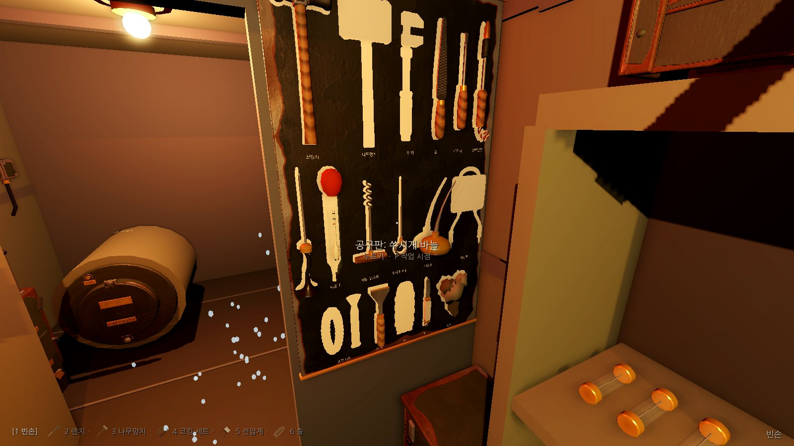

# M2 WP25 도구와 물건의 모양

사용자 요청 "도구도 너무 다 똑같이 생겨서 특색이 없다"에서 나온 작업 묶음이다. 지침은 `docs/plans/M2-figures-and-tools.md`의 'WP25' 절이다.
브랜치는 `claude/deepline-m2-tools`이고, 본선 `claude/dazzling-clarke-m2eohe`(72ed76e)를 합친 상태에서 확인했다.

## 한 일 요약

- **도구 모형 한곳** (`game/scripts/Art/Kit.Tools.cs`): `ToolModels.Build(parent, toolId)`가 도구 17종을 1930년대 기관실 공구로 짓는다. 크기는 실물 크기다.
  공구판, 바닥, 손, 공구띠 그림이 모두 이 모형을 쓴다. 모르는 도구 ID면 `ArgumentException`을 낸다.
  좌표 약속: 원점은 손으로 쥐는 곳, +Y는 일하는 끝, +Z는 보여 주는 면이다. 손에 쥘 때의 자세는 `ToolModels.HandPose` 표에 도구마다 둔다.
- **물건 모형** (`game/scripts/Art/Kit.Items.cs`): `ItemModels.Build(parent, itemId)`가 `items.json`의 44가지를 모두 짓는다. 손에 쥘 때의 자세는 `ItemModels.HandPose`가 준다. 새것과 헌 것은 눈으로 갈린다(아래 표).
- **모형 짓기 도우미** (`ModelCtx`, `Silhouette`): 같은 짓기 함수로 메시를 만들거나 삼각형만 모은다. `MeshBuilder`에 `Capture`(삼각형 꼭짓점 기록)를 더했다. 기본값은 null이라 다른 키트 조각에는 영향이 없다.
- **공구판** (`Submarine.Layout.cs`의 `BuildToolBoard`, `Submarine.Tools.cs`):
  - 짙은 녹흑색으로 칠한 판에 도구마다 그 실루엣을 희게 칠했다. 칸 크기는 도구 길이에 맞춰 줄마다 다르다(`BoardRows`).
  - 윤곽은 모형을 Z 방향으로 투영해 1mm 칸으로 칠하고 둘레를 3mm 넓힌 질감이다(`ToolModels.Outline`). 손으로 그리지 않는다.
  - 걸린 도구는 윤곽과 꼭 겹치게 건다. 도구를 가져가면 그 모양의 빈 윤곽이 남는다. 이름은 칸 아래에 흰 글씨로 적었다.
  - 판을 0.65×0.95m에서 0.70×1.14m로 키웠다(실물 크기 도구 17종이 들어가도록). 작업 시점 자리도 함께 옮겼다.
- **바닥의 도구**: 같은 모형을 보여 주는 면이 위로 오게 눕힌다. 일하는 끝이 배 앞을 본다.
- **손에 든 모양** (`Player/HeldItemView.cs`): 도구 17종과 물건 44가지를 모두 모형으로 쥔다.
  - 망치류는 자루 끝을 쥐고 머리를 세운다. 드라이버, 줄, 바늘, 인두, 청진기는 끝이 앞을 본다. 전압계는 눈금판이 눈을 본다.
  - 코킹 세트의 뱃밥 다발은 허리에 차는 것으로 보고 손에서는 감춘다.
  - 손동작 흔들림(망치질, 문지르기, 돌리기)과 전압계 바늘(두 눈금)은 그대로 살렸다.
  - 거름망 바구니는 막힌 만큼 찌꺼기가 차오른다. 예전에는 바구니 색만 바뀌었다.
- **예비품 칸**: 사물함 칸의 색 상자를 물건 모형으로 바꿨다. 중앙 벽장과 후방 사물함은 `Submarine.Lockers.cs`의 `Stack`이 칸에 들어가는 만큼 늘어놓고 남으면 쌓는다. M1 사물함의 퓨즈, 쐐기, 버팀목은 M1 때 자리 그대로다.
- **공구띠 그림** (`UI/ModelIcons.cs`, `UI/Hud.cs`):
  - 공구띠의 도구 이름 옆과 손에 쥔 도구·물건 이름 옆에 작은 그림을 둔다.
  - 그림은 모형을 `SubViewport`(64px, 투명 바탕, 직교 카메라)로 처음 쓸 때 한 번 찍고(`UpdateMode.Once`), 그 질감을 계속 쓴다.

## 도구 17종

| 도구 | 모형 | 칸(cm) | 윤곽(cm) |
| --- | --- | --- | --- |
| 렌치 | 나무 손잡이와 놋쇠 리벳, 곧은 자루, 놋쇠 조절 고리, 한쪽으로 벌어진 미닫이 턱과 고정 턱('F' 꼴) | 9.0×40 | 7.5×33.2 |
| 나무망치 | 곧은 나무 자루, 생나무색 굵은 원통 머리와 양 끝 쇠테 | 15.5×40 | 14.3×36.4 |
| 코킹 세트 | 맞는 머리가 퍼진 팔각 코킹 정과 부채꼴 날, 옆에 꼰 뱃밥 다발과 묶음 끈 | 15×27 | 13.7×20.3 |
| 전압계 | 베이클라이트 상자, 0~150V 바깥 눈금과 붉은 0~30V 안쪽 눈금, 바늘, 가죽 손잡이, 놋쇠 단자, 붉은·검은 탐침 줄 | 16×38 | 15.2×29.2 |
| 솔 | 양 끝이 둥근 나무 등판, 가장자리가 삐죽한 짧은 솔 다발, 가죽 손잡이 고리 | 9.5×27 | 8.3×20.8 |
| 드라이버 | 골 파인 나무 자루, 놋쇠 고리, 둥근 자루쇠와 납작한 긴 날 | 7×40 | 3.8×27.3 |
| 쇠망치 | 끝이 퍼진 나무 자루, 검은 단조 머리(한쪽 평면, 한쪽 공), 쐐기 | 14.5×40 | 13.7×33.9 |
| 줄 | 배 모양 자루, 놋쇠 고리, 자루보다 넓게 시작해 가늘어지는 거무스름한 줄판과 엇갈린 빗금 | 7×40 | 4.0×32.9 |
| 긁개 | 생나무 자루, 놋쇠 고리, 끝이 넓게 퍼진 납작한 날과 갈아 놓은 날끝 | 8.5×27 | 7.3×22.6 |
| 칼 | 뼈 손잡이, 놋쇠 볼스터, 매는 고리, 펼친 날(곧은 등, 뾰족한 끝) | 6×27 | 3.0×20.6 |
| 걸레 | 기름 먹은 무명 천을 구겨 뭉친 덩어리 셋과 늘어진 귀퉁이(울퉁불퉁한 메시) | 14×27 | 13.5×19.7 |
| 기름통 | 납작한 놋쇠 몸통, 바닥의 엄지 누름판, 비스듬히 휜 길고 가는 주둥이 | 13.5×38 | 12.8×23.2 |
| 패킹 갈고리 | T자 나무 손잡이, 놋쇠 고리, 쇠 자루, 코르크 따개처럼 꼬인 끝 | 13×38 | 10.8×25.5 |
| 쑤시개 바늘 | 쇠 고리 손잡이, 놋쇠 목, 끝으로 가늘어지는 긴 바늘 | 6.5×38 | 5.4×26.4 |
| 청진기 | 뾰족한 쇠막대 탐침, 놋쇠 진동판 통, 짧은 고무관, 검은 나팔꼴 귀대 | 7.5×38 | 6.5×35.2 |
| 비중계 | 유리관 안의 눈금 뜨개(납 알, 붉은·검은 눈금), 위의 붉은 고무 공, 아래 고무 빨대 | 7.5×38 | 6.5×34.9 |
| 납땜인두 | 깎은 나무 자루, 쇠 막대, 검은 열통, 굵은 구리 끝, 자루 끝에서 늘어져 감긴 꼰 전선 | 8.5×40 | 6.5×35.2 |

재질도 서로 다르게 했다. 니스 칠한 나무, 생나무, 맨 강철, 검게 단조한 쇠, 거무스름한 줄판 강철, 놋쇠, 구리, 베이클라이트, 뼈, 가죽, 고무, 유리, 천을 쓴다.

## 물건 44가지: 새것과 헌 것

| 새것 | 헌 것 | 눈으로 갈리는 점 |
| --- | --- | --- |
| 퓨즈 | 끊긴 퓨즈 | 맑은 유리와 가는 선 / 안이 검게 그을린 유리, 녹아 끊긴 선 토막, 마개의 그을음(배전반 퓨즈와 같은 크기) |
| 퓨즈 대용 철사 | 쓴 퓨즈 철사 | 마분지 카드에 가지런히 감긴 철사와 붉은 굵기 띠 / 꼬부라진 토막 끝에 녹아 맺힌 검은 구슬 |
| 상황판 전구 | 탄 전구 | 맑은 유리와 감긴 필라멘트 / 검게 낀 유리와 끊겨 늘어진 필라멘트 |
| 6호 진공관 | 탄 진공관 | 은빛 게터 / 하얗게 바랜 게터, 검은 판극, 그을린 옆면 |
| 탄소봉 한 쌍 | 닳은 탄소봉 | 18cm 봉과 뾰족한 끝 / 4.5cm 토막, 타서 움푹한 잿빛 끝 |
| 전동기 브러시 한 벌 | 닳은 브러시 | 높이 3.2cm 탄소 덩이, 구리 꼰 선 / 1.3cm로 줄고 모서리가 깨진 덩이, 빛나는 닿던 면, 검게 탄 선 |
| 펌프·팬·자이로 베어링 | 닳은 베어링 셋 | 놋쇠·강철·윤낸 놋쇠 고리와 구슬 / 녹슨 고리, 빠진 구슬 둘, 검은 기름때 덩이, 갈려 나간 자국 |
| 항법 계산기 톱니 | 닳은 톱니 | 놋쇠 톱니 12개 / 톱니 셋이 부러지고 이가 뭉툭하며 검게 변한 청동빛 |
| 축압기 개스킷 | 헌 개스킷 | 4mm 섬유판 고리와 볼트 구멍 여섯 / 짓눌려 2mm, 검은 갈색, 한 귀퉁이가 떨어져 나가고 기름 자국 |
| 현창 밀봉, 챔버 문 밀봉 | 헌 밀봉 | 검은 둥근 고리, 검은 네모 고리와 끼우는 혀 / 굳어 잿빛인 고리가 한 곳 끊겨 벌어지고 잔금 |
| 패킹 끈 | 헌 패킹 | 납작하게 감은 꼰 끈 타래 / 검고 딱딱한 고리 토막 셋, 하나는 부서졌다 |
| 브레이크 라이닝 | 닳은 라이닝 | 굽은 쇠 신발 위 1.1cm 갈색 마찰재, 묻힌 리벳 / 0.3cm로 얇고 짧아진 검은 마찰재, 드러나 긁힌 리벳 머리 |
| 흡수제 통 | 다 쓴 흡수제 통 | 황토색 칠 / 바랜 칠과 녹, 마개 둘레에 엉긴 흰 가루, 분필로 그은 X |
| 예비 축전지 셀 | 쓰던 셀, 다 쓴 셀, 완전히 죽은 셀 | 반질한 검은 몸통과 밝은 단자 / 때 낀 몸통과 흐른 자국 / 단자에 흰 황산염 / 황산염 덩이, 부푼 옆구리, 금, 산 자국(축전지 칸 셀과 같은 크기) |
| 절연 테이프, 이음 감개 테이프, 침투유, 잉크병, 점퍼 막대, 역지 밸브 판, 거름망 바구니, 버팀목, 나무 쐐기 | (헌 것 없음) | 좁은 검은 감개와 종이 심, 넓은 삼베빛 감개와 풀린 끝, 붉은 띠 두른 초록 깡통, 네모 유리병과 코르크, 구리 띠와 볼트, 청동 원판과 경첩 팔, 구멍 뚫린 쇠 원통과 철사 손잡이, 0.9m 각재, 옆에서 보면 세모인 쐐기 |

장비 쪽에 이미 그린 부품과 크기와 재질을 맞췄다. 퓨즈는 `Kit.FuseSocket`, 셀은 축전지 칸, 흡수제 통은 흡수통 받침, 점퍼 막대는 점퍼 걸이, 톱니는 항법 계산기, 펌프 베어링은 펌프 덮개 안의 것과 같다.

## 확인

- `dotnet test`: 시뮬레이션 791개, 소리 139개, 계산 도구 93개가 모두 통과한다. 이 작업은 sim과 데이터를 건드리지 않았다.
- Godot 확인 묶음 전부(`tools/godot-check.sh`)가 통과한다. `tools` 묶음 끝에 `ToolModelChecks`(`Testing/AutoPlayer.ToolModels.cs`)를 더했다. 이 검사는 아래를 본다.
  - `tuning.tools`의 17종과 `items.json`의 44가지에 모두 모형이 있고, 지으면 메시가 생기는지 본다. 모르는 ID면 예외가 나는지 본다.
  - 공구판 윤곽 17개가 각자 칸의 이름 띠 위 안에 들어가는지, 칸과 윤곽끼리 겹치지 않는지, 판 밖으로 나가지 않는지 본다.
  - 윤곽끼리 가운데를 맞춰 겹쳐 본다. 겹친 넓이 ÷ 합친 넓이가 0.7을 넘는 짝이 있으면 실패한다. 지금 가장 닮은 짝은 줄·비중계 0.66, 쇠망치·비중계 0.60, 솔·걸레 0.59다. 가늘고 긴 도구끼리는 자루가 겹쳐 0.6대가 나온다. 그래서 숫자는 거친 지킴이로만 쓰고, 실제 구별은 찍은 그림으로 확인했다(아래).
  - 공구판에서 도구를 차례로 가져와 17종을 모두 손에 쥐고, 손의 모형이 카메라 절두체 안에 있고 크기가 있으며 화면 안에 40% 이상 보이는지 본다. 끝나면 공구띠를 처음대로 돌려놓는다.
  - 공구띠와 쥔 것 옆에 그림이 붙었는지 본다.
- `workviews` 묶음: 공구판이 커져서 작업 시점 자리를 (3.45, 1.5, −0.5)로 옮겼다. 17칸이 모두 작업 시점에서 잡힌다.

## 그림

`tools/godot-check.sh --screenshots`가 찍는다(`Testing/ScreenshotTour.Tools.cs`). 줄 세우기 장면은 중앙 폐기함 옆 통로 바닥에 놓고 찍었다. 작은 것은 앞줄에, 새것과 헌 것은 나란히 두었다.

공구판. 공구띠에 나간 다섯 도구(렌치, 나무망치, 코킹 세트, 전압계, 솔)는 빈 윤곽으로 보인다.

손에 든 도구 17장을 한 장에 모았다(차례: 렌치, 나무망치, 코킹 세트, 전압계 / 솔, 드라이버, 쇠망치, 줄 / 긁개, 칼, 걸레, 기름통 / 패킹 갈고리, 쑤시개 바늘, 청진기, 비중계 / 납땜인두). 한 장씩은 `img/m2-tools/held/`에 있다.

물건 44가지:

### 실루엣 스스로 확인

찍은 공구판을 보고 닮은 것을 고쳤다.

- **기름통과 패킹 갈고리**: 처음에는 둘 다 '넓은 바닥 + 위로 곧은 가는 막대'(⊥ 꼴)였다(겹침 0.66). 기름통 주둥이를 한쪽으로 비스듬히 휘게 했다.
- **줄과 드라이버**: 둘 다 '자루 + 가는 막대'였다(0.63). 줄판을 자루보다 넓게 시작해 끝으로 가늘어지는 잎 모양으로 바꿨다.
- **쇠망치와 나무망치**: 처음부터 머리 모양이 다르게 했다(가는 쇠머리와 공 / 굵은 원통). 그림에서도 한눈에 갈린다.
- **솔과 걸레**: 숫자는 0.59지만, 솔은 매끈한 배 모양에 삐죽한 테두리이고 걸레는 울퉁불퉁한 덩어리와 늘어진 귀퉁이라 다르게 보인다.

## 명세와 다르게 한 점

- **공구판 크기**: 실물 크기 도구가 들어가도록 판을 0.70×1.14m(위 끝 1.97m)로 키웠다. 그래서 공구판 작업 시점의 자리도 옮겼다. 배치(WP6)의 자리(해치 격벽 좌현 부분, 판 가운데 z −0.825)는 그대로다. 아래 끝 0.83m는 흡수통(높이 0.63m)보다 위다.
- **긁개**: 명세의 두 안('세모 날 긁개나 넓적한 날') 가운데 넓적한 날을 골랐다. 세모 날은 실루엣이 줄과 거의 같아지기 때문이다.
- **바닥 도구**: 바닥 자리 간격(가로 0.2m, 세로 0.15m)은 그대로 두었다. 한 구역에 도구를 많이 내려놓으면 30cm가 넘는 긴 도구끼리 조금 겹쳐 보일 수 있다. 줍는 상자 크기와 자리는 바뀌지 않았다.
- **헌 밀봉**: `seal_old`는 현창 밀봉과 챔버 문 밀봉 어느 쪽에서 나와도 같은 물건이라, 둥근 고리 꼴의 끊긴 헌 고리로 그렸다.

## 결정 (본선이 DECISIONS로 옮길 줄)

- 도구와 물건의 모양은 `Kit.Tools.cs`의 `ToolModels`와 `Kit.Items.cs`의 `ItemModels` 한곳에서 짓는다. 공구판, 바닥, 손, 사물함 칸, 공구띠 그림이 같은 모형을 쓴다. 새 도구나 물건을 더하면 모형도 함께 더해야 한다(`tools` 묶음이 실패한다).
- 도구 모형의 좌표: 원점은 쥐는 곳, +Y는 일하는 끝, +Z는 보여 주는 면이다. 공구판 윤곽은 이 모형의 Z 투영(1mm 칸, 둘레 3mm)이고, 바닥에는 +Z를 위로 눕힌다.
- 공구판 칸 배치는 `Submarine.Tools.cs`의 `BoardRows` 한곳이다. 판은 0.70×1.14m이다.
- 공구띠와 쥔 것 옆의 그림은 모형을 `SubViewport`로 한 번 찍은 질감이다(`UI/ModelIcons.cs`).
- 헌 부품은 같은 모양에 '닳음'을 얹어 구별한다: 그을음, 황산염, 녹, 짧아짐, 빠진 구슬·톱니, 끊김.

## 사람 확인 요청

- **도구마다 한눈에 알아볼 수 있는가.** 공구판 그림과 손에 든 그림에서 17종이 이름표 없이도 갈리는지 봐 주세요. 특히 줄·드라이버·쑤시개 바늘, 청진기·비중계처럼 가늘고 긴 것들이 걱정입니다.
- 빈 윤곽만 보고 무엇이 빠졌는지 알 수 있는가.
- 헌 부품(끊긴 퓨즈, 닳은 브러시, 닳은 베어링, 죽은 셀)이 한눈에 헌 것으로 보이는가.
- 손에 든 도구의 크기와 자세가 자연스러운가. 끝이 앞을 보는 도구(드라이버, 줄, 인두)가 너무 작아 보이지 않는가.
- 공구띠 그림(30px)이 너무 작거나 흐리지 않은가.
