# M2 WP25 도구와 물건의 모양

사용자 요청 "도구도 너무 다 똑같이 생겨서 특색이 없다"에서 나온 작업 묶음이다. 지침은 `docs/plans/M2-figures-and-tools.md`의 'WP25' 절이다.
브랜치는 `claude/deepline-m2-tools`다. 본선 검토(`docs/reviews/m2-wp25.md`, 지적 31건)를 반영했고, 2차 확인(본선 096dd2c의 '2차 확인' 절)도 반영했고, 본선 최신을 합친 상태에서 확인했다.

## 한 일 요약

- **도구 모형 한곳** (`game/scripts/Art/Kit.Tools.cs`): `ToolModels.Build(parent, toolId)`가 도구 17종을 1930년대 기관실 공구로 짓는다. 크기는 실물 크기다.
  - 공구판, 바닥, 손, 공구띠 그림이 모두 이 모형을 쓴다. 모르는 도구 ID면 `ArgumentException`을 낸다.
  - 좌표 약속: 원점은 손으로 쥐는 곳, +Y는 일하는 끝, +Z는 보여 주는 면이다.
  - 손에 쥘 때의 자세는 `ToolModels.HandPose` 표에 도구마다 둔다.
- **물건 모형** (`game/scripts/Art/Kit.Items.cs`): `ItemModels.Build(parent, itemId)`가 `items.json`의 44가지를 모두 짓는다. 손에 쥘 때의 자세는 `ItemModels.HandPose`가 준다. 새것과 헌 것은 눈으로 갈린다(아래 표).
- **모형 짓기** (`ModelCtx`, `ModelTemplate`, `Silhouette`):
  - 같은 짓기 함수로 메시를 만들거나 삼각형만 모은다. `MeshBuilder`에 `Capture`(삼각형 꼭짓점 기록)를 더했다. 기본값이 null이라 다른 키트 조각에는 영향이 없다.
  - 도구와 물건마다 한 번 지은 메시를 틀(`ModelTemplate`)로 두고, 다시 쓸 때는 같은 메시를 쓰는 노드만 만든다.
  - 모형은 그림자를 던지지 않는다(아트 키트 성능 메모의 '작은 조각은 그림자를 던지지 않는다').
  - 상태에 따라 보이는 부분(거름망 찌꺼기)은 처음에 감춘다. 전압계 바늘의 기본 자세는 0V(왼쪽 멈춤)다.
- **공구판** (`Submarine.Layout.cs`의 `BuildToolBoard`, `Submarine.Tools.cs`):
  - 짙은 녹흑색으로 칠한 판에 도구마다 그 실루엣을 희게 칠했다. 칸 크기는 도구 길이에 맞춰 줄마다 다르다(`BoardRows`).
  - 윤곽은 모형을 Z 방향으로 투영해 1mm 격자로 칠하고 둘레를 3mm 넓힌 질감이다(`ToolModels.Outline`). 손으로 그리지 않는다.
  - 걸린 도구는 윤곽과 꼭 겹치게 건다. 도구를 가져가면 그 모양의 빈 윤곽이 남는다.
  - 이름은 빛을 받지 않는 1.6cm 흰 글씨로 적고, 칸보다 긴 이름은 두 줄로 나눈다. 작업 시점의 눈(높이 1.5m)보다 높은 윗줄은 칸 아래에, 낮은 줄은 칸 위에 이름을 둔다. 위에서 내려다보면 판에서 튀어나온 도구가 제 아래쪽을 가리기 때문이다.
  - 판을 0.65×0.95m에서 0.70×1.14m로 키웠다(실물 크기 도구 17종이 들어가도록). 작업 시점 자리도 함께 옮겼다.
- **바닥의 도구**:
  - 같은 모형을 보여 주는 면이 위로 오게 눕힌다.
  - 자리는 구역마다 빈 바닥 사각형(`FloorAreas`) 안에서 모형 크기로 계산한다(`FloorSlots`). 기울기로 이웃 구역에 옮겨 갈 때는 앞뒤로 눕혀 미끄러지고, 해치 문은 모형 반폭만큼 안쪽으로 지난다. 긴 것부터 줄을 세우고, 줄 너비는 그 줄 첫 도구 길이 + 2cm, 줄 안에서는 폭 + 2cm씩이다.
  - 빈 바닥은 막는 부피를 5cm 격자로 훑은 지도에서 골랐다. 해치 문이 쓸고 가는 곳과 바닥 구멍(케이블 챔버, 축전지 우물)은 피했다.
  - 전방 앞 틀 뒤의 좁은 띠에는 가로(긴 축 Z)로, 나머지는 앞뒤로 눕힌다. 줍기 상자는 눕힌 모형 크기다.
- **손에 든 모양** (`Player/HeldItemView.cs`): 도구 17종과 물건 44가지를 모두 모형으로 쥔다.
  - 망치류는 자루 끝을 쥐고 머리를 세운다. 드라이버, 줄, 바늘, 인두, 청진기는 끝이 앞을 본다. 전압계는 눈금판이 눈을 본다.
  - 코킹 세트의 뱃밥 다발은 허리에 차는 것으로 보고 손에서는 감춘다.
  - 손동작 흔들림(망치질, 문지르기, 돌리기)과 전압계 바늘(두 눈금)은 그대로 살렸다.
  - 거름망 바구니는 막힌 만큼 찌꺼기가 차오른다. 예전에는 바구니 색만 바뀌었다.
- **예비품 칸** (`Submarine.Lockers.cs`의 `Stack`): 사물함 칸의 색 상자를 물건 모형으로 바꿨다.
  - 선반 위에 바로 놓고, 뒤판 안쪽에서 앞 턱 안쪽까지에 칸 폭만큼 늘어놓는다. 남으면 위로 쌓는다.
  - 칸에 눕힐 수 없는 둥근 밀봉(현창 밀봉, 챔버 문 밀봉)은 칸 앞 테의 놋쇠 걸이못에 세로로 건다. 못이 고리 구멍을 지나고, 고리 위끝은 그 칸의 재고 이름표 아래에서 시작한다. 이웃한 두 밀봉 칸은 못 길이를 달리해 고리가 앞뒤로 엇갈린다.
  - 칸 깊이보다 넓은 개스킷과 패킹 끈 타래는 세워서 뒤판에 기댄다.
  - M1 사물함의 퓨즈, 쐐기, 버팀목은 M1 때 자리 그대로다.
- **공구띠 그림** (`UI/ModelIcons.cs`, `UI/Hud.cs`):
  - 공구띠의 도구 이름 옆과 손에 쥔 도구·물건 이름 옆에 44px 그림을 둔다. 놋쇠와 나무색이 장면에 묻히지 않게 짙은 둥근 바탕과 옅은 테를 깐다.
  - 그림은 모형을 `SubViewport`(128px, 투명 바탕, 직교 카메라)로 처음 쓸 때 한 번 찍고(`UpdateMode.Once`), 그 질감을 계속 쓴다.
  - 가늘고 긴 도구를 통째로 담으면 칸에서 모두 같은 사선이 된다. 그래서 도구마다 알아보게 하는 쪽(`IconFrames`: 렌치 턱, 망치 머리, 드라이버 날 끝, 줄판, 인두의 열통과 구리 끝, 기름통 몸통과 주둥이 밑동, 비중계 고무 공, 갈고리의 꼬인 끝, 바늘 고리, 청진기 나팔)만 40도로 기울여 칸을 채운다(꼬인 끝만 잡는 패킹 갈고리는 세운다).
  - 틀의 폭은 고른 높이 구간 안에 실제로 칠한 윤곽의 폭이다. 그래서 머리가 그림의 절반을 넘는다.

## 도구 17종

| 도구 | 모형 | 칸(cm) | 윤곽(cm) |
| --- | --- | --- | --- |
| 렌치 | 호두나무 손잡이와 놋쇠 리벳, 곧은 자루, 놋쇠 조절 고리, 한쪽으로 벌어진 미닫이 턱과 고정 턱('F' 꼴) | 9.0×40 | 7.5×33.2 |
| 나무망치 | 곧은 물푸레나무 자루, 생나무색 굵은 원통 머리와 양 끝 쇠테 | 15.5×40 | 14.3×36.4 |
| 코킹 세트 | 맞는 머리가 퍼진 팔각 코킹 정과 부채꼴 날, 옆에 꼰 뱃밥 다발과 묶음 끈 | 15×26 | 13.7×20.3 |
| 전압계 | 베이클라이트 상자, 0~150V 바깥 눈금과 붉은 0~30V 안쪽 눈금, 바늘, 가죽 손잡이, 놋쇠 단자, 붉은·검은 탐침 줄 | 16×39 | 15.2×29.2 |
| 솔 | 양 끝이 둥근 참나무 등판, 등판 밖으로 삐죽 나온 솔 다발(윤곽 둘레가 톱니), 손잡이 띠와 끝의 거는 가죽 고리 | 11.5×26 | 10.2×21.9 |
| 드라이버 | 붉게 칠한 골 파인 자루, 놋쇠 고리, 둥근 자루쇠와 납작한 긴 날 | 7×40 | 3.8×27.3 |
| 쇠망치 | 끝이 퍼진 히코리 자루, 검은 단조 머리(한쪽 평면, 한쪽 공), 쐐기 | 14.5×40 | 13.7×33.9 |
| 줄 | 짙은 호두나무 배 모양 자루, 놋쇠 고리, 자루보다 넓게 시작해 가늘어지는 거무스름한 줄판과 엇갈린 빗금 | 7×40 | 4.0×32.9 |
| 긁개 | 너도밤나무 버섯꼴 자루, 놋쇠 고리, 곧은 쇠 자루, 끝에서 직각으로 꺾여 옆으로 7cm 뻗은 날(갈고리 긁개, T자 머리) | 8×26 | 7.9×22.8 |
| 칼 | 뼈 손잡이, 놋쇠 볼스터, 매는 고리, 펼친 날(곧은 등, 뾰족한 끝) | 6×26 | 3.0×20.6 |
| 걸레 | 기름 먹은 무명 천을 구겨 뭉친 덩어리 셋과 납작하게 처진 귀퉁이(모두 울퉁불퉁한 덩어리라 딱딱한 판이 없다) | 14×26 | 13.5×18.9 |
| 기름통 | 납작한 놋쇠 몸통, 바닥의 엄지 누름판, 비스듬히 휜 길고 가는 주둥이 | 13.5×39 | 12.8×23.2 |
| 패킹 갈고리 | T자 나무 손잡이, 놋쇠 고리, 쇠 자루, 코르크 따개처럼 꼬인 굵은 끝 | 13×39 | 10.8×25.6 |
| 쑤시개 바늘 | 쇠 고리 손잡이, 놋쇠 목, 끝으로 가늘어지는 긴 바늘 | 6.5×39 | 5.4×26.4 |
| 청진기 | 뾰족한 쇠막대 탐침, 놋쇠 진동판 통, 짧은 고무관, 검은 나팔꼴 귀대 | 7.5×39 | 5.5×32.1 |
| 비중계 | 유리관 안의 눈금 뜨개(납 알, 붉은·검은 눈금), 위의 붉은 고무 공, 아래 고무 빨대 | 7.5×39 | 6.5×34.9 |
| 납땜인두 | 칠하지 않은 밝은 나무 자루, 쇠 막대, 검은 열통, 굵은 구리 끝, 자루 끝에서 늘어져 감긴 꼰 전선 | 8.5×40 | 6.5×35.2 |

머리와 날의 재질을 서로 다르게 했다. 맨 강철, 검게 단조한 쇠, 거무스름한 줄판 강철, 놋쇠, 구리, 베이클라이트, 뼈, 가죽, 고무, 유리, 천을 쓴다.
나무 자루도 결이 자루 방향(Y)을 따르게 하고(`ArtMat.WoodGrain`), 나무와 칠을 도구마다 달리했다: 렌치와 줄은 짙은 호두나무, 나무망치는 밝은 물푸레나무, 쇠망치는 히코리, 드라이버는 붉은 칠, 납땜인두는 칠하지 않은 밝은 나무, 긁개는 너도밤나무, 솔 등판은 참나무다. 공구판 윗줄에 나란히 걸린 줄, 드라이버, 인두는 자루 색이 서로 다르다.

## 물건 44가지: 새것과 헌 것

| 새것 | 헌 것 | 눈으로 갈리는 점 |
| --- | --- | --- |
| 퓨즈 | 끊긴 퓨즈 | 맑은 유리와 가는 선 / 안이 검게 그을린 유리, 녹아 끊긴 선 토막, 마개의 그을음(배전반 퓨즈와 같은 크기) |
| 퓨즈 대용 철사 | 쓴 퓨즈 철사 | 마분지 카드에 가지런히 감긴 철사와 붉은 굵기 띠 / 꼬부라진 토막 끝에 녹아 맺힌 검은 구슬 |
| 상황판 전구 | 탄 전구 | 맑은 유리와 감긴 필라멘트 / 검게 낀 유리와 끊겨 늘어진 필라멘트 |
| 6호 진공관 | 탄 진공관 | 은빛 게터 / 하얗게 바랜 게터, 검은 판극, 그을린 옆면 |
| 탄소봉 한 쌍 | 닳은 탄소봉 | 18cm 봉과 뾰족한 끝 / 4.5cm 토막, 타서 움푹한 잿빛 끝 |
| 전동기 브러시 한 벌 | 닳은 브러시 | 높이 3.2cm 탄소 덩이, 구리 꼰 선 / 1.3cm로 줄고 모서리가 깨진 덩이, 빛나는 닿던 면, 검게 탄 선 |
| 펌프·팬·자이로 베어링 | 닳은 펌프·팬·자이로 베어링 | 놋쇠·강철·윤낸 놋쇠 고리와 구슬 / 녹슨 고리, 빠진 구슬 둘, 검은 기름때 덩이, 갈려 나간 자국 |
| 항법 계산기 톱니 | 닳은 톱니 | 놋쇠 톱니 12개 / 톱니 셋이 부러지고 이가 뭉툭하며 검게 변한 청동빛 |
| 축압기 개스킷 | 헌 개스킷 | 4mm 섬유판 고리와 볼트 구멍 여섯 / 짓눌려 2mm, 검은 갈색, 한 귀퉁이가 떨어져 나가고 기름 자국 |
| 현창 밀봉, 챔버 문 밀봉 | 헌 밀봉 | 검은 둥근 고리, 검은 네모 고리와 끼우는 혀 / 굳어 잿빛인 고리가 한 곳 끊겨 벌어지고 잔금 |
| 패킹 끈 | 헌 패킹 | 납작하게 감은 꼰 끈 타래 / 검고 딱딱한 고리 토막 셋, 하나는 부서졌다 |
| 브레이크 라이닝 | 닳은 라이닝 | 굽은 쇠 받침(브레이크 슈) 위 1.1cm 갈색 마찰재, 묻힌 리벳 / 0.3cm로 얇고 짧아진 검은 마찰재, 드러나 긁힌 리벳 머리 |
| 흡수제 통 | 다 쓴 흡수제 통 | 황토색 칠 / 바랜 칠과 녹, 마개 둘레에 엉긴 흰 가루, 분필로 그은 X |
| 예비 축전지 셀 | 쓰던 축전지 셀, 다 쓴 셀, 완전히 죽은 셀 | 반질한 검은 몸통, 밝은 단자, 놋쇠 통기 마개 / 먼지 낀 칙칙한 몸통, 뚜껑 위의 마른 산 얼룩, 통기 마개 둘레의 젖은 고리, 단자 밑동의 얇은 흰 테, 뚜껑 끝에서 앞면으로 흘러내린 자국, 분필 사선 하나 / 단자를 덮은 흰 황산염 / 푸른 황산염 덩이, 부푼 옆구리, 금, 산 자국(축전지 칸 셀과 같은 크기) |
| 절연 테이프, 이음 감개 테이프, 침투유, 잉크병, 점퍼 막대, 역지 밸브 판, 거름망 바구니, 버팀목, 나무 쐐기 | (헌 것 없음) | 좁은 검은 감개와 종이 심, 넓은 삼베빛 감개와 풀린 끝, 붉은 띠 두른 초록 깡통, 네모 유리병과 코르크, 구리 띠와 볼트, 청동 원판과 경첩 팔, 구멍 뚫린 쇠 원통과 철사 손잡이, 0.9m 각재, 옆에서 보면 세모인 쐐기 |

장비 쪽에 이미 그린 부품에 크기와 재질을 맞췄다. 퓨즈는 `Kit.FuseSocket`, 셀은 축전지 칸, 흡수제 통은 흡수통 받침, 점퍼 막대는 점퍼 걸이, 톱니는 항법 계산기, 펌프 베어링은 펌프 덮개 안의 것과 같다.

## 확인

- `dotnet test`: 시뮬레이션 1190개, 소리 139개, 계산 도구 93개가 모두 통과한다. 이 작업은 sim과 데이터를 건드리지 않았다.
- Godot 확인 묶음 전부(`tools/godot-check.sh --screenshots`)가 통과한다. 묶음별 결과는 아래와 같다.
  - smoke: 상호작용 물체 428개.
  - reach: 손이 닿는 물체 411/411. 공구판 17칸이 판이 커진 뒤에도 모두 닿는다.
  - workviews: 작업 시점 32곳. 공구판 작업 시점은 (3.45, 1.5, −0.5)로 옮겼고 17칸이 모두 잡힌다.
  - fixtures: 장치 280개, 명령 541개. crisis, hands, drill-* 열두 묶음(밸러스트, 역류 방지 밸브, 산소 화로 포함), drills, instruments도 통과한다. tools 묶음 끝의 WP18 `ToolsRollingCheck`도 통과한다(나무망치가 aft → mid → fore로 미끄러져 제 자리에 똑바로 눕는다).
  - tools: `AUTOTEST: 도구 모형 17종과 물건 모형 44가지, 공구판 윤곽, 예비품 칸, 바닥 자리, 손에 든 도구와 물건, 그림 22장 확인`.
- `tools` 묶음 끝의 `ToolModelChecks`(`Testing/AutoPlayer.ToolModels.cs`)가 보는 것:
  - **모형**: `tuning.tools`와 `ToolModels`, `items.json`과 `ItemModels`의 목록이 양쪽으로 같은지 본다. 지은 노드 아래에 면이 있는 메시가 실제로 있는지, 모르는 ID면 예외가 나는지도 본다. 물건 수를 박아 두지 않는다.
  - **공구판**: 윤곽 17개가 각자 칸의 이름 띠 밖 자리에 들어가는지, 칸과 윤곽끼리 겹치지 않는지, 판 밖으로 나가지 않는지 본다. 작업 시점의 눈에서 걸린 도구의 튀어나온 끝을 판으로 투영해 이름 띠를 가리지 않는지도 본다(가장 빠듯한 비중계가 0.9cm 여유).
  - **닮음**: 실크기 마스크를 ±2cm(2mm 간격) 밀어 본 가장 큰 IoU가 0.7을 넘는 짝이 있으면 실패한다. 지금 가장 닮은 짝은 줄·비중계 0.694(문턱과 0.006 차이), 쇠망치·렌치 0.671, 렌치·줄 0.670이다. 길이를 맞춘 모양 비교(높이 300 눈)는 사람 검토용으로 상위 5짝만 기록한다: 줄·칼 0.813, 비중계·칼 0.756, 줄·드라이버 0.717. 공구판은 실물 크기라 길이 차이도 정당한 구별 단서이므로 이 값으로는 실패시키지 않는다.
  - **예비품 칸**: 놓은 모형마다 그 칸(뒤판, 앞 턱, 옆 칸, 위 선반)을 넘치지 않는지 본다. 걸이못에 건 밀봉은 칸 앞 공간으로 본다.
  - **바닥 자리**: 세 구역 모두 17개 자리가 있고, 한 구역에 모두 내려놓아도 자리끼리 겹치지 않으며 빈 바닥 안에 있는지 본다. 막는 부피와 부딪히지 않는지는 물리 질의로 본다.
  - **손에 든 도구**: 17종을 공구판에서 차례로 가져와 쥔다. 모형 꼭짓점(메시마다 지역 범위의 8모서리를 전역 틀로 옮긴 것)을 카메라로 투영해, 카메라 뒤 0개, 절두체 안 60% 이상, 화면 넓이 2500px² 이상인지 본다. 다른 도구 거치대가 숨었는지, 쥔 것 옆 그림이 1장이고 공구띠 그림 수가 공구띠 도구 수와 같은지도 본다.
  - **손에 든 물건**: 44가지 모두 왼손 거치대에서 같은 투영으로 잰다(절두체 안 50% 이상, 버팀목은 0.9m라 30%, 화면 1500px² 이상). 실제 경로로 렌치를 쥔 채 사물함에서 퓨즈를 꺼내, 퓨즈 모형이 보이는지, 쥔 것 옆 그림이 2장(도구와 물건)인지, 퓨즈 그림을 찍었는지 본 뒤 되돌린다.
- **찍기 둘러보기**(`--screenshots`):
  - 공구띠 그림 17장의 불투명한 눈 비율이 10% 아래면 실패한다. 128px 칸을 대각선으로 지나는 6px 획 하나가 7% 남짓이라, 가는 획 하나로는 통과하지 못한다. 지금 가장 낮은 것은 쑤시개 바늘과 비중계 11%, 가장 높은 것은 나무망치 29%다.
  - 손에 든 도구를 찍을 때 실제로 쥐었는지 본다.
  - 줄 세우기 목록이 `ItemModels` 전부를 덮는지 본다.
- 소리 단서는 없다. 그래서 '단서 → 목소리' 표는 해당이 없다.

## 그림

`tools/godot-check.sh --screenshots`가 찍는다(`Testing/ScreenshotTour.Tools.cs`). 줄 세우기의 넓은 사진과 근접 사진 넷은 깔판 앞 끝보다 안쪽 위에서 내려다본다. 깔판 앞의 배전반 아래 상자가 앞줄을 가리지 않게 하려는 것이다. 44가지가 모두 근접 사진 가운데 하나에 이름표와 함께 보인다. 줄 세우기 장면은 중앙 통로 바닥(폐기함과 흡수제 통 받침 옆)에 짙은 깔판을 빈 탁자 대신 깔아 케이블 챔버 해치와 이름판을 덮고, 그 위에 늘어놓았다. 작은 것은 앞줄에, 새것과 헌 것은 나란히 두었다.

공구판. 공구띠에 나간 다섯 도구(렌치, 나무망치, 코킹 세트, 전압계, 솔)는 빈 윤곽으로 보인다.

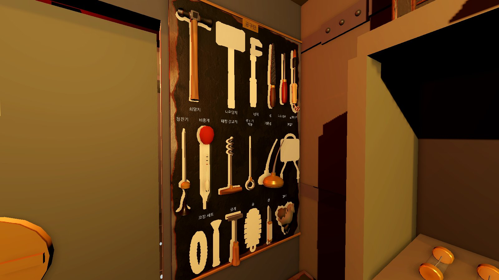
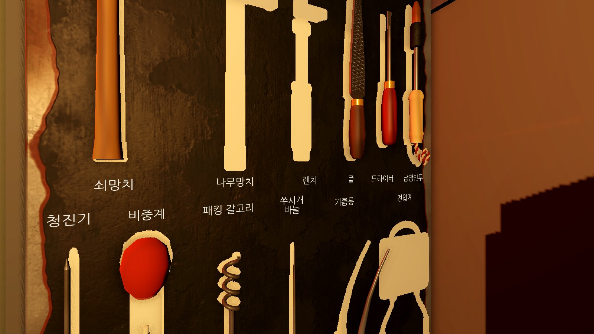
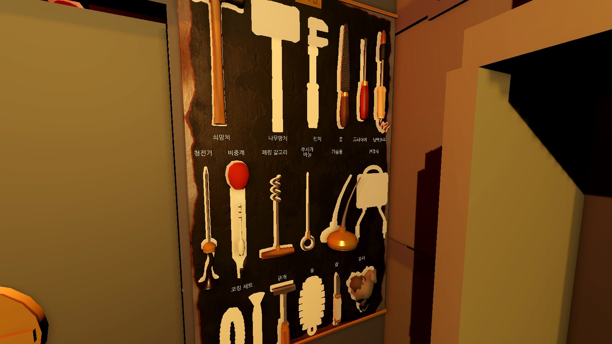

공구띠 그림 17종. 실제 화면 크기(칸 44px) 그대로 한 줄로 늘어놓고 찍은 것과, 그것을 두 배로 키운 것이다.

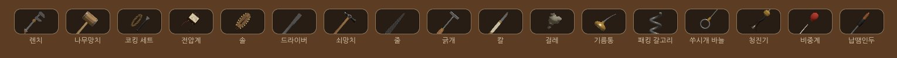
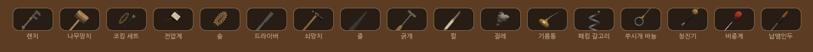

손에 든 도구 17장을 한 장에 모았다(차례: 렌치, 나무망치, 코킹 세트, 전압계 / 솔, 드라이버, 쇠망치, 줄 / 긁개, 칼, 걸레, 기름통 / 패킹 갈고리, 쑤시개 바늘, 청진기, 비중계 / 납땜인두). 한 장씩은 `img/m2-tools/held/`에 있다.

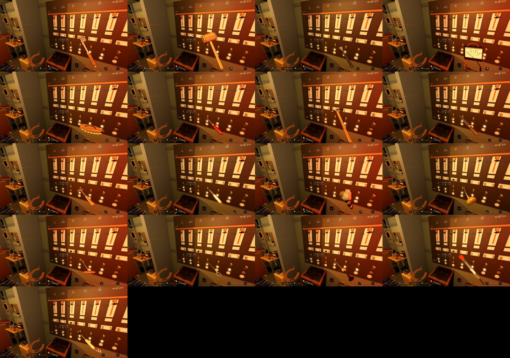

물건 44가지:

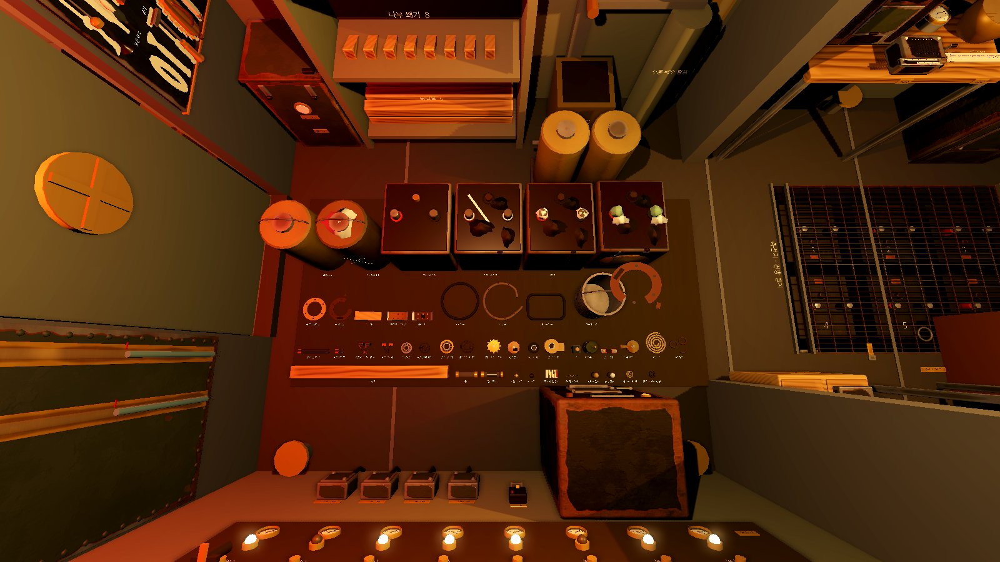
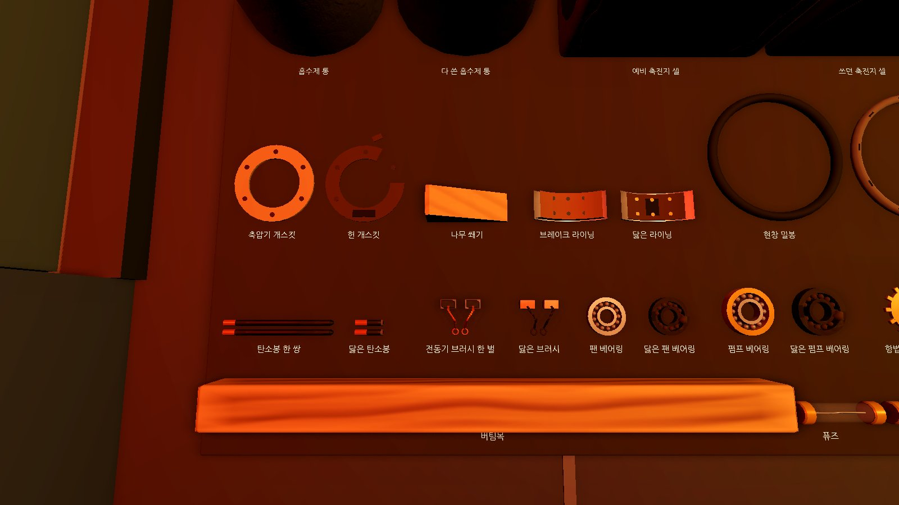
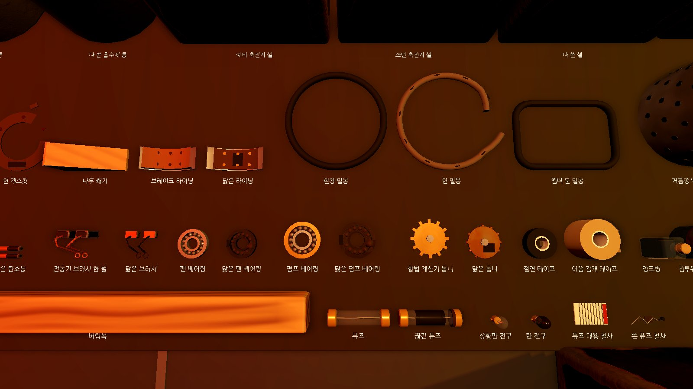
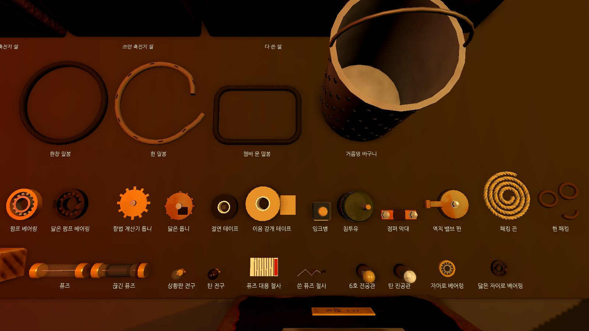
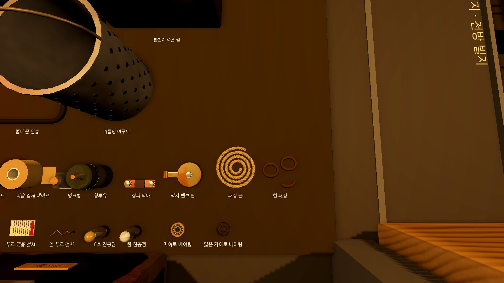
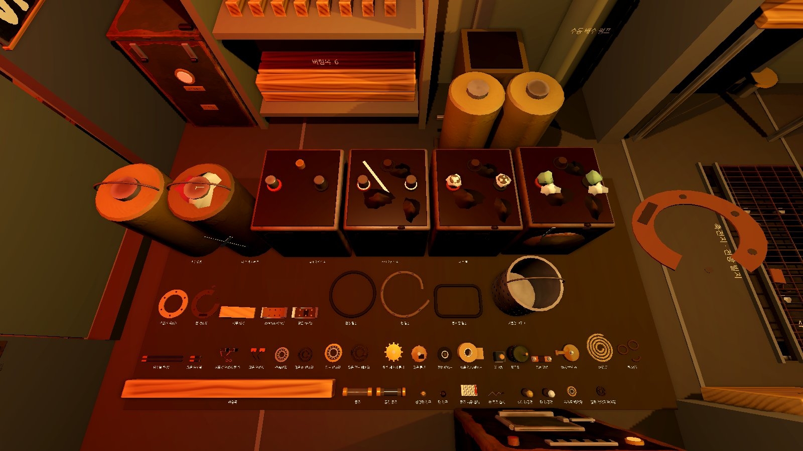
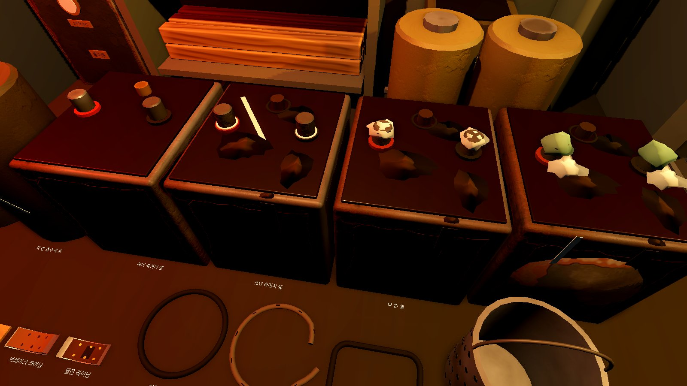

전기 예비품 벽장. 아래 선반의 현창 밀봉과 챔버 문 밀봉은 걸이못에 걸렸고, 재고 이름표는 고리 위에 보인다.

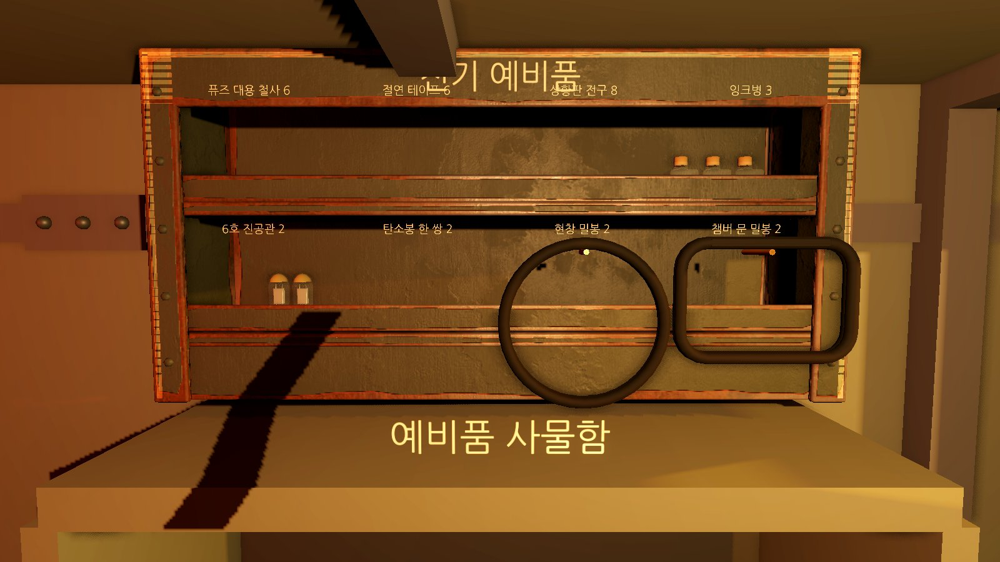

### 찍은 그림을 보고 고친 실루엣

- **기름통과 패킹 갈고리**: 처음에는 둘 다 '넓은 바닥 + 위로 곧은 가는 막대'(⊥ 꼴)였다. 기름통 주둥이를 한쪽으로 비스듬히 휘게 했다.
- **줄과 드라이버**: 둘 다 '자루 + 가는 막대'였다. 줄판을 자루보다 넓게 시작해 끝으로 가늘어지는 잎 모양으로 바꿨다.
- **코킹 정과 긁개**: 손에 들면 둘 다 '막대 끝에 부채처럼 퍼진 날'이었다(검토 지적). 긁개를 날이 직각으로 꺾인 갈고리 긁개(T자 머리)로 바꿨다.
- **쇠망치와 나무망치**: 처음부터 머리 모양을 다르게 했다(가는 쇠머리와 공 / 굵은 원통). 그림에서도 한눈에 갈린다.
- **솔**: 빈 윤곽이 특징 없는 둥근 네모였다(검토 지적). 솔 다발을 등판 밖으로 내고 다발 사이를 띄워 윤곽 둘레가 톱니로 남게 했고, 끝의 가죽 고리가 윤곽에 고리 구멍으로 나온다.
- **공구띠 그림**: 도구를 통째로 45도로 눕혀 30px에 담았더니 가는 도구 아홉 가지가 같은 사선이 되었다(검토 지적). 알아보게 하는 쪽만 크게 잡고 44px로 키웠다.

## 명세와 다르게 한 점

- **공구판 크기**: 실물 크기 도구가 들어가도록 판을 0.70×1.14m(위 끝 1.97m)로 키웠다. 그래서 공구판 작업 시점의 자리도 (3.45, 1.5, −0.5)로 옮겼다. 배치(WP6)의 자리(해치 격벽 좌현 부분, 판 가운데 z −0.825)는 그대로다. 아래 끝 0.83m는 흡수통(높이 0.63m)보다 위다.
- **공구판 이름 띠의 자리**: 낮은 두 줄은 이름을 칸 위쪽에 둔다(위 '한 일 요약'). 칸마다 같은 자리가 아니다.
- **예비품 칸의 밀봉**: 현창 밀봉과 챔버 문 밀봉은 칸에 눕힐 수 없어 칸 앞 테의 걸이못에 건다. 현창 밀봉(지름 0.236m)은 칸 폭(0.23m)보다 조금 넓어 양옆으로 3mm쯤 이웃 칸 앞에 걸친다.

## 알려진 한계

- **닮음 검사는 크게 닮은 짝만 거른다**: 실크기 마스크를 ±2cm 밀어 본 IoU라 크기와 위치 차이에 민감하다. 가늘고 긴 도구끼리는 0.6대가 나오고, 같은 모형을 0.9배로 줄여도 문턱 근처에 걸릴 수 있다. 도구가 한눈에 갈리는지는 찍은 그림으로 사람이 본다.
- **공구띠 그림의 불투명 비율 검사**는 렌더링이 되는 찍기 둘러보기(`--screenshots`)에서만 돈다. 헤드리스 묶음에서는 그림이 그려지지 않기 때문이다.

## WP18과 합친 것

검토 사이에 WP18(기울기와 바닥 도구 구름)이 본선에 들어와, 이 브랜치에서 합쳤다(검토 9번).

- `AutoPlayer.cs`의 충돌은 두 줄을 모두 두었다: `await ToolModelChecks();` 다음에 `await ToolsRollingCheck();`.
- `Submarine.Tools.cs`는 검토 9번의 (가)안을 따랐다.
  - WP18의 굴리기 줄(`mesh.RotateObjectLocal(Vector3.Up, …)`)은 지웠다. 이 모형에서는 그 축이 진행 방향이라 도구가 송곳처럼 돌고 갑판을 파고들기 때문이다. 앞뒤로 길게 누운 도구는 기울기에서 미끄러지기만 한다.
  - 해치 문을 지나 문턱을 넘는 길(WP18)은 그대로 두었다.
  - 도착하면 `FloorSlots`의 자리와 방향으로 똑바로 눕는다.
- 미끄러지는 동안은 앞뒤로 눕힌다(후방과 전방 앞 띠는 가로로 눕는 자리라, 가로인 채 문을 지나면 격벽을 뚫는다). 해치 문은 모형 반폭만큼 안쪽(|z| ≤ 0.35 − 반폭)으로 지난다.
- `ToolsRollingCheck`(`AutoPlayer.Ballast.cs`)에 확인을 셋 더했다. 구른 나무망치가 전방 제 자리에 똑바로 누웠는지(기저가 그 자리의 기저인지), 가장 낮은 곳이 갑판 위인지, 미끄러지는 동안 문틀을 긁지 않았는지(`FloorDoorScrapes` = 0) 본다.
- 기울기 사진 둘(`img/m2-wp18/10-tilt-bow-down.jpg`, `11-tilt-stern-down.jpg`)을 합친 상태에서 다시 찍었다. 새 공구띠 그림과 WP25 바닥 모형이 보인다.

## 2차 확인(36ddbc7)에서 고친 것

| 지적 | 고친 곳 |
| --- | --- |
| 8, 26 앞줄이 어느 그림에도 없다 | 넓은 사진과 근접 사진 넷(41~43, 47)을 깔판 안쪽 위에서 찍는다. 퓨즈 대용 철사, 쓴 퓨즈 철사, 6호 진공관, 탄 진공관, 자이로 베어링이 이름표와 함께 보인다 |
| 9 기울기 사진 | `img/m2-wp18/10`, `11`을 합친 상태에서 다시 찍었다 |
| 21 가는 도구의 그림 | 드라이버는 날 끝, 줄은 줄판, 인두는 열통과 구리 끝, 청진기는 나팔, 갈고리는 꼬인 끝만 잡는다. 틀 폭은 구간 안 윤곽 폭이다. 불투명 하한은 10% |
| 28, 29 문구 | '크게 닮은 짝만 거른다', '쓰던 축전지 셀'. 메시지는 모두 "'{ID}', '{ID}': …" 꼴로 조사를 뺐다 |
| 새 1 걸이못이 이름표를 가림 | 고리 위끝을 이름표 아래로 내리고, 못이 고리 구멍을 지나게 했다. 칸 공간의 위끝을 이름표 아래로 잡아 넘침 검사가 이름표 겹침도 본다. 이웃 밀봉끼리 부딪히지 않는지도 본다. 그림 48 |
| 새 2 가로로 누운 채 문을 지남 | 미끄러지는 동안 앞뒤로 눕히고 문 지점을 반폭만큼 조인다. `FloorDoorScrapes` 검사 |
| 새 3 셀의 흐른 자국 | 앞면 판은 y 0.386에서 끝내고, 뚜껑 가장자리에 납작한 얼룩을 얹어 이어 보이게 했다 |
| 새 4 나무 셰이더 | `wood.gdshader`가 결 축에 따라 수직 두 성분을 고른다(결이 X면 (y, z), 아니면 (x, z)). X축 나무는 그대로다 |
| 새 5 문구와 주석 | 메시지의 조사, Lockers의 '뒤로 10도 젖혀 뒤판에 기댄 판' |

## 검토 지적과 고친 곳

| 지적 | 고친 곳 |
| --- | --- |
| 1, 27 예비 셀과 쓰던 셀 | `Kit.Items.cs` `Cell`: 쓰던 축전지 셀에 칙칙한 몸통(0.15 회색), 뚜껑 위 산 얼룩 셋, 통기 마개 둘레 젖은 고리, 단자 밑동 흰 테, 뚜껑 끝에서 흐른 자국, 분필 사선. 그림 46 |
| 2 코킹 정과 긁개 | 긁개를 갈고리 긁개(T자 머리)로 바꿨다 |
| 3, 23 나무 자루 | `ArtMat.WoodGrain`(결 Y), 자루마다 다른 나무와 칠 |
| 4, 24 청진기가 이름을 가림 | 고무관을 줄이고 나팔을 줄였다. 낮은 줄은 이름을 칸 위에 두고, 작업 시점의 눈에서 투영해 가리는지 검사한다 |
| 5 이름 글씨 | 1.6cm, 빛을 받지 않는 글씨, 긴 이름은 두 줄, 이름 띠 3.2cm |
| 6, 22 솔의 빈 윤곽 | 다발을 등판 밖으로 1cm 내고 1.2cm씩 띄웠다. 끝의 가죽 고리가 윤곽에 나온다 |
| 7 걸레의 판 | 처진 귀퉁이를 납작한 덩어리 둘로 |
| 8, 26 줄 세우기 그림 | 깔판으로 챔버 해치를 덮고, 이름표 폭을 글자 폭으로 잡고, 버팀목을 앞줄에, 근접 카메라를 옮기고, 셀 앞모습을 더했다 |
| 9 WP18과 합치기 | 위 'WP18과 합친 것' |
| 10 바닥 자리 | `FloorAreas`와 `FloorSlots`, 겹침·빈 바닥·물리 질의 검사 |
| 11, 21 공구띠 그림 | 128px로 찍고 44px로 보인다. 알아보게 하는 쪽만 기울여 잡고, 짙은 바탕을 깔았다. 불투명 비율 검사, 그림 45 |
| 12 예비품 칸 | 선반 높이, 뒤판과 앞 턱, 걸이못(밀봉), 세워 기대기(개스킷, 패킹 끈), 넘침 검사 |
| 13 상태 있는 부분 | 전압계 바늘 기본 0V, 거름망 찌꺼기 처음에 감춤 |
| 14 성능 | 그림자 끔, 모형 틀 캐시(`ModelTemplate`), `Image.CreateFromData` |
| 15 닮음 검사 | ±2cm 밀어 본 최대 IoU, 주석 바로잡음, 길이를 맞춘 비교 기록 |
| 16 빈 모형 검사 | 면이 있는 메시를 직접 본다. 범위는 삼각형으로 잰다. 삼각형이 없으면 예외 |
| 17, 25 손에 든 물건 | 44가지 거치대 투영, 실제로 퓨즈를 꺼내 보는 경로 |
| 18 화면 노출 판정 | 메시마다 8모서리를 전역 틀로 옮겨 투영 |
| 19 그림 수 검사 | 쥔 것 줄과 공구띠 줄을 따로 세고 같음(==)으로 본다 |
| 20, 30 목록 검사 | 양쪽 차집합, 44를 박지 않음, 줄 세우기 목록 검사, 찍을 때 쥐었는지 확인 |
| 28, 29, 31 한국어와 보고서 | 표현을 고치고, 메시지에서 조사를 뺀 꼴로 통일, 격자 '눈'과 공구판 '칸'을 갈라 썼다. 묶음별 수와 '단서 → 목소리' 해당 없음을 적었다 |

## 결정 (본선이 DECISIONS로 옮길 줄)

- 도구와 물건의 모양은 `Kit.Tools.cs`의 `ToolModels`와 `Kit.Items.cs`의 `ItemModels` 한곳에서 짓는다. 공구판, 바닥, 손, 사물함 칸, 공구띠 그림이 같은 모형을 쓴다. 새 도구나 물건을 더하면 모형도 함께 더해야 한다(`tools` 묶음이 실패한다).
- 도구 모형의 좌표: 원점은 쥐는 곳, +Y는 일하는 끝, +Z는 보여 주는 면이다. 공구판 윤곽은 이 모형의 Z 투영(1mm 격자, 둘레 3mm)이고, 바닥에는 +Z를 위로 눕힌다.
- 공구판 칸 배치는 `Submarine.Tools.cs`의 `BoardRows` 한곳이다. 판은 0.70×1.14m이고, 눈높이(1.5m)보다 낮은 줄은 이름을 칸 위에 둔다.
- 바닥 도구의 자리는 `FloorAreas`(구역별 빈 바닥)에서 모형 크기로 계산한다. 기울기로 옮겨 갈 때는 미끄러지기만 하고 구르지 않는다.
- 긁개는 명세의 두 안 가운데 날이 꺾인 갈고리 긁개를 골랐다. 세모 날은 줄과, 넓적한 날은 코킹 정과 실루엣이 닮기 때문이다.
- 공구띠와 쥔 것 옆의 그림은 모형을 `SubViewport`로 한 번 찍은 질감이다(`UI/ModelIcons.cs`). 도구는 알아보게 하는 쪽만 기울여 크게 잡는다(`IconFrames`).
- 헌 부품은 같은 모양에 '닳음'을 얹어 구별한다: 그을음, 황산염, 녹, 산 얼룩, 짧아짐, 빠진 구슬·톱니, 끊김.
- 소리 단서는 없다. 그래서 '단서 → 목소리' 표는 해당이 없다.

## 사람 확인 요청

- **도구마다 한눈에 알아볼 수 있는가.** 공구판 그림, 손에 든 그림, 공구띠 그림에서 17종이 이름표 없이도 갈리는지 봐 주세요. 특히 줄·드라이버·쑤시개 바늘, 청진기·비중계처럼 가늘고 긴 것들이 걱정입니다.
- 빈 윤곽만 보고 무엇이 빠졌는지 알 수 있는가(솔의 톱니 윤곽 포함).
- 헌 부품(끊긴 퓨즈, 닳은 브러시, 닳은 베어링, 쓰던 축전지 셀, 다 쓴 셀·완전히 죽은 셀)이 한눈에 헌 것으로 보이는가.
- 손에 든 도구의 크기와 자세가 자연스러운가. 끝이 앞을 보는 도구(드라이버, 줄, 인두)가 너무 작아 보이지 않는가.
- 공구띠 그림(44px)이 잘 보이는가. 위 '공구띠 그림' 두 장을 봐 주세요.
