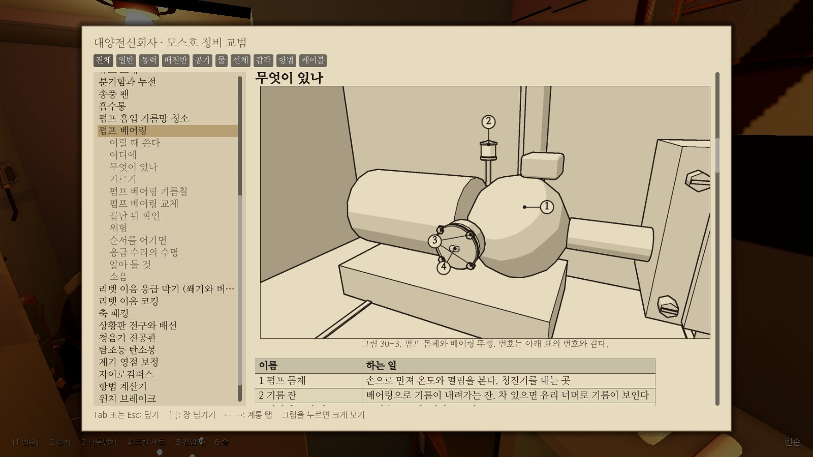
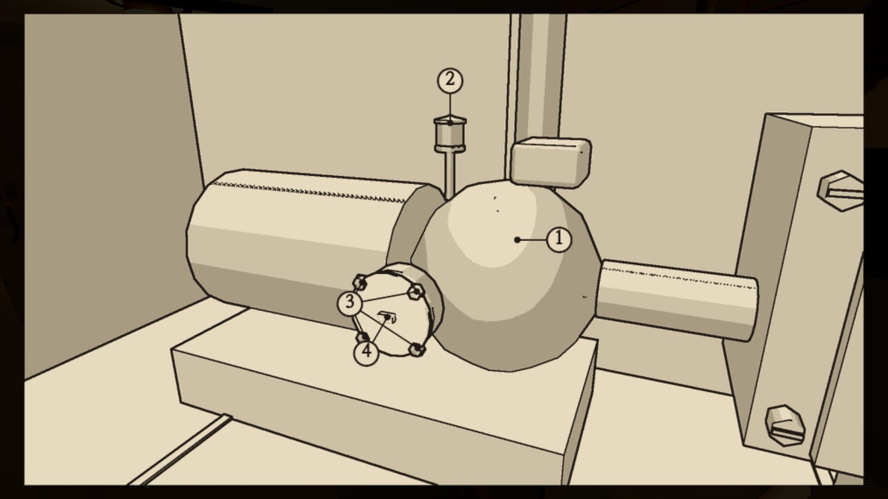

# M2 WP26 보고서 · 교범 그림

2026-10-30 · 브랜치 `claude/deepline-m2-figures` (5차: 본선 f6366f2까지 합침)

## 요약

사용자 요청("교범이 너무 비직관적이다. 그림을 많이 넣어 달라")에 따라 교범에 그림 길을 내고 그림을 넣었다. 일반 쪽(01~13)과 지금 본선에 있는 고장 쪽 25개(20~45)에 모두 **194장**이다. 쪽마다 적어도 셋이고, 고장 쪽은 넷에서 여덟(30쪽)이다. WP19의 22, 35, 37쪽도 넣어 `FiguresPending`은 비었다.

그림은 손으로 그리지 않았다. 모두 `data/manual/fig/figures.json`의 정의에서 나온다.

- **장면 그림**: 실제 잠수함 장면에서 임무를 시작하고, 명령과 절차로 상태를 맞추고(덮개를 연 모습, 고장 난 모습), 정해진 카메라로 찍은 뒤 먹선으로 바꾼다. 열어 젖힌 덮개처럼 부품을 가리는 것은 정의의 `hide`로 지운다(설명에 적는다).
- **부르는 번호**: 지시선 끝은 장면 물체(`Interactable`이나 이름 붙은 노드)의 위치를 화면에 투영해 정한다. 동그라미는 남의 대상 위에 앉지 않고, 계기 줄처럼 늘어선 대상은 줄 밖의 띠에 늘어놓는다.
- **순서 띠**: 절차를 공구판 왕복까지 펼쳐 자동 플레이어처럼 손동작으로 하고, 정한 단계가 끝날 때마다 작업 시점(손에 든 도구가 보이는 플레이어 카메라)에서 찍는다. 칸에는 단계 번호, 손이 간 곳에는 붉은 고리와 손동작 화살표를 붙인다.
- **도식**: 계통도는 `circuits.json`, `devices.json`, 장치 데이터(흡입 선택 레버의 자리)에서, 배치도는 장면을 위에서 정사영으로 찍어서, 볼트 번호도는 절차의 Fasten 단계에서, 계기 도식(표시등 세 상태, 전압계 두 눈금, 비중계 뜨개, 경사계)은 데이터와 장면 계기의 눈금에서 그린다.

그림 속 글자는 번호, 칸 번호, 라틴 글자(A, B), 회로 번호, 숫자, 장비 이름뿐이다. 장비 이름은 `data/text/ko`의 이름 키(장소와 계통 부품은 새 `data/text/ko/figures.json`의 `fig.*`)나 데이터 장치의 명판에서 온다. 설명은 모두 마크다운에 있다.

sim 코드와 시뮬레이션 데이터는 건드리지 않았다. **기준 해시는 그대로다.**

| 쪽 | 그림 수 | 그림 |
| --- | --- | --- |
| 01 개요 | 7 | 실내 배치도(22개 번호, 구역 경계), 바닥 아래, 리벳 이음과 현창, 전기 계통도, 배수와 밸러스트 계통도, 공기 계통도, 증기 계통도 |
| 02 상황판 | 4 | 앞면(번호 13개), 표시등 세 상태 도식, 표시등 켜짐 A·B, 계기 줄(8개) |
| 03~05 진단 표 | 3, 3, 3 | 표 앞에 증상 단서: 배전반 회로, 성한/끊긴 퓨즈, 회로 전류계, 펌프 계기 A·B·C, 역류 방지 밸브, 축 패킹, 흡수통 지시약, 항법 장비, 윈치 구동부 |
| 06 손과 도구 | 4 | 손동작 여섯(화살표), 만져 보는 곳, 공구판 17칸, 바닥의 도구 |
| 07 예비품 | 4 | 보관 위치 배치도, 중앙 사물함, 전기 예비품 벽장, 후방 예비품 사물함 |
| 08 재는 법 | 7 | 전압계 대는 곳, C3 퓨즈 소켓, 전압계 두 눈금 도식, 비중계 꽂는 곳, 비중계 뜨개 읽기 도식, 청진기 대는 곳, 저항 브리지 |
| 09 계산 도구 | 6 | 탁상 계산기, 계산자, 계산자 곱셈 풀이 예 도식, 계산 도표, 계산 도표 자 놓기 예 도식, 저항 브리지 |
| 10 공기와 몸 | 3 | 공기를 맑게 하는 장비, 산소 화로, 다치는 자리 배치도(다섯 갈래) |
| 11 소음 표 | 3 | 소리 내는 장비 배치도, 도는 기계 셋, 손동작 셋 |
| 12 침수 대응 | 4 | 물이 들어오는 자리(구역 경계), 빌지 칸, 수동 펌프, 해치 |
| 13 부력과 기울기 | 5 | 조절반 자리, 조절반, 트림 탱크 배관도, 경사계 도식, 수평과 기울어짐 비교 |
| 고장 쪽 25개 | 3~8 | 어디에(배치도 + 서서 본 모습), 무엇이 있나(번호, 표의 첫 칸에 같은 번호), 절차마다 순서 띠, 정상 대 고장 비교, 볼트 번호도(29, 30쪽) |

그림 종류: 장면 80, 순서 띠 39, 배치도 35, 비교 18, 여러 칸 6, 볼트 번호도 5, 계기 도식 6, 흐름도 4, 계통도 1. 모두 16색 팔레트 PNG(4비트)이고 합계 3.37MB(3,537,737바이트), 한 장 평균 약 17.8KB다.

## 2차 (본선 검토 요청)

- 본선(WP16, WP20이 들어온 뒤)을 합쳤다. 충돌은 01쪽(구역 배치 표와 '이 판의 선체 절차' 줄), 10쪽('다쳤을 때' 목록), `ManualTests.cs`(차례 시험과 그림 시험), `godot-check.sh`(묶음 목록)였고 모두 양쪽을 살렸다. 그림 번호와 '(그림 N-M)' 가리킴은 합친 글에서 시험으로 다시 확인했다. 00쪽(차례)은 그림을 두지 않는 쪽으로 시험에서 뺐다.
- 새 그림: 40쪽 6장(자리, 올려다본 모습, 부품, 새 봉과 탄 봉 비교, 봉 보내기와 봉 교체 순서 띠), 41쪽 4장(자리, 전압 계기의 유리 테와 영점 나사, 맞는 계기와 틀어진 계기 비교, 영점 보정 순서 띠), 38쪽 배선 절 2장(배선함, 배선 말리기 순서 띠). `FiguresPending`에서 38(배선 절은 원래 셈 밖), 40, 41을 뺐다.
- **먹선 렌더러의 번호 읽기 고장을 고쳤다.** 화면 밖 버퍼가 셰이더의 값을 sRGB로 되돌리지 않고 그대로 담는데, 셰이더에서 선형으로 바꿔 내고 있었다. 그래서 어두운 쪽에 담긴 물체 번호가 뭉개져 일부 물체(퓨즈의 그을음, 진하게 칠할 부품 등)가 배경으로 읽혔다. 번호는 이제 변환 없이 밝은 쪽 절반(128~255)에 채널마다 16단계로 담는다. 법선도 변환 없이 담는다. 강조 칠이 제대로 나오고 면 명암도 바르게 되었다. 그림 152장을 모두 다시 찍었다.
- **비교 그림**: 그을음처럼 아주 검은 재질(밝기 0.05 아래)은 짙게 칠하고, B(고장)의 고장 난 부품은 붉은 먹으로 칠하고 붉은 고리로 두른다. 강조는 조준 상자 안에 가운데가 든 메시만 칠한다(이웃 장비의 덮개나 몸통은 칠하지 않는다). 장면에서 차이가 작게 보이던 것은 같은 고장이 계기에 드러나는 모습으로 바꿨다: 29쪽(막힌 거름망 → 펌프 전류 계기), 25쪽(젖은 분기함 → C1 회로 전류계). 진공관 필라멘트 비교(39쪽, 05쪽)는 장면의 필라멘트가 너무 작아 뺐다.

## 3차 (WP17, WP18이 들어온 뒤)

- 본선 17e3fee(WP17까지)를 합쳤다. 충돌은 `AutoPlayer.cs`의 묶음 표(figures와 drill-switchboard-b)와 `godot-check.sh`의 묶음 목록이었고 둘 다 살렸다.
- 새 그림 26장: 13쪽 4장(조절반 자리, 조절반, 트림 탱크 배관도, 수평과 기울어짐 비교), 24쪽 5장(배전반 자리, 칼날 스위치 부품, 깨끗한 칼날과 녹슨 칼날, 집게 나사 조이기와 칼날 줄질 순서 띠), 28쪽 5장(자리, 내려다본 모습, 문을 연 화로, 깨끗한 화로와 막힌 화로, 청소 순서 띠), 31쪽 6장(자리, 배출관, 부품, 보닛 안, 깨끗한 판과 때 낀 판, 청소 순서 띠), 32쪽 6장(자리, 조절반, 침수 밸브 부품, 정상과 굳은 밸브, 쳐서 풀기와 패킹 교체 순서 띠). `FiguresPending`에는 22, 35, 37만 남았다.
- 순서 띠는 밸러스트 훈련 묶음처럼 흡입 선택 레버를 한 칸씩 옮기고(`PerformLever`), 침투유가 스며들기와 탱크가 빠지기를 기다린다(`BallastDrill.WaitAfter`).
- 24쪽 칼날의 녹은 장면에서 잘 드러나지 않아 비교 그림에는 붉은 고리만 두르고, 설명에 소리와 전압계로 가르라고 적었다.
- 그림은 모두 178장, 합계 약 3.6MB다.

## 4차 (본선 검토 87건 반영)

본선 검토(`docs/reviews/m2-wp26.md`, 510f4b8 기준)의 지적 87건을 최신 그림에서 다시 확인하고 고쳤다. 고치는 동안 본선 804775d(WP19), 05de88e(WP25), 30a3cf8(WP23 훈련 고르기)을 합쳤다. 충돌은 `godot-check.sh`의 묶음 목록, `Main.cs`(손에 든 것의 노드), `HeldItemView.cs`(WP25의 도구 모형을 따르고 그림 검사용 `ShownTools`와 전압계 눈금 상수만 더했다), `ScreenshotTour.cs`(교범 그림 장면 뒤에 WP25의 도구 그림)였다. WP19가 장면을 바꿨으므로 그림을 모두 다시 찍었다. 본선의 알림대로 WP19의 22쪽(자리, 서서 본 모습, 부품, 플랜지 볼트 번호도), 35쪽(자리, 부품, 밀봉 교체 순서 띠, 테 볼트 번호도), 37쪽(자리, 해치 둘레, 해치 안, 밀봉 교체 순서 띠, 누름쇠 나사 번호도)에 그림 13장을 넣고 '무엇이 있나' 표에 번호를 붙였다. `FiguresPending`은 비었다. 22쪽의 순서 띠는 넣지 못했다: 손동작으로 관 이음과 플랜지를 만지면 남은 증기에 데고(훈련 묶음은 식기를 기다리는 판단을 따로 한다), 작업 시점에서 플랜지 볼트 겨냥이 엇갈린다. 남은 일에 적었다.

먼저 같은 종류의 지적이 다시 나오지 않도록 구조를 고쳤다. 이 검사들은 그림 정의를 고치는 동안 실제로 50건 남짓을 잡았다.

- **가림 검사를 깊이 버퍼로**: `InkRenderer`가 번호, 법선에 더해 깊이(카메라에서의 거리, 12비트)를 한 번 더 찍는다. 부르는 번호의 끝과 붉은 고리의 자리 둘레에서, 그려진 면이 대상 점보다 앞(6cm나 조준 상자 반 크기 넘게)에만 있으면 '다른 메시가 그 앞을 가린다'로 실패한다. 막는 부피만 보던 광선 검사는 그대로 두었다. 열어 젖힌 덮개처럼 부품을 가리는 것은 그림 정의의 `hide`(장면 그림)와 `strip.hide`(칸마다)로 지운다. 이 검사가 21-open, 21-replace, 20-parts, 08-hydrometer, 27-parts, 07-top·07-aft 같은 지적을 모두 다시 잡았고, 정의를 고쳐 풀었다.
- **번호 읽기 검사**: 찍는 동안 장면 갱신이 메시를 보이게 해도 제 재질로 그려지지 않도록, 보이지 않는 메시에도 번호를 주고 `MaterialOverlay`를 잠시 비운다. 번호로 읽히지 않는 화소가 40개를 넘으면 실패한다. 진하게 칠한 메시는 대상 둘레(30cm)에만 있어야 한다.
- **비교 그림 검사**: compare와 같은 카메라로 찍은 panels의 칸끼리, 부르는 번호 대상이 그림에서 차지한 자리(넉넉히)에서 150화소 넘게 달라야 한다. 이 검사로 24쪽(칼날의 녹)과 40쪽(탄소봉) 비교가 장면에서 차이를 보이지 못함을 확인하고 뺐다.
- **먹선 명암**: 면의 단계를 재질 밝기로 정하고(0.55 넘으면 종이, 0.33 넘으면 옅은 음영, 그 아래 짙은 음영) 빛 방향은 한 단계만 더하고 뺀다. 밝게 올리는 것은 밝은 재질(0.45 넘게)일 때만이다. 빛을 내는 재질은 켜지면 종이색, 꺼지거나 흐리면 짙게 칠한다. 그래서 흰 지시약 창과 진보라 창, 켜진 전구와 꺼진 전구가 그림에서 갈린다.
- **부르는 번호 자리(CalloutLayout)**: 대상 상자는 찍은 그림에서 지시선 끝에 걸린 메시가 차지한 자리로 정한다. 동그라미는 남의 상자와 그 둘레에 앉지 않고, 지시선은 남의 상자를 지나지 않는다. 높이가 같은 넷 이상이 폭의 30% 넘게 늘어서면 동그라미를 남의 상자와 겹치지 않는 쪽의 빈 띠에 늘어놓고 세로 지시선으로 잇는다. 놓은 뒤 남의 상자 위에 앉은 동그라미가 있으면 실패한다.
- **순서 띠**: `marks`가 '대상=손동작'(cw, ccw, up, down …)과 '대상@오프셋'을 받는다. 손이 가는 단계인데 고리를 붙일 대상을 찾지 못하면 실패한다(기관 전령기, 장치 전원 스위치는 `marks`로 준다). 고리와 손동작 화살표 전체가 칸 안에 들어야 한다. 명령이 있는 단계에서 오른손의 도구(`HeldItemView.ShownTools`)는 칸 안에 40화소 넘게 보여야 한다(작업 시점이 판에 너무 붙으면 도구가 판 뒤로 들어간다는 것도 이 검사로 알았다).
- **표시등**: A·B처럼 상태를 견주는 칸에서 번호를 단 상황판 전구는 찍는 때 실제로 켜져 있어야 한다(`Submarine.LampLit`).
- **지문**: `make-figures.sh`가 그림마다 지문(정의, 정의가 부르는 물체의 처음 자리 1cm, 도식의 입력 데이터)을 `figures.lock.json`에 남기고, 헤드리스 figures 묶음이 다시 셈해 다르면 '그림 X이 낡았다'로 실패한다.
- **이름 키**: 이름표가 데이터 장치가 아닌 물체의 명판(C#에 박힌 글)으로 물러서지 않는다. 장소와 계통 부품의 이름은 `data/text/ko/figures.json`(`fig.*` 60개)에 두었다.
- **계기 도식**(새 그림 종류 `dial`): 표시등 세 상태(02쪽), 전압계의 두 눈금과 예시 바늘(08쪽, 눈금은 `HeldItemView`의 상수, 버스 전압과 셀 수는 데이터), 비중계 뜨개 읽기(08쪽, `measure.hydrometer`), 경사계(13쪽, 끝 각도는 `Submarine.InclinometerRangeDeg`, 노랑·빨강 띠는 `tuning.attitude`).
- **29쪽 순서**: 손으로 쓴 '## 순서'를 데이터 절차(10단계)에 맞춰 맨 앞에 알아보기 단계를 넣고 2~10으로 다시 매겼다. '단계마다 지킬 것' 표와 '끝난 뒤 확인'의 단계 번호도 옮겼다. `ManualTests`가 순서 띠 바로 앞의 손으로 쓴 번호 목록이 절차의 단계 수와 같은지 본다.
- **교범 시험**: 그림 줄 정규식을 렌더러와 같게(.png, 줄마다 다듬기), 그림 줄 앞뒤 빈 줄, 같은 PNG 금지, 미룬 쪽에 그림이 들어가면 실패, 지문 파일의 열쇠. 교범 덮개는 실제로 넣은 그림 수(`ShownFigures`)를 보고, 크게 보기는 실제 누르기 길(`ClickFigure` → `MetaClicked`)로 연다. 다른 쪽의 그림 텍스처는 비운다.
- `make-figures.sh`는 이름 여럿을 공백으로 받고, 없는 이름은 실패로 알린다. 실패한 그림은 `$TMPDIR/deepline-figures/failed/`에 남겨 살펴볼 수 있다.

## 검토 반영

| 번호 | 처리 |
| --- | --- |
| 1, 12, 27, 76 | 05-scrubber와 27-compare를 같은 상태(진보라, 400초)로 가까이 다시 찍었다. 명암 규칙을 고쳐 B 창이 짙게 나온다. 27-4는 표 번호 4. 비교 검사로 확인 |
| 2, 14 | 비교 그림을 뺐다: 05-tube, 39-compare는 2차에서 뺐다(필라멘트가 그림 크기에서 점 하나). 진공관 자리는 그림 39-3이 보인다 |
| 3, 44 | 2차에서 풀림(번호 읽기 수정 뒤 그을음이 짙게 나옴). 이번에 23-compare는 03-fuse와 다른 자리(가까이, 비스듬히)에서 찍었다 |
| 4, 28, 40 | 02-lamps를 여덟 전구가 다 들어오게 다시 찍었다. A는 모두 꺼짐, B는 배전반(빨강)과 선체(노랑). 켜진 전구가 희게 나온다(LampLit 검사). 캡션을 실제 상태로 고쳤다 |
| 5, 6, 41, 84 | 계기 줄의 띠 배치. 02-gauges는 여덟 계기 모두에 번호를 달고 캡션을 고쳤다. 02쪽 표 7행을 고쳤다. 03-ammeters도 띠에 놓인다 |
| 7, 26, 30 | 08-probe를 view로 바꾸고 캡션을 '그림 8-2. C3 퓨즈 소켓(붉은 고리). 전압계 탐침을 이 소켓 양단에 댄다.'로 고쳤다. 손에 든 도구 검사를 순서 띠에 더했다. 전압계 두 눈금과 비중계 뜨개 그림(도식)을 넣었다 |
| 8, 29 | 08-hydrometer: 세운 갑판 판을 `hide`로 지우고 통기 마개(셀마다 표지)를 가리킨다 |
| 9 | 3번 대상을 몸체의 D 눈금 쪽으로 옮기고 가까이 찍었다 |
| 10 | 표시등 세 상태, 전압계 두 눈금, 비중계, 경사계 도식을 넣었다. 09쪽 계산자·계산 도표 풀이 예는 남은 일 |
| 11, 84 | 01-water의 이름표를 이름 키로(역류 방지 밸브, 케이블 챔버, 앞·뒤 탱크, 침수 밸브, 수동 배수 펌프), 후방 빌지와 전중 빌지를 흡입 근원으로 더했다 |
| 13 | 2차에서 풀림: 29-compare는 펌프 전류 계기 비교로 바꿨다. 이번에 비교 검사로 차이를 확인 |
| 15, 70 | 2차에서 풀림: 25-compare는 C1 전류계 비교로 바꿨다(이슬은 장면에서 2~3픽셀) |
| 16, 59 | 20-parts를 3번 셀 위에서 다시 찍었다. 셀 번호는 셀 몸통, 통기 마개는 마개 표지를 가리킨다 |
| 17, 18, 24 | 21-open과 21-replace 칸 6, 8, 10은 열어 젖힌 덮개를 지우고 찍었다(설명에 적었다). 깊이 검사가 덮개를 잡는다 |
| 19, 74 | 번호 읽기 검사 뒤 21-where에 엉뚱한 붉은 칠이 없다. 진하게 칠한 메시의 거리 검사를 더했다 |
| 20, 56 | 27-replace 칸 3, 4, 7을 통로 쪽 높은 자리에서 찍었다. 고리 전체가 칸 안에 드는지 본다(42-bearing, 33-wedge, 29-clean 등의 자리도 고쳤다) |
| 21, 23 | 29쪽 순서를 10단계로 고쳤다. 시험을 더했다. M1 쪽 스냅숏 시험은 이 브랜치에 없어 다시 만들 것이 없다 |
| 22 | 36-stand를 전동기 뒤쪽 위에서 찍어 패킹 상자가 보인다 |
| 25 | `figures.lock.json` 지문과 헤드리스 비교, `ManualTests`의 열쇠 시험 |
| 31, 77 | 공기·증기 계통도 이름을 이름 키로(산소 화로, 실내 공기, 흡수통, 증기 축압기, 증기 정지 밸브, 증기관 이음, 빼기 밸브), 빼기 밸브 뒤에 빌지 끝. 1-6, 1-7 캡션을 고쳤다 |
| 32, 77 | 12-bilges를 빌지 칸 그림(해치 격벽 점선, 후방·전중 빌지 이름, 흡입 거름망, 케이블 챔버, 축전지 우물)으로 다시 정의. 1-2 캡션을 '가운데 네모'로. 같은 PNG 금지 시험 |
| 33 | 01-plan과 12-inflow에 구역 경계와 이름. 2·5, 1, 8, 16의 지시선 끝을 옮겼다 |
| 34, 80 | WP25가 본선에 들어와(d2bd7d1) 합친 뒤 06쪽 그림을 모두 다시 찍었다. 공구판은 새 자리에 맞춰 카메라를 옮겼다. 6-3 캡션에 빈 자리의 윤곽 문장을 되살렸다 |
| 35, 79 | 07-where의 이름을 보관 장소 이름 키로, 폐기함 두 곳을 더했다 |
| 36 | 07-top, 07-aft를 선반 높이에서 가까이 찍고 끝점을 칸의 물건으로 옮겼다 |
| 37 | 08-bridge와 09-bridge의 번호를 09쪽 표 차례로 맞추고 검류계(5)를 더했다. 08쪽은 조금 더 가까이 찍어 같은 그림이 아니다 |
| 38, 43, 51, 68 | 배치 규칙(남의 상자 위 금지, 제 상자 위 피하기)으로 풀었다 |
| 39 | 04-checkvalve를 보닛 쪽으로 당겼다 |
| 42, 72 | 11-sources의 5를 소나 발신기로, 11-1과 11-3 캡션을 고쳤다 |
| 45, 57, 62, 70 | 26-compare는 종이 리본(이름 붙인 노드 `FanRibbon`, 표 7번)을 가리키고 캡션을 고쳤다. 26-parts의 베어링 끝점을 허브 쪽으로, 리본 문장은 뺐다 |
| 46, 73 | FixtureBinder는 그대로 두고, 20-jumper와 20-replace 칸 5에 `battery.link.3=cw` |
| 47 | 배치도 고리 반지름 상한 40px, 진하게 칠한 메시 거리 검사 |
| 48 | 43-parts를 오른쪽에서 찍어 되돌림 손잡이가 보인다 |
| 49 | 25-parts의 덮개 번호를 열린 판 위로 옮겼다 |
| 50, 75 | 42, 43쪽 비교는 넣지 못했다(아래 '명세와 다르게 한 점'). 21쪽 '가르기' 아래 빈 줄을 지웠다 |
| 52, 85 | 25-isolate 칸 3은 상황판 배전반 표시등, 30-oil 칸 3은 펌프 전류 계기를 찍고 고리를 단다. 34-caulk는 칸 2 하나 |
| 53, 85 | 23-rewire 칸 7(납땜인두 스위치), 39 띠의 청음기 스위치, 21-spring 칸 2(기관 전령기), 40-rods 칸 1(탐조등 레버)에 고리 |
| 54 | 38-replace를 비스듬히 찍었다. 탄 전구는 짙게 나온다 |
| 55 | 23-twist에 6단계를 넣고 6~10을 분기함 가까이, 설명에 'C6 분기함' |
| 58 | 크기는 그대로(남은 일). 깊이 검사로 펜과 진공관이 실제로 보이는 것은 확인했다 |
| 60, 78 | 23-3 줄을 목록 뒤로 옮겼다. 그림 줄 앞뒤 빈 줄 시험 |
| 61 | 33-2 캡션에 '물줄기와 물방울은 그림에 나오지 않는다' |
| 63, 64, 65 | 미룬 쪽 단언, 00 차례 제외(2차에서 풀림), 정규식 통일 |
| 66, 67 | `ShownFigures`, `ClickFigure`, 그림 캐시 비우기 |
| 69 | 이름 붙이기와 없는 이름 검사 |
| 71 | 20-5 캡션을 '열화했을 때(약 113V)'로 |
| 81 | 21-3 캡션 |
| 82 | 27-compare first 4, 36-compare first 2, 44-compare first 4, 45-compare는 모세관(2)과 잉크 통(3) |
| 83 | 10-hazards 둘째 대상에 흡입 거름망, 전동기는 몸통 가운데. 캡션 |
| 86 | 이 보고서의 요약을 '~다'체로, 숫자를 실제로 고쳤다 |
| 87 | M2-design의 'Figures (WP26)' 절을 고쳤다 |

## 5차 (2차 확인 반영)

본선의 2차 확인(`docs/reviews/m2-wp26.md` '2차 확인 (3466a9f)')이 정한 '반드시 고칠 것'을 모두 고쳤다. 본선 f6366f2(WP23a/b)까지 합쳤다. 합친 뒤 분기함 건조 절차(`proc.junction.dry`)에 단계가 더해져 25-dry 띠의 칸을 3, 4, 5, 8, 9, 10단계로 옮기고, 22-bolts를 다시 찍었다. f6366f2의 사물함 모양 변경으로 지문이 바뀐 23-wire, 38-replace, 40-rods도 다시 찍었다.

- **새 중요 7건**
  - 13-incline: 장면 경사계(Kit.Gauge 기본값)의 얼굴 그대로 그린다. 270° 바늘 계기, 큰 금 4칸, 칸마다 작은 금 4개, 숫자 없음. 바늘 각은 계기와 같은 식이다. 표시등 문턱은 계기 밖 쐐기로 그리고, 실제 얼굴에 없는 표시라고 캡션에 적었다.
  - 13-suction과 01-water: 흡입 거름망을 선택 레버와 펌프 사이 공통 흡입관에 두었다. 13-3의 붉은 길에 거름망을 넣었다. 캡션 1-5, 13-3을 고쳤다.
  - 02-lamps: 여덟 전구가 모두 들어오게 찍었다. 번호 없는 전구도 피할 상자로 넘긴다(정의의 `avoid`). 켜짐과 꺼짐 전체를 검사한다(정의의 `lit`: A는 모두 꺼짐, B는 배전반과 선체만).
  - 24-parts: 칼날과 집게 나사를 실제 메시 노드(`node:BladeC1`, `node:ClampC1`)로 가리킨다.
  - 13-tilt: A를 두 탱크가 붉은 금에 있는 기본 상태로 찍었다. 32-compare는 13-tilt와 사실상 같은 그림이라 뺐다.
  - 번호 일관성: 28-compare는 3(재받이), 4(배기구), 31-compare는 4(판)다. 계기 비교(20, 25, 29, 30, 41쪽)는 번호 없이 붉은 고리로 가리킨다. 02쪽은 앞면에서 계기 여덟에 2~9를 주어 그림 2-4와 같은 번호를 쓴다. 03쪽 3-1에서는 회로 전류계 번호를 뺐다(그림 3-3이 회로 번호로 가리킨다). 03-fuse와 23-compare는 퓨즈 소켓이 2다. 같은 쪽에서 같은 대상의 번호가 그림마다 같은지 보는 `ManualTests` 시험을 더했다.
  - 지문: 순서 띠와 볼트 번호도는 절차의 단계(종류, 명령, 되풀이, 차례)와 그 명령이 부르는 물체의 자리, station 카메라의 눈과 바라볼 점, node: 대상의 처음 자리를 지문에 넣는다. 칸마다 실제 카메라 눈은 넣지 않았다. 작업 시점 카메라가 실시간으로 움직여 1cm 단위에서 실행마다 흔들리기 때문이다.
- **캡션과 번호**
  - 25-4: 그림대로 'B는 누전으로 C1 퓨즈가 끊긴 뒤'로 고쳤다. 끊기기 전의 높은 전류는 4초 뒤에도 이미 퓨즈가 끊겨 찍을 수 없었다.
  - '붉게 칠했다' 캡션 검사: 장면 그림의 highlight가 실제로 30화소 넘게 칠해지지 않으면 실패한다. 28-compare는 재 메시(`FurnaceAsh`)를 칠한다. 칠하지 않는 계기 비교의 캡션은 '붉은 고리'로 고쳤다.
  - 그 밖: 13(29-compare 바구니 문장 뺌, 빌지 차이가 보이게 150초), 27, 4, 11(1-5 '앞 탱크, 뒤 탱크', 이름표 자리), 51·68(계기 위 동그라미를 없앴다), 8-2와 8-3 캡션(30), 44-reline 칸 2 조종 레버 고리와 캡션(53), 21-spring과 39 띠의 화살표(85).
  - 동그라미가 제 대상에 붙어 지시선이 보이지 않으면 실패한다. 26-compare는 옆에서 찍어 B의 늘어진 리본이 보인다. A의 들린 리본은 날개와 겹쳐 따로 보이지 않아, 캡션을 '아래로 늘어지지 않는다'로 맞췄다.
- **09쪽 풀이 예**: 계산자 곱셈 2.4 × 3.7(`DeepLine.Instruments.SlideRule`로 슬라이드와 커서 자리를 셈한다)과 계산 도표 1장의 자 놓기(`DeepLine.Instruments.Nomogram`의 눈금과 가로지름, 수심 300m와 면적 2cm²)를 계기 도식으로 넣었다(그림 9-3, 9-5).
- **사소한 것 가운데 한 것**: 표시등 세 상태 도식은 장면과 같은 약속(꺼짐은 짙게, 켜짐은 희게)이다. 그림 안의 상태 말과 '이물이 숙음' 같은 글을 빼고 A·B·C로 바꿨다(`fig.lamp.*`, `fig.trim.*`, `fig.cabin` 키를 지웠다). 전압계 도식의 금은 실제 모형처럼 바깥 6칸, 안쪽 3칸이고, 손에 든 전압계의 바늘 계산도 눈금 상수를 쓴다. 강조한 그을음은 짙은 붉은 먹이다. 저장소 뿌리의 `--inkdebug` 파일을 지웠다.

## 만든 것

| 파일 | 하는 일 |
| --- | --- |
| `game/scripts/Figures/FigureSpec.cs` | `figures.json` 읽기(엄격, 모르는 필드는 오류). 열쇠가 파일 이름이고 앞 두 자리가 쪽 번호 |
| `game/scripts/Figures/InkRenderer.cs` | 화면 밖 SubViewport에서 같은 세계를 두 번 그린다: 물체 번호 색, 시점 공간 법선. 모든 메시의 재질을 잠시 바꿨다 되돌린다. 비치는 것(유리, 물), Label3D, 입자는 그리지 않는다(`showGlass`로 유리를 넣을 수 있다). 빛나는 재질은 가장 밝게 칠한다(켜진 표시등) |
| `game/scripts/Figures/InkStyle.cs` | 먹선 처리: 물체가 바뀌는 곳은 굵은 윤곽, 한 물체 안에서 법선이 꺾이는 곳은 가는 선, 면은 빛 방향과 원래 재질 밝기로 세 단계(종이, 옅은 음영, 짙은 음영). 진하게 칠할 물체는 붉은 먹. 겹친 면의 번호 뒤섞임(z-fighting)이 만드는 선 뭉치는 지운다. 16색 팔레트와 4비트 팔레트 PNG 쓰기 |
| `game/scripts/Figures/Sheet.cs` | 2D 판: 찍은 칸, 동그라미 번호, 지시선, 화살표, 원호 화살표, 칸 번호, 장비 이름. `SheetCanvas`가 2D SubViewport에서 한 번에 그린다 |
| `game/scripts/Figures/CalloutLayout.cs` | 동그라미 자리 정하기: 칸 밖으로 나가지 않고, 서로 겹치지 않고, 지시선이 엇갈리지 않고, 남의 대상 곁에 서지 않는 곳 |
| `game/scripts/Testing/AutoPlayer.Figures.cs` | 그림 만들기(`--figures=폴더`, `--only=`)와 Godot `figures` 확인 묶음. 상태 맞추기(명령, 시간, 절차의 일부, 고장 주입), 카메라(작업 시점, 물체 기준 `at`+`offset`, 눈과 바라볼 점, 위에서 본 정사영), 순서 띠(계통 훈련 묶음의 손동작 도우미를 그대로 씀), 교범 덮개의 그림 확인 |
| `game/scripts/Testing/AutoPlayer.Figures.Diagrams.cs` | 데이터 도식: 전기 계통도, 배수·공기·증기 흐름도 |
| `game/scripts/UI/MarkdownBb.cs` | 쪽을 글과 그림 덩어리로 나눈다(`Blocks`). 그림 줄 문법 `` |
| `game/scripts/UI/ManualOverlay.cs` | 데이터 폴더의 PNG를 실행 중에 읽어(`Image.LoadFromFile`) `RichTextLabel.AddImage`로 넣는다. 교범 폭에 맞춰 줄이되 키우지 않는다. 설명은 아래 작은 글씨. 그림을 누르면 화면 가득 크게 보고, 누르거나 Esc로 닫는다. 절 넘기기는 덩어리별 문단 번호로 |
| `tools/make-figures.sh` | 다시 만들기(xvfb-run, opengl3, Godot 여러 개를 나란히) |
| `sim.tests/ManualTests.cs` | 그림 시험 다섯 |
| `docs/plans/M2-design.md` | 교범 작성 규칙에 'Figures (WP26)' 절 |

그림을 만들 때는 본 화면의 3D와 화면 동기화를 끈다(소프트웨어 GL에서 열 배쯤 빠르다). 194장을 Godot 넷으로 나란히 만들면 약 3분이다.

## 시험

4차(본선 30a3cf8을 합친 뒤) 결과다.

- 루트 `dotnet test`: 계산 도구 93, 소리 139, sim 1,200개 모두 통과. 교범 그림 시험은 열둘이다:
  - 모든 ``의 파일이 있고, 정의가 있고, 쪽 번호가 맞고, 그림 줄은 그 줄에 홀로 있다. 시험의 그림 줄 정규식은 렌더러와 같다(.png, 줄마다 다듬기).
  - 모든 정의가 꼭 한 쪽에서 한 번 쓰이고, 쓰지 않는 PNG가 없다.
  - '그림 <쪽>-<차례>'가 쪽 번호와 맞고 차례가 빠지지 않는다. 본문이 가리키는 그림 번호가 그 쪽에 있다.
  - 쪽마다 그림이 셋 이상이다(00 차례는 빼고, `FiguresPending`은 비었다. 미룬 쪽에 그림이 생기면 실패한다).
  - 그림 줄 앞뒤는 빈 줄이다.
  - 순서 띠 바로 앞의 손으로 쓴 번호 목록은 절차의 단계 수와 같다.
  - 서로 다른 그림이 같은 PNG가 아니다.
  - 모든 그림에 지문이 있다(`figures.lock.json`).
  - 한 쪽 안에서 같은 부품(같은 대상)은 모든 그림에서 같은 번호다.
  - 폭 400~1000, 팔레트 PNG, 16색 이하, 평균 80KB 안, 합계 8MB 안.
- 그림 만들기(`tools/make-figures.sh`, Godot 넷을 나란히 약 3분): 194장 모두 만들기 검사(깊이 가림, 번호 읽기, 동그라미 자리, 고리, 손에 든 도구, A·B 차이, 켜진 표시등)를 통과했다.
- Godot (`tools/godot-check.sh`, 묶음 전부와 스크린샷): smoke, crisis(교범 덮개 그림 확인 포함), hands, reach, workviews, fixtures, tools, 훈련 묶음 전부, instruments, **figures**. figures 묶음은 헤드리스로 194장의 정의를 다시 계산하고(카메라, 대상, 막는 부피 조준선, 순서 띠를 손동작으로 끝까지, 다치지 않음) 지문을 견준다.
- 교범 덮개(`CheckOverlays`): 그림 줄 194개가 모두 읽히고, 그림이 든 쪽을 펴면 그 쪽 그림 수만큼 실제로 넣었고, 그림을 누르면(`MetaClicked`) 크게 보고 Esc가 크게 보기만 닫는다.

`sim.tests/fixtures/manual-m1/`의 M1 쪽 스냅숏은 이 브랜치에 없다. 그래서 29쪽을 고친 뒤 다시 만든 스냅숏은 없다.

## 사람 확인용 화면

`docs/reports/img/m2-figures/` (ScreenshotTour에 더한 장면)

| 파일 | 내용 |
| --- | --- |
| `09-manual-fig-pump.jpg` | 30쪽 '무엇이 있나': 번호 붙은 부품 그림과 같은 번호의 표 |
| `10-manual-fig-strip.jpg` | 30쪽 절차 블록(순서 띠 바로 위) |
| `11-manual-fig-plan.jpg` | 01쪽 구역 배치도 |
| `12-manual-fig-circuit.jpg` | 01쪽 전기 계통도 |
| `13-manual-fig-tools.jpg` | 06쪽 손동작 그림 |
| `14-manual-fig-zoom.jpg` | 그림을 눌러 크게 본 모습 |

## 명세와 다르게 한 점

- **순서 띠의 카메라**: 명세는 장비의 작업 시점 카메라로 찍으라고 했다. 작업 시점은 장비 전체를 담느라 부품이 작게 나와, 대부분 물체 기준 시점(`at` + `offset`, 장비가 옮겨지면 따라감)으로 더 가까이 찍었다. 어느 쪽이든 플레이어를 그 자리에 작업 시점으로 들여보내 찍으므로 손에 든 도구가 함께 보인다.
- **가림 검사**: 막는 부피(벽 층)를 보는 광선 검사에 더해, 만들 때 찍은 깊이 버퍼로 대상 점 앞을 다른 메시가 가리는지 본다(4차). 헤드리스 확인 묶음은 그림을 찍지 않으므로 광선 검사만 한다. 그 대신 지문으로 정의와 배치가 바뀌었는지 보고, 바뀌면 다시 만들게 한다.
- **배수와 밸러스트 계통도**: 실제 자리 위에 그리면 후방 좌현에 장비가 몰려 읽을 수 없어, 흐름 차례대로 칸에 놓는 도식으로 그렸다. 갈래(흡입 선택 레버의 네 자리)는 장치 데이터에서, 이름은 이름 키에서 온다. 자리는 배치도가 보인다.
- **증기 계통도**: 01쪽에 넣었다. 이름은 `fig.*` 이름 키(증기 축압기, 증기 정지 밸브, 증기관 이음, 빼기 밸브, 빌지)다.
- **계기 읽는 법과 계산 도구 풀이 예**: 표시등 세 상태, 전압계 두 눈금, 비중계, 경사계는 데이터에서 그린 계기 도식으로 넣었다. 전압계를 손에 든 모습은 찍지 않았다(작업 시점이 배전반에 붙으면 손에 든 계기가 판 뒤로 들어간다). 계산자와 계산 도표를 풀이 예의 값에 맞춘 그림은 넣지 못했다. 09쪽은 장치마다 번호 그림만 있다.
- **06쪽 공구판**: WP25의 도구 모양이 들어오기 전 모습이다. WP25가 본선에 들어오면 `tools/make-figures.sh 06-toolboard,06-floor,06-gestures,08-probe` 등으로 다시 찍는다(손에 든 도구가 보이는 순서 띠도 함께 다시 찍으면 좋다).
- **빼거나 바꾼 그림**: 상황판 구역 경고등(장면 노드를 찾지 못함), 21·24·38·40·42·43쪽 비교(장면에서 차이가 보이지 않음. 24쪽 칼날의 녹과 40쪽 탄소봉은 비교 검사가 같은 그림임을 확인했다. 42·43쪽의 차이는 시간에 따라 벌어지는 값이라 한 장으로 보일 수 없다), 05·39쪽 진공관 필라멘트(2차). 26쪽 종이 리본은 표 7번으로 두고 비교 그림이 가리킨다.
- **표의 번호**: '무엇이 있나' 표의 첫 칸 앞에 그림의 번호를 붙였다(예: `1 펌프 몸체`). 23, 29, 33, 34, 42, 43쪽처럼 그 표가 없는 쪽은 그림 설명에 번호의 뜻을 적었다.
- **표시등 색**: 장면 그림에서는 켜진 전구를 희게, 꺼진 전구를 어둡게 그린다(색은 먹선으로 옮기지 않는다). 색은 02쪽 표시등 세 상태 도식(빈 동그라미, 옅은 붉은 칠, 붉은 칠)과 글로 읽는다.

## 사람 확인 요청

- 그림이 한눈에 읽히는가(특히 비교 그림 A·B의 차이: 퓨즈, 펌프 전류 계기, 흡수통 지시약 창, 종이 리본, 라이닝). 4차에서 명암 규칙을 바꿔 전체가 조금 짙어졌다.
- 짙은 음영이 너무 무겁지 않은가(벽과 바닥의 그늘진 면).
- 순서 띠의 칸이 작은 쪽(칸 여덟 이상)에서 붉은 고리와 화살표가 무엇을 가리키는지 알 수 있는가.
- 교범 화면에서 그림 아래 설명의 글씨 크기와 크게 보기가 편한가.

## 결정 (본선이 DECISIONS로 옮길 줄)

- **교범 그림은 `data/manual/fig/figures.json`의 정의에서만 나온다.** 장면 그림은 임무, 상태 맞추기(명령, 시간, 절차의 일부, 고장 주입), 카메라, 번호의 대상으로 정의하고, 도식은 데이터에서 그린다. 다시 만들기는 `tools/make-figures.sh`(xvfb, opengl3). Godot `figures` 묶음이 정의가 낡았는지 본다.
- **비교 그림**: B(고장)의 고장 난 부품은 붉은 먹으로 칠하고 고리로 두른다. 장면에서 차이가 작으면 같은 고장이 드러나는 계기를 비교한다.
- **먹선 꼴**: 물체 번호와 법선을 따로 찍어 윤곽선과 꺾임 선을 얻고, 면은 종이·옅은·짙은 세 단계, 장비의 자리와 손이 간 곳은 붉은 먹. 16색 팔레트 PNG(4비트), 폭 960.
- **그림 속 글자는 번호, 칸 번호, 라틴 글자(A, B), 회로 번호, 숫자, 장비 이름뿐이다.** 장비 이름은 data/text/ko의 이름 키(장소와 계통 부품은 `fig.*`)나 데이터 장치의 명판에서 온다. 번호의 뜻은 그림 아래 마크다운에 둔다. 한 쪽 안에서 같은 부품은 모든 그림에서 그 쪽 '무엇이 있나' 표의 번호를 쓴다.
- **배치도의 방향**: 위에서 내려다보고, 오른쪽이 이물, 위쪽이 좌현이다. 자르는 높이(1.9m) 위의 장비(천장 팬, 탐조등)는 그 아래 바닥 자리에 번호를 단다.
- **순서 띠**는 절차를 공구판 왕복까지 펼쳐 손동작으로 하며 찍는다. 칸 번호는 교범 절차의 단계 번호, 붉은 고리는 그 단계의 마지막 명령의 물체(정의의 `marks`로 바꿀 수 있다), 화살표는 그 손동작.
- **그림 검사는 독자가 보는 것을 본다.** 만들 때: 깊이 버퍼로 가림, 번호로 읽히지 않는 화소, 동그라미 자리, 고리가 칸 안인지, 손에 든 도구, A·B 칸의 차이. 확인할 때(헤드리스): 정의를 다시 계산하고 지문을 견준다.
- **비교 그림은 차이가 보여야 한다.** 장면에서 차이를 보일 수 없으면 계기 비교로 바꾸거나 뺀다.
- **쪽마다 그림은 셋 이상**(`ManualTests`, 00 차례는 뺀다). 2차 고장 쪽은 `FiguresPending`에 있다가 그림을 넣을 때 빠진다. 새 교범 쪽을 쓰는 작업 묶음은 같은 길로 그림을 함께 넣는다.
- **교범 화면**: 그림은 교범 폭에 맞춰 줄이되 키우지 않는다. 누르면 화면 가득 크게 보고, Esc나 누르기로 닫는다.

## 남은 일

- 22쪽 증기 축압기의 이음 감기와 개스킷 교체 순서 띠(증기가 식기를 기다리는 손동작과 플랜지 볼트 겨냥이 필요하다).
- 21, 38, 42, 43쪽 가르기의 비교 그림.
- 45쪽 모세관, 39쪽 진공관처럼 작은 부품을 가까이 찍은 칸.
- 08쪽 전압계와 비중계를 손에 든 모습(작업 시점과 손의 자리를 그림용으로 맞추는 길이 필요).
- M3 아트 손질로 넘김: 2차 확인의 '할 수 있는 만큼' 항목(9 계산자 크기, 18·54 칸끼리의 차이, 20 한 메시가 면적 60%를 넘는 칸 검사, 22 번호 없는 그림의 주제 가시성, 25-parts 덮개 나사, 32 빌지 수위 유리관, 33·35·79 지시선이 남의 물체를 지나는 배치도, 34 공구판 윤곽 톤 검사, 36 사물함 물건 메시, 38·43·84 동그라미가 번호 없는 이웃 메시 위에 앉는 것, 39 체크 밸브 구도, 55 꼰 이음 근접, 57 팬 베어링 끝점, 58 작은 부품 근접, 61 누수 물줄기 표시, 73 rotate 동사의 방향, 02-front 영점 나사 동그라미 자리). 그림이 틀리게 가르치지는 않고 읽기 쉬움의 문제라, 장면 모형과 렌더러를 함께 손볼 M3에서 다룬다. 동그라미가 번호 없는 메시 위에 앉지 않게 하려면 번호 버퍼로 빈 바닥을 찾는 배치가 필요하다.
